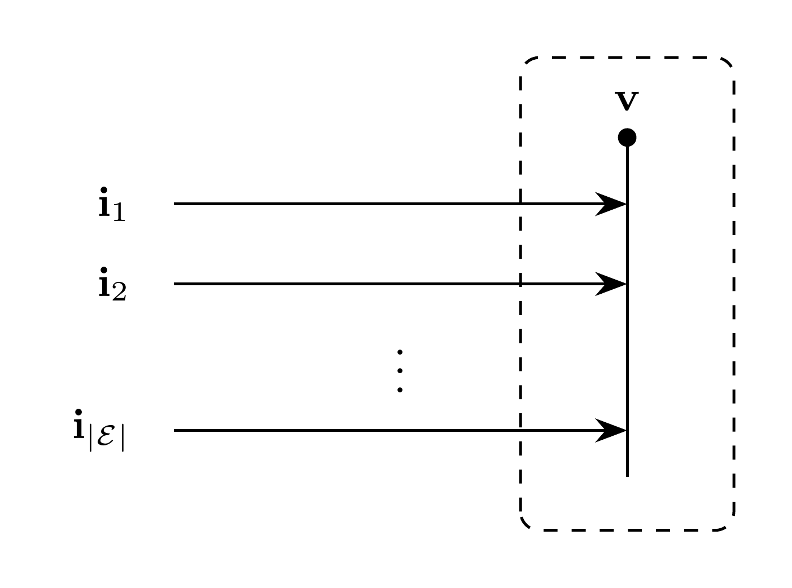

# Bus Model

`Bus` represents an $N$-phase bus in instantaneous phase coordinates. It owns
the bus voltage and contributes the current-balance residual to
the assembled DAE. $\mathcal{D}$ denotes the set of connected devices.
Bus voltage and its residual are algebraic when no connected model contributes
a voltage derivative; see [assembly](../README.md#assembly).

## Block Diagram



Figure 1: Bus model

## Model Parameters

Symbol | Units | JSON | Description | Note
------ | ----- | ---- | ----------- | ----
$N$ | [-] | `N` | Number of phases | Required, positive integer
$V^\mathrm{base}$ | [kV] | `kv` | Base voltage | Required, positive

### Parameter Validation

```math
\begin{aligned}
N &\in \mathbb{Z}_{>0} \\
V^\mathrm{base} &\in \mathbb{R}_{>0}
\end{aligned}
```

### Model Derived Parameters

None.

## Model Ports

None.

## Submodels

None.

### Submodel Validation

None.

### Submodel Wiring

None.

## Model Variables

### Internal Variables

#### Differential

Symbol | Units | Description | Note
------ | ----- | ----------- | ----
$\mathbf{v}$ | [V] | Bus voltage vector | $\mathbf{v} \in \mathbb{R}^N$

#### Algebraic

None.

### External Variables

#### Differential

None.

#### Algebraic

None.

## Model Equations

### Internal Equations

#### Differential

```math
0 = \sum_{d \in \mathcal{D}} \mathbf{i}_d
```

#### Algebraic

None.

### External Equations

None.

## Initialization

None.

## Monitors

Monitor | Units | Description | Note
------- | ----- | ----------- | ----
`v` | [V] | Bus voltage | $\mathbf{v} \in \mathbb{R}^N$
