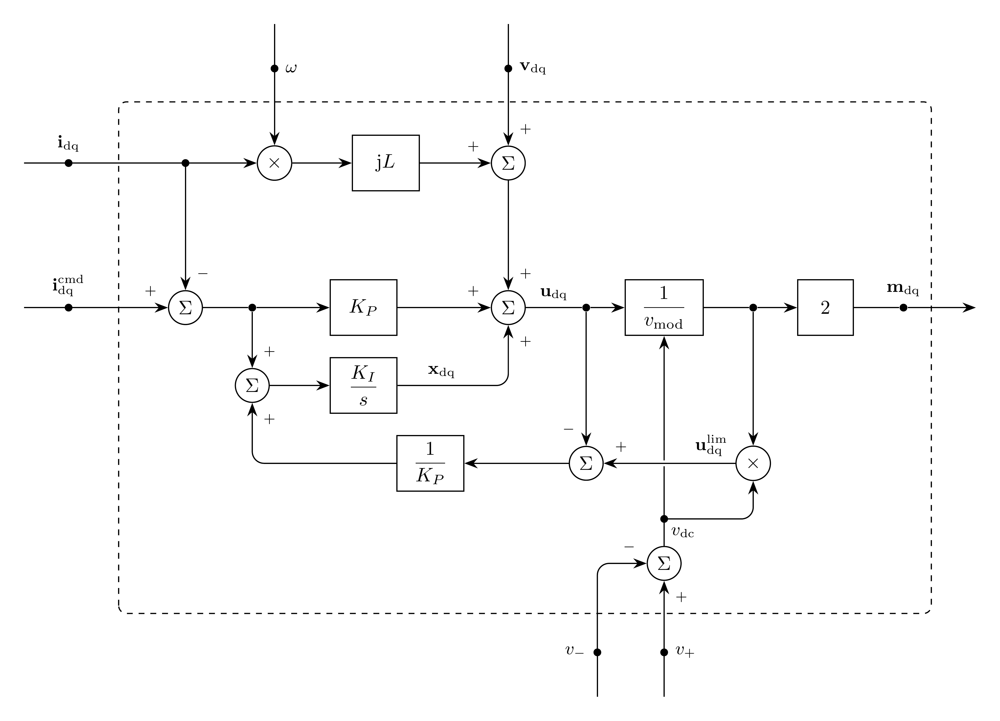

# CurrentControl Model

`CurrentControl` regulates converter currents in dq coordinates. It projects active and reactive
current orders onto the supplied dq axis and produces voltage-limited modulation
signals with integral antiwindup.

## Block Diagram



The diagram shows the inner loop after current projection. Multiplication by
$\mathrm{j}$ rotates a dq vector by $90^\circ$.

## Model Parameters

Symbol | Units | JSON | Description | Note
------ | ----- | ---- | ----------- | ----
$V$ | [V] | `V` | Rated line-to-line RMS voltage | Required, positive
$S$ | [MVA] | `mva` | Three-phase device rating | Required, positive
$K_P$ | [ohm] | `Kp` | Proportional gain | Required, positive
$K_I$ | [ohm/s] | `Ki` | Integral gain | Required, positive
$L$ | [H] | `L` | Decoupling inductance | Required, positive
$C$ | [F] | `C` | Filter capacitance for grid-current commands | Default $0$
$M^{\max}$ | [-] | `Mmax` | Maximum modulation magnitude | Default $1$

For a grid-side current command, supply the LCL shunt capacitance `C` for fundamental capacitor-current feedforward. Converter-side current commands use the default `C = 0`.

### Parameter Validation

```math
\begin{aligned}
V, S &\in \mathbb{R}_{>0} \\
K_P &\in \mathbb{R}_{>0} \\
K_I &\in \mathbb{R}_{>0} \\
L &\in \mathbb{R}_{>0} \\
C &\in \mathbb{R}_{\ge 0} \\
M^{\max} &\in \mathbb{R}_{>0}
\end{aligned}
```

### Model Derived Parameters

The peak phase current in amperes is $I_\mathrm{peak} = \sqrt{2/3}\,10^6 S/V$.

## Model Ports

Symbol | Port | Type | Units | Description | Note
------ | ---- | ---- | ----- | ----------- | ----
$v_+$ | `vpos` | Input | [V] | Positive DC terminal voltage | Scalar
$v_-$ | `vneg` | Input | [V] | Negative DC terminal voltage | Scalar
$\mathbf{v}_\mathrm{dq}$ | `vdq` | Input | [V] | Voltages | $\mathbf{v}_\mathrm{dq} \in \mathbb{R}^2$
$\mathbf{i}_\mathrm{dq}$ | `idq` | Input | [A] | Currents | $\mathbf{i}_\mathrm{dq} \in \mathbb{R}^2$
$\omega$ | `omega` | Input | [rad/s] | Frequency | Scalar
$(c,s)$ | `axis` | Input | [-] | Active-current unit direction in dq | $(1,0)$ for PLL d-axis alignment
$i_p$ | `ip` | Input | [p.u.] | Active-current order | Device base
$i_q$ | `iq` | Input | [p.u.] | Reactive-current order | Device base, positive for injected reactive power
$\mathbf{m}_\mathrm{dq}$ | `mdq` | Output | [-] | Modulation signals | Internal variable, $\mathbf{m}_\mathrm{dq} \in \mathbb{R}^2$

The dq vectors are amplitude invariant, and their d- and q-axis components
carry the subscripts $d$ and $q$, such as $v_d$ and $v_q$. The model reads the
DC terminal voltages and injects no current. The currents
$\mathbf{i}_\mathrm{dq}$ flow through the inductance $L$ toward the voltages
$\mathbf{v}_\mathrm{dq}$. Both may come from
[Bridge](../../Converter/Bridge/README.md), as its converter-side currents and
capacitor voltages. The dq coordinates rotate at $\omega$, which may come from
[Pll](../../../Operators/Reference/Pll/README.md). The modulation signals can
drive [Bridge](../../Converter/Bridge/README.md).

## Submodels

None.

### Submodel Validation

None.

### Submodel Wiring

None.

## Model Variables

### Internal Variables

#### Differential

Symbol | Units | Description | Note
------ | ----- | ----------- | ----
$\mathbf{x}_\mathrm{dq}$ | [V] | Integrator states | $\mathbf{x}_\mathrm{dq} \in \mathbb{R}^2$

#### Algebraic

Symbol | Units | Description | Note
------ | ----- | ----------- | ----
$\mathbf{m}_\mathrm{dq}$ | [-] | Modulation signals | $\mathbf{m}_\mathrm{dq} \in \mathbb{R}^2$

### External Variables

#### Differential

Symbol | Units | Description | Note
------ | ----- | ----------- | ----
$v_+$ | [V] | Positive DC terminal voltage owned by EMT bus |
$v_-$ | [V] | Negative DC terminal voltage owned by EMT bus |

#### Algebraic

Symbol | Units | Description | Note
------ | ----- | ----------- | ----
$\mathbf{v}_\mathrm{dq}$ | [V] | Voltages | $\mathbf{v}_\mathrm{dq} \in \mathbb{R}^2$
$\mathbf{i}_\mathrm{dq}$ | [A] | Currents | $\mathbf{i}_\mathrm{dq} \in \mathbb{R}^2$
$\omega$ | [rad/s] | Frequency |
$(c,s)$ | [-] | Active-current unit direction in dq | Held signal unless the case connects the input
$i_p$ | [p.u.] | Active-current order | Held signal unless the case connects the input
$i_q$ | [p.u.] | Reactive-current order | Held signal unless the case connects the input

## Model Equations

Smooth functions: [`max`](../../../../../CommonMath.md#maximum).

For terminal-voltage alignment, input `axis` reads `axis` of a
[Park](../../../Operators/Reference/Park/README.md) at the angle of the
bridge, with the rated peak phase voltage as its `base`. The projected peak
phase currents are

```math
\begin{aligned}
i_d^\mathrm{cmd} &= I_\mathrm{peak}(c\,i_p + s\,i_q) \\
i_q^\mathrm{cmd} &= I_\mathrm{peak}(s\,i_p - c\,i_q).
\end{aligned}
```

The DC voltage is

```math
v_\mathrm{dc} = v_+ - v_-
```

The voltage commands are

```math
\begin{aligned}
e_d &= i_d^\mathrm{cmd} - \omega C v_q - i_d \\
e_q &= i_q^\mathrm{cmd} + \omega C v_d - i_q \\
u_d &= v_d - \omega L i_q + K_P e_d + x_d \\
u_q &= v_q + \omega L i_d + K_P e_q + x_q
\end{aligned}
```

The limited voltage commands are

```math
\begin{aligned}
v_\mathrm{mod} &= \sqrt{\text{max}\left(v_\mathrm{dc}^2, \dfrac{4}{(M^{\max})^2}(u_d^2 + u_q^2)\right)} \\
u_d^\mathrm{lim} &= \dfrac{1}{v_\mathrm{mod}}v_\mathrm{dc}u_d \\
u_q^\mathrm{lim} &= \dfrac{1}{v_\mathrm{mod}}v_\mathrm{dc}u_q
\end{aligned}
```

### Internal Equations

#### Differential

```math
\begin{aligned}
0 &= -\dfrac{\mathrm{d}x_d}{\mathrm{d}t}
     + K_I\left(e_d + \dfrac{1}{K_P}(u_d^\mathrm{lim} - u_d)\right) \\
0 &= -\dfrac{\mathrm{d}x_q}{\mathrm{d}t}
     + K_I\left(e_q + \dfrac{1}{K_P}(u_q^\mathrm{lim} - u_q)\right)
\end{aligned}
```

#### Algebraic

```math
\begin{aligned}
0 &= -m_d + \dfrac{2}{v_\mathrm{mod}}u_d \\
0 &= -m_q + \dfrac{2}{v_\mathrm{mod}}u_q
\end{aligned}
```

### External Equations

None.

## Initialization

None.

## Monitors

Monitor | Units | Description | Note
------- | ----- | ----------- | ----
`xdq` | [V] | Integrator states | $\mathbf{x}_\mathrm{dq} \in \mathbb{R}^2$
`mdq` | [-] | Modulation signals | $\mathbf{m}_\mathrm{dq} \in \mathbb{R}^2$
