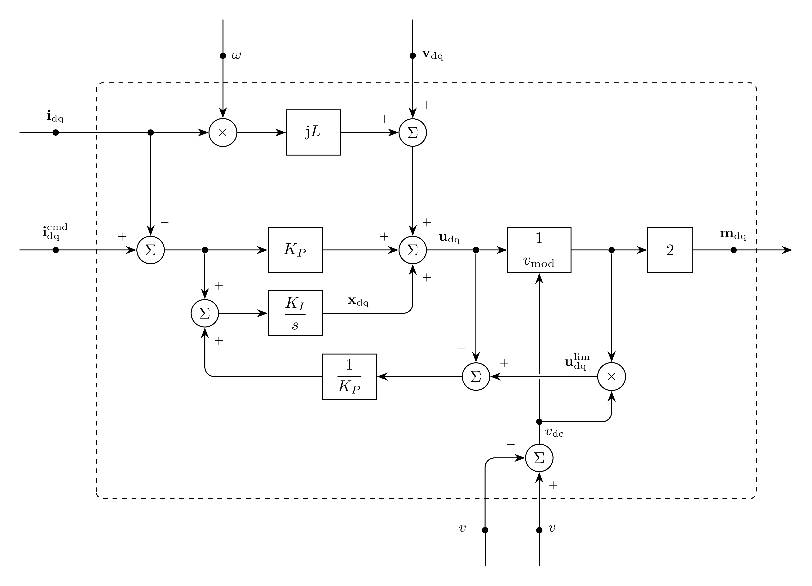

# CurrentControl Model

`CurrentControl` regulates converter currents in dq coordinates. It maps
current commands to modulation signals. Voltage limiting and antiwindup belong
to this model. Coordinate transformations belong to the connected models.

## Block Diagram



Figure 1: CurrentControl model; $\mathrm{j}$ acts on a dq vector as on
$x_d + \mathrm{j}x_q$

## Model Parameters

Symbol | Units | JSON | Description | Note
------ | ----- | ---- | ----------- | ----
$K_P$ | $[\Omega]$ | `Kp` | Proportional gain | Required, positive
$K_I$ | $[\Omega/\mathrm{s}]$ | `Ki` | Integral gain | Required, positive
$L$ | [H] | `L` | Decoupling inductance | Required, positive
$M^{\max}$ | [-] | `Mmax` | Maximum modulation magnitude | Default $1$

### Parameter Validation

```math
\begin{aligned}
K_P &\in \mathbb{R}_{>0} \\
K_I &\in \mathbb{R}_{>0} \\
L &\in \mathbb{R}_{>0} \\
M^{\max} &\in \mathbb{R}_{>0}
\end{aligned}
```

### Model Derived Parameters

None.

## Model Ports

Symbol | Port | Type | Units | Description | Note
------ | ---- | ---- | ----- | ----------- | ----
$v_+$ | `vpos` | Bus | [V] | Positive DC terminal voltage | Scalar
$v_-$ | `vneg` | Bus | [V] | Negative DC terminal voltage | Scalar
$\mathbf{v}_\mathrm{dq}$ | `vdq` | Input | [V] | Voltages | $\mathbf{v}_\mathrm{dq} \in \mathbb{R}^2$
$\mathbf{i}_\mathrm{dq}$ | `idq` | Input | [A] | Currents | $\mathbf{i}_\mathrm{dq} \in \mathbb{R}^2$
$\omega$ | `omega` | Input | [rad/s] | Frequency | Scalar
$\mathbf{i}_\mathrm{dq}^\mathrm{cmd}$ | `icmd` | Input | [A] | Current commands | $\mathbf{i}_\mathrm{dq}^\mathrm{cmd} \in \mathbb{R}^2$
$\mathbf{m}_\mathrm{dq}$ | `mdq` | Output | [-] | Modulation signals | $\mathbf{m}_\mathrm{dq} \in \mathbb{R}^2$

The dq vectors are amplitude invariant, and their d- and q-axis components
carry the subscripts $d$ and $q$, such as $v_d$ and $v_q$. The model reads the
DC terminal voltages and injects no current. The inductance $L$ connects the
converter AC terminals to the bus of $\mathbf{v}_\mathrm{dq}$, and
$\mathbf{i}_\mathrm{dq}$ is positive toward that bus. The dq coordinates
rotate at $\omega$, which may come from
[Pll](../../../Operators/Reference/Pll/README.md).

## Submodels

None.

### Submodel Validation

None.

### Submodel Wiring

None.

## Model Variables

### Internal Variables

#### Differential

Symbol | Units | Description | Note
------ | ----- | ----------- | ----
$\mathbf{x}_\mathrm{dq}$ | [V] | Integrator states | $\mathbf{x}_\mathrm{dq} \in \mathbb{R}^2$

#### Algebraic

None.

### External Variables

#### Differential

Symbol | Units | Description | Note
------ | ----- | ----------- | ----
$v_+$ | [V] | Positive DC terminal voltage owned by EMT bus |
$v_-$ | [V] | Negative DC terminal voltage owned by EMT bus |

#### Algebraic

None.

## Model Equations

Smooth functions: [`max`](../../../../../CommonMath.md#maximum).

The DC voltage is

```math
v_\mathrm{dc} = v_+ - v_-
```

The voltage commands are

```math
\begin{aligned}
u_d &= v_d - \omega L i_q + K_P(i_d^\mathrm{cmd} - i_d) + x_d \\
u_q &= v_q + \omega L i_d + K_P(i_q^\mathrm{cmd} - i_q) + x_q
\end{aligned}
```

The limited voltage commands are

```math
\begin{aligned}
v_\mathrm{mod} &= \sqrt{\text{max}\left(v_\mathrm{dc}^2, \dfrac{4}{(M^{\max})^2}(u_d^2 + u_q^2)\right)} \\
u_d^\mathrm{lim} &= \dfrac{1}{v_\mathrm{mod}}v_\mathrm{dc}u_d \\
u_q^\mathrm{lim} &= \dfrac{1}{v_\mathrm{mod}}v_\mathrm{dc}u_q
\end{aligned}
```

### Internal Equations

#### Differential

```math
\begin{aligned}
0 &= -\dfrac{\mathrm{d}x_d}{\mathrm{d}t}
     + K_I\left(i_d^\mathrm{cmd} - i_d + \dfrac{1}{K_P}(u_d^\mathrm{lim} - u_d)\right) \\
0 &= -\dfrac{\mathrm{d}x_q}{\mathrm{d}t}
     + K_I\left(i_q^\mathrm{cmd} - i_q + \dfrac{1}{K_P}(u_q^\mathrm{lim} - u_q)\right)
\end{aligned}
```

#### Algebraic

None.

### External Equations

```math
\begin{aligned}
m_d &\leftarrow \dfrac{2}{v_\mathrm{mod}}u_d \\
m_q &\leftarrow \dfrac{2}{v_\mathrm{mod}}u_q
\end{aligned}
```

## Initialization

None.

## Monitors

Monitor | Units | Description | Note
------- | ----- | ----------- | ----
`xdq` | [V] | Integrator states | $\mathbf{x}_\mathrm{dq} \in \mathbb{R}^2$
`mdq` | [-] | Modulation signals | $\mathbf{m}_\mathrm{dq} \in \mathbb{R}^2$
