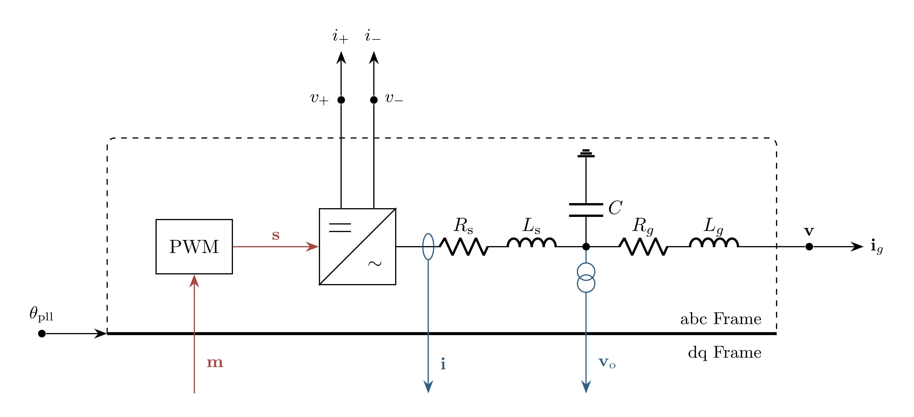

# Bridge Model

`Bridge` represents a two-level converter with $N$ legs, two DC terminals, and
an LCL filter to the EMT bus. Its signals are in dq coordinates at the
angle $\theta$. Modulation signals set the pole voltages and DC current
injections. Grid-side currents $\mathbf{i}_g$ are injected from the bridge
into the EMT bus.

## Block Diagram



Figure 1: Bridge model with one representative filter leg; signals crossing the
solid edge change between the dq frame and the abc frame at the angle
$\theta_\mathrm{pll}$, and the converter symbol denotes the legs

## Model Parameters

Symbol | Units | JSON | Description | Note
------ | ----- | ---- | ----------- | ----
$N$ | [-] | `N` | Number of legs | Required, integer of at least $3$
$R_\mathrm{s}$ | $[\Omega]$ | `Rs` | Converter-side resistance | Nonnegative
$L_\mathrm{s}$ | [H] | `Ls` | Converter-side inductance | Required, positive
$C$ | [F] | `C` | Filter capacitance | Required, positive
$R_g$ | $[\Omega]$ | `Rg` | Grid-side resistance | Nonnegative
$L_g$ | [H] | `Lg` | Grid-side inductance | Required, positive

### Parameter Validation

```math
\begin{aligned}
N &\in \mathbb{Z}_{\ge 3} \\
R_\mathrm{s} &\ge 0 \\
L_\mathrm{s} &> 0 \\
C &> 0 \\
R_g &\ge 0 \\
L_g &> 0
\end{aligned}
```

### Model Derived Parameters

Define the leg-index set and the phase offsets

```math
\begin{aligned}
\mathcal{N} &= \{1,\ldots,N\} \\
\gamma_n &= -\dfrac{2\pi}{N}(n-1),
     \quad n \in \mathcal{N}
\end{aligned}
```

## Model Ports

Symbol | Port | Type | Units | Description | Note
------ | ---- | ---- | ----- | ----------- | ----
$\mathbf{v}$, $\mathbf{i}_g$ | `bus` | Bus | [V], [A] | Reads the bus voltage and injects the grid-side current | $\mathbf{v}, \mathbf{i}_g \in \mathbb{R}^N$
$v_+$, $i_+$ | `vpos` | Bus | [V], [A] | Positive DC terminal voltage and current injection | Scalar
$v_-$, $i_-$ | `vneg` | Bus | [V], [A] | Negative DC terminal voltage and current injection | Scalar
$\theta$ | `theta` | Input | [rad] | Angle | Scalar
$\mathbf{m}_\mathrm{dq}$ | `mdq` | Input | [-] | Modulation signals | $\mathbf{m}_\mathrm{dq} \in \mathbb{R}^2$
$\mathbf{i}_\mathrm{dq}$ | `idq` | Output | [A] | Converter-side currents | $\mathbf{i}_\mathrm{dq} \in \mathbb{R}^2$
$\mathbf{v}_\mathrm{o,dq}$ | `vodq` | Output | [V] | Capacitor voltages | $\mathbf{v}_\mathrm{o,dq} \in \mathbb{R}^2$

All currents are positive from the bridge toward the connected buses. The
capacitor voltages share the bus voltage reference. The dq vectors are amplitude invariant, and their d- and q-axis components carry the
subscripts $d$ and $q$, such as $i_d$ and $i_q$. The angle may come from
[Pll](../../../Operators/Reference/Pll/README.md), and the modulation signals
from [CurrentControl](../../Controller/CurrentControl/README.md).

## Submodels

Symbol | Description | Type | Order | JSON | Inputs | Outputs
------ | ----------- | ---- | ----- | ---- | ------ | -------
$\mathbf{p}$ | Pulse-width modulation | [PWM](../../../Operators/Modulation/PWM/README.md) | $0$ | `pwm` | $\mathbb{R}^N$ | $\mathbb{R}^N$

### Submodel Validation

The submodel uses the $N$ of the bridge.

### Submodel Wiring

```math
\mathbf{s} \leftarrow \mathbf{p}[\mathbf{m}]
```

## Model Variables

### Internal Variables

#### Differential

Symbol | Units | Description | Note
------ | ----- | ----------- | ----
$\mathbf{i}$ | [A] | Converter-side currents | $\mathbf{i} \in \mathbb{R}^N$
$\mathbf{v}_\mathrm{o}$ | [V] | Capacitor voltages | $\mathbf{v}_\mathrm{o} \in \mathbb{R}^N$
$\mathbf{i}_g$ | [A] | Grid-side currents | $\mathbf{i}_g \in \mathbb{R}^N$

#### Algebraic

Symbol | Units | Description | Note
------ | ----- | ----------- | ----
$\mathbf{i}_\mathrm{dq}$ | [A] | Converter-side currents | $\mathbf{i}_\mathrm{dq} \in \mathbb{R}^2$
$\mathbf{v}_\mathrm{o,dq}$ | [V] | Capacitor voltages | $\mathbf{v}_\mathrm{o,dq} \in \mathbb{R}^2$

### External Variables

#### Differential

Symbol | Units | Description | Note
------ | ----- | ----------- | ----
$\mathbf{v}$ | [V] | Bus voltage vector owned by EMT bus | $\mathbf{v} \in \mathbb{R}^N$
$v_+$ | [V] | Positive DC terminal voltage owned by EMT bus |
$v_-$ | [V] | Negative DC terminal voltage owned by EMT bus |

#### Algebraic

None.

## Model Equations

The phase modulation signals and pole voltages are

```math
\begin{aligned}
m_n &= m_d\cos(\theta + \gamma_n) - m_q\sin(\theta + \gamma_n),
     \quad n \in \mathcal{N} \\
e_n &= (1-s_n)v_- + s_n v_+,
     \quad n \in \mathcal{N}
\end{aligned}
```

### Internal Equations

#### Differential

For each leg $n \in \mathcal{N}$,

```math
\begin{aligned}
0 &= L_\mathrm{s}\dfrac{\mathrm{d}i_n}{\mathrm{d}t}
     + R_\mathrm{s}i_n + v_{\mathrm{o},n} - e_n \\
0 &= C\dfrac{\mathrm{d}v_{\mathrm{o},n}}{\mathrm{d}t}
     + i_{g,n} - i_n \\
0 &= L_g\dfrac{\mathrm{d}i_{g,n}}{\mathrm{d}t}
     + R_g i_{g,n} + v_n - v_{\mathrm{o},n}
\end{aligned}
```

#### Algebraic

```math
\begin{aligned}
0 &= -i_d + \dfrac{2}{N}\sum_{n \in \mathcal{N}} i_n \cos(\theta + \gamma_n) \\
0 &= -i_q - \dfrac{2}{N}\sum_{n \in \mathcal{N}} i_n \sin(\theta + \gamma_n) \\
0 &= -v_{\mathrm{o},d} + \dfrac{2}{N}\sum_{n \in \mathcal{N}} v_{\mathrm{o},n} \cos(\theta + \gamma_n) \\
0 &= -v_{\mathrm{o},q} - \dfrac{2}{N}\sum_{n \in \mathcal{N}} v_{\mathrm{o},n} \sin(\theta + \gamma_n)
\end{aligned}
```

### External Equations

The grid-side currents $\mathbf{i}_g$ enter the
[bus current balance](../../../Bus/README.md#model-equations). The DC current
injections are

```math
\begin{aligned}
i_+ &\leftarrow -\sum_{n \in \mathcal{N}} s_n i_n \\
i_- &\leftarrow -\sum_{n \in \mathcal{N}} (1-s_n)i_n
\end{aligned}
```

## Initialization

None.

## Monitors

Monitor | Units | Description | Note
------- | ----- | ----------- | ----
`i` | [A] | Converter-side currents | $\mathbf{i} \in \mathbb{R}^N$
`vo` | [V] | Capacitor voltages | $\mathbf{v}_\mathrm{o} \in \mathbb{R}^N$
`ig` | [A] | Grid-side currents | $\mathbf{i}_g \in \mathbb{R}^N$
`idq` | [A] | Converter-side currents | $\mathbf{i}_\mathrm{dq} \in \mathbb{R}^2$
`vodq` | [V] | Capacitor voltages | $\mathbf{v}_\mathrm{o,dq} \in \mathbb{R}^2$
`ipos` | [A] | Positive DC current injection | Scalar
`ineg` | [A] | Negative DC current injection | Scalar
`e` | [V] | Pole voltages | $\mathbf{e} \in \mathbb{R}^N$
