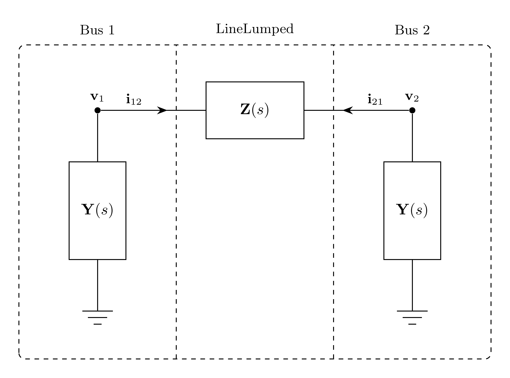

# LineLumped Model

`LineLumped` represents an $N$-phase, $K$-conductor lumped EMT line over length
$\Delta x$. Series current $\mathbf{i}_{12}$ is directed from terminal 1 to
terminal 2.

## Block Diagram



Figure 1: LineLumped model

The conductor-to-phase mappings are shown in the equations and omitted from
the diagram for clarity.

## Model Parameters

Define the phase- and conductor-index sets

```math
\mathcal{N} = \{1,\ldots,N\},
\qquad
\mathcal{K} = \{1,\ldots,K\}
```

Symbol | Units | JSON | Description | Note
------ | ----- | ---- | ----------- | ----
$N$ | [-] | `N` | Number of phases | Required, positive integer
$K$ | [-] | `K` | Number of conductors | Required, positive integer
$\mathbf{c}$ | [-] | `conductors` | Conductor phase-index list | $\mathbf{c} \in \mathcal{N}^K$
$\Delta x$ | [m] | `dx` | Line segment length | Required, positive

### Parameter Validation

```math
\begin{aligned}
N &\in \mathbb{Z}_{>0} \\
K &\in \mathbb{Z}_{>0} \\
\mathbf{c} &\in \mathcal{N}^K \\
\{c_k \mid k \in \mathcal{K}\} &= \mathcal{N} \\
\Delta x &> 0
\end{aligned}
```

### Model Derived Parameters

```math
P_{\phi,nk} =
\begin{cases}
1, & n = c_k \\
0, & n \ne c_k
\end{cases},
\quad n \in \mathcal{N},\quad k \in \mathcal{K}
```

## Model Ports

Symbol | Port | Type | Units | Description | Note
------ | ---- | ---- | ----- | ----------- | ----
$\mathbf{v}_1$, $\mathbf{i}_1$ | `bus1` | Terminal | [V], [A] | Terminal 1 bus voltage and current injection | $\mathbf{v}_1, \mathbf{i}_1 \in \mathbb{R}^N$
$\mathbf{v}_2$, $\mathbf{i}_2$ | `bus2` | Terminal | [V], [A] | Terminal 2 bus voltage and current injection | $\mathbf{v}_2, \mathbf{i}_2 \in \mathbb{R}^N$

## Submodels

Symbol | Description | Type | Order | JSON | Inputs | Outputs
------ | ----------- | ---- | ----- | ---- | ------ | -------
$\mathbf{z}$ | Per-unit-length series impedance | [VectorFit](../../../Operators/Rational/VectorFit/README.md) | $KQ_{\mathbf{z}}$ | `Zp` | $\mathbb{R}^K$ | $\mathbb{R}^K$
$\mathbf{y}_1$ | Per-unit-length shunt admittance at terminal 1 | [VectorFit](../../../Operators/Rational/VectorFit/README.md) | $KQ_{\mathbf{y}}$ | `Yp` | $\mathbb{R}^K$ | $\mathbb{R}^K$
$\mathbf{y}_2$ | Per-unit-length shunt admittance at terminal 2 | [VectorFit](../../../Operators/Rational/VectorFit/README.md) | $KQ_{\mathbf{y}}$ | `Yp` | $\mathbb{R}^K$ | $\mathbb{R}^K$

`Yp` provides one coefficient set; the two terminal instances maintain
independent states. A line without `Yp` has no shunt admittances.

### Submodel Validation

Each submodel is $K$ by $K$.

```math
\mathrm{rank}(\mathbf{E}^{\mathbf{z}}) = K
```

### Submodel Wiring

$\mathbf{y}_1$ and $\mathbf{y}_2$ read the conductor voltages at their
terminals and add their shunt currents to the bus current balances.

## Model Variables

### Internal Variables

#### Differential

Symbol | Units | Description | Note
------ | ----- | ----------- | ----
$\mathbf{i}_{12}$ | [A] | Series current from terminal 1 to terminal 2 | $\mathbf{i}_{12} \in \mathbb{R}^K$

#### Algebraic

None.

### External Variables

#### Differential

Symbol | Units | Description | Note
------ | ----- | ----------- | ----
$\mathbf{v}_1$ | [V] | Terminal 1 voltage owned by EMT bus | $\mathbf{v}_1 \in \mathbb{R}^N$
$\mathbf{v}_2$ | [V] | Terminal 2 voltage owned by EMT bus | $\mathbf{v}_2 \in \mathbb{R}^N$

#### Algebraic

None.

## Model Equations

### Internal Equations

#### Differential

```math
0 = \Delta x\,\mathbf{z}[\mathbf{i}_{12}]
  + \mathbf{P}_\phi^\mathsf T(\mathbf{v}_2-\mathbf{v}_1)
```

#### Algebraic

None.

### External Equations

Each shunt carries half of the line admittance.

```math
\begin{aligned}
\mathbf{i}_1 &\leftarrow
  -\mathbf{P}_\phi\left(
    \mathbf{i}_{12}
    + \dfrac{\Delta x}{2}\,\mathbf{y}_1[\mathbf{P}_\phi^\mathsf T\mathbf{v}_1]
  \right) \\
\mathbf{i}_2 &\leftarrow
  \mathbf{P}_\phi\left(
    \mathbf{i}_{12}
    - \dfrac{\Delta x}{2}\,\mathbf{y}_2[\mathbf{P}_\phi^\mathsf T\mathbf{v}_2]
  \right)
\end{aligned}
```

## Initialization

None.

## Monitors

Monitor | Units | Description | Note
------- | ----- | ----------- | ----
`i12` | [A] | Series current from terminal 1 to terminal 2 | $\mathbf{i}_{12} \in \mathbb{R}^K$
`y1.y` | [A] | Shunt current of each conductor at terminal 1 | Output of $\mathbf{y}_1$, with `Yp`
`y2.y` | [A] | Shunt current of each conductor at terminal 2 | Output of $\mathbf{y}_2$, with `Yp`
