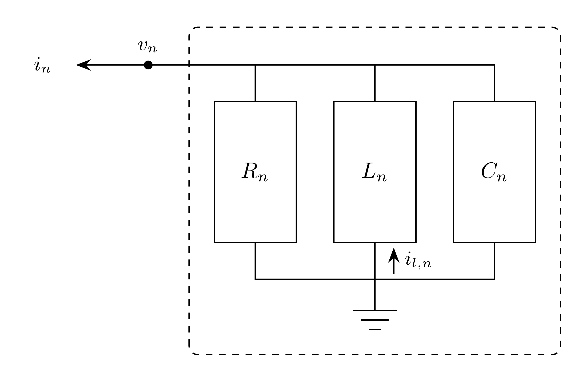

# LoadRLC Model

`LoadRLC` represents an $N$-phase load with a resistor, an inductor and a
capacitor in parallel on each phase, any of which may be absent. Current
$\mathbf{i}$ is injected from the load into the EMT bus.

## Block Diagram



Figure 1: LoadRLC model, phase $n$

## Model Parameters

Symbol | Units | JSON | Description | Note
------ | ----- | ---- | ----------- | ----
$N$ | [-] | `N` | Number of phases | Required, positive integer
$R_n$ | [ohm] | `R` | Resistance by phase | Optional, $N$ entries
$L_n$ | [H] | `L` | Inductance by phase | Optional, $N$ entries
$C_n$ | [F] | `C` | Capacitance by phase | Optional, $N$ entries

### Parameter Validation

```math
N \in \mathbb{Z}_{>0}
```

An array of `R`, `L` or `C` has $N$ entries. Each entry is positive and
finite, or `null` for an absent branch. Omitting an array omits that branch
on every phase.

```json
{"N": 3, "R": [40, 60, null], "L": [0.2, null, 0.4], "C": [null, 5e-6, null]}
```

Phase 1 has a resistor and an inductor, phase 2 a resistor and a capacitor,
and phase 3 an inductor.

### Model Derived Parameters

$\mathcal{L}$ denotes the phases with an inductor. The conductance is
$G_n = 1/R_n$ for a phase with a resistor. An absent resistor has $G_n = 0$
and an absent capacitor has $C_n = 0$.

## Model Ports

Symbol | Port | Type | Units | Description | Note
------ | ---- | ---- | ----- | ----------- | ----
$\mathbf{v}$, $\mathbf{i}$ | `bus` | Terminal | [V], [A] | Reads the bus voltage and injects the load current | $\mathbf{v}, \mathbf{i} \in \mathbb{R}^N$
$\mathbf{i}$ | `i` | Output | [A] | Load current injection | $\mathbf{i} \in \mathbb{R}^N$

## Submodels

None.

### Submodel Validation

None.

### Submodel Wiring

None.

## Model Variables

### Internal Variables

#### Differential

Symbol | Units | Description | Note
------ | ----- | ----------- | ----
$i_{l,n}$ | [A] | Inductor current injection | $n \in \mathcal{L}$, in phase order

#### Algebraic

None.

### External Variables

#### Differential

Symbol | Units | Description | Note
------ | ----- | ----------- | ----
$\mathbf{v}$ | [V] | Bus voltage vector owned by EMT bus | $\mathbf{v} \in \mathbb{R}^N$

#### Algebraic

None.

## Model Equations

### Internal Equations

#### Differential

For $n \in \mathcal{L}$,

```math
0 = L_n \dfrac{\mathrm{d}i_{l,n}}{\mathrm{d}t} + v_n
```

#### Algebraic

None.

### External Equations

With $i_{l,n} = 0$ for $n \notin \mathcal{L}$,

```math
i_n \leftarrow i_{l,n} - G_n v_n - C_n \dfrac{\mathrm{d}v_n}{\mathrm{d}t}
```

The load supplies input $d$ of the [bus current balance](../../../Bus/README.md#model-equations):

```math
\mathbf{i}_d \leftarrow \mathbf{i}
```

## Initialization

None.

## Monitors

Monitor | Units | Description | Note
------- | ----- | ----------- | ----
`i_l` | [A] | Inductor current injection | $n \in \mathcal{L}$, in phase order
`i` | [A] | Load current injection | Output, $\mathbf{i} \in \mathbb{R}^N$
