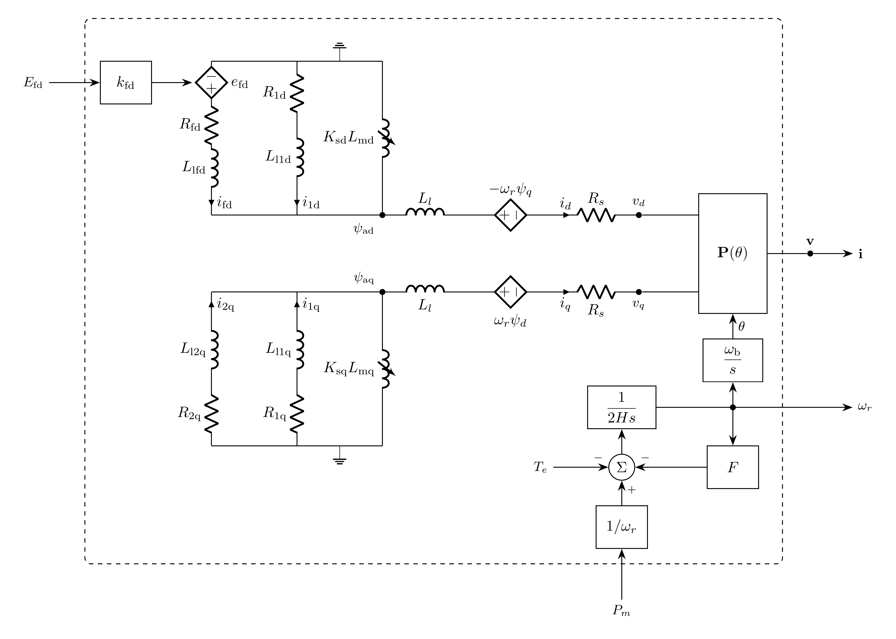

# Machine Model

`Machine` represents a three-phase round-rotor synchronous machine
in instantaneous phase coordinates with fundamental per-unit winding
parameters. The rotor carries the field winding $\mathrm{fd}$, one d-axis
damper $\mathrm{1d}$, and two q-axis dampers $\mathrm{1q}$ and $\mathrm{2q}$.
Current $\mathbf{i}$ is injected from the machine into the EMT bus.

Winding equations use the rotor $dq0$ frame. Terminal voltages are transformed
directly. The inverse Park transform gives the phase currents injected into the bus.

> [!NOTE]
> Internal machine quantities use the rated machine per-unit bases.
> Saturation applies a factor to the magnetizing inductance of each axis
> from the air-gap flux linkage of that axis. Differential leakage between
> same-axis rotor windings is neglected. The winding equations follow the
> MathWorks Synchronous Machine block with round rotor and fundamental
> parameters. Saturation by axis and the iron-loss resistance follow the
> PSCAD synchronous machine.

## Block Diagram



Figure 1: Machine model

## Model Parameters

Symbol | Units | JSON | Description | Note
------ | ----- | ---- | ----------- | ----
$S_\mathrm{b}$ | [VA] | `S` | Rated three-phase apparent power | Required, positive
$V_\mathrm{b}$ | [V] | `V` | Rated line-to-line RMS voltage | Required, positive
$f_\mathrm{b}$ | [Hz] | `f` | Rated electrical frequency | Required, positive
$H$ | [s] | `H` | Inertia constant | Required, positive
$F$ | [p.u.] | `F` | Friction torque factor | Nonnegative
$R_s$ | [p.u.] | `Rs` | Stator winding resistance | Nonnegative
$L_l$ | [p.u.] | `Ll` | Stator leakage inductance | Positive
$L_\mathrm{md}$ | [p.u.] | `Lmd` | Unsaturated d-axis magnetizing inductance | Positive
$L_\mathrm{mq}$ | [p.u.] | `Lmq` | Unsaturated q-axis magnetizing inductance | Positive
$L_0$ | [p.u.] | `L0` | Zero-sequence inductance | Positive, defaults to $L_l$
$R_\mathrm{fd}$ | [p.u.] | `Rfd` | Field winding resistance | Positive
$L_\mathrm{lfd}$ | [p.u.] | `Llfd` | Field leakage inductance | Positive
$R_\mathrm{1d}$ | [p.u.] | `R1d` | d-axis damper resistance | Positive
$L_\mathrm{l1d}$ | [p.u.] | `Ll1d` | d-axis damper leakage inductance | Positive
$R_\mathrm{1q}$ | [p.u.] | `R1q` | q-axis damper 1 resistance | Positive
$L_\mathrm{l1q}$ | [p.u.] | `Ll1q` | q-axis damper 1 leakage inductance | Positive
$R_\mathrm{2q}$ | [p.u.] | `R2q` | q-axis damper 2 resistance | Positive
$L_\mathrm{l2q}$ | [p.u.] | `Ll2q` | q-axis damper 2 leakage inductance | Positive
$S(1.0)$ | [p.u.] | `S10` | Saturation factor at $1.0$ per-unit flux | Nonnegative
$S(1.2)$ | [p.u.] | `S12` | Saturation factor at $1.2$ per-unit flux | Nonnegative
$R_\mathrm{fe}$ | [p.u.] | `Rfe` | Iron-loss resistance | Nonnegative, zero for none

### Parameter Validation

```math
\begin{aligned}
S_\mathrm{b} &> 0 \\
V_\mathrm{b} &> 0 \\
f_\mathrm{b} &> 0 \\
H &> 0 \\
F &\ge 0 \\
R_s &\ge 0 \\
L_l, L_\mathrm{md}, L_\mathrm{mq}, L_0 &> 0 \\
L_\mathrm{lfd}, L_\mathrm{l1d}, L_\mathrm{l1q}, L_\mathrm{l2q} &> 0 \\
R_\mathrm{fd}, R_\mathrm{1d}, R_\mathrm{1q}, R_\mathrm{2q} &> 0 \\
S(1.0), S(1.2) &\ge 0 \\
R_\mathrm{fe} &\ge 0
\end{aligned}
```

### Model Derived Parameters

The phase count is fixed at $N=3$, with $\mathcal{N}=\{1,2,3\}$.

```math
\begin{aligned}
\omega_\mathrm{b} &= 2\pi f_\mathrm{b} \\
V_\mathrm{pk} &= \sqrt{2/3}\,V_\mathrm{b} \\
I_\mathrm{pk} &= \dfrac{\sqrt{2}\,S_\mathrm{b}}{\sqrt{3}\,V_\mathrm{b}} \\
k_\mathrm{fd} &= \dfrac{R_\mathrm{fd}}{L_\mathrm{md}}
\end{aligned}
```

The scaled-quadratic saturation coefficients $S_A$ and $S_B$ follow from
$S(1.0)$ and $S(1.2)$: with $s = \sqrt{S(1.0)/S(1.2)}$,

```math
S_A = \min\left(\dfrac{1.2 s + 1}{s + 1},\;
                \dfrac{1.2 s - 1}{s - 1}\right),
\qquad
S_B = \dfrac{S(1.2)}{(S_A - 1.2)^2},
```

and both are zero when $S(1.2) = 0$. The iron-loss conductance of a phase is

```math
G_\mathrm{fe} = \dfrac{S_\mathrm{b}}{R_\mathrm{fe}\,V_\mathrm{b}^2},
```

and is zero when $R_\mathrm{fe} = 0$.

## Model Ports

Symbol | Port | Type | Units | Description | Note
------ | ---- | ---- | ----- | ----------- | ----
$\mathbf{v}$, $\mathbf{i}$ | `bus` | Terminal | [V], [A] | Reads the bus voltage and injects the machine current | $\mathbf{v}, \mathbf{i} \in \mathbb{R}^N$
$E_\mathrm{fd}$ | `efd` | Input | [p.u.] | Field voltage on the exciter base | Scalar
$P_m$ | `pm` | Input | [p.u.] | Mechanical power | Scalar
$\omega_r$ | `omega` | Output | [p.u.] | Rotor speed | Internal variable
$i_d$ | `id` | Output | [p.u.] | d-axis stator current | Positive out of the machine
$i_q$ | `iq` | Output | [p.u.] | q-axis stator current | Positive out of the machine
$i_0$ | `i0` | Output | [p.u.] | Zero-sequence stator current |
$i_\mathrm{fd}$ | `ifd` | Output | [p.u.] | Field current |
$L_{md} i_{fd}$ | `ifd_exc` | Output | [p.u.] | Field current on the exciter base | Scalar
$i_{abc}$ | `i` | Output | [A] | Terminal current injected into the grid, including iron loss | Three phases
$P$ | `p` | Output | [W] | Sum of the three terminal voltage-current products | Scalar
$i_\mathrm{1d}$ | `i1d` | Output | [p.u.] | d-axis damper current |
$i_\mathrm{1q}$ | `i1q` | Output | [p.u.] | q-axis damper 1 current |
$i_\mathrm{2q}$ | `i2q` | Output | [p.u.] | q-axis damper 2 current |
$T_e$ | `te` | Output | [p.u.] | Electrical torque |
$\mathbf{i}_s$ | `is` | Output | [p.u.] | Instantaneous stator currents | $\mathbf{i}_s \in \mathbb{R}^N$

An input that the case leaves out is held at the value of the state.

## Submodels

None.

### Submodel Validation

None.

### Submodel Wiring

None.

## Model Variables

### Internal Variables

#### Differential

Symbol | Units | Description | Note
------ | ----- | ----------- | ----
$\theta$ | [rad] | Electrical rotor angle | d-axis relative to the phase-a magnetic axis
$\omega_r$ | [p.u.] | Rotor speed |
$\psi_d$ | [p.u.] | d-axis stator flux linkage |
$\psi_q$ | [p.u.] | q-axis stator flux linkage |
$\psi_0$ | [p.u.] | Zero-sequence stator flux linkage |
$\psi_\mathrm{fd}$ | [p.u.] | Field flux linkage |
$\psi_\mathrm{1d}$ | [p.u.] | d-axis damper flux linkage |
$\psi_\mathrm{1q}$ | [p.u.] | q-axis damper 1 flux linkage |
$\psi_\mathrm{2q}$ | [p.u.] | q-axis damper 2 flux linkage |

#### Algebraic

Symbol | Units | Description | Note
------ | ----- | ----------- | ----
$\psi_\mathrm{ad}$ | [p.u.] | d-axis air-gap flux linkage |
$\psi_\mathrm{aq}$ | [p.u.] | q-axis air-gap flux linkage |

### External Variables

#### Differential

Symbol | Units | Description | Note
------ | ----- | ----------- | ----
$\mathbf{v}$ | [V] | Bus voltage vector owned by EMT bus | $\mathbf{v} \in \mathbb{R}^N$
$E_\mathrm{fd}$ | [p.u.] | Field voltage on the exciter base | Held signal unless the case connects the input
$P_m$ | [p.u.] | Mechanical power | Held signal unless the case connects the input

#### Algebraic

None.

## Model Equations

The Park transformation uses the phase offsets
$\gamma_a = 0$, $\gamma_b = -2\pi/3$, and $\gamma_c = +2\pi/3$.
For a phase quantity $\mathbf{x}$,

```math
x_d = \dfrac{2}{3}\sum_{n \in \mathcal{N}} x_n \cos(\theta + \gamma_n),
\qquad
x_q = -\dfrac{2}{3}\sum_{n \in \mathcal{N}} x_n \sin(\theta + \gamma_n),
\qquad
x_0 = \dfrac{1}{3}\sum_{n \in \mathcal{N}} x_n.
```

The terminal voltage enters in machine per unit as
$\mathbf{v}_\mathrm{pu} = \mathbf{v} / V_\mathrm{pk}$, with $v_d$, $v_q$, and
$v_0$ its Park projections. The field voltage enters on the reciprocal base
as $e_\mathrm{fd} = k_\mathrm{fd} E_\mathrm{fd}$, and the mechanical torque is
$T_m = P_m / \omega_r$. The saturated magnetizing inductances are

```math
L_\mathrm{ad} = K_\mathrm{sd} L_\mathrm{md},
\qquad
L_\mathrm{aq} = K_\mathrm{sq} L_\mathrm{mq}.
```

The winding quantities follow from the variables. For axis
$u=d$ or $q$, let $j,k$ be its two rotor windings
($\mathrm{fd},\mathrm{1d}$ or $\mathrm{1q},\mathrm{2q}$). Saturation uses the
shared [quadratic ramp](../../../../../CommonMath.md#primitives) and is even
in the air-gap flux linkage of the axis.

```math
\begin{aligned}
K_{\mathrm{s}u}^{-1} &= 1 + S_B\left(\text{qramp}(\psi_{\mathrm{a}u} - S_A)
     + \text{qramp}(-\psi_{\mathrm{a}u} - S_A)\right) \\
i_u &= (\psi_{\mathrm{a}u}-\psi_u)/L_l, \qquad
i_j = (\psi_j-\psi_{\mathrm{a}u})/L_{lj}, \qquad
i_k = (\psi_k-\psi_{\mathrm{a}u})/L_{lk} \\
i_0 &= -\psi_0/L_0 \\
T_e &= \psi_d\,i_q - \psi_q\,i_d \\
i_{s,n} &= i_d \cos(\theta + \gamma_n) - i_q \sin(\theta + \gamma_n) + i_0,
     \quad n \in \mathcal{N}
\end{aligned}
```

### Internal Equations

#### Differential

```math
\begin{aligned}
0 &= \dfrac{\mathrm{d}\theta}{\mathrm{d}t} - \omega_\mathrm{b}\,\omega_r \\
0 &= 2H\dfrac{\mathrm{d}\omega_r}{\mathrm{d}t}
     - \dfrac{P_m}{\omega_r} + T_e + F\,\omega_r \\
0 &= \dfrac{1}{\omega_\mathrm{b}}\dfrac{\mathrm{d}\psi_d}{\mathrm{d}t}
     - \omega_r\,\psi_q - R_s\,i_d - v_d \\
0 &= \dfrac{1}{\omega_\mathrm{b}}\dfrac{\mathrm{d}\psi_q}{\mathrm{d}t}
     + \omega_r\,\psi_d - R_s\,i_q - v_q \\
0 &= \dfrac{1}{\omega_\mathrm{b}}\dfrac{\mathrm{d}\psi_0}{\mathrm{d}t}
     - R_s\,i_0 - v_0 \\
0 &= \dfrac{1}{\omega_\mathrm{b}}\dfrac{\mathrm{d}\psi_\mathrm{fd}}{\mathrm{d}t}
     + R_\mathrm{fd}\,i_\mathrm{fd} - e_\mathrm{fd} \\
0 &= \dfrac{1}{\omega_\mathrm{b}}\dfrac{\mathrm{d}\psi_\mathrm{1d}}{\mathrm{d}t}
     + R_\mathrm{1d}\,i_\mathrm{1d} \\
0 &= \dfrac{1}{\omega_\mathrm{b}}\dfrac{\mathrm{d}\psi_\mathrm{1q}}{\mathrm{d}t}
     + R_\mathrm{1q}\,i_\mathrm{1q} \\
0 &= \dfrac{1}{\omega_\mathrm{b}}\dfrac{\mathrm{d}\psi_\mathrm{2q}}{\mathrm{d}t}
     + R_\mathrm{2q}\,i_\mathrm{2q}
\end{aligned}
```

#### Algebraic

For each axis $u$ with rotor windings $j,k$,

```math
0 = \psi_{\mathrm{a}u} -
\frac{\psi_u/L_l + \psi_j/L_{lj} + \psi_k/L_{lk}}
     {1/(K_{\mathrm{s}u} L_{\mathrm{m}u}) + 1/L_l + 1/L_{lj} + 1/L_{lk}}
```

### External Equations

The outputs are the winding quantities above.

The machine supplies an input of the
[bus current balance](../../../Bus/README.md#model-equations):

```math
\mathbf{i} \leftarrow I_\mathrm{pk}\,\mathbf{i}_s - G_\mathrm{fe}\,\mathbf{v}
```

## Initialization

None. The rotor speed must be nonzero in the state.

A state for a balanced positive-sequence operating point follows from the
terminal voltages and the phase-current injections. All algebra is in machine
per unit with peak-value phasors sampled at the initial time $t_0$; $\bar{v}$
and $\bar{\imath}$ denote the terminal voltage and stator current phasors,
and $\bar{\psi}_a$ the air-gap flux linkage. The rotor angle is the one at
which the q-axis dampers carry no current, a scalar equation in $\theta$.
The last row gives the inputs that hold the operating point.

```math
\begin{aligned}
\bar{v} &\leftarrow \dfrac{1}{V_\mathrm{pk}}\left(
   \dfrac{2}{3}\left(v_a - \dfrac{v_b}{2} - \dfrac{v_c}{2}\right)
   + \mathrm{j}\,\dfrac{v_b - v_c}{\sqrt{3}}\right) \\
\bar{\imath} &\leftarrow \dfrac{1}{I_\mathrm{pk}}\left(
   \dfrac{2}{3}\left(i_a^\mathrm{SI} - \dfrac{i_b^\mathrm{SI}}{2} - \dfrac{i_c^\mathrm{SI}}{2}\right)
   + \mathrm{j}\,\dfrac{i_b^\mathrm{SI} - i_c^\mathrm{SI}}{\sqrt{3}}\right)
   + \dfrac{G_\mathrm{fe} V_\mathrm{pk}}{I_\mathrm{pk}}\,\bar{v} \\
\bar{\psi}_a &\leftarrow -\mathrm{j}\left(\bar{v} + R_s\,\bar{\imath}\right)
   + L_l\,\bar{\imath} \\
\psi_\mathrm{ad} + \mathrm{j}\,\psi_\mathrm{aq} &\leftarrow \bar{\psi}_a\,e^{-\mathrm{j}\theta},
  \qquad i_d + \mathrm{j}\,i_q \leftarrow \bar{\imath}\,e^{-\mathrm{j}\theta},
  \qquad i_0 \leftarrow 0 \\
\theta &\leftarrow \text{root of }\;
   \dfrac{\psi_\mathrm{aq}}{K_\mathrm{sq}} + L_\mathrm{mq}\,i_q = 0
   \;\text{ nearest }\; \angle\left(\bar{\psi}_a + L_\mathrm{mq}\,\bar{\imath}\right) \\
\psi_d &\leftarrow \psi_\mathrm{ad} - L_l\,i_d,
  \qquad \psi_q \leftarrow \psi_\mathrm{aq} - L_l\,i_q,
  \qquad \psi_0 \leftarrow 0 \\
i_\mathrm{fd} &\leftarrow i_d + \dfrac{\psi_\mathrm{ad}}{K_\mathrm{sd} L_\mathrm{md}},
  \qquad i_\mathrm{1d}, i_\mathrm{1q}, i_\mathrm{2q} \leftarrow 0 \\
\psi_\mathrm{fd} &\leftarrow \psi_\mathrm{ad} + L_\mathrm{lfd}\,i_\mathrm{fd},
  \qquad \psi_\mathrm{1d} \leftarrow \psi_\mathrm{ad} \\
\psi_\mathrm{1q} &\leftarrow \psi_\mathrm{aq},
  \qquad \psi_\mathrm{2q} \leftarrow \psi_\mathrm{aq} \\
T_e &\leftarrow \psi_d\,i_q - \psi_q\,i_d,
  \qquad \omega_r \leftarrow 1 \\
P_m &\leftarrow T_e + F,
  \qquad E_\mathrm{fd} \leftarrow L_\mathrm{md}\,i_\mathrm{fd}
\end{aligned}
```

Every state derivative starts at zero except the rotor angle, which advances
at synchronous speed:

```math
\dfrac{\mathrm{d}\theta}{\mathrm{d}t} \leftarrow \omega_\mathrm{b}.
```

## Monitors

Monitor | Units | Description | Note
------- | ----- | ----------- | ----
`theta` | [rad] | Electrical rotor angle |
`omega` | [p.u.] | Rotor speed |
`psid` | [p.u.] | d-axis stator flux linkage |
`psiq` | [p.u.] | q-axis stator flux linkage |
`psi0` | [p.u.] | Zero-sequence stator flux linkage |
`psifd` | [p.u.] | Field flux linkage |
`psi1d` | [p.u.] | d-axis damper flux linkage |
`psi1q` | [p.u.] | q-axis damper 1 flux linkage |
`psi2q` | [p.u.] | q-axis damper 2 flux linkage |
`psiad` | [p.u.] | d-axis air-gap flux linkage |
`psiaq` | [p.u.] | q-axis air-gap flux linkage |
`id` | [p.u.] | d-axis stator current | Output, positive out of the machine
`iq` | [p.u.] | q-axis stator current | Output, positive out of the machine
`i0` | [p.u.] | Zero-sequence stator current | Output
`ifd` | [p.u.] | Field current | Output
`i1d` | [p.u.] | d-axis damper current | Output
`i1q` | [p.u.] | q-axis damper 1 current | Output
`i2q` | [p.u.] | q-axis damper 2 current | Output
`te` | [p.u.] | Electrical torque | Output
`is` | [p.u.] | Instantaneous stator currents | Output, $\mathbf{i}_s \in \mathbb{R}^N$
