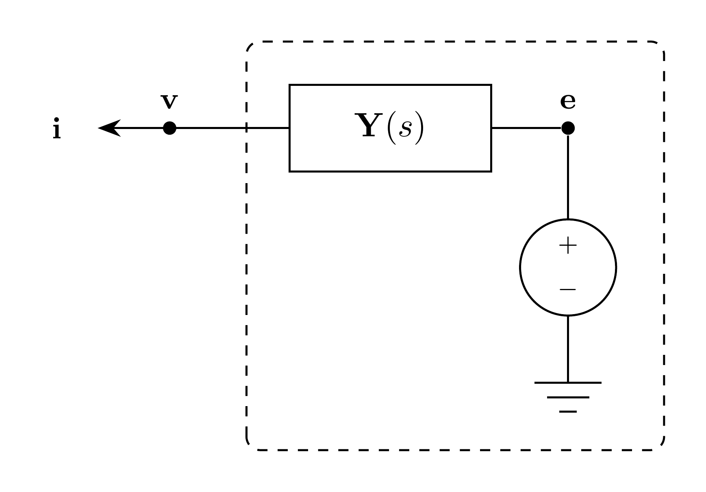

# VoltageSource Model

`VoltageSource` represents an $N$-phase sinusoidal EMT voltage source connected
to the EMT bus through terminal admittance.

## Block Diagram



Figure 1: VoltageSource model

## Model Parameters

Symbol | Units | JSON | Description | Note
------ | ----- | ---- | ----------- | ----
$N$ | [-] | `N` | Number of phases | Required, positive integer
$\mathbf{E}$ | [V] | `E` | Source voltage magnitudes | $\mathbf{E} \in \mathbb{R}_{\ge 0}^N$, RMS
$\boldsymbol{\phi}$ | [rad] | `phi` | Source phase offsets | $\boldsymbol{\phi} \in \mathbb{R}^N$
$\omega$ | [rad/s] | `omega` | Source angular frequency | Required, positive

### Parameter Validation

```math
\begin{aligned}
N &\in \mathbb{Z}_{>0} \\
\mathbf{E} &\in \mathbb{R}_{\ge 0}^N \\
\boldsymbol{\phi} &\in \mathbb{R}^N \\
\omega &> 0
\end{aligned}
```

### Model Derived Parameters

Define the phase-index set

```math
\mathcal{N} = \{1,\ldots,N\}
```

## Model Ports

Symbol | Port | Type | Units | Description | Note
------ | ---- | ---- | ----- | ----------- | ----
$\mathbf{v}$, $\mathbf{i}$ | `bus` | Bus | [V], [A] | Reads the bus voltage and injects the source current | $\mathbf{v}, \mathbf{i} \in \mathbb{R}^N$

## Submodels

Symbol | Description | Type | Order | JSON | Inputs | Outputs
------ | ----------- | ---- | ----- | ---- | ------ | -------
$\mathbf{y}$ | Terminal admittance | [VectorFit](../../../Operators/Rational/VectorFit/README.md) | $NQ_{\mathbf{y}}$ | `Y` | $\mathbb{R}^N$ | $\mathbb{R}^N$

### Submodel Validation

The branch voltage is differential when $\mathbf{E}^{\mathbf{y}}$ is
nonsingular and algebraic when $\mathbf{E}^{\mathbf{y}}=\mathbf{0}$.

```math
\mathbf{E}^{\mathbf{y}}=\mathbf{0}
\qquad \text{or} \qquad
\mathrm{rank}(\mathbf{E}^{\mathbf{y}})=N
```

### Submodel Wiring

None.

## Model Variables

### Internal Variables

#### Differential

Symbol | Units | Description | Note
------ | ----- | ----------- | ----
$\mathbf{u}$ | [V] | Branch voltage | $\mathbf{u} \in \mathbb{R}^N$, $\mathrm{rank}(\mathbf{E}^{\mathbf{y}})=N$

#### Algebraic

Symbol | Units | Description | Note
------ | ----- | ----------- | ----
$\mathbf{u}$ | [V] | Branch voltage | $\mathbf{u} \in \mathbb{R}^N$, $\mathbf{E}^{\mathbf{y}}=\mathbf{0}$
$\mathbf{i}$ | [A] | Current injection from source into EMT bus | $\mathbf{i} \in \mathbb{R}^N$

### External Variables

#### Differential

Symbol | Units | Description | Note
------ | ----- | ----------- | ----
$\mathbf{v}$ | [V] | Bus voltage vector owned by EMT bus | $\mathbf{v} \in \mathbb{R}^N$

#### Algebraic

None.

## Model Equations

```math
e_n(t) = \sqrt{2}E_n\cos(\omega t + \phi_n),
\quad n \in \mathcal{N}
```

### Internal Equations

#### Differential

For $\mathrm{rank}(\mathbf{E}^{\mathbf{y}})=N$,

```math
0 = -\mathbf{i} + \mathbf{y}[\mathbf{u}]
```

#### Algebraic

```math
0 = -\mathbf{u} + \mathbf{e}(t) - \mathbf{v}
```

For $\mathbf{E}^{\mathbf{y}}=\mathbf{0}$, the current residual is also algebraic.

### External Equations

The source supplies input $d$ of the [bus current balance](../../../Bus/README.md#model-equations):

```math
\mathbf{i}_d \leftarrow \mathbf{i}
```

## Initialization

None.

## Monitors

Monitor | Units | Description | Note
------- | ----- | ----------- | ----
`u` | [V] | Branch voltage | $\mathbf{u} \in \mathbb{R}^N$
`i` | [A] | Source current injection | $\mathbf{i} \in \mathbb{R}^N$
