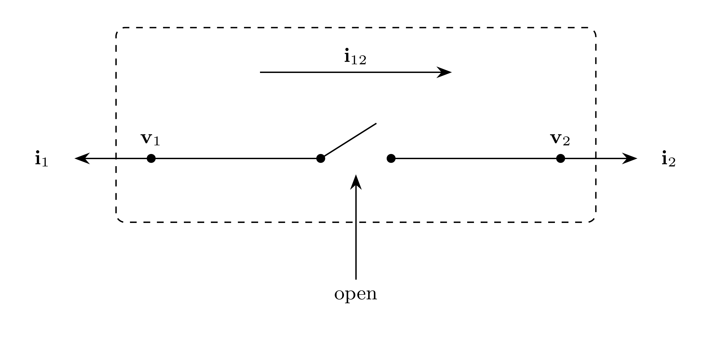

# Switch Model

`Switch` represents an ideal $N$-phase EMT switch between two buses. Series
current $\mathbf{i}_{12}$ is directed from terminal 1 to terminal 2. The
input `open` operates each phase: 1 is open and 0 is closed. A contact changes
state when its current is zero, so a value written to `open` takes effect on a
phase at the next zero of that phase's current. The switch
contains no energy storage; switching transients arise from the connected EMT
network.

## Block Diagram



Figure 1: Switch model

## Model Parameters

Symbol | Units | JSON | Description | Note
------ | ----- | ---- | ----------- | ----
$N$ | [-] | `N` | Number of phases | Required, positive integer

### Parameter Validation

```math
N \in \mathbb{Z}_{>0}
```

### Model Derived Parameters

None.

## Model Ports

Symbol | Port | Type | Units | Description | Note
------ | ---- | ---- | ----- | ----------- | ----
$\mathbf{v}_1$, $\mathbf{i}_1$ | `bus1` | Terminal | [V], [A] | Terminal 1 bus voltage and current injection | $\mathbf{v}_1, \mathbf{i}_1 \in \mathbb{R}^N$
$\mathbf{v}_2$, $\mathbf{i}_2$ | `bus2` | Terminal | [V], [A] | Terminal 2 bus voltage and current injection | $\mathbf{v}_2, \mathbf{i}_2 \in \mathbb{R}^N$
$\mathrm{open}$ | `open` | Input | [-] | Command by phase | $N$ entries, 1 open and 0 closed

## Submodels

None.

### Submodel Validation

None.

### Submodel Wiring

None.

## Model Variables

### Internal Variables

#### Differential

None.

#### Algebraic

Symbol | Units | Description | Note
------ | ----- | ----------- | ----
$\mathbf{i}_{12}$ | [A] | Series current from terminal 1 to terminal 2 | $\mathbf{i}_{12} \in \mathbb{R}^N$

### External Variables

#### Differential

Symbol | Units | Description | Note
------ | ----- | ----------- | ----
$\mathbf{v}_1$ | [V] | Terminal 1 voltage owned by EMT bus | $\mathbf{v}_1 \in \mathbb{R}^N$
$\mathbf{v}_2$ | [V] | Terminal 2 voltage owned by EMT bus | $\mathbf{v}_2 \in \mathbb{R}^N$
$\mathrm{open}$ | [-] | Command by phase | Held signal unless the case connects the input

#### Algebraic

None.

## Model Equations

### Internal Equations

#### Differential

None.

#### Algebraic

An open contact carries no current and a closed contact no voltage.

```math
0 = \mathrm{open}_n\,i_{12,n} + (1-\mathrm{open}_n)(v_{2,n}-v_{1,n})
```

### External Equations

```math
\begin{aligned}
\mathbf{i}_1 &\leftarrow -\mathbf{i}_{12} \\
\mathbf{i}_2 &\leftarrow \mathbf{i}_{12}
\end{aligned}
```

## Initialization

None.

## Monitors

Monitor | Units | Description | Note
------- | ----- | ----------- | ----
`i12` | [A] | Series current from terminal 1 to terminal 2 | $\mathbf{i}_{12} \in \mathbb{R}^N$
