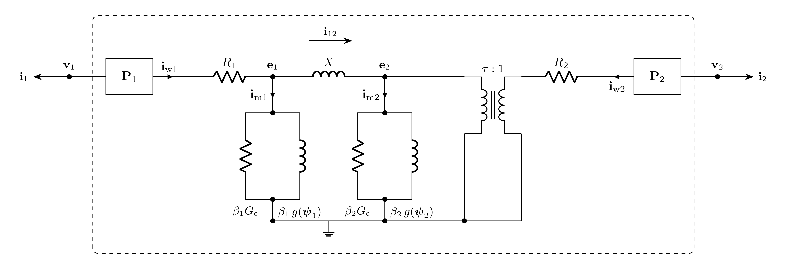

# Transformer Model

`Transformer` represents a three-phase bank of two-winding transformers in
instantaneous phase coordinates with a duality-derived $\pi$ core. Terminal
connection maps apply the winding configuration. Currents $\mathbf{i}_1$ and
$\mathbf{i}_2$ are injected from the transformer into the EMT buses.

> [!NOTE]
> Internal quantities use the rated transformer per-unit bases. The
> magnetizing branch is split between the two winding nodes, and its final
> slope is the terminal saturation inductance. Phases are magnetically
> independent; core topology, hysteresis, and capacitances are not represented.
> The reference is Jazebi et al., Duality Derived Transformer Models for
> Low-Frequency Electromagnetic Transients, Parts I and II.

## Block Diagram



Figure 1: Transformer model

## Model Parameters

Symbol | Units | JSON | Description | Note
------ | ----- | ---- | ----------- | ----
$N$ | [-] | `N` | Number of phases | Fixed at $3$
$S_\mathrm{b}$ | [VA] | `S` | Rated three-phase apparent power | Required, positive
$V_1$ | [V] | `V1` | Rated line-to-line RMS voltage of winding 1 | Required, positive
$V_2$ | [V] | `V2` | Rated line-to-line RMS voltage of winding 2 | Required, positive
$f_\mathrm{b}$ | [Hz] | `f` | Rated frequency | Required, positive
$\mathbf{P}_1$ | [-] | `P1` | Terminal 1 connection map | Default $\mathbf{I}_N$
$\mathbf{P}_2$ | [-] | `P2` | Terminal 2 connection map | Default $\mathbf{I}_N$
$\tau$ | [p.u.] | `tap` | Off-nominal ratio on winding 1 | Default $1$
$R$ | [p.u.] | `R` | Short-circuit resistance | Nonnegative
$X$ | [p.u.] | `X` | Short-circuit reactance | Required, positive
$I_0$ | [p.u.] | `I0` | No-load current at rated voltage | Required, positive
$P_0$ | [W] | `P0` | No-load loss at rated voltage | Nonnegative
$\psi_\mathrm{K}$ | [p.u.] | `knee` | Knee flux linkage | Default $1.2$
$L_\mathrm{sat}$ | [p.u.] | `Lsat` | Terminal saturation inductance | Positive, defaults to $2X$
$\beta$ | [-] | `split` | Winding 1 share of the magnetizing branch | Default $0.5$

### Parameter Validation

```math
\begin{aligned}
N &= 3 \\
S_\mathrm{b}, V_1, V_2, f_\mathrm{b} &> 0 \\
\tau &> 0 \\
R &\ge 0 \\
X &> 0 \\
P_0 &\ge 0 \\
I_0 &> P_0 / S_\mathrm{b} \\
\psi_\mathrm{K}, L_\mathrm{sat} &> 0 \\
0 \le \beta &\le 1 \\
\mathbf{P}_1, \mathbf{P}_2 &\in \{-1, 0, 1\}^{N \times N}
\end{aligned}
```

Each column of $\mathbf{P}_e$ has one entry $+1$, at most one entry $-1$, and
zeros elsewhere. Ungrounded neutrals are not represented. The derived
$L_\mathrm{m}$ must exceed $L_\mathrm{sat}$.

### Model Derived Parameters

The phase count is fixed at $N=3$, with $\mathcal{N}=\{1,2,3\}$ and terminal
index $e \in \{1,2\}$. The positive-sequence unit phasors use the phase
offsets $\gamma_a = 0$, $\gamma_b = -2\pi/3$, and $\gamma_c = +2\pi/3$,
$\alpha_n = e^{\mathrm{j}\gamma_n}$.

```math
\begin{aligned}
\omega_\mathrm{b} &= 2\pi f_\mathrm{b} \\
V_{\mathrm{w},e} &= \dfrac{V_e}{\sqrt{3}}\left|(\mathbf{P}_e^\mathsf{T}\boldsymbol{\alpha})_1\right| \\
V_{\mathrm{pk},e} &= \sqrt{2}\,V_{\mathrm{w},e} \\
I_{\mathrm{pk},e} &= \dfrac{\sqrt{2}\,S_\mathrm{b}}{3\,V_{\mathrm{w},e}} \\
R_1 = R_2 &= R/2 \\
G_\mathrm{c} &= P_0 / S_\mathrm{b} \\
I_\mathrm{m} &= \sqrt{I_0^2 - G_\mathrm{c}^2} \\
L_\mathrm{m} &= 1 / I_\mathrm{m} \\
\beta_1 = \beta, \qquad \beta_2 &= 1 - \beta
\end{aligned}
```

## Model Ports

Symbol | Port | Type | Units | Description | Note
------ | ---- | ---- | ----- | ----------- | ----
$\mathbf{v}_1$, $\mathbf{i}_1$ | `bus1` | Terminal | [V], [A] | Terminal 1 bus voltage and current injection | $\mathbf{v}_1, \mathbf{i}_1 \in \mathbb{R}^N$
$\mathbf{v}_2$, $\mathbf{i}_2$ | `bus2` | Terminal | [V], [A] | Terminal 2 bus voltage and current injection | $\mathbf{v}_2, \mathbf{i}_2 \in \mathbb{R}^N$
$\mathbf{e}_1$ | `e1` | Output | [p.u.] | Node 1 voltage | $\mathbf{e}_1 \in \mathbb{R}^N$
$\mathbf{e}_2$ | `e2` | Output | [p.u.] | Node 2 voltage | $\mathbf{e}_2 \in \mathbb{R}^N$
$\mathbf{i}_\mathrm{m1}$ | `im1` | Output | [p.u.] | Node 1 magnetizing current | $\mathbf{i}_\mathrm{m1} \in \mathbb{R}^N$
$\mathbf{i}_\mathrm{m2}$ | `im2` | Output | [p.u.] | Node 2 magnetizing current | $\mathbf{i}_\mathrm{m2} \in \mathbb{R}^N$
$\mathbf{i}_\mathrm{w1}$ | `iw1` | Output | [p.u.] | Winding 1 current | Positive into the winding, $\mathbf{i}_\mathrm{w1} \in \mathbb{R}^N$
$\mathbf{i}_\mathrm{w2}$ | `iw2` | Output | [p.u.] | Winding 2 current | Positive into the winding, $\mathbf{i}_\mathrm{w2} \in \mathbb{R}^N$

## Submodels

None.

### Submodel Validation

None.

### Submodel Wiring

None.

## Model Variables

### Internal Variables

#### Differential

Symbol | Units | Description | Note
------ | ----- | ----------- | ----
$\mathbf{i}_{12}$ | [p.u.] | Series leakage current from node 1 to node 2 | $\mathbf{i}_{12} \in \mathbb{R}^N$
$\boldsymbol{\psi}_1$ | [p.u.] | Node 1 magnetizing flux linkage | $\boldsymbol{\psi}_1 \in \mathbb{R}^N$
$\boldsymbol{\psi}_2$ | [p.u.] | Node 2 magnetizing flux linkage | $\boldsymbol{\psi}_2 \in \mathbb{R}^N$

#### Algebraic

None.

### External Variables

#### Differential

Symbol | Units | Description | Note
------ | ----- | ----------- | ----
$\mathbf{v}_1$ | [V] | Terminal 1 voltage owned by EMT bus | $\mathbf{v}_1 \in \mathbb{R}^N$
$\mathbf{v}_2$ | [V] | Terminal 2 voltage owned by EMT bus | $\mathbf{v}_2 \in \mathbb{R}^N$

#### Algebraic

None.

## Model Equations

The terminal voltages enter in transformer per unit through the connection
maps,

```math
\mathbf{v}_{\mathrm{w},e} = \dfrac{1}{V_{\mathrm{pk},e}}\,\mathbf{P}_e^\mathsf{T}\mathbf{v}_e,
\quad e \in \{1,2\}.
```

The magnetizing characteristic uses the
[ramp](../../../../CommonMath.md#ramp) $\rho$ and applies elementwise,

```math
g(\psi) = \dfrac{\psi}{L_\mathrm{m}}
  + \left(\dfrac{1}{L_\mathrm{sat}} - \dfrac{1}{L_\mathrm{m}}\right)
    \left(\rho(\psi - \psi_\mathrm{K}) - \rho(-\psi - \psi_\mathrm{K})\right).
```

For winding $e$, let $(a,s)=(1,i_{12})$ on side 1 and $(a,s)=(\tau,-i_{12})$
on side 2. The winding quantities of each phase are

```math
\begin{aligned}
G &= \beta_e G_\mathrm{c}, \qquad m = \beta_e g(\psi_e) \\
i_{\mathrm{w},e} &= \frac{a(s + m + a G v_{\mathrm{w},e})}{1 + a^2 R_e G} \\
e_e &= a(v_{\mathrm{w},e} - R_e i_{\mathrm{w},e}) \\
i_{\mathrm{m},e} &= m + G e_e
\end{aligned}
```

### Internal Equations

#### Differential

```math
\begin{aligned}
0 &= \dfrac{X}{\omega_\mathrm{b}}\dfrac{\mathrm{d}\mathbf{i}_{12}}{\mathrm{d}t}
     + \mathbf{e}_2 - \mathbf{e}_1 \\
0 &= \dfrac{1}{\omega_\mathrm{b}}\dfrac{\mathrm{d}\boldsymbol{\psi}_1}{\mathrm{d}t}
     - \mathbf{e}_1 \\
0 &= \dfrac{1}{\omega_\mathrm{b}}\dfrac{\mathrm{d}\boldsymbol{\psi}_2}{\mathrm{d}t}
     - \mathbf{e}_2
\end{aligned}
```

#### Algebraic

None.

### External Equations

Outputs `e1`, `e2`, `im1`, `im2`, `iw1` and `iw2` are the winding quantities
$\mathbf{e}_e$, $\mathbf{i}_{\mathrm{m},e}$ and $\mathbf{i}_{\mathrm{w},e}$.

The transformer supplies an input of the
[bus current balance](../../Bus/README.md#model-equations) at each terminal:

```math
\begin{aligned}
\mathbf{i}_1 &\leftarrow -I_\mathrm{pk1}\,\mathbf{P}_1\,\mathbf{i}_\mathrm{w1} \\
\mathbf{i}_2 &\leftarrow -I_\mathrm{pk2}\,\mathbf{P}_2\,\mathbf{i}_\mathrm{w2}
\end{aligned}
```

## Initialization

None. The series current and flux linkages start de-energized unless the
state file sets them.

## Monitors

Monitor | Units | Description | Note
------- | ----- | ----------- | ----
`i12` | [p.u.] | Series leakage current from node 1 to node 2 | $\mathbf{i}_{12} \in \mathbb{R}^N$
`psi1` | [p.u.] | Node 1 magnetizing flux linkage | $\boldsymbol{\psi}_1 \in \mathbb{R}^N$
`psi2` | [p.u.] | Node 2 magnetizing flux linkage | $\boldsymbol{\psi}_2 \in \mathbb{R}^N$
`e1` | [p.u.] | Node 1 voltage | Output, $\mathbf{e}_1 \in \mathbb{R}^N$
`e2` | [p.u.] | Node 2 voltage | Output, $\mathbf{e}_2 \in \mathbb{R}^N$
`im1` | [p.u.] | Node 1 magnetizing current | Output, $\mathbf{i}_\mathrm{m1} \in \mathbb{R}^N$
`im2` | [p.u.] | Node 2 magnetizing current | Output, $\mathbf{i}_\mathrm{m2} \in \mathbb{R}^N$
`iw1` | [p.u.] | Winding 1 current | Output, positive into the winding, $\mathbf{i}_\mathrm{w1} \in \mathbb{R}^N$
`iw2` | [p.u.] | Winding 2 current | Output, positive into the winding, $\mathbf{i}_\mathrm{w2} \in \mathbb{R}^N$
