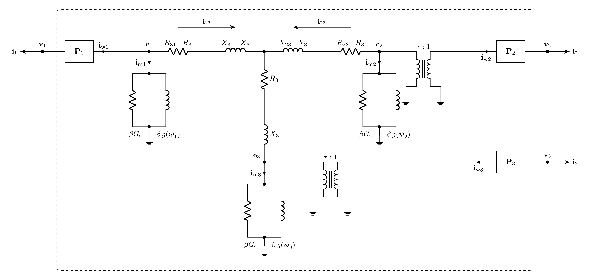

# Three-Winding Transformer Model

`TransformerThreeWinding` represents a three-phase bank of three-winding
transformers in instantaneous phase coordinates. The three short-circuit
impedances define two coupled leakage loops, and each winding node carries a
third of the saturable core. Terminal connection maps apply the winding
configuration. Currents $\mathbf{i}_1$, $\mathbf{i}_2$ and $\mathbf{i}_3$ are
injected from the transformer into the EMT buses.

> [!NOTE]
> Internal quantities use the rated transformer per-unit bases. The two leakage
> loops share the winding 3 leg of the star equivalent. The model has no star
> node, so a star equivalent with a negative leg needs no negative element.
> Phases are magnetically independent; core topology, hysteresis, and
> capacitances are not represented.

## Block Diagram



Figure 1: Three-winding transformer model

## Model Parameters

Symbol | Units | JSON | Description | Note
------ | ----- | ---- | ----------- | ----
$N$ | [-] | `N` | Number of phases | Fixed at $3$
$S_\mathrm{b}$ | [VA] | `S` | Rated three-phase apparent power | Required, positive
$V_1$ | [V] | `V1` | Rated line-to-line RMS voltage of winding 1 | Required, positive
$V_2$ | [V] | `V2` | Rated line-to-line RMS voltage of winding 2 | Required, positive
$V_3$ | [V] | `V3` | Rated line-to-line RMS voltage of winding 3 | Required, positive
$f_\mathrm{b}$ | [Hz] | `f` | Rated frequency | Required, positive
$\mathbf{P}_1$ | [-] | `P1` | Terminal 1 connection map | Default $\mathbf{I}_N$
$\mathbf{P}_2$ | [-] | `P2` | Terminal 2 connection map | Default $\mathbf{I}_N$
$\mathbf{P}_3$ | [-] | `P3` | Terminal 3 connection map | Default $\mathbf{I}_N$
$\tau$ | [p.u.] | `tap` | Off-nominal ratio on winding 1 | Default $1$
$\theta$ | [rad] | `phase` | Phase shift of winding 1 | Default $0$
$R_{12}$ | [p.u.] | `R12` | Short-circuit resistance of windings 1 and 2 | Nonnegative
$R_{23}$ | [p.u.] | `R23` | Short-circuit resistance of windings 2 and 3 | Nonnegative
$R_{31}$ | [p.u.] | `R31` | Short-circuit resistance of windings 3 and 1 | Nonnegative
$X_{12}$ | [p.u.] | `X12` | Short-circuit reactance of windings 1 and 2 | Required, positive
$X_{23}$ | [p.u.] | `X23` | Short-circuit reactance of windings 2 and 3 | Required, positive
$X_{31}$ | [p.u.] | `X31` | Short-circuit reactance of windings 3 and 1 | Required, positive
$I_0$ | [p.u.] | `I0` | No-load current at rated voltage | Required, positive
$P_0$ | [W] | `P0` | No-load loss at rated voltage | Nonnegative
$\psi_\mathrm{K}$ | [p.u.] | `knee` | Knee flux linkage | Default $1.2$
$L_\mathrm{sat}$ | [p.u.] | `Lsat` | Terminal saturation inductance | Required, positive

### Parameter Validation

```math
\begin{aligned}
N &= 3 \\
S_\mathrm{b}, V_1, V_2, V_3, f_\mathrm{b} &> 0 \\
\tau &> 0 \\
R_{12}, R_{23}, R_{31} &\ge 0 \\
X_{12}, X_{23}, X_{31} &> 0 \\
R_3^2 &\le R_{23} R_{31} \\
X_3^2 &< X_{23} X_{31} \\
P_0 &\ge 0 \\
I_0 &> P_0 / S_\mathrm{b} \\
\psi_\mathrm{K}, L_\mathrm{sat} &> 0 \\
\mathbf{P}_1, \mathbf{P}_2, \mathbf{P}_3 &\in \{-1, 0, 1\}^{N \times N}
\end{aligned}
```

Each column of $\mathbf{P}_e$ has one entry $+1$, at most one entry $-1$, and
zeros elsewhere. Ungrounded neutrals are not represented. The derived
$L_\mathrm{m}$ must exceed $L_\mathrm{sat}$. The conditions on $R_3$ and
$X_3$ make the leakage of the three windings passive.

### Model Derived Parameters

The phase count is fixed at $N=3$, with $\mathcal{N}=\{1,2,3\}$ and terminal
index $e \in \{1,2,3\}$. The positive-sequence unit phasors use the phase
offsets $\gamma_a = 0$, $\gamma_b = -2\pi/3$, and $\gamma_c = +2\pi/3$,
$\alpha_n = e^{\mathrm{j}\gamma_n}$.

```math
\begin{aligned}
\omega_\mathrm{b} &= 2\pi f_\mathrm{b} \\
V_{\mathrm{w},e} &= \dfrac{V_e}{\sqrt{3}}\left|(\mathbf{P}_e^\mathsf{T}\boldsymbol{\alpha})_1\right| \\
V_{\mathrm{pk},e} &= \sqrt{2}\,V_{\mathrm{w},e} \\
I_{\mathrm{pk},e} &= \dfrac{\sqrt{2}\,S_\mathrm{b}}{3\,V_{\mathrm{w},e}} \\
R_3 &= \dfrac{1}{2}\left(R_{23} + R_{31} - R_{12}\right) \\
X_3 &= \dfrac{1}{2}\left(X_{23} + X_{31} - X_{12}\right) \\
G_\mathrm{c} &= P_0 / S_\mathrm{b} \\
I_\mathrm{m} &= \sqrt{I_0^2 - G_\mathrm{c}^2} \\
L_\mathrm{m} &= 1 / I_\mathrm{m} \\
\beta &= 1 / 3
\end{aligned}
```

$R_3$ and $X_3$ are the winding 3 leg of the star equivalent, whose winding 1
and winding 2 legs are $R_{31} - R_3$, $X_{31} - X_3$ and $R_{23} - R_3$,
$X_{23} - X_3$.

A phase shift rotates the terminal 1 connection map, so that the
positive-sequence voltage of bus 1 leads that of winding 1 by $\theta$:

```math
\begin{aligned}
\Theta_{nk} &= \dfrac{1}{3}\left(1 + 2\cos(\theta + \gamma_n - \gamma_k)\right) \\
\mathbf{P}_1 &\leftarrow \boldsymbol{\Theta}\,\mathbf{P}_1
\end{aligned}
```

## Model Ports

Symbol | Port | Type | Units | Description | Note
------ | ---- | ---- | ----- | ----------- | ----
$\mathbf{v}_1$, $\mathbf{i}_1$ | `bus1` | Terminal | [V], [A] | Terminal 1 bus voltage and current injection | $\mathbf{v}_1, \mathbf{i}_1 \in \mathbb{R}^N$
$\mathbf{v}_2$, $\mathbf{i}_2$ | `bus2` | Terminal | [V], [A] | Terminal 2 bus voltage and current injection | $\mathbf{v}_2, \mathbf{i}_2 \in \mathbb{R}^N$
$\mathbf{v}_3$, $\mathbf{i}_3$ | `bus3` | Terminal | [V], [A] | Terminal 3 bus voltage and current injection | $\mathbf{v}_3, \mathbf{i}_3 \in \mathbb{R}^N$
$\mathbf{e}_1$ | `e1` | Output | [p.u.] | Node 1 voltage | $\mathbf{e}_1 \in \mathbb{R}^N$
$\mathbf{e}_2$ | `e2` | Output | [p.u.] | Node 2 voltage | $\mathbf{e}_2 \in \mathbb{R}^N$
$\mathbf{e}_3$ | `e3` | Output | [p.u.] | Node 3 voltage | $\mathbf{e}_3 \in \mathbb{R}^N$
$\mathbf{i}_\mathrm{m1}$ | `im1` | Output | [p.u.] | Node 1 magnetizing current | $\mathbf{i}_\mathrm{m1} \in \mathbb{R}^N$
$\mathbf{i}_\mathrm{m2}$ | `im2` | Output | [p.u.] | Node 2 magnetizing current | $\mathbf{i}_\mathrm{m2} \in \mathbb{R}^N$
$\mathbf{i}_\mathrm{m3}$ | `im3` | Output | [p.u.] | Node 3 magnetizing current | $\mathbf{i}_\mathrm{m3} \in \mathbb{R}^N$
$\mathbf{i}_\mathrm{w1}$ | `iw1` | Output | [p.u.] | Winding 1 current | Positive into the winding, $\mathbf{i}_\mathrm{w1} \in \mathbb{R}^N$
$\mathbf{i}_\mathrm{w2}$ | `iw2` | Output | [p.u.] | Winding 2 current | Positive into the winding, $\mathbf{i}_\mathrm{w2} \in \mathbb{R}^N$
$\mathbf{i}_\mathrm{w3}$ | `iw3` | Output | [p.u.] | Winding 3 current | Positive into the winding, $\mathbf{i}_\mathrm{w3} \in \mathbb{R}^N$

## Submodels

None.

### Submodel Validation

None.

### Submodel Wiring

None.

## Model Variables

### Internal Variables

#### Differential

Symbol | Units | Description | Note
------ | ----- | ----------- | ----
$\mathbf{i}_{13}$ | [p.u.] | Leakage current from node 1 to node 3 | $\mathbf{i}_{13} \in \mathbb{R}^N$
$\mathbf{i}_{23}$ | [p.u.] | Leakage current from node 2 to node 3 | $\mathbf{i}_{23} \in \mathbb{R}^N$
$\boldsymbol{\psi}_1$ | [p.u.] | Node 1 magnetizing flux linkage | $\boldsymbol{\psi}_1 \in \mathbb{R}^N$
$\boldsymbol{\psi}_2$ | [p.u.] | Node 2 magnetizing flux linkage | $\boldsymbol{\psi}_2 \in \mathbb{R}^N$
$\boldsymbol{\psi}_3$ | [p.u.] | Node 3 magnetizing flux linkage | $\boldsymbol{\psi}_3 \in \mathbb{R}^N$

#### Algebraic

None.

### External Variables

#### Differential

Symbol | Units | Description | Note
------ | ----- | ----------- | ----
$\mathbf{v}_1$ | [V] | Terminal 1 voltage owned by EMT bus | $\mathbf{v}_1 \in \mathbb{R}^N$
$\mathbf{v}_2$ | [V] | Terminal 2 voltage owned by EMT bus | $\mathbf{v}_2 \in \mathbb{R}^N$
$\mathbf{v}_3$ | [V] | Terminal 3 voltage owned by EMT bus | $\mathbf{v}_3 \in \mathbb{R}^N$

#### Algebraic

None.

## Model Equations

The terminal voltages enter in transformer per unit through the connection
maps,

```math
\mathbf{v}_{\mathrm{w},e} = \dfrac{1}{V_{\mathrm{pk},e}}\,\mathbf{P}_e^\mathsf{T}\mathbf{v}_e,
\quad e \in \{1,2,3\}.
```

The magnetizing characteristic uses the
[ramp](../../../../CommonMath.md#ramp) $\rho$ and applies elementwise,

```math
g(\psi) = \dfrac{\psi}{L_\mathrm{m}}
  + \left(\dfrac{1}{L_\mathrm{sat}} - \dfrac{1}{L_\mathrm{m}}\right)
    \left(\rho(\psi - \psi_\mathrm{K}) - \rho(-\psi - \psi_\mathrm{K})\right).
```

For winding $e$, let $a = 1$ on side 1 and $a = \tau$ on sides 2 and 3, and
let $s$ be the leakage current out of the node: $i_{13}$ on side 1, $i_{23}$
on side 2 and $-(i_{13} + i_{23})$ on side 3. The winding quantities of each
phase are

```math
\begin{aligned}
e_e &= a\,v_{\mathrm{w},e} \\
i_{\mathrm{m},e} &= \beta\left(g(\psi_e) + G_\mathrm{c} e_e\right) \\
i_{\mathrm{w},e} &= a\left(s + i_{\mathrm{m},e}\right)
\end{aligned}
```

### Internal Equations

#### Differential

```math
\begin{aligned}
0 &= \dfrac{X_{31}}{\omega_\mathrm{b}}\dfrac{\mathrm{d}\mathbf{i}_{13}}{\mathrm{d}t}
     + \dfrac{X_3}{\omega_\mathrm{b}}\dfrac{\mathrm{d}\mathbf{i}_{23}}{\mathrm{d}t}
     + R_{31}\mathbf{i}_{13} + R_3\mathbf{i}_{23}
     + \mathbf{e}_3 - \mathbf{e}_1 \\
0 &= \dfrac{X_3}{\omega_\mathrm{b}}\dfrac{\mathrm{d}\mathbf{i}_{13}}{\mathrm{d}t}
     + \dfrac{X_{23}}{\omega_\mathrm{b}}\dfrac{\mathrm{d}\mathbf{i}_{23}}{\mathrm{d}t}
     + R_3\mathbf{i}_{13} + R_{23}\mathbf{i}_{23}
     + \mathbf{e}_3 - \mathbf{e}_2 \\
0 &= \dfrac{1}{\omega_\mathrm{b}}\dfrac{\mathrm{d}\boldsymbol{\psi}_e}{\mathrm{d}t}
     - \mathbf{e}_e, \quad e \in \{1,2,3\}
\end{aligned}
```

#### Algebraic

None.

### External Equations

Outputs `e1` to `e3`, `im1` to `im3` and `iw1` to `iw3` are the winding
quantities $\mathbf{e}_e$, $\mathbf{i}_{\mathrm{m},e}$ and
$\mathbf{i}_{\mathrm{w},e}$.

The transformer supplies an input of the
[bus current balance](../../Bus/README.md#model-equations) at each terminal:

```math
\mathbf{i}_e \leftarrow -I_{\mathrm{pk},e}\,\mathbf{P}_e\,\mathbf{i}_{\mathrm{w},e},
\quad e \in \{1,2,3\}
```

## Initialization

None. The leakage currents and flux linkages start de-energized unless the
state file sets them.

## Monitors

Monitor | Units | Description | Note
------- | ----- | ----------- | ----
`i13` | [p.u.] | Leakage current from node 1 to node 3 | $\mathbf{i}_{13} \in \mathbb{R}^N$
`i23` | [p.u.] | Leakage current from node 2 to node 3 | $\mathbf{i}_{23} \in \mathbb{R}^N$
`psi1` | [p.u.] | Node 1 magnetizing flux linkage | $\boldsymbol{\psi}_1 \in \mathbb{R}^N$
`psi2` | [p.u.] | Node 2 magnetizing flux linkage | $\boldsymbol{\psi}_2 \in \mathbb{R}^N$
`psi3` | [p.u.] | Node 3 magnetizing flux linkage | $\boldsymbol{\psi}_3 \in \mathbb{R}^N$
`e1` | [p.u.] | Node 1 voltage | Output, $\mathbf{e}_1 \in \mathbb{R}^N$
`e2` | [p.u.] | Node 2 voltage | Output, $\mathbf{e}_2 \in \mathbb{R}^N$
`e3` | [p.u.] | Node 3 voltage | Output, $\mathbf{e}_3 \in \mathbb{R}^N$
`im1` | [p.u.] | Node 1 magnetizing current | Output, $\mathbf{i}_\mathrm{m1} \in \mathbb{R}^N$
`im2` | [p.u.] | Node 2 magnetizing current | Output, $\mathbf{i}_\mathrm{m2} \in \mathbb{R}^N$
`im3` | [p.u.] | Node 3 magnetizing current | Output, $\mathbf{i}_\mathrm{m3} \in \mathbb{R}^N$
`iw1` | [p.u.] | Winding 1 current | Output, positive into the winding, $\mathbf{i}_\mathrm{w1} \in \mathbb{R}^N$
`iw2` | [p.u.] | Winding 2 current | Output, positive into the winding, $\mathbf{i}_\mathrm{w2} \in \mathbb{R}^N$
`iw3` | [p.u.] | Winding 3 current | Output, positive into the winding, $\mathbf{i}_\mathrm{w3} \in \mathbb{R}^N$
