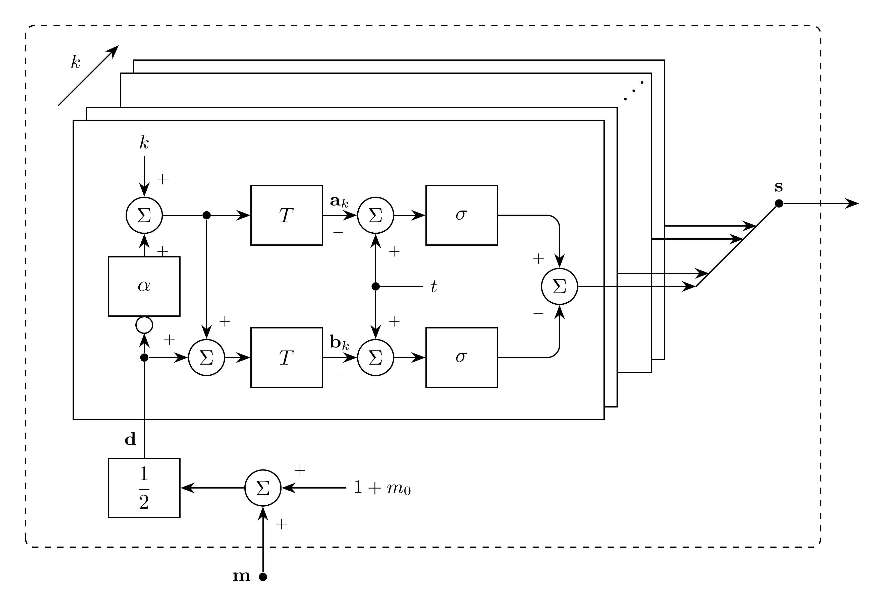
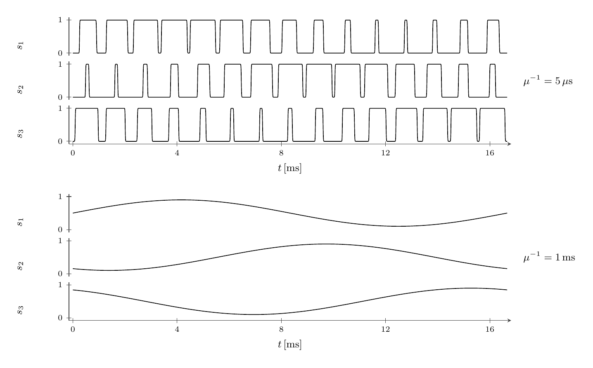

# PWM Model

`PWM` maps modulation signals to smooth switching functions for $N$ channels.
Channels share carrier timing. Duty ratios are internal.

## Block Diagram



Figure 1: PWM model; the input bubble denotes $1-\mathbf{d}$ componentwise,
and the stacked pulse branches sum over all carrier periods



Figure 2: Centered switching functions for sinusoidal duty ratios with modulation
index $\frac{4}{5}$, frequency $60\,\mathrm{Hz}$, and carrier frequency $900\,\mathrm{Hz}$
at $\mu^{-1}=5\,\mu\mathrm{s}$ and $\mu^{-1}=1\,\mathrm{ms}$

## Model Parameters

Symbol | Units | JSON | Description | Note
------ | ----- | ---- | ----------- | ----
$N$ | [-] | `N` | Number of channels | Required, positive integer
$f_{\mathrm{c}}$ | [Hz] | `fc` | Carrier frequency | Required, positive
$\alpha$ | [-] | `alignment` | Pulse alignment | Default $\frac{1}{2}$
$\mathrm{injection}$ | [-] | `injection` | Zero-sequence injection | Optional Boolean, `true` injects (default)
$k_0$ | [-] | `k0` | Zero-state partition | Default $\frac{1}{2}$

### Parameter Validation

All real parameters must be finite.

```math
\begin{aligned}
N &\in \mathbb{Z}_{>0} \\
f_{\mathrm{c}} &> 0 \\
0 &\le \alpha \le 1 \\
0 &\le k_0 \le 1
\end{aligned}
```

A single channel requires no zero-sequence injection.

### Model Derived Parameters

```math
T = \dfrac{1}{f_{\mathrm{c}}}
```

## Model Ports

Symbol | Port | Type | Units | Description | Note
------ | ---- | ---- | ----- | ----------- | ----
$\mathbf{m}$ | `m` | Input | [-] | Modulation signals | $\mathbf{m} \in \mathbb{R}^N$
$\mathbf{s}$ | `s` | Output | [-] | Switching functions | $\mathbf{s} \in \mathbb{R}^N$

The modulation signals must give duty ratios $0 \le d_n \le 1$. Each
switching function satisfies $0 \le s_n \le 1$.
The switching functions can drive
[Bridge](../../../Component/Converter/Bridge/README.md).

## Submodels

None.

### Submodel Validation

None.

### Submodel Wiring

None.

## Model Variables

### Internal Variables

#### Differential

None.

#### Algebraic

None.

### External Variables

The tables apply to inputs that reference DAE variables owned by connected
models. Prescribed and computed signals introduce no variables.

#### Differential

Symbol | Units | Description | Note
------ | ----- | ----------- | ----
$\mathbf{m}$ | [-] | Modulation signals | $\mathbf{m} \in \mathbb{R}^N$

#### Algebraic

Symbol | Units | Description | Note
------ | ----- | ----------- | ----
$\mathbf{m}$ | [-] | Modulation signals | $\mathbf{m} \in \mathbb{R}^N$

## Model Equations

Smooth functions: [`max`](../../../../../CommonMath.md#maximum), [`min`](../../../../../CommonMath.md#minimum), [$\sigma$](../../../../../CommonMath.md#logistic-function).

Scalar offsets and smooth functions apply componentwise.
The extremes $m^{\max}$ and $m^{\min}$ apply `max` and `min` across the
channels. The zero-sequence signal is

```math
m_0 =
\begin{cases}
-\left[(1 - 2k_0) + k_0 m^{\max} + (1 - k_0)m^{\min}\right], & \text{injection} \\
0, & \text{otherwise}
\end{cases}
```

The duty ratios are

```math
\mathbf{d} = \dfrac{1}{2}(1 + \mathbf{m} + m_0)
```

For each integer $k$, the pulse-edge vectors are

```math
\begin{aligned}
\mathbf{a}_k &= [k+\alpha(1-\mathbf{d})]T \\
\mathbf{b}_k &= \mathbf{a}_k+T\mathbf{d}
\end{aligned}
```

All channels use the same carrier periods starting at $t=kT$.
Electrical phase and phase sequence are carried by $\mathbf{m}$.
Every periodic copy uses the current duty vector. There is no sample-and-hold.
Alignment $\alpha=0$ fixes the rising edge at the period start,
$\alpha=1$ fixes the falling edge at the period end, and
$\alpha=\frac{1}{2}$ centers the pulse.

### Internal Equations

#### Differential

None.

#### Algebraic

None.

### External Equations

```math
\mathbf{s} \leftarrow \sum_{k\in\mathbb{Z}}
  \left[\sigma(t-\mathbf{a}_k)-\sigma(t-\mathbf{b}_k)\right]
```

## Initialization

None.

## Monitors

Monitor | Units | Description | Note
------- | ----- | ----------- | ----
`d` | [-] | Duty ratios | $\mathbf{d} \in \mathbb{R}^N$
`s` | [-] | Switching functions | $\mathbf{s} \in \mathbb{R}^N$
