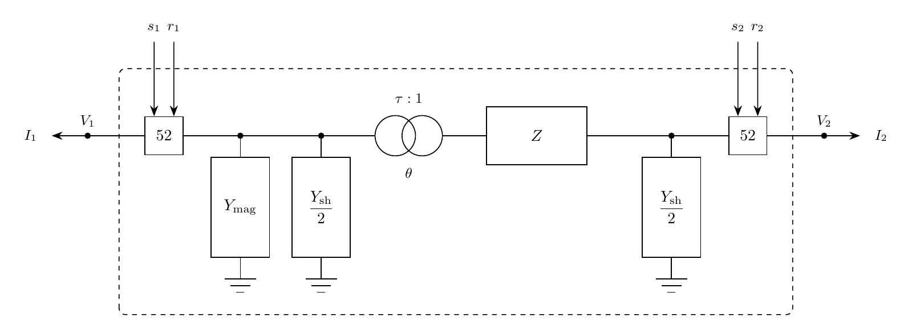

# BranchBreakers

A two-terminal phasor-domain $\pi$ branch with independently controlled circuit
breakers at both terminals.

## Notes

- Terminal-current outputs publish values without Jacobian coupling to the bus
  voltages or breaker states.

## Block Diagram



Figure 1: BranchBreakers model.

## Model Parameters

Symbol           | Units  | JSON    | Description                            | Typical Value | Note
-----------------|--------|---------|----------------------------------------|---------------|----------------------------
$R$              | [p.u.] | `R`     | Branch series resistance               |               |
$X$              | [p.u.] | `X`     | Branch series reactance                |               |
$G$              | [p.u.] | `G`     | Total line shunt conductance           | 0.0           |
$B$              | [p.u.] | `B`     | Total line shunt susceptance           | 0.0           |
$G_\mathrm{mag}$ | [p.u.] | `Gmag`  | Magnetizing shunt conductance at bus 1 | 0.0           |
$B_\mathrm{mag}$ | [p.u.] | `Bmag`  | Magnetizing shunt susceptance at bus 1 | 0.0           |
$\tau$           | [p.u.] | `tap`   | Off-nominal tap magnitude at bus 1     | 1.0           |
$\theta$         | [rad]  | `phase` | Phase-shift angle                      | 0.0           |
$T_\mathrm{brk}$ | [s]    | `Tbrk`  | Breaker operating time                 | 0.05          | Time to $z_k = 1/2$ for a unit step command

### Parameter Validation

```math
\begin{aligned}
  R^2 + X^2 &> 0 \\
  \tau &> 0 \\
  T_\mathrm{brk} &\ge 0 \\
  Y_{11}, Y_{22} &\ne 0
\end{aligned}
```

All parameters must be finite real values.

### Model Derived Parameters

$Y_{mn}$ are entries of the closed-branch admittance matrix $\mathbf{Y}$.
$Y_k^\mathrm{o}$ is the admittance seen at terminal $k$ with the opposite breaker open.

```math
\begin{aligned}
  \epsilon_T &= 10^{-3}\ \mathrm{s} \\
  T_\mathrm{brk} &\leftarrow \max(T_\mathrm{brk}, \epsilon_T) \\
  T_\mathrm{latch} &= \dfrac{T_\mathrm{brk}}{\ln 2} \\
  Z &= R + jX \\
  Y_\mathrm{mag} &= G_\mathrm{mag} + jB_\mathrm{mag} \\
  Y_\mathrm{sh} &= G + jB \\
  \mathbf{Y}_0 &= \dfrac{1}{Z}
    \begin{bmatrix}
      -1 & 1 \\
      1 & -1
    \end{bmatrix} \\
  \mathbf{Y}_\mathrm{mag} &=
    \begin{bmatrix}
      -Y_\mathrm{mag} & 0 \\
      0 & 0
    \end{bmatrix} \\
  \mathbf{Y}_\mathrm{sh} &= \dfrac{1}{2}
    \begin{bmatrix}
      -Y_\mathrm{sh} & 0 \\
      0 & -Y_\mathrm{sh}
    \end{bmatrix} \\
  \mathbf{M} &=
    \begin{bmatrix}
      \tau^{-1} & 0 \\
      0 & \exp(j\theta)
    \end{bmatrix} \\
  \mathbf{Y} &= \mathbf{M}^{\dagger}\mathbf{Y}_0\mathbf{M}
    + \mathbf{Y}_\mathrm{mag} + \mathbf{Y}_\mathrm{sh} \\
  Y_1^\mathrm{o} &= Y_{11} - \dfrac{Y_{12}Y_{21}}{Y_{22}} \\
  Y_2^\mathrm{o} &= Y_{22} - \dfrac{Y_{21}Y_{12}}{Y_{11}}
\end{aligned}
```

## Model Ports

Name     | Port   | Init  | Description
---------|--------|-------|--------------------------------------------
`bus1`   | Bus    | Known | Required bus-1 terminal; the tapped side
`bus2`   | Bus    | Known | Required bus-2 terminal
`trip1`  | Input  | Known | Bus-1 breaker trip command
`reset1` | Input  | Known | Bus-1 breaker reset command
`trip2`  | Input  | Known | Bus-2 breaker trip command
`reset2` | Input  | Known | Bus-2 breaker reset command
`ir1`    | Output | Known | Bus-1 terminal current, real component
`ii1`    | Output | Known | Bus-1 terminal current, imaginary component
`ir2`    | Output | Known | Bus-2 terminal current, real component
`ii2`    | Output | Known | Bus-2 terminal current, imaginary component

Signal ports are optional. Attached inputs must be linked. Trip and reset
commands lie in $[0,1]$; unattached inputs default to zero.

## Model Variables

### Internal Variables

#### Differential

Symbol | Units | Description                      | Note
-------|-------|----------------------------------|-----
$z_1$  | [-]   | Bus-1 breaker closed-state latch |
$z_2$  | [-]   | Bus-2 breaker closed-state latch |

#### Algebraic

None.

### External Variables

#### Differential

None.

#### Algebraic

Symbol   | Units  | Description                                  | Note
---------|--------|----------------------------------------------|--------------------
$V_{r1}$ | [p.u.] | Terminal voltage, real component, bus 1      | Owned by bus object
$V_{i1}$ | [p.u.] | Terminal voltage, imaginary component, bus 1 | Owned by bus object
$V_{r2}$ | [p.u.] | Terminal voltage, real component, bus 2      | Owned by bus object
$V_{i2}$ | [p.u.] | Terminal voltage, imaginary component, bus 2 | Owned by bus object
$s_1$    | [-]    | Bus-1 breaker trip command                   | `trip1`
$r_1$    | [-]    | Bus-1 breaker reset command                  | `reset1`
$s_2$    | [-]    | Bus-2 breaker trip command                   | `trip2`
$r_2$    | [-]    | Bus-2 breaker reset command                  | `reset2`

## Model Equations

Smooth functions: [`above`](../../../../CommonMath.md#above),
[`below`](../../../../CommonMath.md#below), [`latch`](#appendix-a-latch).

For readability, define:

```math
\begin{aligned}
  u_1 &= \text{above}(z_1; 1/2) \\
  u_2 &= \text{above}(z_2; 1/2) \\
  \bar{u}_1 &= \text{below}(z_1; 1/2) \\
  \bar{u}_2 &= \text{below}(z_2; 1/2)
\end{aligned}
```

### Internal Equations

#### Differential

```math
\begin{aligned}
  0 &= -\dot{z}_1 + \dfrac{1}{T_\mathrm{latch}}\text{latch}(z_1, r_1, s_1) \\
  0 &= -\dot{z}_2 + \dfrac{1}{T_\mathrm{latch}}\text{latch}(z_2, r_2, s_2)
\end{aligned}
```

Reset drives the latch toward closed; a full trip command overrides reset.

#### Algebraic

None.

### External Equations

```math
\begin{aligned}
  I_1 &= u_1\left[u_2(Y_{11} V_1 + Y_{12} V_2)
         + \bar{u}_2 Y_1^\mathrm{o} V_1\right] \\
  I_2 &= u_2\left[u_1(Y_{21} V_1 + Y_{22} V_2)
         + \bar{u}_1 Y_2^\mathrm{o} V_2\right]
\end{aligned}
```

The real and imaginary parts are added to the bus residuals, positive entering
the buses.

## Initialization

```math
\begin{aligned}
  z_1 &\leftarrow 1 \\
  z_2 &\leftarrow 1
\end{aligned}
```

All internal derivatives initialize to zero.

## Monitors

Monitor | Units  | Description                                  | Note
--------|--------|----------------------------------------------|--------------------------------
`ir1`   | [p.u.] | Terminal current, real component, bus 1      | $I_{r1}$
`ii1`   | [p.u.] | Terminal current, imaginary component, bus 1 | $I_{i1}$
`im1`   | [p.u.] | Terminal current magnitude, bus 1            | $\sqrt{I_{r1}^2 + I_{i1}^2}$
`p1`    | [p.u.] | Active power entering bus 1                  | $V_{r1} I_{r1} + V_{i1} I_{i1}$
`q1`    | [p.u.] | Reactive power entering bus 1                | $V_{i1} I_{r1} - V_{r1} I_{i1}$
`ir2`   | [p.u.] | Terminal current, real component, bus 2      | $I_{r2}$
`ii2`   | [p.u.] | Terminal current, imaginary component, bus 2 | $I_{i2}$
`im2`   | [p.u.] | Terminal current magnitude, bus 2            | $\sqrt{I_{r2}^2 + I_{i2}^2}$
`p2`    | [p.u.] | Active power entering bus 2                  | $V_{r2} I_{r2} + V_{i2} I_{i2}$
`q2`    | [p.u.] | Reactive power entering bus 2                | $V_{i2} I_{r2} - V_{r2} I_{i2}$

## Appendix A: `latch`

For $x,a,b \in [0,1]$:

```math
\text{latch}(x, a, b)
  = (1 - b)\left[a + (1 - a)\sigma(x - 1/2)\right] - x
```

where $\sigma$ is GridKit's smooth
[`sigmoid`](../../../../CommonMath.md#logistic-function), with $\mu > 4$.
Here $x$ is the state, $a$ the set drive, and $b$ the reset drive. Full reset has
priority. With both drives zero, $x = 1/2$ separates the stable low and high states.
