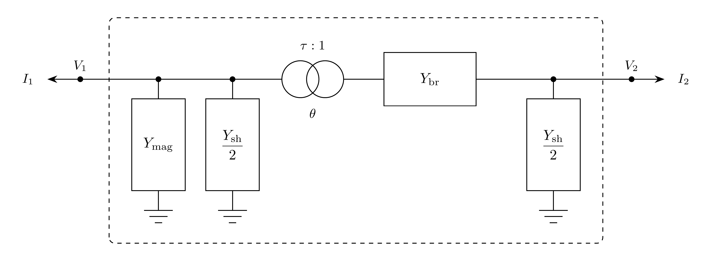
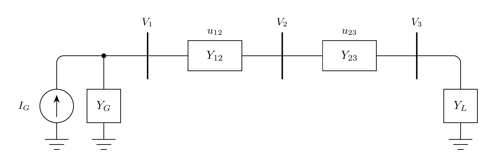
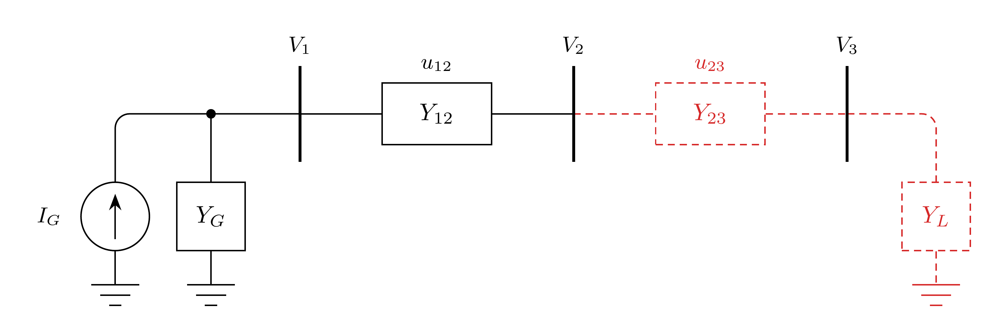
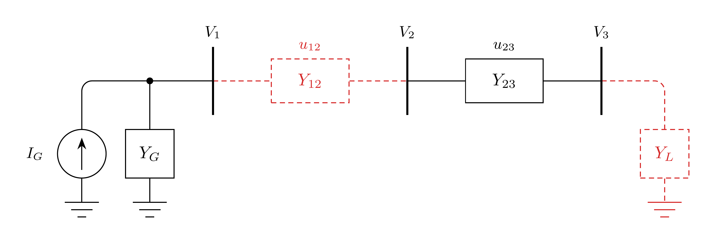
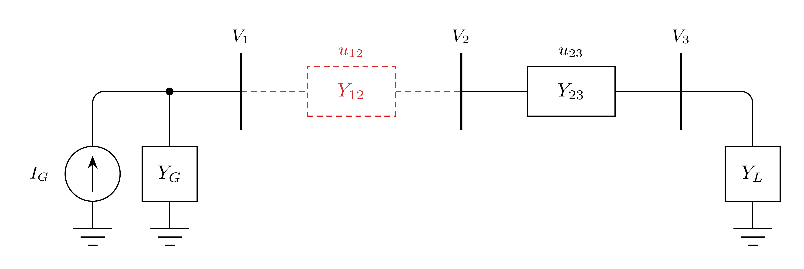
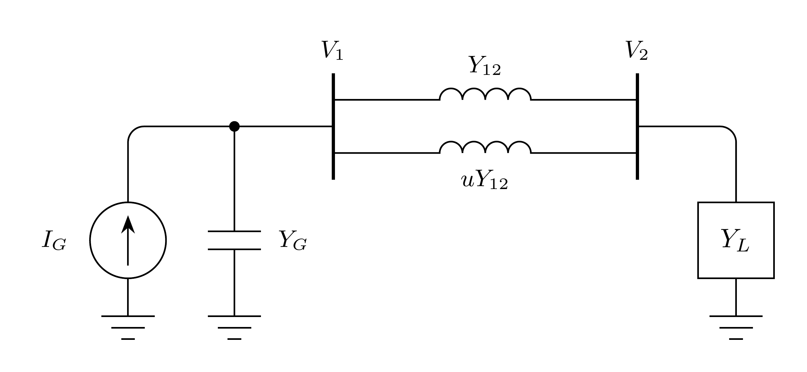
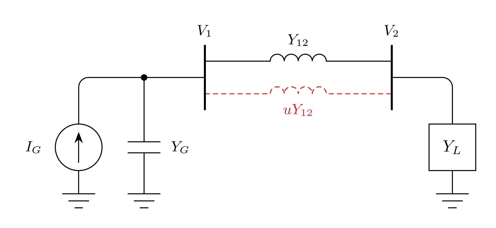

# Branch

The Branch model represents a two-terminal phasor-domain $\pi$ branch with an
optional off-nominal tap magnitude and phase shift on bus 1. Terminal current
contributions are oriented entering the adjacent buses.

## Notes

- Setting $\tau = 1$ and $\theta = 0$ gives the ordinary symmetric
  transmission-line $\pi$ model.
- The total line shunt $G + jB$ is split equally between the two terminals,
  while the magnetizing shunt $G_\mathrm{mag} + jB_\mathrm{mag}$ is connected at
  bus 1; both shunts are added outside the $\mathbf{M}$ transformation.
- The branch has no solver-owned variables; it contributes current residuals
  directly to the connected buses.
- Taking a branch out of service can make the system Jacobian singular, which
  the model does not detect. See
  [Appendix A](#appendix-a-out-of-service-branches) and
  [Appendix B](#appendix-b-series-resonance).

## Block Diagram



Figure 1: Branch model.

## Model Parameters

Symbol           | Units  | JSON    | Description                             | Typical Value | Note
-----------------|--------|---------|-----------------------------------------|---------------|-----
$R$              | [p.u.] | `R`     | Branch series resistance                |               |
$X$              | [p.u.] | `X`     | Branch series reactance                 | 0.01          | Default when omitted
$G$              | [p.u.] | `G`     | Total line shunt conductance            | 0.0           |
$B$              | [p.u.] | `B`     | Total line shunt susceptance            | 0.0           |
$G_\mathrm{mag}$ | [p.u.] | `Gmag`  | Magnetizing shunt conductance at bus 1  | 0.0           |
$B_\mathrm{mag}$ | [p.u.] | `Bmag`  | Magnetizing shunt susceptance at bus 1  | 0.0           |
$\tau$           | [p.u.] | `tap`   | Off-nominal tap magnitude on bus-1 side | 1.0           |
$\theta$         | [rad]  | `phase` | Phase-shift angle                       | 0.0           |

### Parameter Validation

A valid Branch parameter set must satisfy the following conditions:

```math
\begin{aligned}
  &R, X, G, B, G_\mathrm{mag}, B_\mathrm{mag}, \tau, \theta
    \in \mathbb{R}\ \text{and finite} \\
  &R^2 + X^2 > 0 \\
  &\tau > 0
\end{aligned}
```

### Model Derived Parameters

The series, magnetizing shunt, and line shunt admittances are:

```math
\begin{aligned}
  Y_{\mathrm{br}}  &= \dfrac{1}{R + jX} \\
  Y_{\mathrm{mag}} &= G_\mathrm{mag} + jB_\mathrm{mag} \\
  Y_{\mathrm{sh}}  &= G + jB
\end{aligned}
```

The series, magnetizing shunt, and line shunt admittance matrices are:

```math
\begin{aligned}
  \mathbf{Y}_0
    &=
    \begin{bmatrix}
      -Y_{\mathrm{br}} & Y_{\mathrm{br}} \\
      Y_{\mathrm{br}}
      & -Y_{\mathrm{br}}
    \end{bmatrix}
    \\
  \mathbf{Y}_\mathrm{mag}
    &=
    \begin{bmatrix}
      -Y_{\mathrm{mag}} & 0 \\
      0 & 0
    \end{bmatrix}
    \\
  \mathbf{Y}_\mathrm{sh}
    &=
    \dfrac{1}{2}
    \begin{bmatrix}
      -Y_{\mathrm{sh}} & 0 \\
      0 & -Y_{\mathrm{sh}}
    \end{bmatrix}
\end{aligned}
```

The off-nominal transformer transformation uses bus 1 as the tap side:

```math
\begin{aligned}
  \mathbf{M}
    &=
    \begin{bmatrix}
      \tau^{-1} & 0 \\
      0 & \exp(j\theta)
    \end{bmatrix}
\end{aligned}
```

The magnetizing and line shunts are added outside the transformation, and the
service status $u$ scales the whole branch:

```math
\begin{aligned}
  \mathbf{Y}
    &=
    u
    \left(
    \mathbf{M}^{\dagger}
    \mathbf{Y}_0
    \mathbf{M}
    +
    \mathbf{Y}_\mathrm{mag}
    +
    \mathbf{Y}_\mathrm{sh}
    \right)
\end{aligned}
```

For the equations below, write each entry as $Y_{mn}=G_{mn}+jB_{mn}$.

## Model Ports

Name   | Port | Init  | Description
-------|------|-------|-----------------------------------------
`bus1` | Bus  | Known | Required bus-1 terminal; the tapped side
`bus2` | Bus  | Known | Required bus-2 terminal

## Model Variables

### Internal Variables

#### Differential

None.

#### Algebraic

None.

### External Variables

#### Differential

None.

#### Algebraic

Symbol   | Units  | Description                                  | Note
---------|--------|----------------------------------------------|--------------------
$V_{r1}$ | [p.u.] | Terminal voltage, real component, bus 1      | Owned by bus object
$V_{i1}$ | [p.u.] | Terminal voltage, imaginary component, bus 1 | Owned by bus object
$V_{r2}$ | [p.u.] | Terminal voltage, real component, bus 2      | Owned by bus object
$V_{i2}$ | [p.u.] | Terminal voltage, imaginary component, bus 2 | Owned by bus object

## Model Equations

### Internal Equations

#### Differential

None.

#### Algebraic

None.

### External Equations

The branch current relation is $0 = -\mathbf{I} + \mathbf{Y}\mathbf{V}$.

```math
\begin{aligned}
  I_{r1} &= G_{11} V_{r1} - B_{11} V_{i1}
         + G_{12} V_{r2} - B_{12} V_{i2} \\
  I_{i1} &= B_{11} V_{r1} + G_{11} V_{i1}
         + B_{12} V_{r2} + G_{12} V_{i2} \\
  I_{r2} &= G_{21} V_{r1} - B_{21} V_{i1}
         + G_{22} V_{r2} - B_{22} V_{i2} \\
  I_{i2} &= B_{21} V_{r1} + G_{21} V_{i1}
         + B_{22} V_{r2} + G_{22} V_{i2}
\end{aligned}
```

These current contributions are added to the connected bus residuals with
positive sign because branch current is oriented entering the bus.

## Initialization

The Branch model has no internal state to initialize. During construction or
parameter updates, the component computes $\mathbf{Y}$ from the current
parameter values. Terminal current and power monitor values are evaluated
from the connected bus voltages when read. Parameter verification enforces the
conditions in [Parameter Validation](#parameter-validation).

## Monitors

Monitor | Units  | Description                                  | Note
--------|--------|----------------------------------------------|------------------------
`ir1`   | [p.u.] | Terminal current, real component, bus 1      | Oriented entering bus 1
`ii1`   | [p.u.] | Terminal current, imaginary component, bus 1 | Oriented entering bus 1
`im1`   | [p.u.] | Terminal current magnitude, bus 1            |
`p1`    | [p.u.] | Active power at bus 1 terminal               | Positive entering bus 1
`q1`    | [p.u.] | Reactive power at bus 1 terminal             | Positive entering bus 1
`ir2`   | [p.u.] | Terminal current, real component, bus 2      | Oriented entering bus 2
`ii2`   | [p.u.] | Terminal current, imaginary component, bus 2 | Oriented entering bus 2
`im2`   | [p.u.] | Terminal current magnitude, bus 2            |
`p2`    | [p.u.] | Active power at bus 2 terminal               | Positive entering bus 2
`q2`    | [p.u.] | Reactive power at bus 2 terminal             | Positive entering bus 2

## Appendix A: Out-of-Service Branches

Taking a branch out of service changes the system Jacobian and can make it
singular. Let the system be described by the DAE
$\mathbf{F}(\mathbf{x}, \dot{\mathbf{x}}, t) = \mathbf{0}$. For a purely
algebraic network, $\mathbf{x} = \mathbf{V}$ are the bus voltages and

```math
\mathbf{F}(\mathbf{V}) = -\mathbf{I} + \mathbf{Y}\mathbf{V}
```

where $\mathbf{I}$ is the current injected by devices and $\mathbf{Y}$ is the
bus admittance matrix. In the three-bus example below, bus 1 has a Norton
generator, a constant $I_G$ in parallel with $Y_G$, and the branch statuses are
$u_{12}$ and $u_{23}$.



Since $\mathbf{I} = (I_G, 0, 0)$ is constant, the Jacobian is the admittance
matrix:

```math
\begin{aligned}
  \mathbf{J} &= \dfrac{\partial \mathbf{F}}{\partial \mathbf{V}} = \mathbf{Y} \\
  \mathbf{Y} &=
  u_{12}
  \begin{bmatrix}
    Y_{12} & -Y_{12} & 0 \\
    -Y_{12} & Y_{12} & 0 \\
    0 & 0 & 0
  \end{bmatrix}
  + u_{23}
  \begin{bmatrix}
    0 & 0 & 0 \\
    0 & Y_{23} & -Y_{23} \\
    0 & -Y_{23} & Y_{23}
  \end{bmatrix}
  +
  \begin{bmatrix}
    Y_G & 0 & 0 \\
    0 & 0 & 0 \\
    0 & 0 & Y_L
  \end{bmatrix} \\
  \det \mathbf{J} &= u_{12} u_{23} Y_{12} Y_{23} (Y_G + Y_L) + (u_{12} Y_{12} + u_{23} Y_{23}) Y_G Y_L
\end{aligned}
```

### Scenario A.1: Isolated Bus



With $u_{23} = 0$ and $Y_L = 0$:

```math
\begin{aligned}
  \mathbf{J} &=
  \begin{bmatrix}
    Y_G + Y_{12} & -Y_{12} & 0 \\
    -Y_{12} & Y_{12} & 0 \\
    0 & 0 & 0
  \end{bmatrix} \\
  \det \mathbf{J} &= 0
\end{aligned}
```

The bus 3 row is zero, so $V_3$ is undetermined.

### Scenario A.2: Floating Island



With $u_{12} = 0$ and $Y_L = 0$:

```math
\begin{aligned}
  \mathbf{J} &=
  \begin{bmatrix}
    Y_G & 0 & 0 \\
    0 & Y_{23} & -Y_{23} \\
    0 & -Y_{23} & Y_{23}
  \end{bmatrix} \\
  \det \mathbf{J} &= 0
\end{aligned}
```

The island rows sum to zero, so $V_2 = V_3$ is undetermined. (Edge case: Parallel
branches whose taps or phase shifts disagree make the island nonsingular).

### Scenario A.3: Grounded Island



With $u_{12} = 0$ and $Y_L \neq 0$:

```math
\begin{aligned}
  \mathbf{J} &=
  \begin{bmatrix}
    Y_G & 0 & 0 \\
    0 & Y_{23} & -Y_{23} \\
    0 & -Y_{23} & Y_{23} + Y_L
  \end{bmatrix} \\
  \det \mathbf{J} &= Y_G Y_{23} Y_L \neq 0
\end{aligned}
```

The load grounds the island. A fault or generator at bus 3 does the same.

## Appendix B: Series Resonance

An outage can also make $\mathbf{J}$ singular without creating an island. In
the two-bus example below, bus 1 has a Norton generator with a capacitive
$Y_G$, as when a capacitor bank outweighs the generator's own admittance, and
the second circuit has status $u$.



With $Y_G = j$, $Y_{12} = -j2$ per circuit, and $Y_L = -j2$:

```math
\begin{aligned}
  \mathbf{J} &=
  (1 + u)
  \begin{bmatrix}
    Y_{12} & -Y_{12} \\
    -Y_{12} & Y_{12}
  \end{bmatrix}
  +
  \begin{bmatrix}
    Y_G & 0 \\
    0 & Y_L
  \end{bmatrix} \\
  \det \mathbf{J} &= (1 + u) Y_{12} (Y_G + Y_L) + Y_G Y_L = -2u
\end{aligned}
```

### Scenario B.1: Circuit Trip



With $u = 0$:

```math
\begin{aligned}
  \mathbf{J} &=
  j
  \begin{bmatrix}
    -1 & 2 \\
    2 & -4
  \end{bmatrix} \\
  \det \mathbf{J} &= 0
\end{aligned}
```

The network stays connected, but the loop impedance
$1/Y_G + 1/Y_{12} + 1/Y_L = -j + j0.5 + j0.5$ is zero, so the loop through
ground is series resonant. Any resistance makes $\det \mathbf{J} \neq 0$, but a
nearly lossless loop still leaves $\mathbf{J}$ ill-conditioned.
