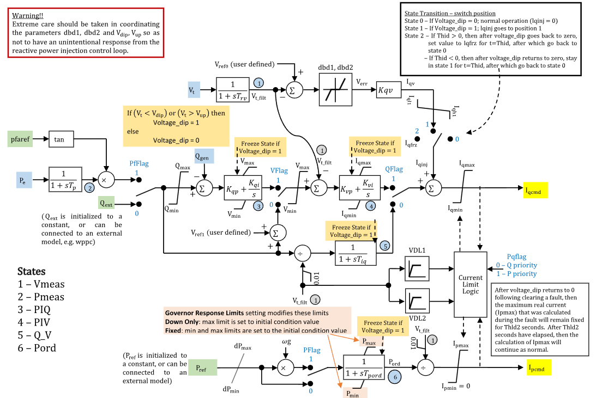

# REECA

REECA is a WECC renewable energy electrical control model for inverter-coupled resources. In GridKit it is represented as a signal-control model that computes active- and reactive-current commands.

At voltage recovery, `Thld2` holds the last active-current limit for the specified time. A positive `Thld` holds `Iqfrz` as the extra reactive-current injection. A negative `Thld` continues voltage-dependent injection for `abs(Thld)` seconds. A new dip resets both timers.

## Notes

- Internal electrical quantities and current commands are on model base unless otherwise stated.
- Optional signal inputs default to their documented constant values when omitted.

## Block Diagram



Figure 1: REECA block diagram. Figure courtesy of [PowerWorld](https://www.powerworld.com/WebHelp/)

## Model Parameters

Symbol                             | Units    | JSON | Description                                                          | Typical Value | Note
-----------------------------------|----------|------|----------------------------------------------------------------------|---------------|---------------------------------------------------------------------------
$S^{\mathrm{base}}$                | [MVA]    | `MVABase`  | REECA model power base                                               | TBD           | Source label: `MVABase`
$s_{\mathrm{pf}}$                  | [binary] | `PfFlag`  | Power-factor control flag                                            | TBD           | Source label: `PfFlag`; 1 = power-factor control, 0 = Q control
$s_V$                              | [binary] | `VFlag`  | Voltage-control mode flag                                            | TBD           | Source label: `VFlag`; 1 = Q control, 0 = voltage control
$s_Q$                              | [binary] | `QFlag`  | Reactive-power control flag                                          | TBD           | Source label: `QFlag`; 1 = voltage/Q control, 0 = constant pf or Q control
$s_P$                              | [binary] | `Pflag`  | Active-power reference speed-multiplier flag                         | TBD           | Source label: `Pflag`; 1 = multiply by generator speed
$s_\mathrm{PQ}$                           | [binary] | `Pqflag`  | P/Q priority flag for converter current limit                        | TBD           | Source label: `Pqflag`; 0 = Q priority, 1 = P priority
$T_{\mathrm{rv}}$                  | [s]      | `Trv`  | Voltage-measurement filter time constant                             | TBD           | Source label: `Trv`; if zero, $V_{\mathrm{meas}}$ is algebraic
$T_{\mathrm{p}}$                   | [s]      | `Tp`  | Electrical-power measurement filter time constant                    | TBD           | Source label: `Tp`; if zero, $P_{\mathrm{meas}}$ is algebraic
$V_{\mathrm{ref0}}$                | [p.u.]   | `Vref0`  | Outer-loop voltage reference                                         | TBD           | Source label: `Vref0`; initialized to terminal voltage if omitted
$V_{\mathrm{dip}}$                 | [p.u.]   | `Vdip`  | Low-voltage threshold for reactive-current injection logic           | TBD           | Source label: `Vdip`
$V_{\mathrm{up}}$                  | [p.u.]   | `Vup`  | High-voltage threshold for reactive-current injection logic          | TBD           | Source label: `Vup`
$D_{\mathrm{bd1}}$                 | [p.u.]   | `dbd1`  | Overvoltage deadband for voltage-error response                      | TBD           | Source label: `dbd1`
$D_{\mathrm{bd2}}$                 | [p.u.]   | `dbd2`  | Undervoltage deadband for voltage-error response                     | TBD           | Source label: `dbd2`
$K_{\mathrm{qv}}$                  | [p.u.]   | `kqv`  | Reactive-current injection gain during voltage dip/overvoltage logic | TBD           | Source label: `kqv`
$I_{\mathrm{qinj}}^{\min}$         | [p.u.]   | `Iql1`  | Minimum reactive-current injection limit                             | TBD           | Source label: `Iql1`
$I_{\mathrm{qinj}}^{\max}$         | [p.u.]   | `Iqh1`  | Maximum reactive-current injection limit                             | TBD           | Source label: `Iqh1`
$I_{\mathrm{qinj}}^{\mathrm{frz}}$ | [p.u.]   | `Iqfrz`  | Held reactive-current injection value after voltage dip              | TBD           | Source label: `Iqfrz`; unused when $T_{\mathrm{hld}} = 0$
$T_{\mathrm{hld}}$                 | [s]      | `Thld`  | Reactive-current injection hold time after voltage dip clears        | TBD           | Source label: `Thld`
$Q^{\max}$                         | [p.u.]   | `Qmax`  | Maximum reactive-power control limit                                 | TBD           | Source label: `Qmax`
$Q^{\min}$                         | [p.u.]   | `Qmin`  | Minimum reactive-power control limit                                 | TBD           | Source label: `Qmin`
$K_{\mathrm{qp}}$                  | [p.u.]   | `Kqp`  | Reactive-power control proportional gain                             | TBD           | Source label: `Kqp`
$K_{\mathrm{qi}}$                  | [p.u./s] | `Kqi`  | Reactive-power control integral gain                                 | TBD           | Source label: `Kqi`
$V^{\max}$                         | [p.u.]   | `Vmax`  | Maximum voltage-control limit                                        | TBD           | Source label: `Vmax`
$V^{\min}$                         | [p.u.]   | `Vmin`  | Minimum voltage-control limit                                        | TBD           | Source label: `Vmin`
$V_{\mathrm{ref1}}$                | [p.u.]   | `Vref1`  | Inner-loop voltage-control reference/bias                            | 0             | Source label: `Vref1`
$K_{\mathrm{vp}}$                  | [p.u.]   | `Kvp`  | Voltage-control proportional gain                                    | TBD           | Source label: `Kvp`
$K_{\mathrm{vi}}$                  | [p.u./s] | `Kvi`  | Voltage-control integral gain                                        | TBD           | Source label: `Kvi`
$T_{\mathrm{iq}}$                  | [s]      | `Tiq`  | Reactive-current command lag time constant                           | TBD           | Source label: `Tiq`
$T_{\mathrm{pord}}$                | [s]      | `Tpord`  | Active-power order filter time constant                              | TBD           | Source label: `Tpord`
$R_P^{\max}$                       | [p.u./s] | `dPmax`  | Positive active-power order ramp-rate limit                          | TBD           | Source label: `dPmax`
$R_P^{\min}$                       | [p.u./s] | `dPmin`  | Negative active-power order ramp-rate limit                          | TBD           | Source label: `dPmin`
$P^{\max}$                         | [p.u.]   | `Pmax`  | Maximum active-power order limit                                     | TBD           | Source label: `Pmax`
$P^{\min}$                         | [p.u.]   | `Pmin`  | Minimum active-power order limit                                     | TBD           | Source label: `Pmin`
$I^{\max}$                         | [p.u.]   | `Imax`  | Maximum total converter current                                      | TBD           | Source label: `Imax`
$V_{\mathrm{q},1}$                 | [p.u.]   | `vq1`  | VDL1 voltage point 1                                                 | TBD           | Source label: `vq1`
$I_{\mathrm{q},1}^{\max}$          | [p.u.]   | `lq1`  | VDL1 reactive-current limit point 1                                  | TBD           | Source label: `lq1`
$V_{\mathrm{q},2}$                 | [p.u.]   | `vq2`  | VDL1 voltage point 2                                                 | TBD           | Source label: `vq2`
$I_{\mathrm{q},2}^{\max}$          | [p.u.]   | `lq2`  | VDL1 reactive-current limit point 2                                  | TBD           | Source label: `lq2`
$V_{\mathrm{q},3}$                 | [p.u.]   | `vq3`  | VDL1 voltage point 3                                                 | TBD           | Source label: `vq3`
$I_{\mathrm{q},3}^{\max}$          | [p.u.]   | `lq3`  | VDL1 reactive-current limit point 3                                  | TBD           | Source label: `lq3`
$V_{\mathrm{q},4}$                 | [p.u.]   | `vq4`  | VDL1 voltage point 4                                                 | TBD           | Source label: `vq4`
$I_{\mathrm{q},4}^{\max}$          | [p.u.]   | `lq4`  | VDL1 reactive-current limit point 4                                  | TBD           | Source label: `lq4`
$V_{\mathrm{p},1}$                 | [p.u.]   | `vp1`  | VDL2 voltage point 1                                                 | TBD           | Source label: `vp1`
$I_{\mathrm{p},1}^{\max}$          | [p.u.]   | `lp1`  | VDL2 active-current limit point 1                                    | TBD           | Source label: `lp1`
$V_{\mathrm{p},2}$                 | [p.u.]   | `vp2`  | VDL2 voltage point 2                                                 | TBD           | Source label: `vp2`
$I_{\mathrm{p},2}^{\max}$          | [p.u.]   | `lp2`  | VDL2 active-current limit point 2                                    | TBD           | Source label: `lp2`
$V_{\mathrm{p},3}$                 | [p.u.]   | `vp3`  | VDL2 voltage point 3                                                 | TBD           | Source label: `vp3`
$I_{\mathrm{p},3}^{\max}$          | [p.u.]   | `lp3`  | VDL2 active-current limit point 3                                    | TBD           | Source label: `lp3`
$V_{\mathrm{p},4}$                 | [p.u.]   | `vp4`  | VDL2 voltage point 4                                                 | TBD           | Source label: `vp4`
$I_{\mathrm{p},4}^{\max}$          | [p.u.]   | `lp4`  | VDL2 active-current limit point 4                                    | TBD           | Source label: `lp4`
$T_{\mathrm{hld2}}$                | [s]      | `Thld2`  | Active-current limit hold time after voltage dip clears              | TBD           | Source label: `Thld2`

JSON parameter names are not yet specified.

### Parameter Validation

A valid REECA parameter set must satisfy the following conditions:

```math
\begin{aligned}
  &S^{\mathrm{base}} > 0 \\
  &s_{\mathrm{pf}}, s_V, s_Q, s_P, s_\mathrm{PQ} \in \{0,1\} \\
  &T_{\mathrm{rv}}, T_{\mathrm{p}} \ge 0 \\
  &0 \le V_{\mathrm{dip}} < V_{\mathrm{up}} \\
  &D_{\mathrm{bd1}} \le 0 \le D_{\mathrm{bd2}} \\
  &I_{\mathrm{qinj}}^{\min} \le I_{\mathrm{qinj}}^{\max} \\
  &T_{\mathrm{hld2}} \ge 0 \\
  &Q^{\min} \le Q^{\max} \\
  &V^{\min} \le V^{\max} \\
  &T_{\mathrm{iq}} \ge 0,\quad T_{\mathrm{pord}} > 0 \\
  &R_P^{\min} < 0 < R_P^{\max} \\
  &P^{\min} \le P^{\max} \\
  &I^{\max} > 0 \\
  &0 \le V_{\mathrm{q},1} < V_{\mathrm{q},2} < V_{\mathrm{q},3} < V_{\mathrm{q},4} \\
  &I_{\mathrm{q},k}^{\max} \ge 0\ \text{for } k=1,\ldots,4 \\
  &0 \le V_{\mathrm{p},1} < V_{\mathrm{p},2} < V_{\mathrm{p},3} < V_{\mathrm{p},4} \\
  &I_{\mathrm{p},k}^{\max} \ge 0\ \text{for } k=1,\ldots,4
\end{aligned}
```

### Model Derived Parameters

The off-mode flag complements are:

```math
\begin{aligned}
  s_{\mathrm{pf}}^{\mathrm{off}} &= 1 - s_{\mathrm{pf}} \\
  s_V^{\mathrm{off}} &= 1 - s_V \\
  s_Q^{\mathrm{off}} &= 1 - s_Q \\
  s_\mathrm{PQ}^{\mathrm{off}} &= 1 - s_\mathrm{PQ}
\end{aligned}
```

The VDL functions use GridKit's smooth [Linear Segment](../../../../CommonMath.md#linear-segment) helper and provide flat extrapolation outside the first and fourth voltage points:

```math
\begin{aligned}
  g_q(x) &=
    I_{\mathrm{q},1}^{\max}
    + \sum_{k=1}^{3}
      \text{linseg}\!(
        x;\,
        V_{\mathrm{q},k},\,
        V_{\mathrm{q},k+1},\,
        I_{\mathrm{q},k+1}^{\max} - I_{\mathrm{q},k}^{\max}
      ) \\
  g_p(x) &=
    I_{\mathrm{p},1}^{\max}
    + \sum_{k=1}^{3}
      \text{linseg}\!(
        x;\,
        V_{\mathrm{p},k},\,
        V_{\mathrm{p},k+1},\,
        I_{\mathrm{p},k+1}^{\max} - I_{\mathrm{p},k}^{\max}
      )
\end{aligned}
```

## Model Ports

Name      | Port   | Init | Description
----------|--------|------|------------
`bus`     | Bus    | TBD  | Terminal-bus voltage
`speed`   | Input  | TBD  | Generator speed deviation
`pe`      | Input  | TBD  | Electrical active-power feedback
`qgen`    | Input  | TBD  | Reactive-power feedback
`qext`    | Input  | TBD  | External reactive-power command
`pfaref`  | Input  | TBD  | Power-factor angle reference
`pref`    | Input  | TBD  | Active-power reference
`iqcmd`   | Output | TBD  | Reactive-current command
`ipcmd`   | Output | TBD  | Active-current command

## Model Variables

### Internal Variables

#### Differential

Symbol              | Units  | Description                        | Note
--------------------|--------|------------------------------------|-------------------------------------------------------------------------------
$V_{\mathrm{meas}}$ | [p.u.] | Filtered terminal voltage          | State 1 in Fig. 1; Source label: `Vmeas`; algebraic when $T_{\mathrm{rv}} = 0$
$P_{\mathrm{meas}}$ | [p.u.] | Filtered electrical power          | State 2 in Fig. 1; Source label: `Pmeas`; algebraic when $T_{\mathrm{p}} = 0$
$x_{\mathrm{PIQ}}$  | [p.u.] | Reactive-power PI controller state | State 3 in Fig. 1; Source label: `PIQ`
$x_{\mathrm{PIV}}$  | [p.u.] | Voltage PI controller state        | State 4 in Fig. 1; Source label: `PIV`
$Q_V$               | [p.u.] | Reactive-current command lag state | State 5 in Fig. 1; Source label: `Q_V`
$P_{\mathrm{ramp}}$ | [p.u.] | Rate-limited active-power reference | Tracks the speed-adjusted reference with $T_{\mathrm{track}}=1$ ms
$P_{\mathrm{ord}}$  | [p.u.] | Filtered active-power order        | State 6 in Fig. 1; Source label: `Pord`

#### Algebraic

Symbol                          | Units  | Description                         | Note
--------------------------------|--------|-------------------------------------|------
$V_T$                           | [p.u.] | Terminal voltage magnitude          |
$V_{\mathrm{meas}}^{\mathrm{safe}}$ | [p.u.] | Safe filtered terminal voltage for divider blocks | Lower bounded by 0.01
$s_{\mathrm{dip}}$              | [binary] | Voltage-dip/overvoltage freeze indicator | 1 when outside voltage thresholds
$V_{\mathrm{err}}$              | [p.u.] | Deadbanded voltage error            | Defined by CommonMath `deadband2`
$I_{\mathrm{qv}}$               | [p.u.] | Reactive-current injection candidate | Converter base
$Q_{\mathrm{ref}}$              | [p.u.] | Selected reactive-power reference   | From power-factor or external reactive-power command
$e_Q$                           | [p.u.] | Reactive-power control error        | Limited $Q_{\mathrm{ref}}$ minus $Q_{\mathrm{gen}}$
$V_{\mathrm{PIQ}}$              | [p.u.] | Reactive-power control PI output    | Limited by $V^{\min}$ and $V^{\max}$
$e_{\mathrm{PIV}}$              | [p.u.] | Voltage-control PI error            | Selected voltage-control signal minus $V_{\mathrm{meas}}$
$r_{\mathrm{pord}}$             | [p.u./s] | Power-order lag rate | Feeds $P_{\mathrm{ord}}$ anti-windup
$I_{\mathrm{q}}^{\mathrm{circ}}$ | [p.u.] | Reactive-current limit from converter current circle | Converter base; nonnegative algebraic branch
$I_{\mathrm{p}}^{\mathrm{circ}}$ | [p.u.] | Active-current limit from converter current circle | Converter base; nonnegative algebraic branch
$I_{\mathrm{q}}^{\max}$         | [p.u.] | Final reactive-current upper limit  | Converter base; updated by VDL1 and current-limit logic
$I_{\mathrm{p}}^{\max}$         | [p.u.] | Final active-current upper limit    | Converter base; updated by VDL2 and current-limit logic
$I_{\mathrm{qbase}}$            | [p.u.] | Base reactive-current command       | Converter base; before $s_Q$ selection and reactive-current injection
$I_{\mathrm{q}}^{\mathrm{raw}}$ | [p.u.] | Raw reactive-current command before final limit | Converter base
$I_{\mathrm{q}}^{\mathrm{cmd}}$ | [p.u.] | Reactive-current command output     | Converter base
$I_{\mathrm{p}}^{\mathrm{cmd}}$ | [p.u.] | Active-current command output       | Converter base

### External Variables

#### Differential

Symbol     | Units  | Description             | Note
-----------|--------|-------------------------|------
$\omega$   | [p.u.] | Generator speed deviation | Optional, defaults to zero; source diagram $\omega_\mathrm{g} = 1 + \omega$

#### Algebraic

Symbol                              | Units  | Description                           | Note
------------------------------------|--------|---------------------------------------|---------------------------------------------------
$V_r$                               | [p.u.] | Terminal voltage, real component      | Owned by bus object
$V_i$                               | [p.u.] | Terminal voltage, imaginary component | Owned by bus object
$P_\mathrm{e}$                               | [p.u.] | Electrical active power               | Source label: `Pe`
$Q_{\mathrm{gen}}$                  | [p.u.] | Reactive-power feedback               | Source label: `Qgen`
$Q_{\mathrm{ext}}$                  | [p.u.] | External reactive-power command       | Optional, defaults to initialized constant
$\phi_{\mathrm{pf}}^{\mathrm{ref}}$ | [rad]  | Power-factor angle reference          | Source label: `pfaref`; used through tangent block
$P_{\mathrm{ref}}$                  | [p.u.] | External active-power reference       | Optional, defaults to initialized constant

## Model Equations

Smooth functions: [`antiwindup`](../../../../CommonMath.md#antiwindup), [`clamp`](../../../../CommonMath.md#clamp), [`deadband2`](../../../../CommonMath.md#type-ii-deadband), [`max`](../../../../CommonMath.md#maximum), [`min`](../../../../CommonMath.md#minimum), [`outside`](../../../../CommonMath.md#outside).

For readability, define:

```math
\begin{aligned}
  f_{\mathrm{PIQ}} &= K_{\mathrm{qi}} e_Q \\
  f_{\mathrm{PIV}} &= K_{\mathrm{vi}} e_{\mathrm{PIV}}
\end{aligned}
```

### Internal Equations

#### Differential

The ramp equation uses the active-power reference $P_{\mathrm{ref}}$ on the converter MVA base.

```math
\begin{aligned}
  0 &= -T_{\mathrm{rv}}\dot V_{\mathrm{meas}} - V_{\mathrm{meas}} + V_T \\
  0 &= -T_{\mathrm{p}}\dot P_{\mathrm{meas}} - P_{\mathrm{meas}} + P_\mathrm{e} \\
  0 &=
    -\dot x_{\mathrm{PIQ}}
    + (1 - s_{\mathrm{dip}})
    \text{antiwindup}\!(
      V_{\mathrm{PIQ}},
      f_{\mathrm{PIQ}};
      V^{\min},
      V^{\max}
    ) \\
  0 &=
    -\dot x_{\mathrm{PIV}}
    + (1 - s_{\mathrm{dip}})
    \text{antiwindup}\!(
      I_{\mathrm{qbase}},
      f_{\mathrm{PIV}};
      -I_{\mathrm{q}}^{\max},
      I_{\mathrm{q}}^{\max}
    ) \\
  0 &=
    -T_{\mathrm{iq}}\dot Q_V
    - (1 - s_{\mathrm{dip}})Q_V
    + (1 - s_{\mathrm{dip}})Q_{\mathrm{ref}}/V_{\mathrm{meas}}^{\mathrm{safe}} \\
  0 &= -\dot P_{\mathrm{ramp}} +
    \min\!\left(R_P^{\max}, \max\!\left(R_P^{\min},
    \frac{(1+s_P\omega)P_{\mathrm{ref}}-P_{\mathrm{ramp}}}{T_{\mathrm{track}}}\right)\right) \\
  0 &=
    -\dot P_{\mathrm{ord}}
    + (1 - s_{\mathrm{dip}})
    \text{antiwindup}\!(
      P_{\mathrm{ord}},
      r_{\mathrm{pord}};
      P^{\min},
      P^{\max}
    )
\end{aligned}
```

#### Algebraic

```math
\begin{aligned}
  0 &= -V_T^2 + V_\mathrm r^2 + V_\mathrm i^2 \\
  0 &= -V_\mathrm{meas}^\mathrm{safe} + \max(V_\mathrm{meas}, 0.01) \\
  0 &= -s_\mathrm{dip} + \mathbf{1}_{V_T<V_\mathrm{dip}\,\lor\,V_T>V_\mathrm{up}} \\
  0 &= -V_\mathrm{err} + \text{deadband2}(V_\mathrm{ref0} - V_\mathrm{meas}; D_\mathrm{bd1}, D_\mathrm{bd2}) \\
  0 &= -I_\mathrm{qv} + \text{clamp}(K_\mathrm{qv} V_\mathrm{err}; I_\mathrm{qinj}^{\min}, I_\mathrm{qinj}^{\max}) \\
  0 &= -Q_\mathrm{ref}
       + s_\mathrm{pf} P_\mathrm{meas}\tan(\phi_\mathrm{pf}^\mathrm{ref})
       + s_\mathrm{pf}^\mathrm{off} Q_\mathrm{ext} \\
  0 &= -e_Q + \text{clamp}(Q_\mathrm{ref}; Q^{\min}, Q^{\max}) - Q_\mathrm{gen} \\
  0 &= -V_\mathrm{PIQ} + \text{clamp}(K_\mathrm{qp} e_Q + x_\mathrm{PIQ}; V^{\min}, V^{\max}) \\
  0 &= -e_\mathrm{PIV} + s_V V_\mathrm{PIQ} + s_V^\mathrm{off}(Q_\mathrm{ext} + V_\mathrm{ref1}) - V_\mathrm{meas} \\
  0 &= -T_\mathrm{pord} r_\mathrm{pord} + P_\mathrm{ramp} - P_\mathrm{ord}
\end{aligned}
```

```math
\begin{aligned}
  0 &= -{I_\mathrm{q}^\mathrm{circ}}^2 + (I^{\max})^2 - s_\mathrm{PQ}(I_\mathrm{p}^\mathrm{cmd})^2 \\
  0 &= -{I_\mathrm{p}^\mathrm{circ}}^2 + (I^{\max})^2 - s_\mathrm{PQ}^\mathrm{off}(I_\mathrm{q}^\mathrm{cmd})^2 \\
  0 &= -I_\mathrm{q}^{\max} + \text{min}(g_q(V_\mathrm{meas}), I_\mathrm{q}^\mathrm{circ}) \\
  0 &= -I_\mathrm{p}^{\max} + \text{min}(g_p(V_\mathrm{meas}), I_\mathrm{p}^\mathrm{circ}) \\
  0 &= -I_\mathrm{qbase} + \text{clamp}(K_\mathrm{vp} e_\mathrm{PIV} + x_\mathrm{PIV}; -I_\mathrm{q}^{\max}, I_\mathrm{q}^{\max}) \\
  0 &= -I_\mathrm{q}^\mathrm{raw} + s_Q I_\mathrm{qbase} + s_Q^\mathrm{off} Q_V + s_\mathrm{dip} I_\mathrm{qv} \\
  0 &= -I_\mathrm{q}^\mathrm{cmd} + \text{clamp}(I_\mathrm{q}^\mathrm{raw}; -I_\mathrm{q}^{\max}, I_\mathrm{q}^{\max}) \\
  0 &= -I_\mathrm{p}^\mathrm{cmd} + \text{clamp}(P_\mathrm{ord}/V_\mathrm{meas}^\mathrm{safe}; 0, I_\mathrm{p}^{\max})
\end{aligned}
```

The $V_T$, $I_{\mathrm{q}}^{\mathrm{circ}}$, and $I_{\mathrm{p}}^{\mathrm{circ}}$ variables use nonnegative branches of squared algebraic residuals.

### External Equations

None.

## Initialization

All internal derivatives initialize to zero. Omitted optional signals use the following constants:

```math
\begin{aligned}
  V_T &\leftarrow \sqrt{V_r^2 + V_i^2} \\
  \omega &\leftarrow 0,\quad \text{if omitted} \\
  Q_{\mathrm{ext}} &\leftarrow Q_{\mathrm{gen}},\quad \text{if omitted} \\
  P_{\mathrm{ref}} &\leftarrow \dfrac{P_{\mathrm{e}}}{1+s_P\omega},\quad \text{if omitted}
\end{aligned}
```

Connected optional signals use their supplied initial values; if only some are omitted, compute the omitted constants with the connected initial values. Inconsistent supplied commands require a residual solve or initialization rejection.

If $V_{\mathrm{ref0}}$ is omitted, set $V_{\mathrm{ref0}}\leftarrow V_T$.

```math
\begin{aligned}
  V_{\mathrm{meas}} &\leftarrow V_T \\
  P_{\mathrm{meas}} &\leftarrow P_{\mathrm{e}}
\end{aligned}
```

Then evaluate the upstream algebraic chain:

```math
\begin{aligned}
  V_{\mathrm{meas}}^{\mathrm{safe}} &\leftarrow \text{max}(V_{\mathrm{meas}}, 0.01) \\
  s_{\mathrm{dip}} &\leftarrow \text{outside}(V_T; V_{\mathrm{dip}}, V_{\mathrm{up}}) \\
  V_{\mathrm{err}} &\leftarrow \text{deadband2}(V_{\mathrm{ref0}} - V_{\mathrm{meas}}; D_{\mathrm{bd1}}, D_{\mathrm{bd2}}) \\
  I_{\mathrm{qv}} &\leftarrow \text{clamp}(K_{\mathrm{qv}} V_{\mathrm{err}}; I_{\mathrm{qinj}}^{\min}, I_{\mathrm{qinj}}^{\max}) \\
  Q_{\mathrm{ref}} &\leftarrow s_{\mathrm{pf}} P_{\mathrm{meas}}\tan(\phi_{\mathrm{pf}}^{\mathrm{ref}}) + s_{\mathrm{pf}}^{\mathrm{off}} Q_{\mathrm{ext}} \\
  e_Q &\leftarrow \text{clamp}(Q_{\mathrm{ref}}; Q^{\min}, Q^{\max}) - Q_{\mathrm{gen}} \\
  Q_V &\leftarrow \dfrac{Q_{\mathrm{ref}}}{V_{\mathrm{meas}}^{\mathrm{safe}}} \\
  P_{\mathrm{ramp}} &\leftarrow (1+s_P\omega)P_{\mathrm{ref}} \\
  P_{\mathrm{ord}} &\leftarrow P_{\mathrm{ramp}}
\end{aligned}
```

The PI states must satisfy:

```math
\begin{aligned}
  0 &= -V_{\mathrm{PIQ}} + \text{clamp}(K_{\mathrm{qp}} e_Q + x_{\mathrm{PIQ}}; V^{\min}, V^{\max}) \\
  0 &= -e_{\mathrm{PIV}} + s_V V_{\mathrm{PIQ}} + s_V^{\mathrm{off}}(Q_{\mathrm{ref}} + V_{\mathrm{ref1}}) - V_{\mathrm{meas}}
\end{aligned}
```

An unsaturated start requires $e_Q=0$ and $e_{\mathrm{PIV}}=0$.
When $s_V=1$, set $V_{\mathrm{PIQ}}\leftarrow V_{\mathrm{meas}}$; when
$s_V=0$, the supplied $Q_{\mathrm{ref}}+V_{\mathrm{ref1}}$ must equal
$V_{\mathrm{meas}}$. Then
$x_{\mathrm{PIQ}}\leftarrow V_{\mathrm{PIQ}}-K_{\mathrm{qp}}e_Q$.
Saturated starts require a solve against the anti-windup residuals.

Finish by evaluating $g_q(V_{\mathrm{meas}})$, $g_p(V_{\mathrm{meas}})$, and the current-limit and current-command algebraic residuals in priority order. At the command steps, use the power-flow current targets before final limiting:

```math
\begin{aligned}
  I_{\mathrm{qbase}}^{\star} &\leftarrow \dfrac{Q_{\mathrm{gen}}}{V_{\mathrm{meas}}^{\mathrm{safe}}} \\
  I_{\mathrm{p}}^{\star} &\leftarrow \dfrac{P_{\mathrm{ord}}}{V_{\mathrm{meas}}^{\mathrm{safe}}}
\end{aligned}
```

Evaluate current limits and commands in this order:

- $s_\mathrm{PQ}=0$: $I_{\mathrm{q}}^{\mathrm{circ}}$, $I_{\mathrm{q}}^{\max}$, $I_{\mathrm{qbase}}$, $I_{\mathrm{q}}^{\mathrm{raw}}$, $I_{\mathrm{q}}^{\mathrm{cmd}}$, $I_{\mathrm{p}}^{\mathrm{circ}}$, $I_{\mathrm{p}}^{\max}$, $I_{\mathrm{p}}^{\mathrm{cmd}}$.
- $s_\mathrm{PQ}=1$: $I_{\mathrm{p}}^{\mathrm{circ}}$, $I_{\mathrm{p}}^{\max}$, $I_{\mathrm{p}}^{\mathrm{cmd}}$, $I_{\mathrm{q}}^{\mathrm{circ}}$, $I_{\mathrm{q}}^{\max}$, $I_{\mathrm{qbase}}$, $I_{\mathrm{q}}^{\mathrm{raw}}$, $I_{\mathrm{q}}^{\mathrm{cmd}}$.

After $I_{\mathrm{q}}^{\max}$ and $I_{\mathrm{qbase}}$ are known, initialize the voltage PI state:

```math
x_{\mathrm{PIV}} \leftarrow I_{\mathrm{qbase}} - K_{\mathrm{vp}} e_{\mathrm{PIV}}
```

Initialization requires terminal voltage strictly between `Vdip` and `Vup`. Current and power signal ports use the system base.

## Monitors

Monitor         | Units  | Description                         | Note
----------------|--------|-------------------------------------|------
`iqcmd`         | [p.u.] | Reactive-current command output     | System base
`ipcmd`         | [p.u.] | Active-current command output       | System base
`ipmax`         | [p.u.] | Final active-current upper limit    | Converter base
`vt` | [p.u.] | Terminal voltage magnitude |
`iqinj` | [p.u.] | Voltage-dependent reactive-current injection candidate | Converter base
