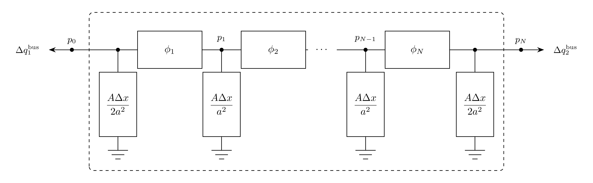

# GasBranch

GasBranch is a gas pipe between two gas buses, divided into $N$ equal segments
along its length. Terminal mass flows are oriented entering the adjacent buses.

## Notes

- Each terminal holds half a segment of gas storage, like the split line shunt
  of [Branch](../../Branch/README.md).
- Flow is isothermal. As in GasTranSim, convective acceleration and elevation
  change are neglected.
- $b_1 = 1$ and $b_2 = 0$ give an ideal gas. [Gas Laws](../README.md#gas-laws)
  lists the GasTranSim gas laws.

## Block Diagram



Figure 1: GasBranch model.

## Model Parameters

Symbol            | Units  | JSON     | Description                | Typical Value | Note
------------------|--------|----------|----------------------------|---------------|-----
$L$               | [m]    | `L`      | Pipe length                | Required      |
$D$               | [m]    | `D`      | Pipe diameter              | Required      |
$\lambda$         | [-]    | `lambda` | Darcy friction factor      | Required      |
$a$               | [m/s]  | `a`      | Isothermal speed of sound  | Required      |
$b_1$             | [-]    | `b1`     | First density coefficient  | 1.0           |
$b_2$             | [1/Pa] | `b2`     | Second density coefficient | 0.0           |
$\Delta x^{\max}$ | [m]    | `dxmax`  | Maximum segment length     | 1000.0        |

### Parameter Validation

A valid GasBranch parameter set must satisfy the following conditions:

```math
\begin{aligned}
  0 &< L, D, \lambda, a, b_1, \Delta x^{\max} < \infty \\
  0 &\le b_2 < \infty
\end{aligned}
```

### Model Derived Parameters

```math
\begin{aligned}
  N &= \left\lceil \dfrac{L}{\Delta x^{\max}} \right\rceil \\
  \Delta x &= \dfrac{L}{N} \\
  A &= \dfrac{\pi D^2}{4}
\end{aligned}
```

## Model Ports

Name   | Port   | Init  | Description
-------|--------|-------|------------------------
`bus1` | GasBus | Known | Required bus-1 terminal
`bus2` | GasBus | Known | Required bus-2 terminal

## Model Variables

### Internal Variables

#### Differential

Symbol   | Units       | Description       | Note
---------|-------------|-------------------|-----------------------------------------------------
$p_j$    | [Pa]        | Node pressure     | $j \in \{1,\ldots,N-1\}$
$\phi_k$ | [kg/(m²·s)] | Segment mass flux | $k \in \{1,\ldots,N\}$; positive from bus 1 to bus 2

#### Algebraic

None.

### External Variables

#### Differential

Symbol | Units | Description    | Note
-------|-------|----------------|--------------------
$p_0$  | [Pa]  | Bus-1 pressure | Owned by bus object
$p_N$  | [Pa]  | Bus-2 pressure | Owned by bus object

#### Algebraic

None.

## Model Equations

Node $j$ is at distance $j\Delta x$ from bus 1, and segment $k$ joins nodes
$k-1$ and $k$. The density $\rho$, its pressure derivative $\rho'$, and the
segment density $\bar\rho_k$, the mean of $\rho$ over the pressures between
nodes $k-1$ and $k$, are:

```math
\begin{aligned}
  \rho(p) &= \dfrac{p\,(b_1 + b_2 p)}{a^2} \\
  \rho'(p) &= \dfrac{b_1 + 2b_2 p}{a^2} \\
  \bar\rho_k &= \dfrac{1}{a^2}\left[\dfrac{b_1}{2}(p_{k-1} + p_k) + \dfrac{b_2}{3}\left(p_{k-1}^2 + p_{k-1}p_k + p_k^2\right)\right]
\end{aligned}
```

### Internal Equations

#### Differential

```math
\begin{aligned}
  0 &= -\dot p_j + \dfrac{\phi_j - \phi_{j+1}}{\rho'(p_j)\,\Delta x}, && j \in \{1,\ldots,N-1\} \\
  0 &= -\dot\phi_k + \dfrac{p_{k-1} - p_k}{\Delta x} - \dfrac{\lambda}{2D}\dfrac{\phi_k|\phi_k|}{\bar\rho_k}, && k \in \{1,\ldots,N\}
\end{aligned}
```

#### Algebraic

None.

### External Equations

```math
\begin{aligned}
  \Delta q^\mathrm{bus}_1 &\mathrel{+}= -A\phi_1 - \dfrac{A\Delta x}{2}\rho'(p_0)\,\dot p_0 \\
  \Delta q^\mathrm{bus}_2 &\mathrel{+}= A\phi_N - \dfrac{A\Delta x}{2}\rho'(p_N)\,\dot p_N
\end{aligned}
```

## Initialization

### Input Initialization

```math
p_0, p_N \leftarrow \text{terminal-bus pressures}
```

### Internal Initialization

Initialization requires $p_0, p_N > 0$. All internal derivatives initialize to
zero, and the values below are the steady flow between the terminal pressures,
along which the potential $\Pi(p) = (b_1 p^2/2 + b_2 p^3/3)/a^2$ falls
linearly:

```math
\begin{aligned}
  \phi_k &\leftarrow \text{sign}(\Pi(p_0) - \Pi(p_N))\sqrt{\dfrac{2D\,|\Pi(p_0) - \Pi(p_N)|}{\lambda L}} \\
  p_j &\leftarrow \Pi^{-1}\left(\Pi(p_0) - \dfrac{j}{N}\big(\Pi(p_0) - \Pi(p_N)\big)\right)
\end{aligned}
```

## Monitors

Monitor    | Units  | Description               | Note
-----------|--------|---------------------------|------------------------------------------------------------------
`q1`       | [kg/s] | Terminal mass flow, bus 1 | $\Delta q^\mathrm{bus}_1$; oriented entering bus 1
`q2`       | [kg/s] | Terminal mass flow, bus 2 | $\Delta q^\mathrm{bus}_2$; oriented entering bus 2
`linepack` | [kg]   | Gas mass in the pipe      | $A\Delta x\,[(\rho(p_0)+\rho(p_N))/2+\sum_{j=1}^{N-1}\rho(p_j)]$
