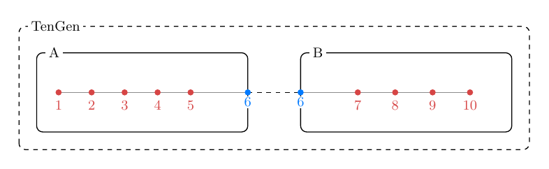
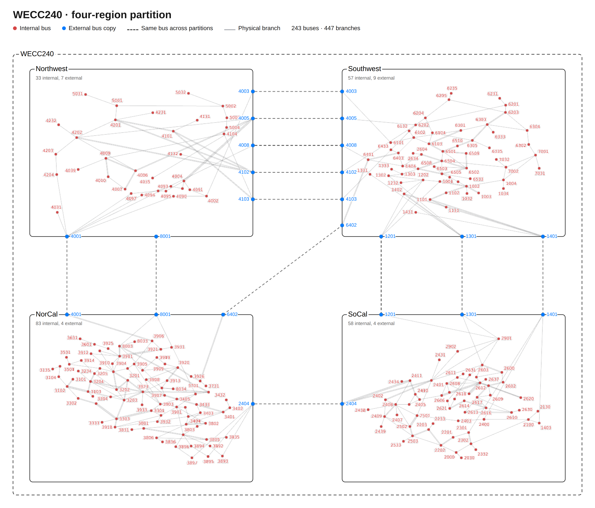
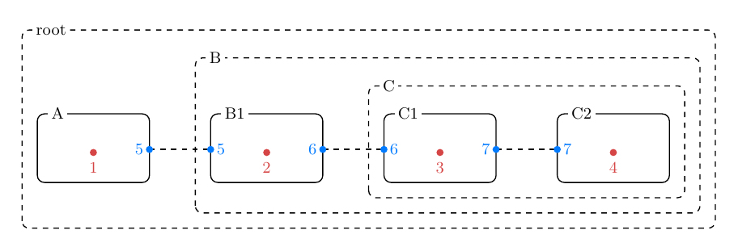

# Partitions in Phasor Dynamics

## Overview and Purpose

The concept of "Partition" is used in phasor dynamics in GridKit to refer
to dividing up a system model into smaller parts
**for the purpose of parallel simulation** and other
solver acceleration techniques. 
Dividing up a system for _modeling convenience_ (like having physically
meaningful areas corresponding to particular utilities, 
containerized subcomponents, template aggregate models
for multi-instantiation, etc.) 
is a fundamentally different goal. It is not
appropriate to use divisions driven by modeling for solver acceleration.

Partitions for a system are defined in a JSON file withan extension of 
`.partition.json`, which is separate from the system model 
definition
but refers to buses by number from the system model definition.
Defining a partition file for a system is optional, but needed to enable
parallel model evaluation for some solvers.

This file defines a nested, hierarchical structure of containers
of type `Partition`.
The format is general and could accommodate any combination of nested
partitions, including the common structure of a single level of partitions
dividing the system for a single level of parallel evaluation.
Any more complex structure can also be flattened 
into a single level for solvers that require 
only a single level of partitioning.
The JSON file schema is defined in `partition.schema.json`, and is also
described below.

In the future it is envisioned that users would not need to think about
partitioning a system. Rather, an automated partitioning routine 
would pick
the best partitioning for maximum solver efficiency on a given computational
environment,
and perhaps write the `partition.json` file as an intermediate step. 
For now, partitions need to be defined by the user-written JSON file.

## Partition Definitions and JSON Structure

A `Partition` is a container for buses and other partitions. 
Each partition has the following properties:
- `name` of type `string` identifying the partition
- `external` of type `array of integers` containing the 
  bus numbers external to the partition. These bus numbers must correspond to 
  buses in the model JSON file. Any bus connecting to this partition and also
  to other partitions is considered external. This property is optional:
  omitting it implies there are no external buses.
- `internal` of type `array of integers` containing the bus numbers internal 
  to the partition. These bus numbers must correspond to 
  buses in the model JSON file. Any bus completely unique to this partition
  should go in this list. This property is optional:
  omitting it implies there are no internal buses.
- `partitions` of type `array of Partition` 
  containing zero or more Partitions which are child partitions of this
  partition. his property is optional:
  omitting it implies there are no child partitions.

The root-level object of the JSON file is a partition.

The hierarchy is primarily for convenience. All internal buses are truly
isolated to that partition and may not be connected to any other partition,
even child partitions. All external buses are globally visible and may connect
even across branches of the hierarchy. There is no requirement for the structure
of the hierarchy to be balanced.

## Validation Rules and Component Assignment

Any violation of the rules below results in a exception indicating a badly 
formed partition.
Component assignment is done automatically. This avoids the error-prone 
requirement for the user to manually assign both buses and components and
ensure they are compatible.

1. The file must follow the `partition.schema.json` structure.
2. Every bus must appear somewhere in the file,
either as `external` or `internal`, but not both.
3. Internal buses must only appear uniquely in one `Partition`.
External buses may appear more than once.
4. Each `Component` that has bus ports shall be assigned to the first 
`Partition`, in the order partitions are listed in the file,
which contains every one of the `Component`'s connected buses as either an
internal or external bus in that partition itself. If no such partition exists,
raise an exception indicating a badly 
formed partition.
5. Some components are connected to each other by signals.
Place signal-connected devices together, 
in the first partition containing all bus ports of all of them. 
Signal nodes go with the devices that use them.
If a `Component` is left unassigned or if two connected
components are assigned to different partitions,
raise an exception indicating a badly 
formed partition.

Partition names are not required to be unique, though this is a recommended.

In the future it is envisioned that signals may also be part of the 
partition definition, allowing connected components to be in separate 
partitions. For now, only buses can divide partitions.

## Examples

### Ten Generator Case - Divide into Two Partitions

File name: `TenGen.partition.json`

```JSON
{
  "name": "TenGen",
  "partitions": [
    {
      "name": "A",
      "internal": [
        1,
        2,
        3,
        4,
        5
      ],
      "external": [
        6
      ]
    },
    {
      "name": "B",
      "internal": [
        7,
        8,
        9,
        10
      ],
      "external": [
        6
      ]
    }
  ]
}
```



*Figure 1: TenGen split into two partitions, A and B. Buses 1–5 are internal to A and buses 7–10 are internal to B (red). Bus 6 is external for both (blue); the dashed line indicates the partitions couple at Bus 6.*

### WECC 240 Case - Divide into Four Partitions

File name: `WECC240.partition.json`

(This file can be found under `examples/PhasorDynamics/Partitions/WECC240`.)



*Figure 2: WECC240 split into four regional partitions: Northwest, Southwest, NorCal and SoCal. Internal buses (red) belong to exactly one partition. Boundary buses (blue) are external and appear in every partition that touches them; dashed lines show where
buses couple between partitions.*


### Sample Multi-Level Partition

This example shows how a multi-level hierarchical structure can be implemented
with partitions.

File name: `deep.partition.json`

```JSON
{
  "name": "root",
  "partitions": [
    {
      "name": "A",
      "internal": [
        1
      ],
      "external": [
        5
      ]
    },
    {
      "name": "B",
      "partitions": [
        {
          "name": "B1",
          "internal": [
            2
          ],
          "external": [
            5,
            6
          ]
        },
        {
          "name": "C",
          "partitions": [
            {
              "name": "C1",
              "internal": [
                3
              ],
              "external": [
                6,
                7
              ]
            },
            {
              "name": "C2",
              "internal": [
                4
              ],
              "external": [
                7
              ]
            }
          ]
        }
      ]
    }
  ]
}
```



*Figure 3: Sample multi-level partition scheme. The partitions 
containing buses are
A, B1, C1, and C2, whereas root, B and C are partitions only 
containing other partitions.*
