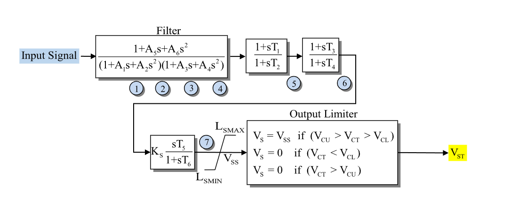

# IEEEST

IEEEST is an IEEE power system stabilizer with a notch filter, two lead–lag
blocks, a washout, and an output limiter.

## Notes

- The notch order $n$ is the degree of the notch denominator. It is derived
  from $A_1$–$A_4$, not given as a parameter, and a model of order $n$ has $n$
  notch states.
- The block outputs $v_4$–$v_7$ are evaluated from the states rather than
  solved for.
- $V_{\mathrm{cu}}$, $V_{\mathrm{cl}}$, and $T_{\mathrm{delay}}$ are read but
  not modeled; a nonzero value logs a warning.

## Block Diagram



Figure 1: IEEEST stabilizer model. Figure courtesy of the
[PowerWorld IEEEST model reference](https://www.powerworld.com/WebHelp/Content/TransientModels_HTML/Stabilizer%20IEEEST.htm).

## Model Parameters

Symbol               | Units            | JSON     | Description                          | Typical Value | Note
---------------------|------------------|----------|--------------------------------------|---------------|------------
$A_1$                | [s]              | `A1`     | Notch denominator coefficient        | 1.013         |
$A_2$                | [$\mathrm{s}^2$] | `A2`     | Notch denominator coefficient        | 0.013         |
$A_3$                | [s]              | `A3`     | Notch denominator coefficient        | 0.0           |
$A_4$                | [$\mathrm{s}^2$] | `A4`     | Notch denominator coefficient        | 0.0           |
$A_5$                | [s]              | `A5`     | Notch numerator coefficient          | 1.013         |
$A_6$                | [$\mathrm{s}^2$] | `A6`     | Notch numerator coefficient          | 0.113         |
$T_1$                | [s]              | `T1`     | Lead–lag 1 numerator time constant   | 0.0           |
$T_2$                | [s]              | `T2`     | Lead–lag 1 denominator time constant | 0.02          |
$T_3$                | [s]              | `T3`     | Lead–lag 2 numerator time constant   | 0.0           |
$T_4$                | [s]              | `T4`     | Lead–lag 2 denominator time constant | 0.0           |
$T_5$                | [s]              | `T5`     | Washout numerator time constant      | 1.65          |
$T_6$                | [s]              | `T6`     | Washout denominator time constant    | 1.65          |
$K_s$                | [p.u.]           | `Ks`     | Stabilizer gain                      | 3.0           |
$L_s^{\max}$         | [p.u.]           | `Lsmax`  | Maximum stabilizer output            | 0.1           |
$L_s^{\min}$         | [p.u.]           | `Lsmin`  | Minimum stabilizer output            | -0.1          |
$V_{\mathrm{cu}}$    | [p.u.]           | `Vcu`    | Upper cutout voltage                 | 0.0           | Not modeled
$V_{\mathrm{cl}}$    | [p.u.]           | `Vcl`    | Lower cutout voltage                 | 0.0           | Not modeled
$T_{\mathrm{delay}}$ | [s]              | `Tdelay` | Input delay                          | 0.0           | Not modeled

Every parameter is optional and must be finite. An omitted parameter is zero,
except $T_2 = T_4 = T_6 = K_s = 1$ and $L_s^{\max} = -L_s^{\min} = 0.1$.

### Parameter Validation

```math
\begin{aligned}
  T_2, T_4, T_6
    &\ge 0 \\
  L_s^{\min}
    &< L_s^{\max} \\
  m
    &\le n
\end{aligned}
```

### Model Derived Parameters

A zero coefficient marks an absent term, so the degree of $1 + ps + qs^2$ is

```math
d(p,q) =
  \begin{cases}
    2 & q \ne 0 \\
    1 & q = 0,\ p \ne 0 \\
    0 & p = q = 0
  \end{cases}
```

and the notch denominator and numerator degrees are

```math
\begin{aligned}
  n &= d(A_1,A_2) + d(A_3,A_4) \\
  m &= d(A_5,A_6)
\end{aligned}
```

The notch is realized as two factors in series,
$(1 + A_5 s + A_6 s^2) / [(1 + b_1 s + b_2 s^2)(1 + c_1 s + c_2 s^2)]$. The
denominator factors commute; the second-order factor goes first so it can carry
the numerator:

```math
(b_1, b_2, c_1, c_2) =
  \begin{cases}
    (A_1 + A_3,\ A_2 + A_4 + A_1 A_3,\ 0,\ 0) & n \le 2 \\
    (A_1, A_2, A_3, A_4) & n \ge 3,\ A_2 \ne 0 \\
    (A_3, A_4, A_1, A_2) & n \ge 3,\ A_2 = 0
  \end{cases}
```

Let $\epsilon_T = 10^{-3}\ \mathrm{s}$. A lag time constant below $\epsilon_T$
is raised to that floor in place:

```math
T_x \leftarrow \max\!(T_x, \epsilon_T), \quad x \in \{2, 4, 6\}
```

## Model Ports

Name     | Port   | Init  | Description
---------|--------|-------|------------------------
`input`  | Input  | Known | Stabilizer input signal
`output` | Output | Known | Stabilizer output

The input is required; the output is optional.

## Model Variables

### Internal Variables

#### Differential

Symbol | Units    | Description                | Note
-------|----------|----------------------------|------------------
$x_1$  | [p.u.]   | First notch factor output  | $n \ge 1$
$x_2$  | [p.u./s] | Rate of $x_1$              | $n \ge 2$
$x_3$  | [p.u.]   | Second notch factor output | $n \ge 3$
$x_4$  | [p.u./s] | Rate of $x_3$              | $n = 4$
$x_5$  | [p.u.]   | Lead–lag 1 state           | State 5 in Fig. 1
$x_6$  | [p.u.]   | Lead–lag 2 state           | State 6 in Fig. 1
$x_7$  | [p.u.]   | Washout state              | State 7 in Fig. 1

#### Algebraic

Symbol            | Units  | Description               | Note
------------------|--------|---------------------------|--------------------------
$V_{\mathrm{ss}}$ | [p.u.] | Limited stabilizer output | Published through `output`

### External Variables

#### Differential

None.

#### Algebraic

Symbol | Units  | Description             | Note
-------|--------|-------------------------|--------------------
$u$    | [p.u.] | Stabilizer input signal | Signal port `input`

## Model Equations

Smooth functions: [`clamp`](../../../../CommonMath.md#clamp).

### Internal Equations

Define the notch rates, the first-factor output $w$, and the block outputs:

```math
\begin{aligned}
  f_1 &:= \dfrac{1}{b_1}(u - x_1) \\
  f_2 &:= \dfrac{1}{b_2}(u - x_1 - b_1 x_2) \\
  w &:=
    \begin{cases}
      x_1 + A_5 f_1 & n = 1 \\
      x_1 + A_5 x_2 + A_6 f_2 & n \ge 2
    \end{cases} \\
  v_4 &:=
    \begin{cases}
      u & n = 0 \\
      w & n \in \{1, 2\} \\
      x_3 & n \ge 3
    \end{cases} \\
  v_5 &:= x_5 + \dfrac{T_1}{T_2}(v_4 - x_5) \\
  v_6 &:= x_6 + \dfrac{T_3}{T_4}(v_5 - x_6) \\
  v_7 &:= K_s \dfrac{T_5}{T_6}(v_6 - x_7)
\end{aligned}
```

#### Differential

Equations for notch states above order $n$ are absent.

```math
\begin{aligned}
  0 &= -\dot{x}_1 + f_1 && n = 1 \\
  0 &= -\dot{x}_1 + x_2 && n \ge 2 \\
  0 &= -\dot{x}_2 + f_2 && n \ge 2 \\
  0 &= -\dot{x}_3 + \dfrac{1}{c_1}(w - x_3) && n = 3 \\
  0 &= -\dot{x}_3 + x_4 && n = 4 \\
  0 &= -\dot{x}_4 + \dfrac{1}{c_2}(w - x_3 - c_1 x_4) && n = 4 \\
  0 &= -\dot{x}_5 + \dfrac{1}{T_2}(v_4 - x_5) \\
  0 &= -\dot{x}_6 + \dfrac{1}{T_4}(v_5 - x_6) \\
  0 &= -\dot{x}_7 + \dfrac{1}{T_6}(v_6 - x_7)
\end{aligned}
```

#### Algebraic

```math
0 = -V_{\mathrm{ss}} + \text{clamp}(v_7, L_s^{\min}, L_s^{\max})
```

### External Equations

None.

## Initialization

### Input Initialization

```math
u \leftarrow \text{input signal}
```

### Internal Initialization

All derivatives initialize to zero. A constant input is an equilibrium: each
notch factor and lead–lag passes it, and the washout blocks it.

```math
\begin{aligned}
  x_1, x_3, x_5, x_6, x_7 &\leftarrow u \\
  x_2, x_4 &\leftarrow 0 \\
  V_{\mathrm{ss}} &\leftarrow \text{clamp}(0, L_s^{\min}, L_s^{\max})
\end{aligned}
```

### Output Initialization

None.

## Monitors

Monitor | Units  | Description               | Note
--------|--------|---------------------------|------------------
`vss`   | [p.u.] | Limited stabilizer output | $V_{\mathrm{ss}}$
