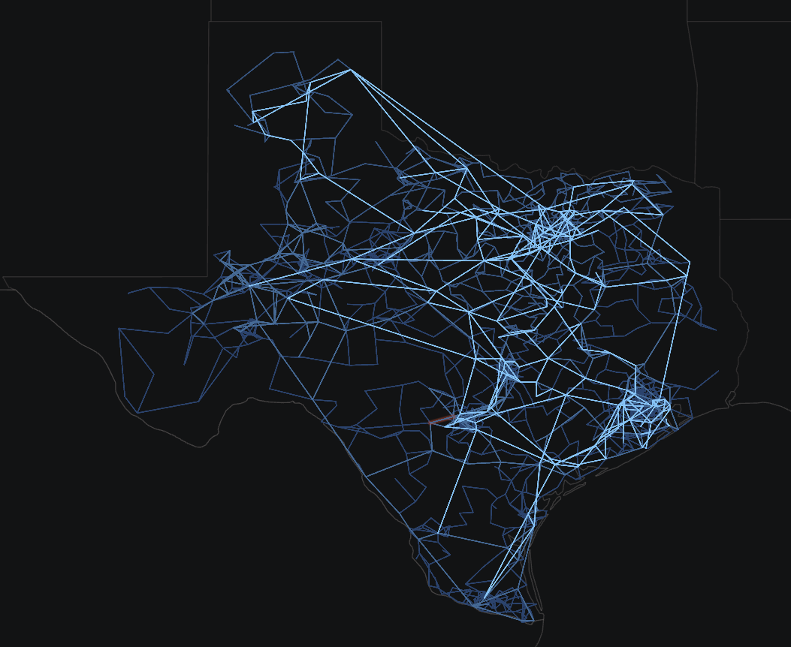

# Synthetic Texas (ACTIVSg2000)

## One-Line Diagram

Figure 1: One-line diagram of the ACTIVSg2000 case.[^1]

## Development

The complete optimal power flow of this case is modeled in GridKit.

The economic dispatch results are provided [here](../../../examples/OptimalPowerFlow/EconomicDispatch/README.md).

[^1]: Texas A&M University, [Grid Repository](https://electricgrids.engr.tamu.edu/electric-grid-test-cases/activsg2000/).
