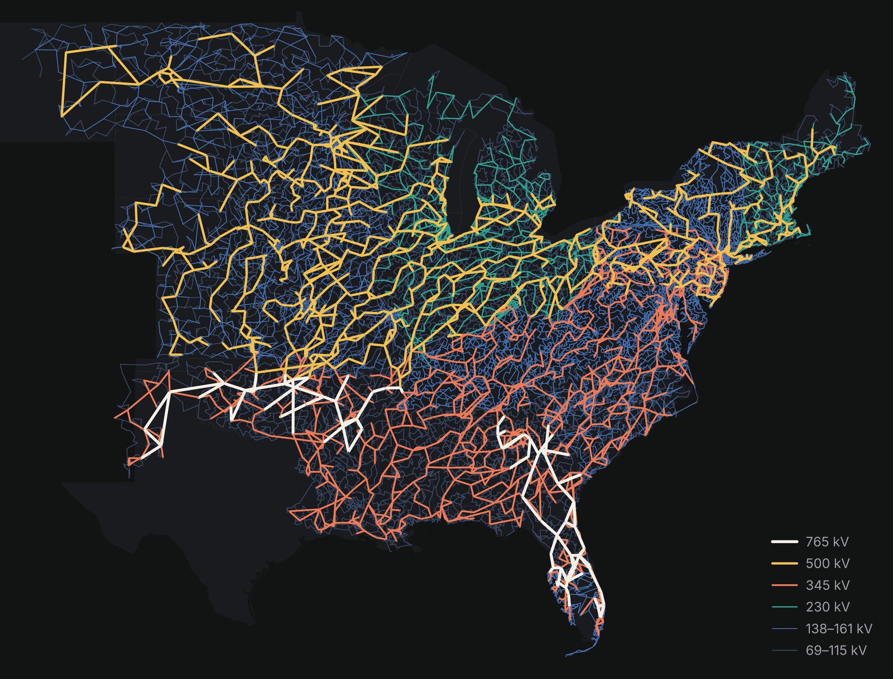

# Synthetic Eastern United States (ACTIVSg70k)

## One-Line Diagram

Figure 1: One-line diagram of the ACTIVSg70k case.[^1]

## Development

Unimplemented models:

- `ESAC1A`
- [ESAC6A](../../../GridKit/Model/PhasorDynamics/Exciter/ESAC6A/README.md)
- [ESDC2A](../../../GridKit/Model/PhasorDynamics/Exciter/ESDC2A/README.md)
- [ESST4B](../../../GridKit/Model/PhasorDynamics/Exciter/ESST4B/README.md)
- [EXAC1](../../../GridKit/Model/PhasorDynamics/Exciter/EXAC1/README.md)
- [EXAC2](../../../GridKit/Model/PhasorDynamics/Exciter/EXAC2/README.md)
- [EXPIC1](../../../GridKit/Model/PhasorDynamics/Exciter/EXPIC1/README.md)
- [GGOV1](../../../GridKit/Model/PhasorDynamics/Governor/GGOV1/README.md)
- [IEEEG1](../../../GridKit/Model/PhasorDynamics/Governor/IEEEG1/README.md)
- [REEC_A](../../../GridKit/Model/PhasorDynamics/Controller/REECA/README.md)
- [SCRX](../../../GridKit/Model/PhasorDynamics/Exciter/SCRX/README.md)
- `WT3E1`
- `WT3G1`
- `WT3P1`
- `WT3T1`

Simulation and validation studies have not yet been implemented for this case.

[^1]: Texas A&M University, [Grid Repository](https://electricgrids.engr.tamu.edu/electric-grid-test-cases/activsg70k/).
