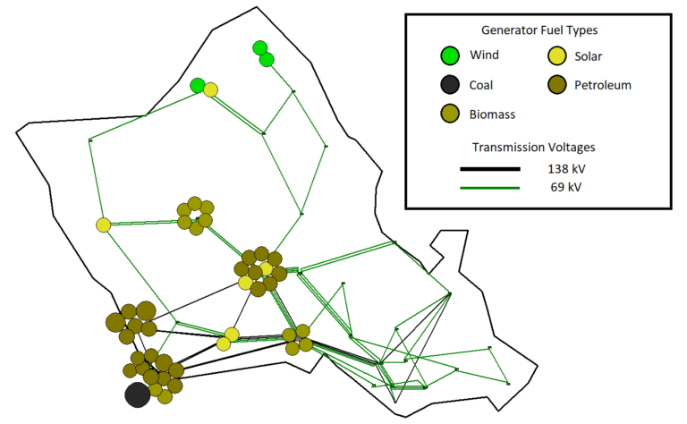

# Synthetic Hawaii

## One-Line Diagram

Figure 1: One-line diagram of the synthetic Hawaii case.[^1]

## Development

The distributed validation case uses TGOV1, IEEET1, and REECB. The source system also uses these controls.

- [ESST1A](../../../GridKit/Model/PhasorDynamics/Exciter/ESST1A/README.md)
- [ESST4B](../../../GridKit/Model/PhasorDynamics/Exciter/ESST4B/README.md)
- [EXST1-PTI](../../../GridKit/Model/PhasorDynamics/Exciter/EXST1-PTI/README.md)
- [GGOV1](../../../GridKit/Model/PhasorDynamics/Governor/GGOV1/README.md)
- [IEEEG1](../../../GridKit/Model/PhasorDynamics/Governor/IEEEG1/README.md)
- [REECA](../../../GridKit/Model/PhasorDynamics/Controller/REECA/README.md)

This case was validated against PowerWorld. The comparison results are provided [here](../../../examples/PhasorDynamics/Validation/Hawaii/README.md).

[^1]: Texas A&M University, [Electric Grid Test Case Repository](https://electricgrids.engr.tamu.edu/electric-grid-test-cases/).
