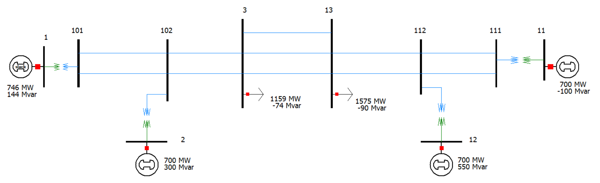

# Two-Area Kundur

## One-Line Diagram

Figure 1: One-line diagram of the TwoArea case.[^1]

## Development

This case is derived from the Kundur two-area system and includes exciters for use in GridKit.

The exciters use the rate feedback `Kf = 0.1` and `Tf = 1.0` from the DC1C sample data in IEEE 421.5-2016, Annex H, because the generators lose synchronism without it. These values are not specific to this case. All four exciters use `Vrmax = 3.0` for consistency.

Simulation and validation studies have not yet been implemented for this case.

[^1]: PowerWorld, [Simulator Help](https://www.powerworld.com/WebHelp/).
