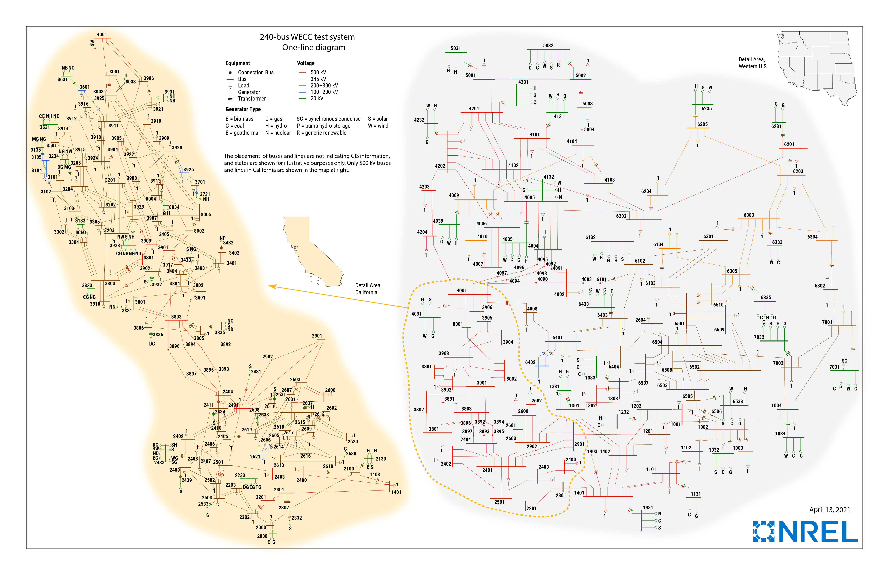

# Western Electricity Coordinating Council (WECC)

## One-Line Diagram

Figure 1: One-line diagram of the WECC240 case.[^1]

## Development

The complete dynamics of this case are modeled in GridKit.

This case was validated against PowerWorld. The comparison results are provided [here](../../../examples/PhasorDynamics/Validation/WECC240/README.md).

## WECC240Relay

[WECC240Relay](./WECC240Relay.case.json) protects the Southern California
(area 2) 500 kV network. Each of its 19 lines is a BranchBreakers with a 0.05 s
breaker operating time and an inverse-time overcurrent relay at each end. Line
LUGO-SERRANO is split at mid-line bus 2999 into two sections, each with half the
series impedance and its station's half of the line charging, so the case
starts from the WECC240 operating point and a fault event at bus 2999 faults
the line itself.

Every relay uses the IEEE C37.112 very-inverse curve with time dial 0.05 and
lockout. Its pickup is twice its pre-fault current, with a 15 pu floor,
rounded up to 0.1 pu; the factor of two covers the post-contingency loading of
the neighboring lines. The study is provided
[here](../../../examples/PhasorDynamics/DynamicSimulation/WECC240Relay/README.md).

[^1]: [National Laboratory of the Rockies Test Case Repository](https://www.nlr.gov/grid/test-case-repository).
