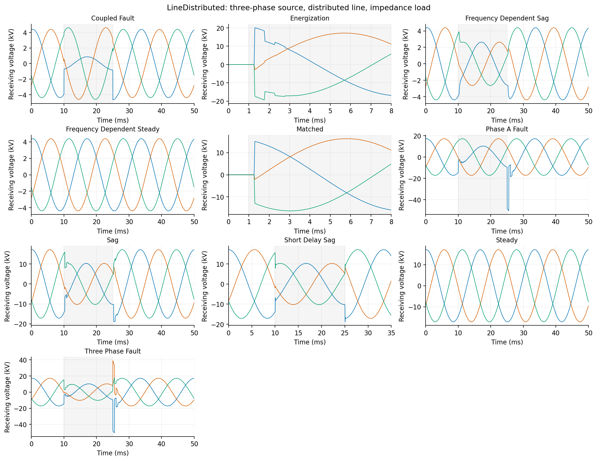
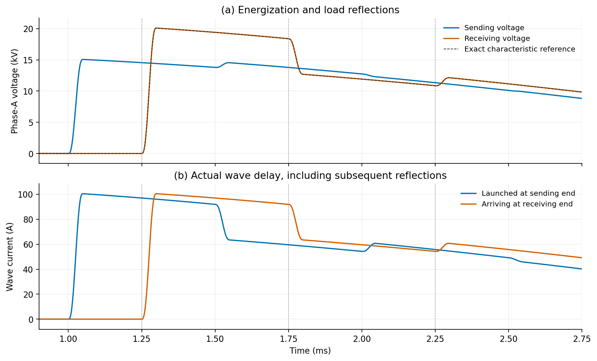

# LineDistributed

A standalone, instantaneous three-phase EMT circuit using the existing
adaptive signal-delay implementation. The reusable line equations and rational
realizations are local to this example. The only shared build change is its
entry in `examples/CMakeLists.txt`.



## Run

Use a GridKit build with SUNDIALS KLU, the branch's IDAS step-check patch, and
Enzyme-enabled system assembly. All example derivatives are analytic; Enzyme
is required by the existing `PhasorDynamics::SystemModel` assembly selection.
Python plotting and independent validation require NumPy and Matplotlib.

From the repository root:

```sh
cmake -S . -B build
cmake --build build --target line_distributed line_distributed_tests -j 10
build/examples/EMT/LineDistributed/line_distributed_tests examples/EMT/LineDistributed
build/examples/EMT/LineDistributed/line_distributed examples/EMT/LineDistributed/demo.json
python3 examples/EMT/LineDistributed/validate.py examples/EMT/LineDistributed/results \
  --executable build/examples/EMT/LineDistributed/line_distributed
python3 examples/EMT/LineDistributed/plot.py
```

`results/` contains reproducible inputs, sampled waveforms, actual accepted
steps, statistics, and validation results. It is ignored by Git. PNG and editable
SVG figures are written to **this example's `plots/` directory**, never to
`build/`. The figures are regenerated from the saved data. These explicit
example targets are excluded from the default build and CTest suite.

The executable also accepts a single run object and an optional results
directory. `demo.json` merges each named run into its `defaults` object.
Each completed run writes `statistics.json`; a failed rerun removes that
success marker before starting.

## Circuit

```text
three-phase source e -- Rs -- v1 -- LineDistributed -- v2 -- R or RL load
                                                       |
                                             fault conductance to ground
```

The source is 22 kV line-to-line RMS at 60 Hz, behind 30 ohms per phase.
The grounded-wye load is 600 ohms per phase, except for the 300-ohm matched
case. The frequency-dependent sag case adds 50 mH per phase. All quantities
are SI, and input source magnitudes are phase-to-ground RMS.

| Run | Purpose |
| --- | --- |
| `energization` | Zero initial energy, delayed first arrival and reflections |
| `matched` | Reflection-free receiving termination |
| `steady` | Sinusoidal initialization without a startup transient |
| `sag` | Source sag and recovery |
| `phase_a_fault` | Phase-A fault application and clearing |
| `three_phase_fault` | Three-phase fault application and clearing |
| `frequency_dependent_steady` | Rational admittance and propagation |
| `frequency_dependent_sag` | Frequency-dependent line with an RL load |
| `coupled_fault` | Coupled phases and unequal modal delays |
| `short_delay_sag` | Implicit integration with steps longer than the 20-us delay |

Events use finite, C2 transitions: `6*x^5 - 15*x^4 + 10*x^3` for normalized
time `x` in [0,1], with constant endpoints outside that interval. Source-event
`value` is an additive amplitude change; fault-event `value` is conductance in
siemens. `phases` uses one-based phase numbers. Faults use 50-ohm shunts and
50-us transitions. The driver stops at transition boundaries and caps the
step at one eighth of the transition duration while each transition is active.
Outside these intervals, `h_max` is independent of the transport delay.

**Ideal discontinuous switching is not supported by the current history
controller.** These are finite-transition fault and source events, not ideal
breaker models. The example does not reset history at event boundaries.

## Line and rational operators

The implementation follows the [LineDistributed specification](../../../GridKit/Model/EMT/Component/Line/LineDistributed/README.md).
For conductor-to-phase mapping P, characteristic currents c, incident currents
a, and reflected currents r:

```math
\begin{aligned}
c_1 &= Y_c[P^T v_1], & c_2 &= Y_c[P^T v_2],\\
a_1 &= H[r_2], & a_2 &= H[r_1],\\
0 &= -r_1+2c_1-a_1, & 0 &= -r_2+2c_2-a_2,\\
i_1 &= P(a_1-c_1), & i_2 &= P(a_2-c_2).
\end{aligned}
```

Line currents `i1` and `i2` are positive **into the buses**. The recorded load
current is positive **into the load**. The circuit equations are

```math
(e-v_1)/R_s+i_1=0,\qquad
i_2-i_{load}-G_f(t)v_2=0,\qquad
v_2-R_{load}i_{load}-L_{load}\dot i_{load}=0.
```

Each terminal has independent admittance states. Each direction has independent
input/output factor states and modal histories. Only coefficient data are shared
between instances. `LineDistributed` supports N phases and K mapped conductors;
the demonstration circuit requires N=3. Multiple conductors may map to one
phase, and their injections are summed.

Propagation is the documented factorization

```math
H(s)=G_{out}(s)\,\mathrm{diag}(e^{-s\tau_m})\,G_{in}(s).
```

It consumes **current-wave** coefficients. Voltage-wave fits must be converted
to that convention before import. Matrix factors cannot generally be moved
across unequal delays. The example does not perform line-geometry calculations,
vector fitting, or passivity enforcement.

| File | Responsibility |
| --- | --- |
| `VectorFit.hpp` | Pole/residue parsing and real rational realization |
| `LineDistributed.hpp` | Conductor mapping and two-ended line equations |
| `LinearDAE.hpp` | Sparse constant equation assembly and initialization solve |
| `LineCircuit.*` | Source/load equations and existing GridKit component adapter |
| `Input.hpp`, `main.cpp` | Study input, events, solver control, and output |
| `tests.cpp`, `validate.py` | Implementation checks and independent references |

`VectorFit` accepts full residue matrices with real poles or adjacent conjugate
pairs. The realization has K real states per pole, counting both members of a
pair. Memory coordinates are scaled by the pole magnitude so their units and
error scales match the input. Sparse equations and Jacobian structure are
assembled once. Runtime work updates matrix values and evaluates sparse sums.

The adapter publishes the input-factor output using K algebraic variables per
direction. The existing signal composer owns the corresponding delayed variables.
This gives the controller actual solver-variable indices for both its implicit
Jacobian and dense-output history checks. Pole-free three-phase cases have 27
unknowns; the supplied frequency-dependent cases have 39. Zero-delay channels
use the existing alias path.

## Input

`Yc` and each propagation factor can be inline JSON or a filename, resolved
relative to the containing JSON file. A fit has `rows`, `cols`, `D`, optional
`E`, `poles`, and `residues`. Residues are **pole-major**:
`residues[q][row][column]`. Complex numbers are `[real, imaginary]`.
Omitted D or E means zero. All line fits require E=0 and strictly stable poles.
The parser rejects invalid dimensions, conjugate pairs, mappings, and fields.

```json
{
  "N": 3,
  "K": 3,
  "conductors": [1, 2, 3],
  "Yc": "yc.fit.json",
  "H": {
    "input": "h-input.fit.json",
    "delays": [0.00035, 0.00025, 0.00025],
    "output": "h-output.fit.json"
  }
}
```

For a common delay, `"H": {"delay": 0.00025, "fit": "h.fit.json"}` expands
to an identity input factor, equal delays, and the supplied output factor.
Arbitrary full-matrix delay groups are not silently approximated by this
factorization. The exact schema is illustrated by the two supplied fit files.

`initialization` is `zero` or `sinusoidal`. Zero initialization also means a
zero source until an energization event. Sinusoidal initialization solves the
assembled complex-frequency equations and supplies consistent states,
derivatives, and analytical modal prehistory, including its derivative.

`solver.rel_tol` controls history reconstruction; native IDA uses one tenth of
that tolerance to leave an error budget for history checks. `history_abs_tol`
is in modal-current units. The circuit sets absolute tolerances by voltage and
current scales. `h_max=0` leaves smooth intervals uncapped. The monitor interval
`dt` does not set the internal step size.

## Fixtures and validation

`bergeron.fit.json` has Yc=I/300 S and H=I times a 250-us delay.
Its first received wave begins at 1.25 ms after energization at 1 ms. The load
reflection coefficient is 1/3, or zero in the matched case.



`frequency-dependent.fit.json` is a **manufactured passive rational fixture**,
not a fit to a measured cable. In its real orthogonal modal basis:

```math
y_m(s)=g_m\left(1+\frac{200}{s+2000}\right),\qquad
h_m(s)=\frac{1000}{s+5000}e^{-s\tau_m},
```

with g=(1/500,1/300,1/300) S and delays (350,250,250) us. The basis is stored
in the factor matrices. This supplies mutual coupling, unequal delays, and
nontrivial poles in both admittance and propagation. The deliberately strong
attenuation also permits a simple passivity bound: Re(y)>=g, |y|<=1.1g and
|h|<=0.2 imply Re[y(1+h)/(1-h)] and Re[y(1-h)/(1+h)] are at least 0.45g.
Both modal terminal eigenadmittances are therefore positive real.

The C++ tests check real/conjugate-pole realizations, both dynamic propagation
factors, analytical initialization, nonzero start times, K>N conductor mapping,
zero-delay aliases, invalid inputs, and finite-difference Jacobian products
including current-step delay coupling and active fault conductance.

The Python validator independently checks:

- Exact retarded-time Bergeron recursion, including switched conductances.
- A direct frequency-domain circuit solution for sinusoidal operation.
- An inverse-Fourier transient reference for the frequency-dependent sag,
  with a refinement check on the reference itself.
- KCL, first arrival, sampled reciprocity/passivity, tolerance refinement,
  compression, and comparison with steps capped below the delay.
- Accepted-step counts and actual steps longer than the delay.

The coupled, time-varying fault case uses refinement and compression/cap
comparisons; it has no independent external transient benchmark. Sampled
passivity checks on imported fits are diagnostics, not certificates. Physical
cable accuracy requires externally fitted data and a corresponding reference.
The sampled nodal-admittance check excludes ill-conditioned resonance points
and accounts for conversion roundoff; lossless nodal admittance has poles.

`results/validation.json` records measured errors and the executable hash.
Timing reports include CSV output and use three repetitions of the
frequency-dependent sag. Existing delay and IDA regression tests can be run
with `ctest --test-dir build -R 'SignalDelay|IDATest' --output-on-failure`.
