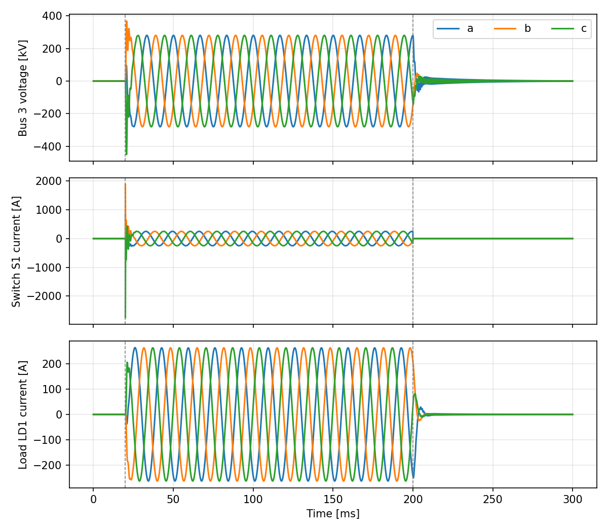

# ThreeBusBasic Line Energization

This study uses the reusable
[ThreeBusBasic case](../../../../cases/EMT/Toy/README.md).
Switch `S1` closes at 20 ms to energize the line and the load, and opens at
200 ms.

