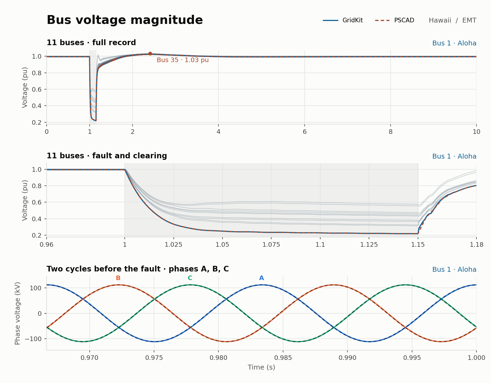
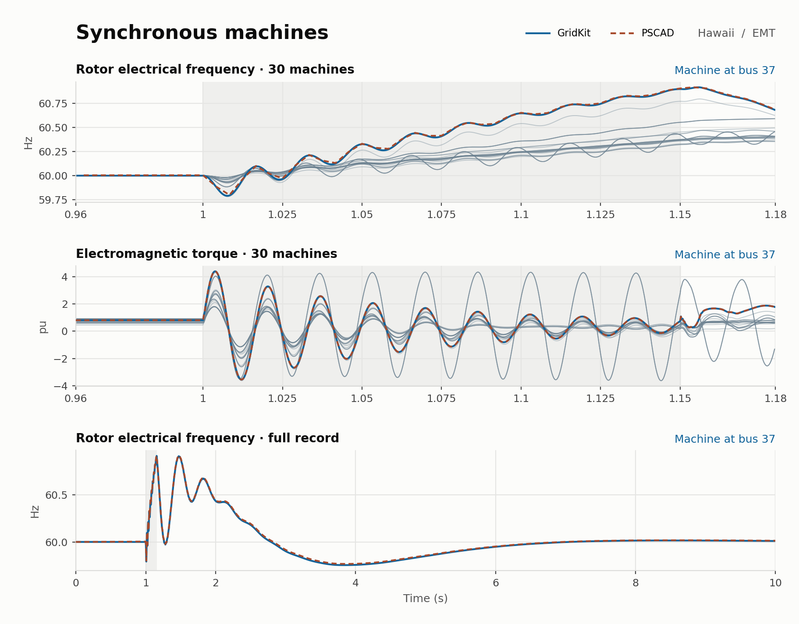
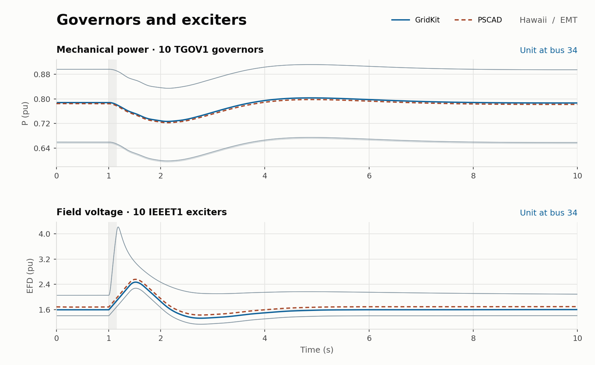
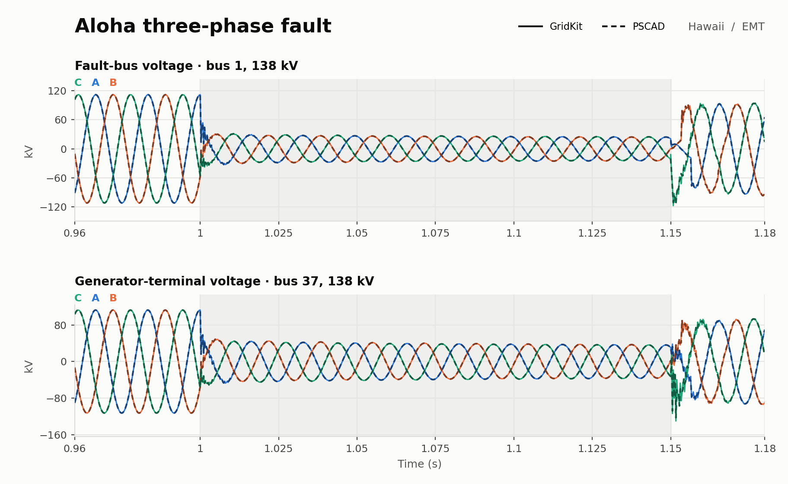
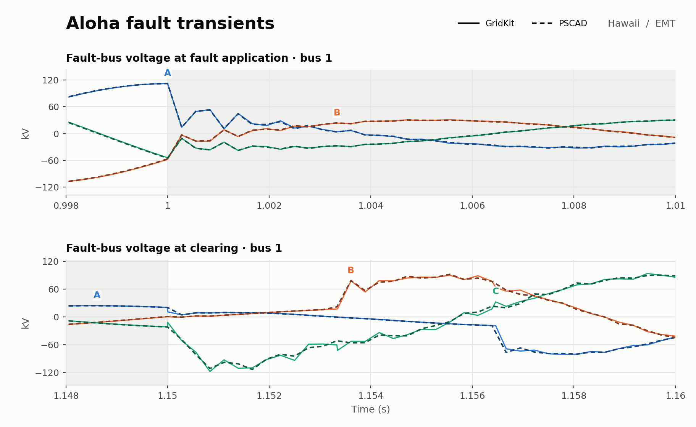
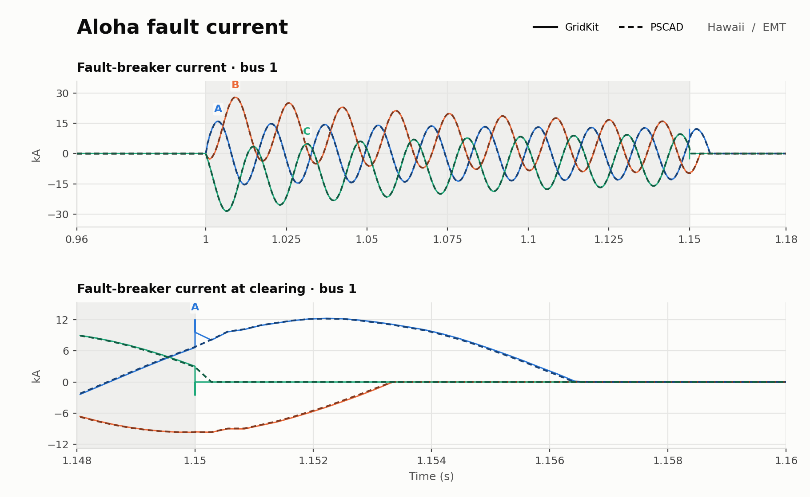

# Hawaii Validation

This study uses the reusable
[Hawaii case](../../../../cases/EMT/Hawaii/README.md) and compares it with a
PSCAD 5.1 simulation of the same system, whose
[project](reference/HawaiiEMT.pscx) is included. A three-phase reactor fault is
applied at bus 1 at 1 s and cleared at 1.15 s, each pole at its current zero.
The test compares generator speed with its
[reference](reference/Hawaii.omega.ref.csv).

Each file in [reference](reference) holds PSCAD outputs under the names of the
GridKit monitors. Generator speed, PMU voltage, mechanical power, field voltage
and plant commands are sampled at 240 Hz over the study. Torque, bus voltages
and currents are sampled at 3600 Hz from 0.95 s to 1.35 s.

