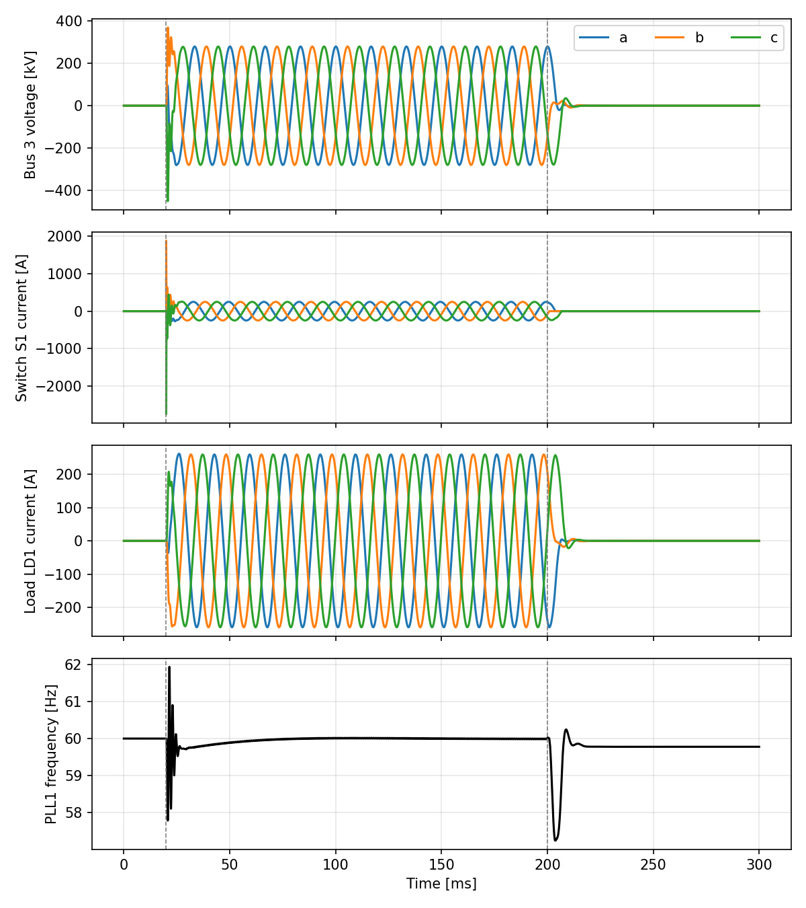

# ThreeBusBasic Validation

This study uses the reusable
[ThreeBusBasic case](../../../../../cases/EMT/Toy/README.md).
Switch `S1` closes at 20 ms to energize the line and the load. From 200 ms each
phase opens at its next current zero.

