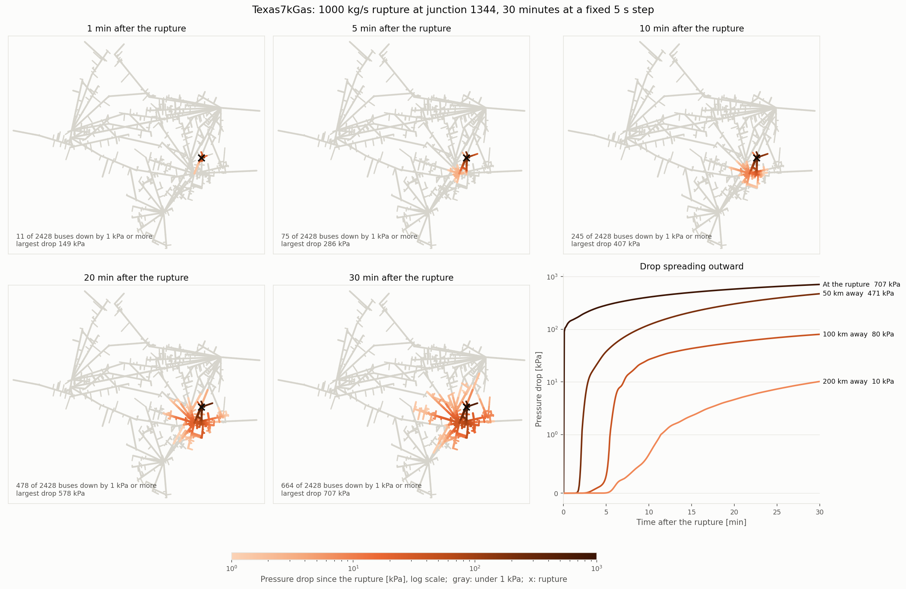

# Texas7kGas Pipeline Rupture

This example runs the gas network of the
[Texas7kGas case](../../../../cases/PhasorDynamics/Texas7kGas/Texas7kGas.case.json)
on its own. Gas-fired plants are fixed withdrawals at their initial fuel burn.
At 10 s, a rupture at junction 1344, north of Houston, withdraws 1000 kg/s. The
simulation then runs for 30 minutes at a fixed 5 s step. [`plot.py`](plot.py)
maps the pressure drop over the whole network and follows it at buses farther
from the rupture.

