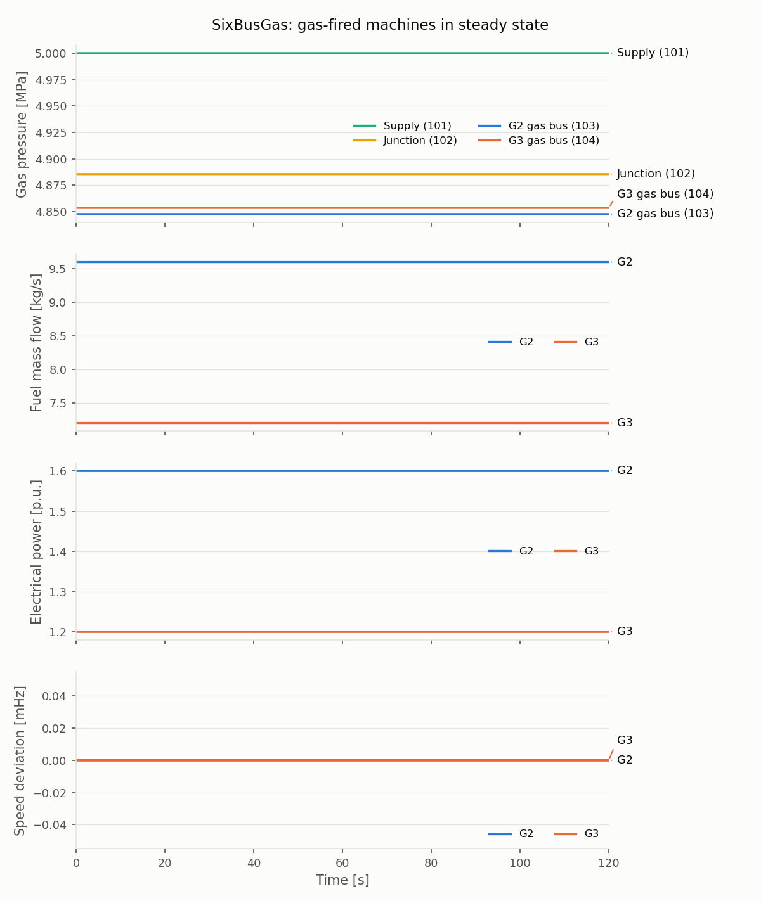

# SixBusGas Steady State

This study runs the reusable
[SixBusGas case](../../../../../cases/PhasorDynamics/Toy/README.md) without
disturbances. [`steady_state.py`](steady_state.py) writes the case in steady
state, and [`plot.py`](plot.py) plots the study output.

