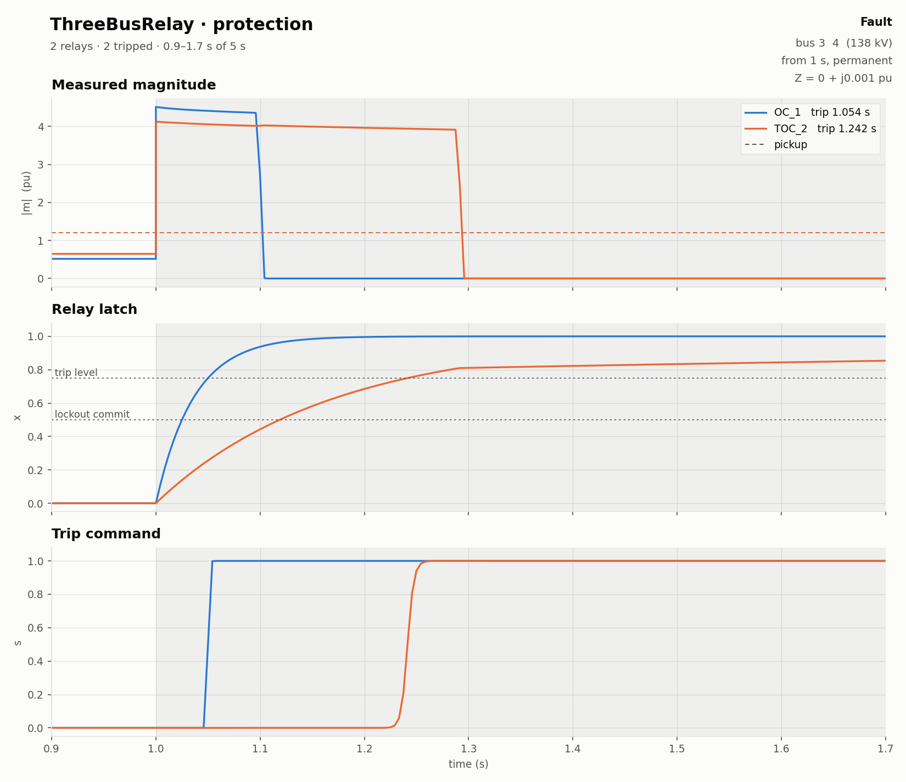
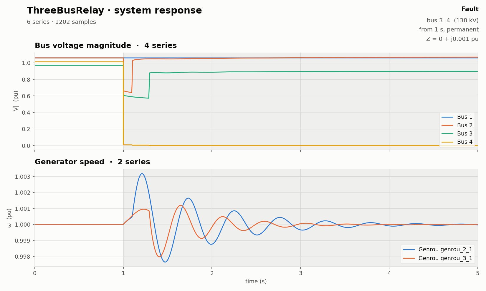

# ThreeBusRelay Line Protection

This study uses the reusable
[ThreeBusRelay case](../../../../../cases/PhasorDynamics/Toy/README.md), which
splits line `BR_1_2` of ThreeBusBasic at mid-line bus `4` into the
BranchBreakers sections `BR_1_3` and `BR_2_3`. A permanent fault at bus `4`
from 1 s is cleared by the definite-time relay `OC_1` on `BR_1_3`, which trips
at 1.054 s, and the inverse-time relay `TOC_2` on `BR_2_3`, which trips at
1.242 s. Each breaker opens 0.05 s after its trip command, and the remaining
system settles.

