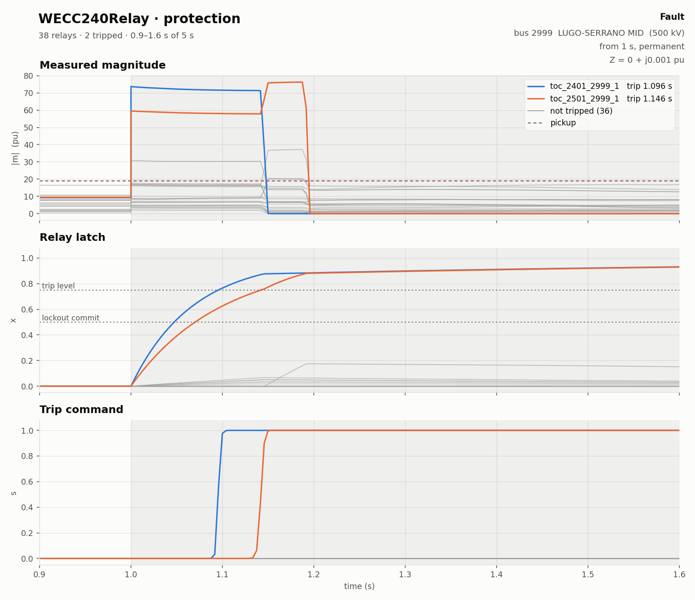
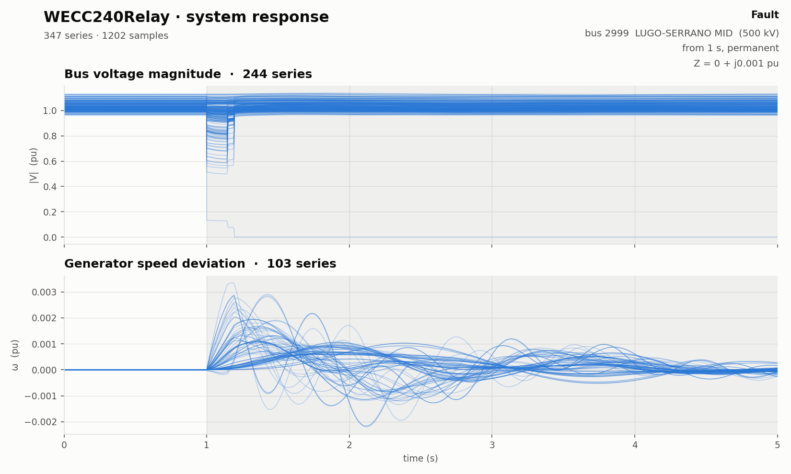

# WECC240Relay Line Protection

This study uses the reusable
[WECC240Relay case](../../../../cases/PhasorDynamics/WECC240/README.md), in
which every 500 kV line in Southern California (WECC240 area 2) is a
BranchBreakers with an inverse-time overcurrent relay at each end, 38 relays in
all. A permanent bolted fault at mid-line bus 2999 of LUGO-SERRANO from 1 s is
cleared by the two relays on that line: `toc_2401_2999_1` at LUGO trips at
1.096 s and `toc_2501_2999_1` at SERRANO trips at 1.146 s. Ten neighboring
relays start timing during the fault and reset once it is isolated, so only the
faulted line is removed and the rest of the system settles.

