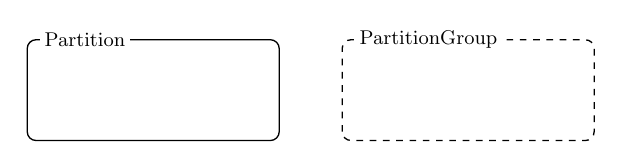
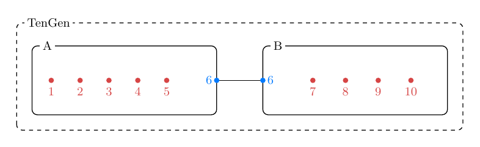

# Partition Diagrams

Red buses are internal. Blue buses are external, with a copy on each referencing
Partition's border. Black connectors join copies of the same bus; they are not
electrical branches. Groups organize Partitions without changing membership.

## Flat Partitions

A, BX, and BY are direct children of the root. [JSON](simple/flat.partition.json)

## Grouped Partitions

The same memberships, with BX and BY grouped under B. [JSON](simple/hierarchical.partition.json)

## Single Partition

One Partition with internal buses only. [JSON](single/single.partition.json)

## One Shared Bus

A and B share bus 3. [JSON](pair/one-bus.partition.json)

## Several Shared Buses

A and B share buses 3 and 4. [JSON](pair/multiple-buses.partition.json)

## Bus Shared by Three Partitions

A, B, and C share bus 4. [JSON](shared/shared.partition.json)

## Chain

A shares bus 4 with B; B shares bus 5 with C. [JSON](connectivity/chain.partition.json)

## Branching

A shares a different bus with each of B, C, and D. [JSON](connectivity/branching.partition.json)

## Cycle

Bus references form a cycle; the group hierarchy remains a tree. [JSON](connectivity/cycle.partition.json)

## Disconnected

A and B share bus 4; C has no external buses. [JSON](connectivity/disconnected.partition.json)

## Balanced Hierarchy

Two groups, each containing two Partitions. [JSON](hierarchy/balanced.partition.json)

## Mixed Hierarchy

The root contains both Partitions and a group. [JSON](hierarchy/mixed.partition.json)

## Deep Hierarchy

Groups can nest to arbitrary depth. [JSON](hierarchy/deep.partition.json)

## Single-Child Group

G wraps A without changing its membership. [JSON](hierarchy/single-child.partition.json)

## No Internal Buses

A's internal list is empty. [JSON](boundary/no-internal.partition.json)

## Empty Partition

Both bus lists can be empty under the schema. [JSON](boundary/empty.partition.json)

## One Reference to an External Bus

An external bus may appear in only one Partition. [JSON](boundary/single-reference.partition.json)

## TenGen

The TenGen integration-test topology shares bus 6; A contains the weak branch
5–6. [JSON](TenGen/TenGen.partition.json)

## WECC240

Four regions covering all 243 buses and 447 branches. Gray lines show physical
branches. Bus 8001 deliberately retains one unused external copy in Northwest;
all other external copies are used by components assigned to their Partition.
[JSON](WECC240/WECC240.partition.json)

The WECC image uses published Latkit npm releases, pinned in
[package.json](WECC240/package.json). Run `npm run render` from `WECC240/` to
regenerate it. The other figures have editable TeX sources beside their images.
