# Partition Schema & Rules

## TYPES

A `Partition` has the following properties:
- A `name` of type `str` identifying the partition
- A `external` of type `List<int>` containing the bus numbers external to the partition.
- A `internal` of type `List<int>` containing the bus numbers internal to the partition.

A `PartitionGroup` has the following properties:
- A `name` of type `str` identifying the partition group.
- A `partitions` list of type `List<Partition|PartitionGroup>` containing any combination of partitions and partition groups.

## RULES


- The root object is a `PartitionGroup`.
- Internal buses are unique to one `Partition`.
- Every bus must be exlusively `external` or `internal`.

## PROPERTIES

- A `PartitionGroup` can always be written as a flat set of `Partitions`


## Regarding Components and SignalNodes

Until we support `internal`/`external` signals, we should enforce:
- Assign each `Component` with bus ports to the first `Partition` containing all its bus ports. Reject partition if none exists. 
- If a `Component` assigned to a partition is connected to an unassigned `Component`, assign to the same partition. Repeat until no further assignments occur, then reject the partition if a `Component` is left unassigned or conflicts occur.

## Diagram Gallery

Red dots are internal buses. Bright blue dots are external buses, repeated on
the border of every Partition that references them. Copies with the same bus
number represent one bus; black connectors join those copies, not electrical
branches. A bus shared by three or more Partitions has a copy on each border.
**Solid enclosures are Partitions; dashed enclosures are PartitionGroups.**
Groups organize Partitions without changing their bus memberships.

| Example | Possibilities shown |
| --- | --- |
| [Flat](#flat-partitions) and [grouped](#grouped-partitions) | The same leaf memberships, flat and grouped |
| [Single partition](#single-partition) | Internal buses without external buses |
| [One](#one-shared-bus) or [several shared buses](#several-shared-buses) | Two Partitions sharing external buses |
| [Shared bus](#bus-shared-by-three-partitions) | One bus referenced by three Partitions |
| [Connectivity](#chain) | Chain, branching, cycle, and disconnected references |
| [Hierarchy](#balanced-hierarchy) | Balanced, mixed, deep, and single-child groups |
| [Boundary cases](#no-internal-buses) | Empty lists and a bus referenced by only one Partition |

These are representative combinations, not an exhaustive catalog: the schema
allows arbitrary nesting and numbers of Partitions and buses. The examples
describe membership only; they do not include electrical cases or demonstrate
solver admissibility.

Each figure has editable TeX, a vector PDF, a PNG preview, and its corresponding
JSON linked below.

### Flat Partitions

The root contains A, BX, and BY directly. Bus 3 is referenced by A and BX,
bus 4 by A and BY, and bus 7 by BX and BY.

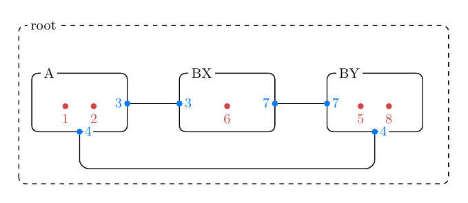

[JSON](simple/flat.partition.json) · [TeX](simple/flat.tex) · [PDF](simple/flat.pdf)

### Grouped Partitions

The same bus positions, leaf memberships, and references as above. Only the
group B enclosure is added around BX and BY; it assigns no buses to the group.

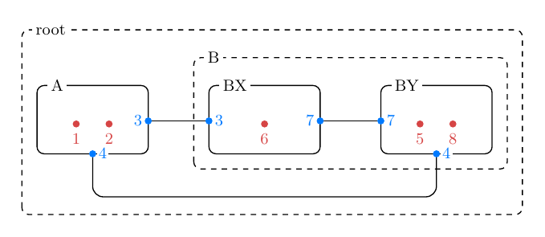

[JSON](simple/hierarchical.partition.json) · [TeX](simple/hierarchical.tex) · [PDF](simple/hierarchical.pdf)

### Single Partition

The root contains one leaf with two internal buses and an empty external list.

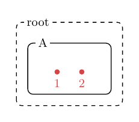

[JSON](single/single.partition.json) · [TeX](single/single.tex) · [PDF](single/single.pdf)

### One Shared Bus

A and B both reference external bus 3.

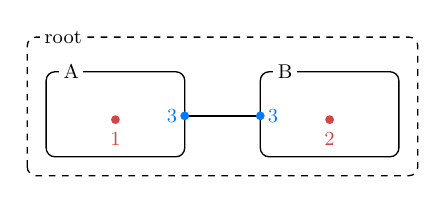

[JSON](pair/one-bus.partition.json) · [TeX](pair/one-bus.tex) · [PDF](pair/one-bus.pdf)

### Several Shared Buses

The same two Partitions can share more than one external bus, here 3 and 4.
Both buses appear on both A's and B's borders, with matching copies connected.

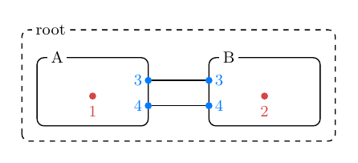

[JSON](pair/multiple-buses.partition.json) · [TeX](pair/multiple-buses.tex) · [PDF](pair/multiple-buses.pdf)

### Bus Shared by Three Partitions

A, B, and C all reference the same external bus 4. Each Partition has a blue
copy of bus 4 on its border, and the black connectors join all three copies.

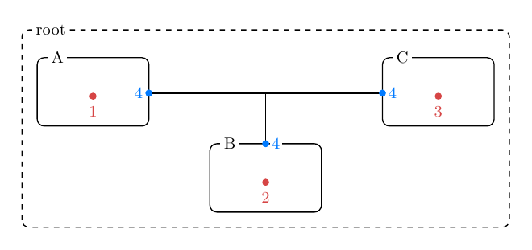

[JSON](shared/shared.partition.json) · [TeX](shared/shared.tex) · [PDF](shared/shared.pdf)

### Chain

A shares bus 4 with B; B shares bus 5 with C.

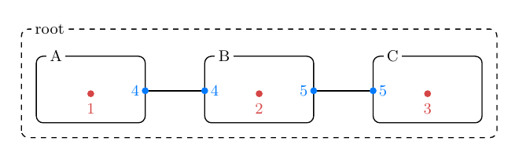

[JSON](connectivity/chain.partition.json) · [TeX](connectivity/chain.tex) · [PDF](connectivity/chain.pdf)

### Branching

A shares a different external bus with each of B, C, and D.

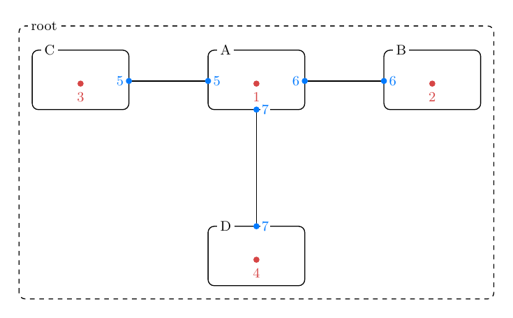

[JSON](connectivity/branching.partition.json) · [TeX](connectivity/branching.tex) · [PDF](connectivity/branching.pdf)

### Cycle

A, B, and C share buses pairwise in a cycle. The group hierarchy remains a tree;
external-bus references need not form a tree.

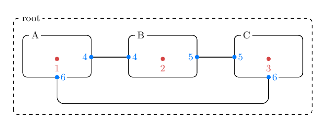

[JSON](connectivity/cycle.partition.json) · [TeX](connectivity/cycle.tex) · [PDF](connectivity/cycle.pdf)

### Disconnected

A and B share bus 4. C has no external-bus references.

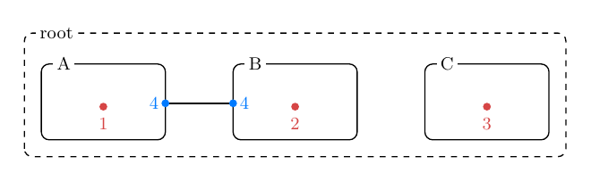

[JSON](connectivity/disconnected.partition.json) · [TeX](connectivity/disconnected.tex) · [PDF](connectivity/disconnected.pdf)

### Balanced Hierarchy

The root contains two groups, each containing two leaves. This and the next two
examples use the same four-leaf reference chain with different grouping and names.

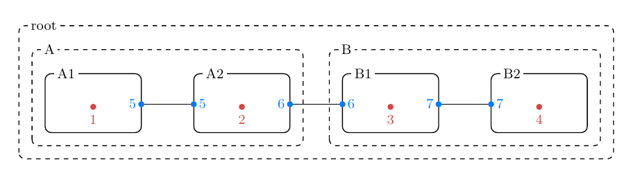

[JSON](hierarchy/balanced.partition.json) · [TeX](hierarchy/balanced.tex) · [PDF](hierarchy/balanced.pdf)

### Mixed Hierarchy

The root contains both leaves and a group: A, B containing BX and BY, then C.

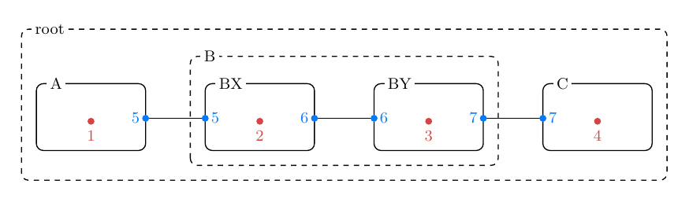

[JSON](hierarchy/mixed.partition.json) · [TeX](hierarchy/mixed.tex) · [PDF](hierarchy/mixed.pdf)

### Deep Hierarchy

B contains leaf B1 and group C, which contains C1 and C2. This recursive pattern
can be extended to arbitrary depth.

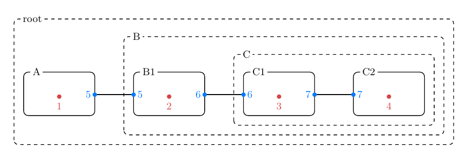

[JSON](hierarchy/deep.partition.json) · [TeX](hierarchy/deep.tex) · [PDF](hierarchy/deep.pdf)

### Single-Child Group

A group can contain just one child. Here G wraps leaf A without changing it.

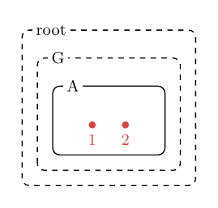

[JSON](hierarchy/single-child.partition.json) · [TeX](hierarchy/single-child.tex) · [PDF](hierarchy/single-child.pdf)

### No Internal Buses

A has an empty internal list and references bus 3. An empty internal-bus list
does not establish whether the Partition has device states.

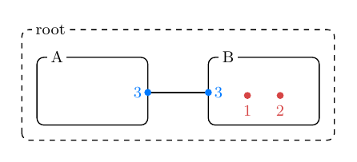

[JSON](boundary/no-internal.partition.json) · [TeX](boundary/no-internal.tex) · [PDF](boundary/no-internal.pdf)

### Empty Partition

A has neither internal nor external buses. The schema accepts both lists empty;
it does not establish a usable solver partition.

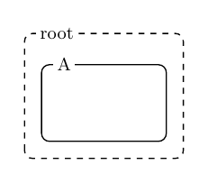

[JSON](boundary/empty.partition.json) · [TeX](boundary/empty.tex) · [PDF](boundary/empty.pdf)

### One Reference to an External Bus

Bus 2 is external but appears in only A's external list. The schema imposes no
minimum number of Partitions referencing an external bus. Its single border
copy needs no connector.

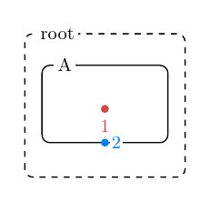

[JSON](boundary/single-reference.partition.json) · [TeX](boundary/single-reference.tex) · [PDF](boundary/single-reference.pdf)

## Rebuilding Figures

Figures reuse the [EMT diagram style](../../../docs/Figures/EMT/diagram-style.tex)
through [diagram-style.tex](diagram-style.tex). Run from the figure's directory,
for example `simple/`:

```bash
pdflatex -interaction=nonstopmode -halt-on-error flat.tex
pdftoppm -png -r 160 -singlefile flat.pdf flat
```
