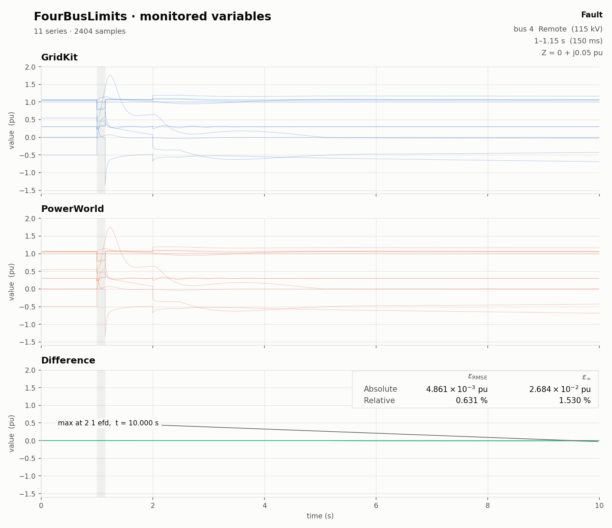

# FourBusLimits Validation

This study uses the reusable
[FourBusLimits case](../../../../../cases/PhasorDynamics/Toy/README.md).

A fault at bus 4 from 1.0 to 1.15 s is followed by opening branch 1–4 at 2.0 s,
which leaves the charged branch 2–4 open at bus 4 and raises the plant and machine
voltages. Together, the two events drive these limits:

- REPCA saturates at `Qmax` during the fault and at `Qmin` after the opening.
- REECB limits the REPCA voltage reference to `Vmax` during the fault.
- REGCA holds the plant voltage at `Vhvmax` after the opening.
- ESDC1A holds the field voltage at zero after the opening.

The monitored variables are compared against `reference/FourBusLimits.ref.csv`,
from PowerWorld 24. To reproduce it, load `reference/FourBusLimits.aux` into an
empty case and run its `FourBusLimits` contingency.

