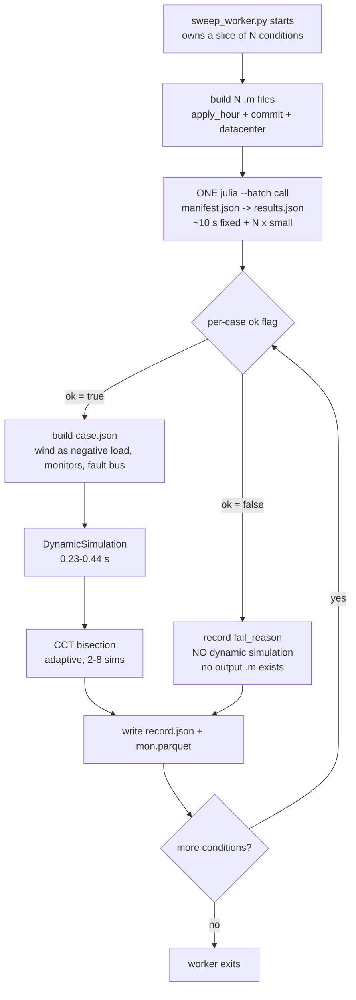
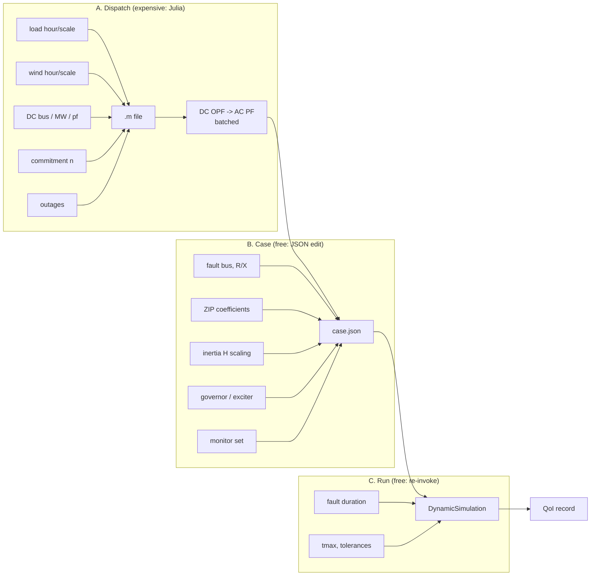

# Datacenter load UQ: campaign plan

Status: **planning**, nothing in this document is implemented yet.
Companion to [`m_to_case_helper.md`](m_to_case_helper.md), which covers the
`.aux`/`.dyr` -> `case.json` conversion chain this campaign sits on top of.

Every number below is tagged with where it came from. Numbers marked
*(measured)* were produced by a tool run in this workspace; numbers marked
*(assumed)* are placeholders that still need computing.

---

## 1. The question

> **Where, and how much, large datacenter load can be added to a grid before
> dynamic security degrades, given renewable-driven variability in system
> inertia?**

Why this framing:

* **Topical.** Large, geographically concentrated, fast-growing datacenter load
  is currently a dominant interconnection concern. A defensible answer has an
  immediate audience.
* **It frees us from one historical year.** The 8760 series becomes *background
  variability*; the datacenter is a **design variable** we place and size at
  will.
* **It is a real UQ problem, not an enumeration.** Aleatoric inputs (demand
  level, wind, hence inertia) give a QoI *distribution*; design inputs (bus, MW)
  shift that distribution.
* **It sets up the graph surrogate naturally.** "Which bus should I site load
  at" is intrinsically a graph question, which is what a GNN or graph
  transformer is for.

### What industry does today, and the gap

Planning practice (NERC TPL-001 and utility equivalents) studies a **handful of
hand-picked cases**: summer peak, winter peak, light load, and increasingly a
high-renewable case. Not 8760, because dynamic simulation has historically been
too expensive to do otherwise.

That selection was designed for thermal grids, where peak genuinely was the
stressing condition. Our data says it no longer is:

| | *(measured)* |
|---|---|
| inertia at the peak-demand hour | **96.5th percentile** |
| lowest-inertia hours | demand ~1150-1200 MW, wind ~700 MW |
| `corr(inertia, demand)` | **+0.686** |
| `corr(inertia, wind)` | **-0.843** |

The peak hour is one of the *safest* hours of the year. **If cheap simulation
lets us characterise the whole distribution instead of four points, we can ask
whether the standard screening cases still bound the risk.** That is the
contribution.

---

## Glossary

Terms that recur throughout and are easy to misread. Several mean the opposite
of the obvious guess.

| Term | Meaning |
|---|---|
| **Operating condition** | One (hour, commitment) pair. The hour fixes load and wind; the commitment fixes which thermal units are online. 20 hours x 2 commitments = 40 conditions in `aleatoric1`. |
| **Baseline** | The *no-datacenter* run **for a given operating condition**, not a single global reference. Every condition has its own, because `dCCT` must compare the same hour and the same commitment with and without the datacenter. |
| **Net load** | System demand minus wind, aggregated. What the thermal fleet must serve. Not a per-bus subtraction (see section 3). |
| **CCT** | Critical clearing time: the longest fault the system survives. Found by bisecting fault duration. Larger is safer. |
| **`cct_max` / "the cap"** | The top of the bisection bracket, **0.5 s**, set at a credible protection time (EHV primary clearing ~0.05-0.10 s, breaker-failure backup ~0.25-0.50 s). We do not search past it because a longer fault is not a contingency any protection scheme permits. |
| **Censored** | **CCT is at or above the cap** - the system survived the longest fault we are willing to consider. The stored `0.5` is a **lower bound, not a measurement**. Counter-intuitive: censored means *very stable*, not "failed". |
| **Uncensored / measured** | The bisection found the boundary inside the bracket, so CCT < 0.5 s and the value is a real number. |
| **Uncensored pair** | A (baseline, sited) pair where **both** sides are measured, so `dCCT` is a number rather than a bound. If either side is censored, only an inequality is known. |
| **Hosting capacity** | Largest datacenter MW at a bus that is both deliverable and secure. Interval-censored between ladder rungs, and right-censored if the top rung still succeeds. |
| **`LOCALLY_INFEASIBLE`** | The OPF could not serve the load at all. A **result** (deliverability binds), not an error to retry. |
| **Deliverable** | The dispatch solved. Distinct from "dynamics completed" - reporting them together once produced a badly wrong capacity table (section 7). |
| **Stage A / B / C** | Where a parameter binds: A = dispatch (needs a Julia solve, ~2.5 s batched), B = `case.json` edit (free), C = re-run (free). See "Parallel sampling runs". |
| **`alphaZ` / `alphaI` / `alphaP`** | ZIP load shares: constant impedance / current / power, summing to 1. `alphaP = 1` means the load draws the same MW however far the voltage sags. |

---

## Physical intuition

The rest of this document assumes some power-system dynamics. This section
supplies it, for a reader comfortable with sampling and statistics but not with
transient stability. Nothing here is specific to our case; it is the background
that makes the design choices make sense.

### Why a short circuit is dangerous

A generator is a spinning mass driven by a turbine and braked by the electrical
power it exports. In normal operation those balance and the rotor turns at
constant speed.

A short circuit collapses the voltage near the fault. Power transfer depends on
voltage, so the generator can suddenly **no longer export** much of what its
turbine is still pushing in. The turbine does not notice for several seconds —
steam valves and water gates are slow — so the excess energy goes into
**accelerating the rotor**. The machine speeds up and its rotor angle runs ahead
of the rest of the system.

Clear the fault quickly and the machine can be pulled back into step: the
voltage recovers, it can export again, and it decelerates. Clear it too late and
it has gained so much angle that the restored electrical torque is no longer
enough to recover it. It then **pole slips** — runs permanently out of step with
the rest of the grid — and must be tripped.

The dividing line between those two outcomes is the **critical clearing time**.

### Why CCT is the right single number

CCT answers "how long can the protection take?" in the same units protection
engineers already use. It is a property of the *operating condition*, not of any
particular fault duration we might choose to simulate, so it does not inherit an
arbitrary modelling choice.

It also has a natural safety interpretation: compare CCT against how long
protection actually takes. EHV primary clearing is roughly 0.05-0.10 s, and
breaker-failure backup roughly 0.25-0.50 s. A condition with a CCT of 0.18 s
survives normal clearing comfortably but has little margin if a breaker fails.

This is also why we **cap the search at 0.5 s**. Beyond that the question stops
being meaningful: no protection scheme permits a multi-second fault, so "the
CCT is 3 s" and "the CCT is 8 s" are the same engineering statement — *it
survives anything credible*. Rather than spend simulations distinguishing them,
we stop and record the result as censored.

### Why inertia matters, and why wind changes it

Acceleration is torque divided by inertia. A heavy spinning fleet gains angle
slowly for the same power imbalance, so there is more time to clear the fault.
Inertia is literally the system's thermal mass against disturbances, and it is
supplied by **synchronous machines that happen to be online**.

This is the hinge of the whole study. Inertia is not a fixed property of the
grid; it is a property of *what is running right now*. Wind displaces
synchronous machines, so hours with a lot of wind can have substantially less
inertia than hours with the same demand and little wind. Hence the premise:
**renewable output makes system inertia vary hour to hour**, and therefore
makes transient security vary hour to hour.

It is also why a wind generator left modelled as a synchronous machine would
quietly ruin the study: it would contribute inertia that real inverter-based
wind does not have, suppressing exactly the variation we are trying to measure
*(2,766 MW.s of it, measured on this case)*.

### What "unstable" looks like, and what COI means

With many machines, "did it stay stable?" needs care. Every machine's angle
moves after a disturbance; what matters is whether they move **together**.

The **centre of inertia** is the inertia-weighted average angle of the fleet —
the system's collective swing. Measuring each machine against the COI separates
"the whole system swung" (fine) from "this machine left the group" (not fine).
We declare instability when any machine exceeds 180 degrees from the COI, which
is the standard pole-slip criterion.

A naive alternative, "the final angle spread is close to the maximum spread",
was tried and rejected: the post-fault spread settles at a nonzero value, so a
perfectly healthy case can look like sustained swinging.

### What a load does during a voltage dip: the ZIP model

Loads are not all the same when the voltage sags. The ZIP model splits a load
into three behaviours, weighted by `alphaZ`, `alphaI`, `alphaP`:

| share | behaves like | during a 50 % voltage dip, draws |
|---|---|---|
| `alphaZ` | a fixed **impedance** (a resistor) | **25 %** of nominal power |
| `alphaI` | a fixed **current** | 50 % of nominal power |
| `alphaP` | a fixed **power** | **100 %** of nominal power |

The difference is large and it matters for stability. Constant-impedance load
**sheds itself** during a dip, which unloads the system and helps it recover.
Constant-power load does the opposite: it keeps demanding full power at reduced
voltage, which means drawing *more current*, which depresses the voltage
further.

A datacenter is rectifier-and-UPS fed and behaves close to constant power, so it
is the unhelpful kind. That is not a detail — it is the physical reason a
datacenter is a more interesting load to add than, say, an equivalent amount of
industrial heating. It is also why the ZIP mix is treated as a study parameter
rather than inherited from the case defaults *(which are `alphaZ = 1`, pure
constant impedance)*.

### Why dispatch has to be re-solved for every condition

A dynamic simulation starts from a steady operating point, and that point must
be **self-consistent**: generation equals load plus losses, voltages satisfy the
network equations, and no unit exceeds its limits.

If we changed the load for a new hour without re-dispatching, the power flow
would hand the entire difference to one machine — the slack — because a power
flow leaves exactly one generator's output free. That machine would start the
simulation far outside its governor range, and every quantity we measured would
be an artifact of that, not of the physics we care about.

So each sampled condition gets a fresh dispatch. Two solves:

* **DC OPF** decides *who generates what*. It is a linear approximation that
  ignores voltage and losses, so it is fast and always has an answer. It is the
  economic decision.
* **AC PF** then solves the *real* network at that dispatch: actual voltages,
  actual losses. It is the physical check.

The loop between them exists because the DC step does not know about losses, so
the AC step always finds a small shortfall. Feeding that back once is enough
*(measured: a 27 MW discrepancy falls to 0.34 MW after one iteration)*.

### Two different ways a datacenter can be refused

Worth separating, because they are easy to conflate and we conflated them once:

* **Deliverability** — the OPF cannot serve the load at all. The branches into
  that bus are not rated to carry it. This is a *thermal* limit, it has nothing
  to do with dynamics, and it shows up as `LOCALLY_INFEASIBLE`.
* **Stability** — the load can be delivered, but the system no longer survives a
  credible fault.

Both are real answers to "can we put a datacenter here?", and in this case
deliverability binds first at several buses. Reporting them together produced a
badly wrong hosting-capacity table at one point, which is why they are now
always separated.

### Why censoring is not missing data

If a condition survives the longest fault we are willing to simulate, we have
not failed to measure it — we have learned that it is **safe by any standard we
care about**. The recorded 0.5 s is a lower bound.

The statistical consequence is that these runs must stay in the denominator.
Dropping them keeps only the conditions severe enough to have a measurable CCT,
which is a sample of the stressed half of the year, and every risk estimate
computed from it comes out too high *(measured: by 1.36x in one campaign and
4.31x in another)*.

---

## 2. Decisions taken

| Decision | Choice | Rationale |
|---|---|---|
| Wind representation | **negative `LoadZIP`, constant power** | see §3 |
| Contingency | **single, relocatable** fault | keep scope tight; mechanism already exists |
| Study order | **sampling-based UQ first**, graph surrogate second | surrogate needs the data the UQ run produces |
| PF/OPF stack | **PM.jl** | multiple formulations behind one `--pf-type` switch |
| Scaling to ACTIVSg2000/10k | **deferred** | separate problem, open later |

---

## 3. Wind: why negative load, not fixed

ACTIVSg200 has **no IBR model**; all 6 wind units are full `Genrou` synchronous
machines, so in the current model wind *contributes inertia*. Real wind
contributes essentially none.

Effect of the three options on the inertia range *(measured)*:

| scenario | H min | H max | range | ratio |
|---|---|---|---|---|
| wind varies (negative load) | 2,323 | 11,495 | 9,172 | **4.95x** |
| wind fixed at seed 117 MW | 6,032 | 11,495 | 5,463 | 1.91x |
| wind fixed at mean 306 MW | 4,249 | 11,495 | 7,245 | 2.71x |

Fixing wind discards **40 %** of the inertia variation and makes the
low-inertia tail unreachable (minimum rises 2,323 -> 6,032 MW.s). Leaving wind
as `Genrou` additionally keeps **2,766 MW.s** *(measured)* of fake inertia
present at all times, regardless of wind output.

**Wind is not being studied as an uncertain resource. It is the mechanism that
makes inertia vary.** That is why it has to move.

### Implementation

Keep wind as a generator in the `.m` so the PF/OPF sees a proper PV bus with
reactive support, then convert it to a negative `LoadZIP` when building
`case.json`, carrying both P and Q from the solved power flow.

```
power flow / OPF :  wind is a PV-bus generator   -> correct dispatch, correct Q
case.json        :  negative LoadZIP, alphaI=1   -> no inertia, no voltage control
```

`alphaI = 1` (constant **current**) is the right mix, **not** `alphaP = 1`.
Measured in Phase 1: a constant-power negative injection makes `IDACalcIC` fail
outright at high wind penetration, regardless of how many synchronous machines
are committed, while constant current converges. It is also the better physical
analogue, because a converter is current-controlled and REGCA's own interface is
`ipcmd`/`iqcmd`. The injection then falls linearly with `V` during a fault:
between constant power (held up, wrong for a current-limited converter) and
constant impedance (falls as `V^2`, too steep).

Pure constant impedance would be the worst choice: the injection would collapse
toward zero during the fault, equivalent to losing all wind at the worst instant.

```
alphaZ = 1 - alphaI - alphaP
P      = Pnom * [ alphaZ*(V/Vnom)^2 + alphaI*(V/Vnom) + alphaP ]
```

All 109 existing loads use `alphaI = alphaP = 0`, i.e. **pure constant
impedance**, so the stand-in has to set `alphaI` explicitly; inheriting the
default would collapse the wind injection as `V^2`.

**Stated limitation:** this models wind as a constant-power injection with no
inertia, no voltage control and no fault-ride-through dynamics. It is a **common
academic stand-in when IBR models are not wired into the case**, not a rigorous
representation, and it is conservative.

**On `Regca` as the eventual replacement** *(verified 2026-10-20)*: GridKit
implements it properly. The JSON parser accepts `Regca`, `Reecb` and `Repca`;
`test_phasor_converter_regca` is registered in CMake and passes **8/8**. Only
`Regcb` is a README-only stub. The honest caveat is that unit tests are not
system-level validation: no network case has yet run `Regca`, so swapping to it
is a project in itself, not a config change.

---

### Where the wind timeseries came from, and what it looks like

`wind.csv` did **not** ship with the case. It was generated with NREL's reV
tool: sites were selected up to `PMAX` near each wind generator bus, then
WIND Toolkit data gave realistic hourly output. A different year or site
selection can be substituted, so the campaign is **not tied to this exact
series**.

Validation against the `.m` nameplate ratings *(measured 2026-10-21)*:

| col | bus | PMAX MW | hours at nameplate | capacity factor |
|---|---|---|---|---|
| gen6 | 65 | 150.4 | 11.8 % | 41.7 % |
| gen22 | 104 | 99.0 | 16.8 % | 45.2 % |
| gen23 | 105 | 198.0 | 11.3 % | 42.7 % |
| **gen24** | **114** | **1.7** | **69.5 %** | **79.2 %** |
| gen25 | 115 | 150.0 | 10.5 % | 43.4 % |
| gen31 | 147 | 100.5 | 18.0 % | 47.7 % |

Fleet `PMAX` 699.6 MW, fleet capacity factor **43.8 %**, and the fleet sits at
or above 95 % of nameplate in **14 % of hours**.

* **No real limit violations.** The largest excursion above `PMAX` is
  3.7e-09 MW, pure float representation noise, and **zero** hours exceed by more
  than 1e-3 MW.
* **The top end is optimistic.** Each unit is clipped *at* nameplate rather than
  derated. The expectation was a peak near 88 % of nameplate after losses; if
  reV applied losses, the result was then clipped to `PMAX`. A ~0.88 derate, or
  regeneration with losses retained, would make the upper tail more realistic.
* **`gen24` is a scaling artifact, not a bad profile.** Verified in the `.m`:
  row 24 is `genfuel = wind`, bus 114, `PMAX` 1.700 MW, `MBASE` 2.040 MVA. Every
  wind unit in the case has `PMAX/MBASE` = 0.833 exactly, so the ratings are a
  uniform scaling of one plant definition and `gen24` is simply the smallest
  instance, roughly half a modern turbine. A reV site scaled down to 1.7 MW will
  sit at its cap most of the time because the site resource far exceeds that
  nameplate, which explains the 79.2 % capacity factor and the 70 % of hours at
  cap. At 0.24 % of fleet capacity it is immaterial either way.

Mapping check *(verified)*: the six `wind.csv` columns `gen6, gen22, gen23,
gen24, gen25, gen31` are 1-based row indices into `mpc.gen`, and all six land on
rows whose `genfuel` is `wind`. Those are the only six wind rows among 49
generators (25 coal, 17 natural gas, 6 wind, 1 nuclear).

None of this blocks the campaign: the pipeline pins `PMIN = PMAX = PG` for
non-dispatchable units, so the `.m` nameplate is overridden by the hourly
forecast anyway.

### "Net load" is an aggregate, not a per-bus subtraction

Worth stating plainly because the phrase "wind as negative load" invites the
wrong reading. **Wind is never moved to a load bus and no nearest-bus mapping
exists anywhere in the pipeline.**

* loads stay at their own **108 load buses**, driven by `demand.csv`
* wind injects at its own **6 generator buses** (65, 104, 105, 114, 115, 147)
* the network solves the flows between them, fully spatially

`net_load = sum(PD) - sum(wind PG)` is a **scalar** and is used for exactly one
purpose: sizing the unit commitment (how many thermal units to start). It never
touches the power flow.

When wind is converted to the stand-in, the `LoadZIP` is placed at **the wind
generator's own bus**. "Negative load" names the *device type* (a `LoadZIP` with
negative `Pnom`), not a relocation. A more accurate name would be
"non-inertial injection".

---

## 4. ZIP coefficients are a first-class lever

Because `alphaI` and `alphaP` are per-device parameters in `case.json`, load
character is adjustable without touching GridKit:

| `alphaI` | `alphaP` | behaviour | used for |
|---|---|---|---|
| 0 | 0 | constant impedance | the 109 existing loads |
| 1 | 0 | constant current | not used yet |
| 0 | 1 | constant power | wind pseudo-load, **datacenter** |

This matters for the headline question. A constant-impedance load sheds itself
during a voltage dip and *helps* the system; real datacenter load is closer to
constant power and does not. Modelling the datacenter as constant impedance
would understate its impact, so the ZIP mix is a deliberate study parameter, not
a default to inherit.

**Open question:** what ZIP mix best represents datacenter load? Pending a
literature review, the working default is **`alphaP = 1.0`** (pure constant
power, `alphaI = 0`). Rationale, which is an engineering judgement and not a
cited value: IT load is fed through rectifiers and UPS and behaves close to
constant power, and constant power is the conservative choice because it does
not self-shed during a voltage dip. A facility also contains cooling load that
is closer to constant impedance, so the true mix is softer than 1.0; treating
`alphaP` as a sensitivity parameter covers that until the review lands.

### `alphaP` tested as a sensitivity: it governs simulability, not CCT *(measured 2026-10-22)*

`alphaP` was the obvious candidate for a first **epistemic** dimension. It was
tested directly before committing to that: 4 hours x 3 buses x
`alphaP in {1.0, 0.8, 0.5, 0.2, 0.0}` (remainder to constant current, which is
how a converter-fed load behaves when it current-limits), 200 MW, fault bus 66.

**Result 1: `alphaP` decides whether the case can be simulated at all**, and the
threshold is a property of the bus, nearly independent of the hour.

| bus | runs at | fails at | host load |
|---|---|---|---|
| 108 | all `alphaP` | - | large |
| 172 | `<= 0.5` (2 hours), `<= 0.2` (2 hours) | above that | medium |
| 93 | `<= 0.2` (all 4 hours) | `>= 0.5` | small |

This confirms the Phase 3 hypothesis: the constant-power component is what makes
`IDASolve` fail during the fault, and reducing it rescues the case.

**Result 2: `alphaP` barely moves the QoI.** Spread of CCT across all `alphaP`
values that ran, per (hour, bus):

| spread | count |
|---|---|
| exactly 0.0000 | **10 of 12** |
| 0.0070 (below the 0.01 bisection tolerance, not resolvable) | 1 |
| **0.0281** (hour 6164, bus 172) | 1 |

So in 11 of 12 cells `alphaP` has no resolvable effect on CCT. It is **not**
zero everywhere, and that single 0.0281 s case should not be rounded away, but
it is far too weak to carry an epistemic study.

**Decision: drop `alphaP` as the epistemic dimension and run the pilot
aleatoric-only.** The model-form parameters remain available later (there are
many), and this is a legitimate UQ result in its own right: a parameter that was
expected to matter, tested, and found not to. Adopt `alphaP = 0.2` as the
working value, which is simulable across the full MW range and gives CCT
indistinguishable from `alphaP = 1.0` wherever both run.

**For contrast, the aleatoric effect is large.** Same 200 MW, same bus, baseline
versus sited:

| hour | baseline CCT | with 200 MW at bus 108 |
|---|---|---|
| 7549 | 0.5 *(censored)* | 0.5 *(censored)* - no effect at all |
| 5572 | 0.5 *(censored)* | **0.1906** - censored to measurable |
| 6164 | 0.2891 | **0.1836** |
| 4737 | 0.1906 | 0.1906 - already at the floor |

The *same* datacenter is harmless at hour 7549 and drives the system from
"stable beyond the protection cap" to 0.19 s at hour 5572. **The operating
condition, not the load model, is where the uncertainty lives** - which is the
premise the whole study rests on, now supported by direct comparison.

---

## 5. Contingency

The `BusFault` device is minimal *(verified from the shipped `case.json`)*:

```json
{ "class": "BusFault", "ports": { "bus": 149 },
  "id": "fault_1", "params": { "state0": false, "R": 0.0, "X": 0.01 } }
```

Relocating a fault is just changing `ports.bus`; adding faults means appending
devices, each taking the next `element_id`. No GridKit change is needed.

**Decision: one fault device, relocated per run.** Not one `BusFault` per bus.
The pre-#577 case carried **200** of them and upstream cut it to **1**; every
extra fault is another component GridKit assembles and solves. `su.set_fault_bus`
implements the relocation; `su.fault_element_id` still resolves the index, which
stays 0 while there is a single device.

`solver_utils` also has `list_faults`, `set_fault_impedance` and
`make_solver(fault_bus=...)`, but the latter only *selects among existing*
faults.

**Scope note:** stability risk is really `P(unstable | condition, contingency)`,
and industry screens N-1 across many elements. With one fixed fault we answer a
narrower question. That is a deliberate first-study choice and should be stated
in any writeup.

---

## 6. The operating-condition space

Derived from `/kfs2/projects/scidac/scidac-data/ACTIVSg200/grid-v1/`
(`demand.csv` 8760x108, `wind.csv` 8760x6) *(measured)*:

| quantity | p0 | p50 | p100 | mean |
|---|---|---|---|---|
| demand (MW) | 1116.7 | 1521.8 | 2177.9 | 1536.9 |
| wind (MW) | 0.0 | 248.9 | 699.6 | 306.3 |
| net load (MW) | 417.1 | 1243.2 | 2154.9 | |
| committed inertia (MW.s) | 2,323 | 7,512 | 11,495 | |

The demand bus set matches the seed's 108 load buses exactly *(measured)*.

Two facts that shape the design:

1. **The seed is the annual peak.** Seed PD = 2178.0 MW sits at the **100th
   percentile** *(measured)*. The campaign therefore runs almost entirely
   *downward* from the seed.
2. **12 % of hours need decommitment.** 1042 of 8760 hours have net load below
   the thermal `PMIN` sum of 800.3 MW, worst shortfall 383.2 MW *(measured)*.
   Commitment is **not** an independent axis; it is a function of net load.

### 8760 is not a sampling design

The series is one realisation of one year, strongly autocorrelated, with large
redundancy between neighbouring hours, so its effective sample size is far below
8760. Its proper role is as the **empirical joint distribution** of operating
conditions. We sample *from* it, we do not march *through* it.

Cleanest formulation: treat the input as **(net load, committed inertia)** and
sample that space directly, with a merit-order UC rule providing the
net load -> commitment -> inertia map. Wind then never has to be defended as
"wind"; it is simply one of the things that moves the operating point.

---

## 7. Phases

| Phase | What it does | Deliverable | Status |
|---|---|---|---|
| **0** | Infrastructure: Julia resolver, fault relocation, monitor selection, wind stand-in, loss-aware OPF, reference-bus move, validation gate | a pipeline that cannot fail silently | **in progress** |
| **1** | **Go/no-go gate.** Do the QoI respond to fault location and to inertia? | evidence the premise holds | **PASSED** |
| **2** | Aleatoric baseline, no datacenter. Stratified sample over (net load, inertia), reweighted to the true distribution | QoI distribution, `P(violation)`, and whether industry screening cases bound the risk | not started |
| **3** | Datacenter dimension. (bus, MW, ZIP mix) as design variables on top of Phase 2 | siting map: how much load each bus tolerates | not started |
| **4** | Model-form robustness. Re-run a subset with wind as REGCA+REECB+REPCA instead of the negative-load stand-in | do the conclusions survive a change of wind model? | optional |

Phases 0-3 are the **sampling-based study** and are self-contained: they produce
a publishable result without any machine learning. Phase 4 is a robustness check
on top.

The graph-transformer work is deliberately **not** a phase here. See
"Track B" below: it is a separate project with its own gates, and it should not
be started until Phase 2 has produced the data it would train on.

### Phase 0: infrastructure

| Item | Status | Why |
|---|---|---|
| Replace hardcoded `julia112` in `pm_utils.py` with a resolver that **verifies the binary runs** | **done** (`resolve_julia`, `julia_probe`) | the Sienna-Ops build hangs on `println(VERSION)` in a clean env *(measured)* |
| `su.set_fault_bus(case, bus)` | **done** | relocate the contingency, by number or bus name |
| `su.enable_monitors(case)` | **done** | shipped case records `omega` only, see below |
| Wind -> negative `LoadZIP` (`alphaP=1`) in `build_case_from_m` | todo | section 3 |
| Loss-aware DC OPF wrapper | todo | section 8 |
| Move the PF reference bus off nuclear `189_1` | todo | section 8 |
| Validation gate: units within limits, buses within `[VMIN, VMAX]`, slack residual small | todo | silent violations are the main failure mode so far |
| Correct the stale "OPF not implemented" text in notebook + doc | **done** | it is implemented and works |

### Monitors: the shipped case records almost nothing

*(verified 2026-10-20)* Post-#577 ACTIVSg200 has `"mon": []` on all 200 buses
and `"mon": ["omega"]` on each `Genrou`, so the output csv carries **only the 40
machine speeds**. No bus voltage, no rotor angle, nothing PMU-observable. The
helper notebook's QoI code assumed otherwise and could not have run.

`su.enable_monitors(case)` widens it; with buses on `Vr,Vi` and machines on
`delta,omega` the csv goes to 481 columns *(measured)*. Valid names, from the
GridKit enums:

| Class | Monitorable |
|---|---|
| `Bus` | `Vr`, `Vi` |
| `Genrou` | `ir`, `ii`, `p`, `q`, `delta`, `omega`, `speed` |

An unrecognised name is logged as an error and then **ignored**, so a typo costs
the channel silently.

**Duplicate timestamps.** GridKit re-initialises at each event and emits two
rows at the same `t` (2 duplicates for a 2-event run, *measured*). Differentiating
across the zero `dt` yields `inf`, so drop duplicates keeping the post-event row
before computing frequency or ROCOF.

### Phase 1: does the premise hold? **PASSED 2026-10-20**

Ran the shipped operating point with the fault relocated across 7 buses chosen
by branch degree. All 7: `rc=0`, zero `ERROR` lines, no NaN, **~0.25 s each**.

| fault bus | degree | gen bus | Vmin fault | Vmin post | nadir Hz | ROCOF Hz/s | max d-spread deg |
|---|---|---|---|---|---|---|---|
| 149 (shipped) | 8 | no | 0.1921 | 0.8564 | 59.846 | 1.83 | 82.77 |
| **66** | **11** | no | 0.1413 | 0.8286 | **59.691** | **5.81** | **102.54** |
| 163 | 10 | no | 0.1475 | 0.9534 | 59.955 | 1.36 | 72.37 |
| 196 | 1 | no | 0.0771 | 0.9785 | **59.981** | **0.42** | 71.41 |
| 197 | 1 | yes | 0.0738 | 0.9644 | 59.960 | 0.58 | 70.28 |
| 189 (slack) | 1 | yes | 0.3351 | 0.8283 | 59.884 | 2.20 | 75.81 |
| 135 (big coal) | 1 | yes | 0.2563 | 0.9019 | 59.915 | 1.50 | 82.96 |

**ROCOF spans 0.42 to 5.81 Hz/s, a 14x range**; rotor-angle spread spans
70-103 deg. Ample discrimination, so the campaign premise holds.

Three findings:

* **Bus 149 is middling, not stressing.** Bus **66** (highest degree) is worse
  on every frequency metric. A stressing default should be 66, not the shipped
  149.
* **Electrical centrality predicts severity.** The three highest-degree buses
  give the largest angle spreads; degree-1 buses are mild. Useful prior for
  choosing an N-1 screening set.
* **Deepest voltage dip is not the most severe event.** Bus 196 has the lowest
  `Vmin_fault` (0.0771) yet the *highest* nadir and *lowest* ROCOF. Local dip
  and system-wide frequency stress are different things, which is the argument
  for keeping both QoI families.

#### 1b. Inertia sweep *(measured 2026-10-20)*

Fault location alone does not close the gate: the question is whether QoI respond
to **inertia**. Three experiments, all with wind converted to a non-inertial
stand-in, merit-order UC, loss-aware DC OPF -> AC PF, fault at bus 66.

**A. Real hours, inertia and demand co-vary.**

| | demand | wind | net | machines | inertia MW.s | nadir Hz | ROCOF Hz/s |
|---|---|---|---|---|---|---|---|
| H_low | 1234.0 | 699.6 | 534.4 | 8 | 2,620 | 59.795 | 2.42 |
| H_mid | 1278.3 | 64.2 | 1214.1 | 23 | 7,512 | 59.828 | 5.06 |
| H_high | 1976.4 | 9.3 | 1967.1 | 26 | 11,495 | 59.758 | 5.50 |

**Non-monotonic, and that is the finding, not an error.** `df/dt = f0*dP/(2H)`
has both terms moving: in real operation the low-inertia hours are also the
low-demand hours, so the disturbance shrinks alongside the inertia and the two
effects partly cancel. **Risk cannot be inferred from inertia alone**, which is
a direct argument for sampling the joint distribution rather than screening on a
single indicator.

**B. Controlled, hour 6719, load fixed, commitment forced.**

| machines | inertia MW.s | nadir Hz | ROCOF Hz/s | machine nadir |
|---|---|---|---|---|
| 23 | 7,512 | 59.828 | **5.06** | 58.553 |
| 28 | 11,527 | 59.867 | **2.53** | 59.011 |

**C. Controlled, hour 2862 (high wind), load fixed, commitment forced.**

| machines | inertia MW.s | nadir Hz | ROCOF Hz/s | d-spread deg |
|---|---|---|---|---|
| 8 | 2,620 | 59.795 | 2.42 | 71.03 |
| 14 | 3,144 | 59.809 | 2.37 | 54.35 |
| 20 | 5,615 | 59.893 | **1.40** | 43.74 |
| 26 | — | — | OPF `LOCALLY_INFEASIBLE` | — |

Both controlled sets are **monotonic in inertia**: B gives inertia x1.53 ->
ROCOF /2.0; C gives inertia x2.14 -> ROCOF /1.73 and angle spread /1.62.

**Gate passed.** QoI respond to inertia when the operating point is held fixed.

#### Three design findings from this phase

1. **UC needs a minimum-commitment floor.** Capacity-plus-reserve alone commits
   *only nuclear* at low net load, leaving the 200-bus network with one
   voltage-controlling machine; `IDACalcIC` fails with `IDA_CONV_FAIL`. A
   `MIN_THERMAL` floor fixes it. Real UC carries reserve spread over several
   units and must-run voltage support.
2. **The wind stand-in must be constant CURRENT, not constant power.** Measured
   on hour 2862 (699.6 MW wind against 1234 MW load):

   | stand-in ZIP | result |
   |---|---|
   | `alphaP=1` constant power | **`IDA_CONV_FAIL`**, at 8, 14 and 20 machines alike |
   | `alphaI=1` constant current | converges |
   | `alphaZ=1` constant impedance | converges |

   Constant current is also the better physical analogue: a converter is
   current-controlled, and REGCA's own interface is `ipcmd`/`iqcmd`. This
   **supersedes the `alphaP=1` recommendation in section 3**.
3. **Over-commitment is infeasible at low net load.** Forcing 26 units at net
   load 534 MW gives `LOCALLY_INFEASIBLE` because the `PMIN` sum exceeds demand.
   The commitment floor and the `PMIN` ceiling squeeze from both sides, so the
   UC rule needs both bounds.

Still outstanding: the campaign QoI should be checked against a no-fault flat
run, where any deviation is by definition an initialisation artifact.

### Phase 2: aleatoric baseline, no datacenter

Stratified sample over the operating-condition space, oversampling the
low-inertia tail, reweighted to the true distribution. Order 500-1000 runs
*(assumed, to be sized after the first batch)*.

Deliverables: the QoI distribution, `P(violation)`, and the comparison against
the industry screening cases. Our inertia numbers predict peak will **not**
bound the risk.

#### How commitment is sampled

Not as a handful of fixed cases. Commitment is a **conditional** variable, and
the feasible band is measured rather than assumed *(measured 2026-10-20)*:

```
hours with NO feasible commitment : 0 / 8760
feasible commitment levels per hour: min 10, median 20, max 25
inertia spread AT FIXED net load  : p50 1.65x, p95 3.07x, max 3.37x
```

Roughly 20 commitments are feasible in a typical hour, and choosing among them
moves inertia by a median 1.65x. Phase 1 showed inertia x1.53 halves ROCOF, so
**commitment is a first-order driver, not a nuisance parameter**. Three fixed
cases would miss most of the variation.

The procedure:

1. draw `(demand, wind)` from the empirical 8760 joint -> net load
2. compute the feasible band `[n_min, n_max]`, bounded by two measured
   constraints:
   * **lower**: the `min_thermal` floor (below it the network loses voltage
     support and `IDACalcIC` fails) and adequacy, `capacity >= net * reserve`
   * **upper**: `sum(PMIN) <= net`, above which the OPF is `LOCALLY_INFEASIBLE`
3. **stratify** at fixed fractions of that band rather than sampling from an
   assumed distribution

Step 3 is deliberate. We have real data for the net-load distribution (the
8760), but **none** for how this synthetic system's operators would commit.
Inventing a commitment PDF would fabricate the very thing that drives the
result. Stratifying lets the result be reported conditionally, "at this net
load, risk spans X to Y depending on commitment", and reweighted later if a
real UC distribution becomes available.

#### Why the band is so wide, and why we sample both ends

A natural objection: at 762 MW net, hour 4779 is run at both `n = 23` and
`n = 33`. If 23 units can serve the load, why commit 10 more?

The band at that net load is `[18, 38]` *(measured)*:

| n | cum PMAX | cum PMIN | headroom over net | fleet H.MVA | mean output per unit |
|---|---|---|---|---|---|
| 18 | 913 | 274 | 151 MW | - | 42.4 MW |
| **23** | 1,445 | 422 | 683 MW | **7,512 MW.s** | 33.1 MW |
| **33** | 2,527 | 740 | 1,765 MW | **11,702 MW.s** | 23.1 MW |
| 38 | 2,586 | 758 | 1,823 MW | - | 20.1 MW |

Both ends are *feasible*: at `n = 33` the committed minimums still total
740 MW, under the 762 MW net load, so the OPF can dispatch it. The units simply
run further down their range.

Three reasons the wide band is the honest choice:

* **We are not solving a UC.** `commitment_band` returns a **necessary
  condition**, not an economic optimum. An economic MILP would pick one point;
  a real operator picks another, driven by reserve policy, must-run contracts,
  maintenance, start-up costs and ramp needs that this synthetic case does not
  encode. We do not know which point, so we bracket.
* **Committing more is not irrational.** Carrying 1,765 MW of headroom instead
  of 683 MW buys contingency reserve and regulating range. Operators routinely
  run more units at part load than a pure energy-cost optimum would suggest.
* **This is the whole experiment.** The two ends differ by **7,512 vs
  11,702 MW.s of inertia, a factor of 1.56 at identical load and wind**. That is
  the lever that moves stability at fixed net load, and it is far larger than
  anything `alphaP` did. Collapsing the band to one number would discard the
  dominant source of variation and make the sampling study pointless.

So `n = 23` and `n = 33` are not "right" and "wrong"; they are two defensible
operating postures for the same hour, and the spread between them is the result.

`campaign.commitment_band()` implements the screen. It is a **necessary
condition only**: Phase 1's `L_min26` sat inside the band and was still OPF
infeasible, so the solve remains the real test.

#### Initialisation is clean *(measured 2026-10-21)*

A no-fault flat run of a solved case, 10 s:

| | |
|---|---|
| `max abs(V(t) - V(0))` | 1.005e-07 pu |
| `max abs(omega)` | 7.205e-09 pu |
| `max abs(delta(t) - delta(0))` | 5.063e-06 rad |

All at numerical zero, so the operating point is genuinely steady and every
post-fault QoI is fault-induced rather than an initialisation artifact. This
also clears the constant-current wind stand-in.

#### Implementation

`py-utils/campaign.py` holds the shared pipeline (`CampaignConfig`,
`commitment_band`, `apply_hour`, `solve_chain`, `wind_to_negative_load`,
`reduce_qoi`, `run_condition`). `scripts/phase2_sample.py` is the driver; it
writes incrementally and resumes, so a kill does not lose completed runs.
One condition costs about 30 s, nearly all of it two Julia launches.

#### First batch *(measured 2026-10-21)*

30 conditions, 10 hours over 5 net-load bins, 3 commitment levels each.
**30/30 succeeded**, no solve or simulation failures, ~27 s per condition.

It also exposed a QoI defect that had to be fixed before the numbers meant
anything. The original `max_rocof_Hz_s` was the max over all buses and all
post-blank time. Measured, it lands **at the faulted bus at `t_off + blank`
in every single run**: it was tracking the tail of the clearing transient that
the blanking window was meant to exclude, not an inertial response.

Replacing it with a centre-of-inertia metric (mean bus frequency) settles it.
Correlation of each QoI with committed inertia **within an hour**, i.e. at
fixed load, across 10 hours:

| QoI | rho with inertia |
|---|---|
| **`coi_nadir_Hz`** | **+0.990** |
| `coi_max_rocof_Hz_s` | -0.568 |
| `local_max_rocof_Hz_s` (the old metric) | **-0.164** |
| `max_delta_spread_deg` | +0.279 |
| `Vmin_post` | +0.351 |

The old metric was uncorrelated with inertia. **The apparent "more inertia,
worse ROCOF" reversal seen in the raw batch was a measurement artifact, not
physics.** COI nadir is near-perfectly ordered by inertia at fixed load.

Averaging over buses is justified here: the bus-frequency spread at the COI
nadir is 0.0065 to 0.0491 Hz, so the machines move together.

**Lead QoI from here**: `coi_nadir_Hz` for frequency, plus the angular and
voltage quantities. `local_max_rocof_Hz_s` is retained in the output only for
continuity and should not be read as a system ROCOF.

#### A disturbance-type limitation that shapes the study

GridKit exposes exactly two event types
(`AnalysisUtilities.hpp`: `enum class Type { FAULT_ON, FAULT_OFF }`). There is
no generator trip, no load step, no branch trip.

A self-clearing bus fault leaves generation and load balanced, so it is
fundamentally an **angular and voltage** disturbance, not a power-imbalance
frequency event. The frequency excursion it produces is the trough of a swing,
not a UFLS-relevant nadir. That is why the frequency QoI respond to inertia only
indirectly while the angular ones respond directly.

Consequences:

* frame the study around **transient and voltage security**, with frequency
  reported as a secondary, clearly-caveated quantity
* if frequency-and-inertia risk is to be a headline result, GridKit needs a
  generation-trip event. That is an upstream feature request, not something to
  work around here

### Phase 3: datacenter dimension

#### The question

**Where, and how much, datacenter load can be added before the grid's transient
stability margin degrades unacceptably?**

Phase 2 established the *background*: how transient margin (CCT) varies across
the year as load, wind and commitment move. Phase 3 adds a **design variable**
on top of that background and asks how much the margin moves when a large,
concentrated, constant-power load is attached at a chosen bus.

#### What is sampled, and what is chosen

The two are different in kind and must not be conflated:

| | variable | type | source |
|---|---|---|---|
| **aleatoric** | hourly demand, wind | sampled | empirical 8760 joint |
| **aleatoric** | commitment | stratified | feasible band, section 7 |
| **design** | datacenter bus | chosen | stratified by hop distance |
| **design** | datacenter MW | chosen | 150 and 400 MW |
| **design** | datacenter ZIP mix | chosen | `alphaP = 1`, constant power |

A siting decision is not uncertain, it is a **decision**. So buses and sizes are
enumerated on a grid, while the operating condition they are exposed to is
sampled. The deliverable is therefore conditional: *for this siting choice, here
is the distribution of margin across operating conditions.*

#### Design of the sweep

Deliberately small, to produce a result at modest cost:

```
3 operating conditions  x  ( 8 candidate buses  x  2 sizes  +  1 baseline )  =  51 runs
```

* **Operating conditions** are the 10th, 50th and 90th percentile of net load,
  each at its own feasible commitment floor. Phase 2 showed net load is the
  dominant driver of CCT, so spanning it is what matters.
* **Candidate buses** are stratified by **hop distance from the fault bus**
  (breadth-first over the branch graph), two per quartile band, so the sweep
  covers electrically near and far siting rather than clustering in one corner.
* **Sizes** are 150 and 400 MW, hyperscale against a 2178 MW peak system.
* **A baseline at `dc_mw = 0`** is run for every condition, so the reported
  quantity is **`delta CCT` caused by the datacenter**, not absolute CCT. This
  differences away the operating-condition effect that Phase 2 already
  characterised.

Three modelling choices that materially affect the answer:

1. **The datacenter is added before dispatch.** It enters the `.m`, so the OPF
   must serve it and the commitment resizes to cover it. Adding it after
   dispatch would be free power and would understate the impact.
2. **It gets its own `LoadZIP` with `alphaP = 1`.** `build_case_from_m` folds
   all demand at a bus into a single device, which would force the datacenter to
   inherit the surrounding load's constant-impedance behaviour. A real
   datacenter is rectifier-fed and close to constant power, so it does **not**
   self-shed during a voltage dip the way the host load does. Folding it in
   would understate its impact during the fault.
3. **Power factor 0.98 lagging** is an assumption, not a sourced value.

#### Two limits, and the thermal one binds first

The sweep immediately exposed a constraint the plan had not anticipated:
**several candidate buses cannot host the load at all**, for reasons that have
nothing to do with stability.

Measured delivery capacity at the candidate buses *(2026-10-21)*:

| bus | incident branches | sum `RATE_A` | min `RATE_A` | existing load |
|---|---|---|---|---|
| **6** | **1** | **100.0** | **100.0** | 10.8 MW |
| **19** | **1** | **100.0** | **100.0** | 1.2 MW |
| 56 | 2 | 381.1 | 160.0 | 1.8 MW |
| 61 | 2 | 442.2 | 221.1 | 28.0 MW |
| 132 | 2 | 442.2 | 221.1 | 39.5 MW |
| 143 | 2 | 442.2 | 221.1 | 42.4 MW |
| 144 | 2 | 442.2 | 221.1 | 13.3 MW |
| 174 | 3 | 663.3 | 221.1 | 4.4 MW |

Buses 6 and 19 are **radial, fed by a single 100 MVA line**. A 150 MW
datacenter cannot be delivered there, and the DC OPF correctly returns
`LOCALLY_INFEASIBLE`. That is a **result, not a failed run**, and it is the
first-order siting constraint:

> **Deliverability binds before stability.** Before asking what a datacenter
> does to transient margin, ask whether the network can carry the power to that
> bus at all. On this case the thermal limit eliminates candidate sites that
> the stability analysis would never even get to evaluate.

So the siting map has two regimes, and both belong in the deliverable:

1. **Thermal / deliverability limit** - the maximum MW the incident branches can
   carry. Hard, binary, and cheap to evaluate (a DC OPF feasibility check).
2. **Transient stability limit** - for sites that pass (1), how far `CCT` falls
   as MW increases, and whether it approaches protection clearing time.

Runs that return `LOCALLY_INFEASIBLE` are therefore recorded and reported as
"cannot host", not discarded as errors.

#### Results

#### Pilot results *(`phase3b`, run 2026-10-22)*

First clean run through the parallel machinery: 16 load-carrying buses stratified
by hop distance from the fault, x {50, 100, 200, 300, 400} MW, x 3 hours (one per
net-load tercile), fault at bus 66. **243 of 243 conditions completed, nothing
missing, no crashes**, on 2 nodes x 8 workers in ~95 s per worker.

| outcome | n |
|---|---|
| `ok` | 108 |
| `solve_failed` (all `LOCALLY_INFEASIBLE`) | 83 |
| `sim_failed` | 52 |

**Maximum deliverable datacenter, by bus** (OPF feasibility only):

| max MW | buses |
|---|---|
| 50 | 6, 19, 37, 40 |
| 200 | 120 |
| 300 | 39, 57, 97, 108, 172, 179, 184 |
| 400 | 93, 118, 148, 158 |

An **8x spread in hosting capacity across buses on the same system**, and the
ladder is what exposes it: at bus 6, 50 MW is fine and 100 MW is already
infeasible. The earlier two-point design (150/400 MW) returned "infeasible,
infeasible" for that bus and carried no information. It also spent half its
budget at 400 MW, which yielded **2 usable runs out of 24**.

> **Correction.** A first pass at this table was built from `status == "ok"`,
> which requires the dispatch *and* the dynamics to succeed, and so badly
> understated deliverability (bus 158 appeared capped at 50 MW when it is
> deliverable to 400 MW). **Deliverability and dynamic completion must be
> reported separately.** With that fixed, "deliverability dominates" is too
> strong: it binds hard at 4 of 16 buses, not most.

#### The 52 `sim_failed` are a model-validity limit, not instability

Verified from the solver log:

```
IDASolve ... IDA_CONV_FAIL at t = 1.0207, h = 1.9e-17
```

`t_on` is 1.0, so this is **0.02 s into the fault**, with the step size
collapsing to ~1e-17. It is `IDASolve`, *not* `IDACalcIC`, so it is a different
mechanism from the greenfield initialisation failure in section 7.

Three facts rule out "the operating point was simply too stressed":

* **30 of the 52 have a healthy steady state** (`vmin >= 0.90`);
* the failure rate is monotone in size: **0 % at 50 MW, 11 % at 100, 58 % at
  200, 72 % at 300, 75 % at 400**;
* datacenter-to-host-load ratio is **8.5** at successes and **25.6** at failures.

**Working hypothesis**, consistent with all three but not directly confirmed: a
pure constant-power load holds `P` fixed as `V -> 0` during the fault, so current
grows without bound and the algebraic system becomes singular. A real datacenter
current-limits or trips on undervoltage; `LoadZIP` cannot express either. This is
the same family as the greenfield `alphaP > 0` failure and the wind stand-in
needing `alphaI = 1`.

What would falsify it: a modest `Z`/`I` component should rescue the large cases.
That scan has **not** been run yet.

> **Updated 2026-10-30 — the mechanism is a *ratio*, and two simpler
> explanations were ruled out.** See
> [the constant-power ratio limit](#the-constant-power-simulability-limit-three-hypotheses-none-sufficient-measured-2026-10-30).
> `alphaP = 1` is fine on an existing load of any size tested, and a pure
> constant-power 200 MW load runs at a bus with an 87.1 MW host. What fails is a
> large constant-power load with little or no *co-located voltage-dependent*
> load. The "greenfield" case is simply the ratio-infinite end of the same
> effect, not a separate phenomenon.

**Consequence.** `alphaP = 1` is not merely a modelling preference, it is *not
simulable under a bus fault at scale in this tool*. So:

* the **deliverability** map above is valid across the whole MW range;
* the **stability** results are valid only where the model holds, which on this
  evidence is roughly **<= 100 MW**, or at buses whose host load is large relative
  to the datacenter.

This turns section 4's open question ("what ZIP mix best represents datacenter
load?") from a modelling preference into a binding constraint on the study.

Artifacts: `gridkit-campaigns/phase3b/{results.parquet, conditions.csv,
meta.json, records/, series/}`.

#### Aleatoric pilot *(`aleatoric1`, run 2026-10-22)*

First campaign with the design settled: **aleatoric only**, `alphaP = 0.2`.
20 hours stratified over 5 net-load quintiles x 2 commitment levels (0.25 and
0.75 of the feasible band) x 4 buses spanning the hosting-capacity range x
{50, 100, 200, 300, 400} MW, fault at bus 66. **840 of 840 conditions, nothing
missing, and zero `sim_failed`** - the 52 model-validity failures of `phase3b`
are gone, which is the `alphaP = 0.2` decision paying off. 322 runs are
`LOCALLY_INFEASIBLE`, which is a result rather than a loss.

**Baseline CCT is strongly ordered by net load**, as Phase 2 found:

| bin | mean net MW | median CCT | censored |
|---|---|---|---|
| q0 | 809 | 0.500 | **8 of 8** |
| q1 | 1,001 | 0.500 | **8 of 8** |
| q2 | 1,221 | 0.359 | 2 of 8 |
| q3 | 1,477 | 0.177 | 0 of 8 |
| q4 | 1,660 | 0.184 | 0 of 8 |

**Headline, and it was not the expected one: hosting capacity is a network
property, not an operating-condition property.** Across all 40 (hour,
commitment) conditions:

| bus | min cap | median | max | distinct values |
|---|---|---|---|---|
| 6 | 50 | 50 | 50 | **1** |
| 120 | 200 | 200 | 200 | **1** |
| 108 | 200 | 300 | 300 | 2 |
| 148 | 300 | 300 | 400 | 2 |

Two of four buses have a capacity that **does not move at all** across a year's
worth of load, wind and commitment variation; the other two move by a single
ladder rung. The binding constraint is deliverability, which is set by branch
ratings, and those do not care what hour it is.

**The aleatoric variability is in the damage, not the capacity.** For the
uncensored sited-versus-own-baseline pairs:

| datacenter MW | n | mean dCCT | worst dCCT |
|---|---|---|---|
| 50 | 88 | -0.012 | -0.113 |
| 100 | 66 | -0.026 | -0.169 |
| 200 | 66 | -0.029 | -0.260 |
| 300 | 44 | -0.031 | -0.260 |
| 400 | 2 | -0.127 | -0.162 |

Degradation is monotone in size, but the *mean* is small while the *worst case*
is an order of magnitude larger. The same 200 MW datacenter costs ~0.03 s of CCT
on an average condition and up to 0.26 s on a bad one. **That spread is the
aleatoric result**, and it is exactly what a mean-value or single-snapshot study
would miss.

**Censoring is not a nuisance here, it is most of the low-load data.** 18 of 40
baselines sit at the 0.5 s cap, and only 266 of the 478 successful *sited* runs
form an uncensored pair with their baseline. Any distribution fitted to CCT or
to `dCCT` has to treat these as right-censored rather than discard them.

How the 478 split, by whether each side reached the cap:

| | sited measured | sited censored |
|---|---|---|
| **baseline measured** | **266** usable | **0** |
| **baseline censored** | 86 (bound only) | 126 (nothing known) |

The empty cell is a useful monotonicity check: adding load never moved a
measured baseline up into censored territory, i.e. a datacenter never *improved*
stability. Discarding the censored rows would throw away 212 of 478 runs, all
drawn from the low-net-load half of the year, leaving a sample that is not
representative of the operating space.

**Reframing this suggests.** "How much can we host?" is answered by the network
and is nearly deterministic. "How bad is the impact of hosting it?" is answered
by the operating condition and is highly variable. Those are two different
questions with two different uncertainty structures, and only the second needs
sampling.

Artifacts: `gridkit-campaigns/aleatoric1/`.

#### Fault-location screening *(`faultscreen1`, run 2026-10-23)*

Every result above is conditional on a fault at bus 66. This run tests whether
that choice matters: 10 hours x 2 commitments x {no datacenter, 200 MW at bus
108, 200 MW at bus 148} x **17 fault buses** stratified by hop distance (0 to
14), including bus 66 and both siting buses. **1,020 conditions from only 60
operating points** - `fault_bus` is a stage-B parameter, so 17 contingencies fan
off each dispatch solve at ~0.8 s each. 1,020/1,020 collected.

**Finding 1: most contingencies carry no information.** Baseline CCT by fault
location, over the 20 operating conditions:

| fault bus | median CCT | min | % censored |
|---|---|---|---|
| 94 | **0.3664** | 0.2469 | **35 %** |
| 66 | 0.5 | 0.1766 | 55 % |
| 68 | 0.5 | 0.3313 | 60 % |
| 181 | 0.5 | 0.4297 | 65 % |
| **the other 13** | 0.5 | 0.5 | **100 %** |

**Thirteen of seventeen fault locations are censored in every single condition**
- the system rides through a 0.5 s fault there no matter the hour or
commitment. Counting informative (uncensored) runs per fault bus: 48, 41, 39, 31
for buses 94, 66, 68, 181; then 5, 1, and **zero for the remaining eleven**.

**This is the sampling-design result.** Contingency location is not something to
sample uniformly: ~76 % of a uniform budget would land on faults that cannot
discriminate between operating conditions. The practical recipe is cheap-screen
then concentrate, and the screen itself is affordable precisely because
`fault_bus` is stage B.

**Finding 2: bus 66 was not the worst choice, but it was a defensible one.**
Bus 94 is more discriminating by median (0.3664 versus 0.5) while bus 66 has the
lowest single CCT observed (0.1766). Results reported against bus 66 are
therefore not a worst case, and should be labelled as one contingency among
several rather than "the" contingency.

**Finding 3: at 200 MW the two siting buses are indistinguishable.** Mean `dCCT`
over uncensored pairs:

| fault bus | 200 MW at bus 108 | 200 MW at bus 148 |
|---|---|---|
| 66 | -0.0227 | -0.0227 |
| 68 | +0.0009 | +0.0009 |
| 94 | -0.0434 | -0.0434 |
| 181 | +0.0058 | +0.0058 |

Identical to four decimals, because both are electrically strong buses (hosting
capacity 300 and 400 MW) and the CCT bisection resolves to 0.01 s. The two
positive entries are smaller than that tolerance and should be read as zero, not
as a datacenter improving stability. **"Where" does not discriminate between two
strong buses at this size**; it discriminated sharply in `phase3b` only between
strong and weak ones.

**Finding 4: the constant-power limit returns, now driven by fault proximity.**
All 77 `sim_failed` carry a datacenter (no baseline failed), and **37 of 77 are
faults at the datacenter bus itself**; the rest cluster at buses 1, 8, 118, 141.
So `alphaP = 0.2` fixed the size-driven failures but not a fault *at* the
constant-power load, where the local voltage collapse is deepest. A fault at the
datacenter bus is currently outside the model's validity.

**Censoring is now extreme**: 727 of 892 successful runs (81 %), because most
contingencies are benign. This makes censored-aware estimation mandatory rather
than merely advisable.

Artifacts: `gridkit-campaigns/faultscreen1/`.

### Phase 4 (optional): model-form robustness, wind as a real IBR

Re-run a **subset** of Phase 2-3 conditions with the 6 wind plants modelled as
REGCA + REECB + REPCA instead of the negative-load stand-in, and compare.

This does **not** add an aleatoric dimension. Wind *output* variability is
already an input via `wind.csv` and is unaffected by how the device is modelled.
What it adds is a **model-form (epistemic) comparison**, which is exactly the
robustness check a reviewer asks for: *do the conclusions survive a change in
wind representation?*

Feasibility is good *(verified 2026-10-20)*:

* parameters are **95 % constant across plants** in WECC240: only `mva`, `p0`,
  `q0` vary on Regca, and only `mva` on Reecb and Repca. We already have those
  three from the `.m`.
* wiring is a fixed template: 3 devices and **8 signals** per plant, all on one
  bus. `Repca -> Reecb -> Regca` forward, with Regca's `ibranchr/ibranchi/
  pbranch/qbranch` fed back to both. For 6 plants that is 18 devices and 48
  signals, mechanically generated.
* WECC240 runs this configuration and passes its reference check.

**Predicted effect, not yet measured.** IBR should change **voltage** QoI more
than frequency QoI: REECB adds volt/var support and REGCA adds current limiting
and low-voltage power logic, none of which the negative-load stand-in has.
Neither representation contributes inertia, so the inertia story is unchanged,
and REPCA cannot do frequency droop on this build (the bus exposes no frequency
signal), so neither gives primary frequency response. If that prediction holds,
it is itself a useful result: it would say the frequency conclusions are robust
to the wind model while the voltage conclusions are not.

---

## Track B (separate project): graph surrogate

Deliberately not a phase. Training a graph transformer is a project in its own
right, and folding it into the campaign would couple a physics result to an ML
result that may take much longer to mature.

It needs its own gates, roughly:

| Gate | Question |
|---|---|
| B0 | Is there enough data? Phase 2-3 must have run first. |
| B1 | What is the graph representation, and what are node/edge features? |
| B2 | Does a surrogate beat a trivial baseline (e.g. regression on inertia and net load)? |
| B3 | **Does it hold up in the tail?** A surrogate trained on a mostly-benign sample is likely worst exactly where the risk is. |
| B4 | Does active learning back into GridKit close the tail gap? |

B3 is the one that decides whether the surrogate is usable for risk estimation
at all, and it is the reason the sampling-based study must stand on its own
first: if the surrogate fails, Phases 0-3 are still a complete result.

---

## 8. Disturbances: what a bus fault can and cannot tell us

GridKit exposes exactly two event types
(`application/PhasorDynamics/AnalysisUtilities.hpp`):

```cpp
enum class Type { FAULT_ON, FAULT_OFF };
```

No generator trip, no load step, no branch trip. Everything below follows from
that.

### A self-clearing bus fault is an angular and voltage event, not a frequency event

**Generation and load are balanced before the fault, during it, and after it.**
The fault does not remove a source or add a sink; it temporarily shorts a bus.
Machines accelerate during the fault because their *electrical* output is
suppressed while mechanical input is unchanged, then decelerate once it clears.
The result is a **swing**, and the system returns to the same dispatch.

So the "frequency nadir" after a cleared fault is the trough of that swing. It
is **not** a UFLS-relevant nadir, and it is not governed by `dP/(2H)` in the way
a generation trip would be. This is the measured reason the frequency QoI
respond to inertia only indirectly while the angular ones respond directly.

### Would a fault on a generator bus be equivalent to a generator trip?

No. The distinction matters:

| | bus fault at a gen bus (self-clearing) | generator trip |
|---|---|---|
| during | terminal voltage collapses, machine's electrical output ~0, it accelerates | unit disconnects |
| after | machine **still connected**, returns to dispatch | its MW are **gone** |
| net power balance | unchanged | **sustained deficit of `P_gen`** |
| what it probes | first-swing angular stability of that machine | inertial + governor frequency response |

A gen-bus fault is the most severe *angular* test for that unit, so it is a
useful probe, but it cannot create a sustained imbalance. A permanent uncleared
fault is not a substitute either: it shorts the bus rather than removing the
machine, and drags neighbouring voltages down indefinitely.

### Consequence for the study

Frame this work as **transient and voltage security**, which is what the
available disturbance actually interrogates, and which is anyway the natural
frame for a siting question. Report frequency quantities as secondary and
clearly caveated.

If frequency-and-inertia risk is ever to be a headline result, GridKit needs a
generation-trip event. That is an upstream feature request. Line faults are
expected later and would add a second contingency family without changing this
reasoning.

---

## 9. Quantities of interest

### Why critical clearing time is the headline metric

A fixed 100 ms fault produces `max_delta_spread_deg` between 45 and 129 across
the Phase 2 sample: **nothing is near instability**, so `P(violation)` would be
identically zero and the campaign would learn nothing about risk.

**Critical clearing time (CCT)**, the longest fault the system survives, fixes
this. It is the classic transient-stability margin, it is continuous so it needs
no arbitrary threshold, and it answers the siting question directly: *does
adding load at bus X shorten CCT?*

It is also nearly free, because of how the cost splits *(measured)*:

| step | cost |
|---|---|
| condition setup: DC OPF + AC PF | ~27 s (two Julia launches) |
| **one dynamic run** | **0.23 - 0.44 s** |

So a CCT bisection of ~8 dynamic runs adds ~2 s to a 27 s condition. Verified
findable: on a low-inertia condition the system is stable at 0.30 s and unstable
at 0.40 s.

### Stability criterion

Use **COI-relative pole slip**: unstable if `max_i |delta_i - delta_COI| > 180`
degrees, or if the integrator fails or produces NaN.

Do **not** use "final spread is close to max spread" as a divergence test. It
was tried and gives false positives, because the post-fault angle spread settles
to a *nonzero* value: a 0.10 s fault was flagged unstable while 0.15 - 0.30 s
were stable, which is impossible.

### Stability criterion

This is the definition the whole campaign rests on, so it is stated in full.

**What kind of stability.** In the standard IEEE/CIGRE classification this is
**transient rotor-angle stability**, also called large-disturbance rotor-angle
stability: after a large fault, do the synchronous machines stay in step with
each other? It is *not* frequency stability (that needs a power imbalance,
which a self-clearing bus fault cannot create, see section 8) and it is not
small-signal stability.

**The centre of inertia (COI).** Individual rotor angles are measured against an
arbitrary synchronously-rotating frame, so their absolute values drift together
whenever the whole system speeds up or slows down. What matters is whether
machines stay together *relative to each other*, so angles are referred to the
inertia-weighted system average:

```
                sum_i ( H_i * MVA_i * delta_i(t) )
delta_COI(t)  = -----------------------------------
                    sum_i ( H_i * MVA_i )
```

`H_i * MVA_i` is machine i's stored kinetic energy at synchronous speed, so the
COI is the angle of the equivalent single machine representing the whole system.
**Weighting matters**: an unweighted mean would give the 1.7 MW wind unit the
same influence on the reference as the 569 MW nuclear unit.

**The test.** A condition is unstable if any machine separates from the COI by
more than a threshold at any time:

```
unstable  <=>  max over i, t of | delta_i(t) - delta_COI(t) |  >  180 degrees
```

plus three degenerate cases that also count as unstable: the integrator fails,
the trace contains NaN, or no monitor output is produced. An integrator giving
up is itself evidence the point was not survivable.

**Why 180 degrees.** Power transfer across a reactance goes as `sin(delta)`, so
synchronising torque peaks at 90 degrees and reverses beyond 180. Past that a
machine cannot be pulled back and slips a pole. The 180 degree figure is a
**practical detection threshold** used by transient-stability tools, not an
exact theoretical boundary; the true boundary depends on the post-fault
equilibrium.

**It is not a sensitive choice here** *(measured 2026-10-21)*. Across sampled
runs the two populations separate cleanly:

| | `max abs(delta - delta_COI)` |
|---|---|
| stable runs | 63 - 140 degrees |
| unstable runs | 443 - 447 degrees |

Nothing falls between 140 and 443, so any threshold from roughly 150 to 400
degrees classifies identically. Switching to an unweighted mean also does not
flip any classification on this case, though it shifts individual values by a
few degrees.

**A criterion that does NOT work**, recorded so it is not reinvented: "the final
angle spread is close to the maximum spread", intended to detect sustained
swinging. It gives false positives, because the post-fault spread settles to a
*nonzero* value. It labelled a 0.10 s fault unstable while 0.15 - 0.30 s were
stable, which is impossible.

### CCT measured: it discriminates, and net load drives it

Bisection on fault duration, COI pole-slip criterion, run on **8 operating
conditions reused from the Phase 2 sample** *(measured 2026-10-21)*.

A *condition* is one complete operating point: a specific `(hour, commitment)`
pair, which fixes the 108 bus loads, the 6 wind injections, which thermal units
are online, and hence the solved dispatch and voltages. The Phase 2 first batch
produced 30 such conditions (10 hours x 3 commitment levels); 8 were reused
here.

Reused rather than rebuilt because the expensive step is the dispatch (DC OPF +
AC PF, ~27 s, two Julia launches) and those were already solved on disk. A CCT
probe only re-runs the **dynamics** at ~0.3 s each.

The 8 were chosen as 4 hours x 2 commitment levels, to separate two effects at
once: net load spans 724 - 1977 MW **across** the hours, while the two
commitment levels **within** each hour vary inertia at fixed load.

| tag | net MW | inertia MW.s | CCT s | sims | wall |
|---|---|---|---|---|---|
| h7536_n16 | 724 | 3,568 | 0.411 | 8 | 2.4 s |
| h7536_n22 | 724 | 6,373 | **>=0.600** | 2 | 0.5 s |
| h2151_n22 | 1115 | 6,373 | 0.196 | 8 | 3.9 s |
| h2151_n29 | 1115 | 11,559 | **>=0.600** | 2 | 0.6 s |
| h7311_n24 | 1428 | 8,041 | 0.188 | 8 | 4.2 s |
| h7311_n37 | 1428 | 11,741 | 0.179 | 8 | 4.0 s |
| h5101_n26 | 1977 | 11,495 | 0.188 | 8 | 4.3 s |
| h5101_n38 | 1977 | 11,741 | 0.188 | 8 | 5.1 s |

> **Stale column.** The `inertia MW.s` values here are *as recorded* and are
> therefore understated by the `inertia_MWs` bug (see section 9). These cases
> were not preserved, so the column cannot be corrected and the size of the
> error for these specific rows is unknown. `CCT`, `sims` and `wall` are
> unaffected: the bug changed a reported metric, never the simulation.

Reading the table:

* **tag** is `h<hour>_n<units committed>`, so `h2151_n29` is hour 2151 with 29
  thermal units online.
* **`>=`** means **right-censored**: the system was still stable at the top of
  the bracket, so the value is a lower bound, not a measurement.
* **sims** is how many dynamic runs the bisection needed. **2** is the
  early-exit path: probe the bottom of the bracket (stable), probe the top
  (still stable), return censored without ever bisecting. **8** means the
  boundary was inside the bracket: 2 probes plus ~6 halvings to reach the
  0.01 s tolerance.
* **wall** is wall-clock elapsed time for the whole CCT search, not CPU time.
  The censored rows are fast precisely because they only needed two runs.

Note this probe used a 0.6 s bracket. The implementation now caps at
`cfg.cct_max = 0.5 s` for the credibility reasons above, so censored results in
production read `>= 0.5`.

```
CCT range 0.179 .. >=0.600 s   (at least 3.35x)
corr(CCT, net load) = -0.701    <- dominant driver
corr(CCT, inertia)  = -0.268
```

Three findings:

1. **Net load dominates CCT, not inertia.** Physically expected: heavier loading
   means larger pre-fault rotor angles and less angular room before pole slip.
   This is good for the campaign, because **adding datacenter load is exactly
   the mechanism that erodes CCT**, so Phase 3 has a direct causal path.
2. **Inertia helps where it actually varies.** Within an hour at fixed load,
   h7536 goes 0.411 -> >=0.600 s as inertia nearly doubles, and h2151 goes
   0.196 -> >=0.600 s. At high load inertia barely moves (+2 %) and CCT does not
   respond. The negative overall correlation with inertia is the same
   load/inertia confound seen throughout, not a physical reversal.
3. **Margin is real but not large.** CCT 0.179 - 0.411 s against typical EHV
   primary clearing of 0.08 - 0.10 s is a 2 - 4x margin: tight enough that added
   load can matter, wide enough that the system is not already at the edge.

### Bounding the search: faults must stay credible

The bisection bracket is capped at **`CCT_MAX = 0.5 s`**, not extended until
instability is found. A multi-second fault is not a contingency any protection
scheme would permit, so chasing one would produce a number with no engineering
meaning.

Reference points: EHV **primary** clearing is roughly 3-6 cycles (0.05-0.10 s);
**breaker-failure and backup** schemes operate around 0.25-0.50 s. Beyond that
is not a credible clearing time.

Conditions still stable at the cap are **right-censored** and recorded as
`cct_s >= 0.5`, which is a meaningful category rather than a defect: *stable for
any credible clearing time, margin effectively unlimited*. Censored values must
not be treated as point estimates when fitting a distribution.

In the 8-condition probe above, 2 of 8 were censored at a 0.6 s bracket, so
censoring will be common at low net load and must be handled explicitly.

### The QoI set

Tagged by what a real installation could actually see. **PMU** = synchrophasor,
**SCADA** = slow telemetry, **internal** = model state with no field equivalent.

| QoI | Class | Observable? | Role |
|---|---|---|---|
| `cct_s` | margin | derived | **headline**: transient stability margin |
| `max_delta_coi_deg` | angle | internal | pole-slip indicator, drives the CCT verdict |
| `max_delta_spread_deg` | angle | internal | classic transient-stability severity |
| `max_va_spread_deg` | angle | **PMU** | observable proxy for the above |
| `final_va_spread_deg` | angle | **PMU** | did it settle |
| `Vmin_fault` | voltage | **PMU/SCADA** | dip depth, mostly a property of fault location |
| `Vmin_post` | voltage | **PMU/SCADA** | recovery depth |
| `v_recovery_s` | voltage | **PMU/SCADA** | time to return above threshold |
| `n_bus_below_0p9_post` | voltage | **PMU/SCADA** | spatial extent of the depression |
| `coi_nadir_Hz` | frequency | **PMU** | system frequency excursion, caveated per section 8 |
| `coi_max_rocof_Hz_s` | frequency | **PMU** | caveated, window-dependent |
| `freq_spread_at_nadir_Hz` | frequency | **PMU** | coherence; justifies COI averaging |
| `local_max_rocof_Hz_s` | frequency | **PMU** | **retained only for continuity, not a system ROCOF** |
| `max_machine_dp_mw`, `max_machine_dq_mvar` | power | **SCADA** (slow) | which units absorb the swing |
| `nadir_mach_Hz` | frequency | internal | machine speed, ground truth |
| `any_nan`, `t_end`, `sim_rc` | health | n/a | run validity gates |

### `inertia_MWs` was silently undercounted **BUG, fixed 2026-10-22**

`CampaignConfig.inertia_of` summed `H*MVA` by looking each machine up in
`cfg.hmva`, a dict built once from `base_case`:

```python
self.hmva.get(mu.gen_id_of(d["id"], self.spec), 0.0)   # silent 0.0 on a miss
```

`base_case` is built from the **seed dispatch**, in which some units are
offline and therefore have no `Genrou` device. When a condition commits one of
those units, `build_case_from_m` creates its `Genrou` from the `.dyr`, but
`cfg.hmva` has no entry for it, so the `.get` default contributed **zero
inertia** for a machine that is spinning.

Measured on hour 6164 at `n_commit=33`: two machines were missed, `166_1`
(105.13 MW*s) and `92_1` (56.10 MW*s), totalling exactly the 161.23 MW*s gap
between the two formulas (11,702.50 vs 11,863.73, **1.4 % low**).

Fixed by reading the device's own parameters, which is also what makes
`Disturbance.h_scale` show up in the metric at all:

```python
d["params"]["H"] * d["params"]["mva"] for d in case["devices"] if d["class"] == "Genrou"
```

**Consequence for recorded results, measured over all 80 Phase 2 runs.** The
fix changes only a *reported number*: `inertia_of` is used in exactly one
place, `rec["inertia_MWs"]`, and never feeds the case or the solver. The
`case.json` files always carried the correct `H`, so **every dynamic result
(CCT, nadir, ROCOF, voltage) is unaffected and nothing was re-simulated.** The
80 saved cases were re-read and the metric recomputed.

| | |
|---|---|
| runs affected | **37 of 80** |
| understatement | mean 132 MW*s (1.09 %), max 439 MW*s (3.60 %) |
| `corr(error, n_commit)` | **+0.883** |
| `corr(error, net_mw)` | +0.177 |

So the error is driven by **commitment**, which is the expected mechanism: more
committed units means more machines that were offline in the seed. It tracks
net load only weakly.

Corrected per-bin means:

| bin | net MW | inertia (corrected) | as recorded |
|---|---|---|---|
| q0 | 809 | 9,034 | 8,972 |
| q1 | 1,001 | 10,345 | 10,209 |
| q2 | 1,221 | 10,649 | 10,498 |
| q3 | 1,477 | 11,248 | 11,093 |
| q4 | 1,660 | 11,358 | 11,203 |

**The headline correlation survives**: `corr(CCT, inertia)` over the 52
uncensored runs moves from **-0.227 to -0.223**. An earlier draft of this note
warned that the bias was "correlated with the independent variable" and so
might matter; measured, it does not. `corr(CCT, net_mw) = -0.558` is untouched.
Phase 1 used deliberately set inertia levels rather than this metric and is
unaffected.

Both versions are preserved outside the ephemeral scratch:
`store/phase2_results_asrun.csv` and `store/phase2_results_corrected.csv`, the
latter keeping `inertia_MWs_recorded` and `inertia_correction` alongside the
corrected `inertia_MWs`.

### Observable vs internal: use both, but tag them

GridKit gives us states no field installation could measure, and there is no
reason to discard them. The physics study is better served by rotor angle than
by its terminal proxy.

But tagging costs nothing and buys two things:

1. **A practical framing.** A digital twin can only be validated against, and
   only act on, what is measured. Keeping the observable subset identifiable
   means the practical claim can be made separately from the physics claim.
2. **A free secondary result.** Comparing observable against internal answers
   *how much of the machine behaviour is visible at the terminals* - i.e.
   whether a PMU-only twin can detect the conditions that matter. On this case
   the pairing is `max_va_spread_deg` against `max_delta_spread_deg`, and the
   correlation between them is itself worth reporting.

So: compute everything, label each QoI with its class, and let the framing be
decided at writing time rather than at measurement time.

---

## 10. The dispatch chain

Calibration on 5 real hours spanning the net-load range *(measured)*, all 15
solves converged:

| hour | net MW | cost gap DC vs AC | slack over `PMAX` | mean `dV` |
|---|---|---|---|---|
| p0 | 801 | 0.15 % | 0.0 | 0.034 |
| p25 | 1061 | 0.16 % | 0.0 | 0.036 |
| p50 | 1305 | 0.60 % | 12.0 | 0.041 |
| p75 | 1519 | 0.66 % | 16.6 | 0.044 |
| p100 | 2155 | 0.95 % | 27.1 | 0.062 |

Solve times *(measured)*: DC OPF **0.026 s**, AC OPF **3.02 s**, AC PF
**2.94 s**.

### The slack problem

A power flow leaves one generator's P free, so it **structurally cannot enforce
`PMAX` on the slack**. Our slack is nuclear `189_1` with **0.0082 MW** of
headroom *(measured)*. Consequences:

* DC OPF ignores losses, so AC PF hands the slack the entire loss term, putting
  it over `PMAX` by exactly the losses.
* Worse, in an hourly loop without re-dispatch the slack absorbs the **whole
  load change**. The governor limit is `Pvmax * Trate` = **682.98 MW**
  *(measured)* against `PMAX` 569.15, i.e. **113.83 MW** of margin, and
  **8718 of 8760 hours** deviate from the seed by more than that *(measured)*.
  The governor would saturate at t=0 and every QoI would be an artifact.

**Re-dispatch per sampled condition is therefore mandatory, not an improvement.**

### Fix

Loss-aware DC OPF iteration, verified *(measured)*:

| hour | iter 0 | iter 1 | iter 2 |
|---|---|---|---|
| p75 | over by 16.57 MW | 0.0000 MW | 0.0038 MW |
| p100 | over by 27.05 MW | 0.3356 MW | 0.0049 MW |

One iteration is enough (0.34 MW on the worst hour, 0.016 % of load). Pair it
with moving the reference bus to a unit with real regulating range, and a
validation gate.

### Why DC OPF then AC PF, rather than AC OPF

Honest accounting: at 200 buses there is **no speed advantage**. DC OPF plus one
AC PF is about 2.97 s against AC OPF's 3.02 s. The argument rests on two things:

* *(measured)* DC->AC PF preserves a realistic voltage profile (0.99-1.06 pu)
  whereas AC OPF drives `Vmax` to exactly 1.100 in every hour tested, riding the
  limit to minimise losses. The former is the better dynamic initial condition.
* *(working hypothesis, not verified)* AC OPF as an NLP scales far worse than AC
  PF toward 2000/10k buses. Standard expectation, but unmeasured here, and the
  2000-bus question is deferred.

---

## Parallel sampling runs

Every sweep so far has been serial on one node, at ~30 s per condition. That
caps a campaign at a few hundred conditions and makes the Track B surrogate
(which needs thousands) impossible. Sampling is **embarrassingly parallel**:
each condition is an independent `seed .m -> perturb -> OPF/PF -> case.json ->
DynamicSimulation -> QoI` chain that shares nothing with its neighbours.

### Reuse what exists

`py-utils/slurm_utils.py` (1058 lines) already implements the hard parts,
written for the earlier inertia campaign driven by `notebooks/uq_setup.ipynb`:

| capability | function |
|---|---|
| split N samples across nodes x workers | `compute_slices` |
| write per-chunk sbatch scripts | `generate_sim_script`, `write_script_files` |
| submit, singly or batched | `submit_job`, `submit_jobs_batch` |
| chain a collector after the sweep | `submit_collect_with_dependency` |
| status via `sacct` | `check_job_status`, `get_experiment_status` |
| find and resubmit failures | `parse_failed_runs`, `generate_and_write_resubmit_scripts` |
| job metadata across kernel restarts | `save_job_metadata`, `load_job_metadata` |

Its proven configuration was `N_NODES=4`, `WORKERS_PER_NODE=4`, partition
`short`, account `scidac`, with chunk scripts `chunk_00.sh ... chunk_03.sh` and
an optional dependent collect job.

**Do not rebuild this.** The work is to give the campaign a *sample driver*
that matches the interface `slurm_utils` already expects.

### Recommended shape: scripts plus utils, not a notebook

Recommendation: **plain scripts**, with the notebook kept only for inspection.

* a sweep is a batch job, and a notebook is a poor place for something that
  outlives a kernel session
* scripts are what `sbatch` actually invokes, so a notebook would only ever be
  a wrapper that writes them
* resume, failure handling and provenance are easier to get right in a script
* the campaign is already script-shaped: `phase2_sample.py`, `phase3_siting.py`

The notebook keeps the jobs it is genuinely good at: looking at results,
plotting, and QC.

### Design

Three pieces, mirroring the existing layout:

```
scripts/sweep_build.py     design -> conditions.csv    (cheap, serial, local)
scripts/sweep_worker.py    --conditions F --start i --count n   (one chunk)
scripts/sweep_collect.py   gather per-condition records -> one results parquet
```

1. **`sweep_build.py`** enumerates the design (hours, commitments, datacenter
   bus/MW) and writes `conditions.csv`, one row per condition, plus a
   `meta.yml` recording the design, seed and case provenance. No simulation.
2. **`sweep_worker.py`** takes a contiguous slice of that file and runs
   `campaign.run_condition` for each row, writing **one small record file per
   condition** into `runs/<tag>/record.json`.
3. **`sweep_collect.py`** globs those records into a single dataframe.

**One file per condition, never a shared append.** The current scripts append to
a single CSV, which is safe serially and a corruption risk in parallel. Separate
files also make resume trivial: a condition is done if its record exists.

### Parallelism: cores first, then nodes

ACTIVSg200 is small and the per-condition chain is single-threaded, so the unit
of parallelism is a **core**, not a node.

Per condition, measured: ~27 s dispatch (two Julia launches) + ~0.3 s per
dynamic run + ~2-5 s for a CCT bisection. Julia startup dominates, so the first
optimisation is not more nodes but **fewer Julia launches** (see below).

| nodes x workers | conditions/hour (at 30 s each) |
|---|---|
| 1 x 1 (today) | 120 |
| 4 x 4 | ~1,900 |
| 10 x 8 | ~9,600 |

A 10,000-condition sweep is about an hour on 10 nodes. That is the scale Track B
would need.

### The real bottleneck is Julia startup, not cores

~27 of every 30 s is two `julia` process launches, and the measured warm cost of
`using PowerModels` is only 1.2 s. So most of that time is interpreter start, not
solving (DC OPF solves in 0.026 s, AC PF in 2.94 s).

Remaining optimisations, now that batching is done (below):

1. **PackageCompiler sysimage** for the pm-solver project, cutting the ~10 s
   startup to near zero without changing the interface.
2. **Node-local Julia depot.** `~/.julia` is on Lustre; a depot on node-local
   scratch would cut precompile-check I/O.

### Execution model: one job per worker, Julia batched inside it **DECIDED 2026-10-22**

**Decision: do not split dispatch and dynamics into separate dependent SLURM
jobs.** One job per worker does both, with the Julia solves batched *within* the
worker.

Two facts force this:

* **CCT bisection is adaptive.** `find_cct` chooses each next fault duration
  from the previous simulation's stability verdict, so the dynamic runs cannot
  be enumerated in advance. A strict "solve everything, then simulate
  everything" split breaks as soon as CCT is in the loop.
* **The cost asymmetry is in process launches, not job topology.** A warm PF
  solve is ~0.1-0.2 s but costs ~10 s if it pays Julia startup. A dynamic run is
  0.23-0.44 s. So the thing to minimise is the *number of Julia launches*.

A worker owning 50 operating points used to pay 100 launches, roughly 1000 s of
pure interpreter start. Now it pays one:

```
worker start
  └─ ONE julia --batch call: all 50 operating points     ~10 s + 50 x small
  └─ for each point that came back ok=True:
       build case.json, run dynamics + CCT locally       ~0.23-0.44 s per sim
```



**Implemented and measured 2026-10-22.** `pm_solve.jl` gained
`--batch <manifest.json> --results <results.json>`; the per-case body of `main()`
became `solve_one(...)`, which returns a status instead of calling `exit()`. That
refactor was the crux: the old code exited the process on the first
non-converged case, which is exactly what makes batching unsafe.

| batch size | wall time |
|---|---|
| 4 cases | 10.2 s |
| 10 cases | 10.16 s |

~10 s is fixed startup and JIT; each additional warm solve is near-free.

**Failure isolation, verified.** A 4-case manifest containing one infeasible
case and one missing file:

```
[0] ok=True  LOCALLY_SOLVED      wrote=True   good.m
[1] ok=False LOCALLY_INFEASIBLE  wrote=False  infeasible.m
[2] ok=False EXCEPTION           wrote=False  missing_file.m
[3] ok=True  LOCALLY_SOLVED      wrote=True   good.m
```

Two independent barriers stop a failed case reaching `DynamicSimulation`, because
a single flag is too easy to forget at a call site:

1. the caller filters on `rec["ok"]` before dispatching dynamics;
2. **a failed case writes no output `.m` at all**, so even a caller that ignores
   the flag cannot silently simulate a stale case left over from a previous run.

The batch exits 0 whenever the manifest was processed; a nonzero exit means the
batch itself could not run. Those two conditions must stay distinguishable.
Python side: `pm_utils.run_pm_solve_batch(...) -> (records, stderr, rc)`.

Gotcha worth keeping: JSON.jl refuses to serialise `NaN`, so non-finite floats
are written as `null`.

### What a sample is: parameters and where they bind

A campaign may want to vary wind, load, datacenter bus and size, fault location
and fault duration. All of those are expressible, and more. But the useful way
to organise them is **not** a flat parameter list; it is *where in the pipeline
each one binds*, because that determines what is expensive.

| stage | parameters | cost to vary |
|---|---|---|
| **A. Dispatch** — rewrites `.m`, needs OPF + PF | load hour/scale, wind hour/scale, DC bus, DC MW, DC power factor, commitment `n`, branch/gen outages | **Expensive**: a Julia solve |
| **B. Case** — rewrites `case.json` only | fault bus, fault R/X, ZIP coefficients, inertia `H` scaling, governor/exciter params, DC load model `alpha_p`, monitor set | **Free**: a JSON edit |
| **C. Run** — same case, different invocation | fault duration, `tmax`, solver tolerances | **Free**: just re-run |



This is the extensibility lever. Every **epistemic** factor (`H`, ZIP, governor
gains) is stage B, so **one solved operating point can fan out to hundreds of
stage-B/C variations at ~0.3 s each with zero additional Julia work**. The
earlier 48,020-simulation inertia campaign is exactly this shape.

So the sweep tool should not take a flat list of samples. It should accept a
declared structure:

```python
design = Design(
    operating=lhs(load=..., wind=..., dc_bus=..., dc_mw=...),   # stage A, N points
    disturbance=cross(fault_bus=[...], fault_dur=[...]),         # stage B/C, K each
    uncertain=gaussian(h_scale=..., alpha_p=...),                # stage B, M each
)
```

Worker cost becomes `N x solve + N*K*M x 0.3 s` instead of `N*K*M x solve`. A
pure joint Monte Carlo that resamples every factor per run is still supported,
it simply earns no discount.

Concretely this means two frozen dataclasses split on the stage boundary, with
`OperatingPoint` hashable so distinct points can be deduplicated and cached:

```python
@dataclass(frozen=True)
class OperatingPoint:      # stage A
    hour: int
    load_scale: float = 1.0
    wind_scale: float = 1.0
    n_commit: int | None = None
    dc_bus: int | None = None
    dc_mw: float = 0.0
    outages: tuple[int, ...] = ()

@dataclass(frozen=True)
class Disturbance:         # stages B + C
    fault_bus: int
    duration: float | None = None   # None -> bisect for CCT
    fault_r: float = 0.0
    h_scale: float = 1.0
    alpha_p: float | None = None
```

Three prerequisites in current code, all small:

1. `fault_bus`, `t_on`, `t_off` are campaign-wide constants on `CampaignConfig`.
   They must move to `Disturbance` before a fault-location sweep is expressible
   at all.
2. `run_condition` splits into `solve_point(cfg, op)` and
   `run_disturbance(cfg, case, dist)` so the fan-out loop exists.
3. `solve_point` needs a batched entry point so the worker can hand its whole
   slice to one `run_pm_solve_batch` call.

### Storage

Storage is a first-class design element here, not an afterthought: one
simulation emits 24.8 MB of time series, and the sweep is designed to produce
thousands of them.

#### Kestrel filesystems, and which to use for what

| path | backing | size | persistence | use for |
|---|---|---|---|---|
| `/home/$USER` | ClusterStor HFS | **50 GB quota** | durable | code only, never data |
| `/projects/<alloc>` | ProjectFS Lustre, 68 PB, 200 GB/s | per-allocation quota | durable, **no backup** | campaign results |
| `/scratch/$USER` | ScratchFS Lustre, 354 GB/s | 27 PB shared | **purged after 28 days idle** | intensive I/O during a campaign |
| `$TMPDIR` = `/tmp/scratch/<JOBID>` | node-local NVMe | 1.7 TB standard, 5.6 TB bigmem, 3.4 TB GPU | **deleted when the job ends** | per-run scratch churn |

Source: [Kestrel Filesystems](https://natlabrockies.github.io/HPC/Documentation/Systems/Kestrel/Filesystems/).

Two traps in that table:

* **Only 256 of the 2,314 CPU nodes have a local NVMe disk.** Requesting one via
  `--tmp=1600000` restricts the job to ~11 % of the cluster, so a campaign that
  demands local disk will queue noticeably longer. For ACTIVSg200 that trade is
  not obviously worth it; for a 10k-bus case it will be.
* **Writing to `$TMPDIR` on a node without a real local disk consumes RAM.**
  This is the dangerous one, because it fails silently as memory pressure rather
  than as a disk error.

#### Current state is wrong and must change

`phase2_sample.py` and `phase3_siting.py` hardcode `/tmp/phase2` and
`/tmp/phase3`, and `CampaignConfig` defaults to `work="/tmp/campaign"`. Note
that plain `/tmp` is **not** `/tmp/scratch`: it is RAM-backed on nodes without
NVMe. Nothing has been written to `/projects` at all.

This survived single-node testing by luck. It breaks the moment the sweep is
sbatched across nodes: each worker writes to its own node's `/tmp`, so a
collector running elsewhere sees nothing, and the data is purged when the job
ends.

**On this node `/tmp` is RAM, and the campaign was eating it.** *(measured
2026-10-22 on `x1004c5s0b0n0`)*

```
tmpfs on /tmp type tmpfs (rw,relatime,mpol=interleave:0-7)
/tmp   tmpfs  126G   5.7G used
```

`/tmp/scratch` exists on this node as a path, but `df` reports it as the *same
tmpfs*, not a disk: this is a node without local NVMe, so it is precisely the
case the Kestrel docs warn about. The tmpfs is sized at 126 G, half the node's
250 G of RAM, so a large enough sweep writing to `/tmp` would OOM the node
rather than return a disk-full error.

Migrating Phase 2 and Phase 3 off `/tmp` returned the memory, measured with
`free -h`:

| | before | after |
|---|---|---|
| `shared` (tmpfs resident in RAM) | 6.1 Gi | **1.1 Gi** |
| `free` | 223 Gi | 228 Gi |
| `available` | 227 Gi | 232 Gi |
| `/tmp` used | 5.7 G | 690 M |

**5.0 GiB of RAM reclaimed.** At the 10k-condition scale this stops being a
tidiness question: 10k monitor CSVs at ~25 MB is ~250 GB, which exceeds both
the tmpfs cap and the node's memory.

**Decision: split scratch from durable storage.**

* **Scratch** (node-local `$TMPDIR` where available, else `/scratch`) for
  per-run churn: `dc.m`, `acin.m`, `ac.m`, `case.json`, `solver.json`, and
  especially the `cct/` bisection probes. This is a storm of small files with
  repeated open/close, the access pattern Lustre handles worst. Keeping it off
  ProjectFS is also what will make the planned darshan profiling interpretable.
* **Durable** `/kfs2/projects/scidac/scidac-data/<campaign>/<sample_id>/` for
  the two artifacts worth keeping: `record.json` (the reduced QoI) and
  `mon.parquet` (the time series), written once at the end of each run.

Config gains `scratch`, `store`, and a `keep_timeseries` policy flag.

#### ScratchFS pools and Lustre layout

ScratchFS (`kfs3`) has three pools: `disk1`, `disk2` and `flash` (NVMe). A new
directory gets the **disk** pool for anything past 2 MB unless it is explicitly
striped. Measured defaults (`lfs getstripe -d`):

| | `[0, 2M)` | `[2M, 256M)` | `[256M, EOF)` |
|---|---|---|---|
| `/scratch` (kfs3) | c=1, S=1M, **flash** | c=8, S=4M, disk | c=16, S=4M, disk |
| `/projects/scidac` (kfs2) | c=1, S=1M, disk | c=8, S=4M, disk | c=16, S=4M, disk |

kfs3 is 30 PB with 1.3 PB on flash, 2 MDTs x 15 TB, 90 OSTs, **22 of them in the
flash pool**.

Our measured file-size distribution over 80 Phase 2 runs, 962 files:

| bucket | count | share | what |
|---|---|---|---|
| `< 256K` | 642 | 67 % | `.m` files (~41 KB), `solver.json`, `sim.log` |
| `256K - 1M` | 160 | 17 % | `case.json` (max 321 KB) |
| `1M - 2M` | 0 | 0 % | - |
| `> 2M` | 160 | 17 % | `omega.csv` (max 27 MB), 3,958 MB total |

**The campaign never creates a file larger than ~27 MB.** The third extent of the
default layout is therefore decoration, and the second extent (`c=8`, disk) is
where every monitor CSV lands.

What the stripe count actually does to a 25 MB file, measured by counting OST
objects:

| layout | OST objects for a 25 MB file |
|---|---|
| scratch default | **9** (1 flash + 8 disk) |
| `-E 2M -c 1 -p flash -E -1 -c 1 -p flash` | **2** |
| `-E 256K -L mdt -E -1 -c 1 -p flash` | **1** |

Nine object allocations, nine lock acquisitions and nine RPC streams for a file
one OST serves comfortably. The presentation's own rule applies at our scale:
*"flat stripe_count=24 on a 10 KB file: 24 OST locks for data that fits on one
OST."*

**Honest caveat on the benchmark.** A single-client serial write of 25 MB took
0.02-0.06 s under *all three* layouts, and 200 x 40 KB files took 0.38-0.40 s
under all three. Those differences are noise. The timing test does **not**
demonstrate a win, because one client writing serially is not the regime we care
about. The argument for narrow striping is the OST-object count under
*thousands of concurrent workers*, which was not measured here. Treat the
performance claim as a working hypothesis grounded in object counts, not as a
measured speedup.

**Decision: stripe narrow, and match the layout to the directory's contents.**

```bash
# scratch: per-run churn (.m, case.json, logs, cct probes, monitor csv)
lfs setstripe -E 2M -S 1M -c 1 -p flash -E -1 -S 4M -c 1 -p flash <scratch>/<campaign>

# durable: time series, 5-10 MB each (kfs2 has no flash in the default layout)
lfs setstripe -E 2M -S 1M -c 1 -p disk -E -1 -S 4M -c 1 -p disk <store>/series

# durable: reduced records only, all ~2 KB -> DoM, zero OST involvement
lfs setstripe -E 256K -L mdt -E -1 -S 1M -c 1 -p disk <store>/records
```

`c=1` is correct because the workload is **file-per-process**: aggregate
bandwidth comes from thousands of distinct files spread round-robin across the
22 flash OSTs, not from striping any one file. Wide striping is for shared-file
I/O, which the guardrails explicitly forbid.

**DoM only on a directory that holds nothing but small files.** This is the trap
worth recording: with `-E 256K -L mdt` on a *mixed* directory, every file larger
than 256 K also puts its first 256 K on the MDT, including each 27 MB CSV. For
Phase 2 that is 160 `case.json` + 160 `omega.csv` x 256 K ~ 82 MB per 80 runs,
scaling to ~10 GB of MDT at 10k runs, buying nothing for the large files. MDT
space is 15 TB x 2 and shared cluster-wide. Keeping `records/` separate from
`series/` makes DoM safe, and it also lets the collector glob one flat directory
instead of walking 10k run directories.

If consolidated multi-GB training shards are built later for the GT work, those
want the opposite treatment (`c=8` to `c=16`) in their own directory.

**Applied 2026-10-22** by `campaign.prepare_storage()`, which is called from
`CampaignConfig.__init__` and is idempotent. Verified with `lfs getstripe -d`:
scratch is flash `c=1` on both extents, `series/` is disk `c=1`, `records/` is
`pattern: mdt` for the first 256 K then disk `c=1`. A layout only affects files
created *afterwards*, so this must run before a sweep, not after. A monitor CSV
written into the new scratch tree uses **2 OST objects instead of 9**.

`CampaignConfig` now takes `name`, `scratch`, `store` and `keep_timeseries`.
The old `work=` argument still works and is treated as `scratch`.

#### No scratch-to-projects transfer step

Durable artifacts are written **directly** to `/projects` at the end of each
run. They are write-once, two files, ~10 MB total, which is trivial bandwidth
next to a ~30 s condition. Scratch holds only churn. This removes the 28-day
purge as a risk and removes a migration step that could be forgotten.

**Implemented 2026-10-22.** `run_condition` ends in `persist(cfg, tag, rec, csv)`,
which writes `store/records/<tag>.json` and, when `keep_timeseries`,
`store/series/<tag>.parquet`. Validated on two conditions:

| | record | series | note |
|---|---|---|---|
| `ok1` (solved) | 36 keys | 5.29 MB parquet, 2401 x 467 | from a 26.26 MB csv, **5.0x** |
| `fail1` (bus 6, 150 MW) | 11 keys, `LOCALLY_INFEASIBLE` | none | failure persisted as data |

Three properties worth keeping:

* **Failed conditions are persisted too.** An infeasible point is a Phase 3
  result, not an error, and a record on disk is also what makes resume work: a
  condition is done if its record exists.
* **Records are strict JSON.** Non-finite floats become `null`, so `cct_s` for
  a failed run reads back as `None` rather than a `NaN` literal that strict
  parsers reject. Same trap as JSON.jl, same fix.
* **Duplicate timestamps are dropped once, at write time.** The parquet has
  2401 rows against the csv's 2403, and `dt.min()` is 4.17e-3 s rather than 0,
  so no consumer has to rediscover the `np.gradient` -> `inf` problem. `t` stays
  float64; the 466 channel columns are float32.

Column pruning was confirmed to work on the output: reading 3 of 467 columns
returns `(2401, 3)` without touching the rest.

#### The largest I/O lever is not striping

Measured over the 80 Phase 2 runs: CCT probe CSVs account for 1,980 MB against
1,978 MB for the base runs, i.e. **half the CSV volume, and that is only the
residual** since each probe file is rewritten 2-8 times during bisection.

But a CCT probe is only ever asked one question, by `is_unstable`: did any
machine exceed 180 deg from the COI? That needs `t` plus the Genrou `delta`
columns, which is **21 of 441 columns, 4.8 % of the file**. The other 400 bus
`Vr`/`Vi` columns are written and then never read.

Cutting monitors to `delta` for bisection probes is a ~20x reduction on the
single largest I/O item in the campaign, and it is a larger effect than any
striping choice. Worth doing before tuning the filesystem.

**Implemented and validated 2026-10-22.** `find_cct` no longer copies the base
`case.json` into `cct/`; it writes one with `bus=()` and `genrou=("delta",)`.
Measured on hour 6164, `n_commit=33`:

| | CCT | sims | probe csv | bisection wall |
|---|---|---|---|---|
| full monitors (old) | 0.2891 | 8 | 26.25 MB | 4.0 s |
| `delta` only (new) | **0.2891** | 8 | **1.91 MB** | **2.1 s** |

**The CCT is identical**, which is the check that mattered: monitors select
output channels and must not touch the physics. Probe I/O for one bisection
falls from 210 MB to 15.3 MB, 13.8x, and the bisection runs about twice as fast
because it is no longer writing 26 MB eight times.

#### Serialise the monitor output as parquet, not CSV

Measured on one real run, `ACTIVSg200.omega.csv`, 2403 rows x 441 columns:

| format | size | read |
|---|---|---|
| CSV | 24.8 MB | 0.14 s |
| parquet + snappy | 10.2 MB | 0.09 s |
| parquet + zstd | 9.7 MB | **0.02 s** |
| parquet + zstd, float32 | **5.2 MB** | - |

2.6x smaller and 7x faster to read at zstd/float64; 4.8x smaller at float32.
Phase 2's 80 runs are 2.0 GB as CSV, ~0.4 GB as float32 parquet.

Against a 10 TB allocation that size difference is irrelevant, so **storage is
not the reason to switch**. The reasons that matter:

1. **Column pruning.** Of the 441 columns, 400 are bus `Vr`/`Vi` and 40 are
   Genrou `delta`/`omega`. An analysis wanting only `omega` reads only those
   columns from parquet; CSV forces parsing all 441. For NN training ingestion
   that is the difference between a dataloader that keeps a GPU fed and one that
   does not.
2. **A typed schema.** 29 of 51 Phase 3 runs were lost when a multi-line solver
   log leaked into a CSV field. CSV has no schema to violate, so corruption is
   silent until analysis; parquet would have thrown at write time.
3. **float32 is physically honest.** `omega` sits near 1.0 pu with deviations
   around 1e-3, and float32 carries ~7 significant digits, so float64 is storing
   noise. Worth one check against the stability threshold before adopting.

GridKit's CSV output stays as-is (we do not control it); the worker converts to
parquet at the end of a run and deletes the CSV.

#### Two findings from the measurement that affect the design

* **Column count varies per run.** 441 = 1 `t` + 400 bus + 40 Genrou, where the
  40 is 2 x 20 *committed* units for that sample's `n_commit=20`. A run with
  different commitment has a **different schema**, so frames cannot simply be
  concatenated for training. Options are a long/tidy layout or a fixed device
  universe padded with NaN. Flagged now, to be decided when the GT work firms up.
* **Duplicate timestamps are present.** `dt` has `min = 0.0` and
  `median = 4.17e-3` s (1/240 s), the known event double-row. `np.gradient` on
  the raw frame returns `inf`. The parquet writer should drop duplicates on `t`
  once, at write time, rather than letting every consumer rediscover it.

#### Later, not now

At this case size, storage needs no cleverness. For the GT work, 35M simulations
at 5.2 MB each would be ~180 PB, so reduction becomes mandatory rather than
optional. Cheapest lever first: **stop recording all 400 bus `Vr`/`Vi`**, then
coarsen output `dt`, and only then consider basis reduction. That is a separate
study, and the planned darshan profiling belongs with it.

### Guardrails

* **Record provenance per sweep**: git SHA of the repo, the case file hash, the
  design seed, and the `CampaignConfig` settings, in `meta.yml`.
* **Never append to a shared file from parallel workers.**
* **Scratch is node-local and dies with the job.** Only `record.json` and
  `mon.parquet`, written to `/projects`, survive. Anything left in `$TMPDIR` or
  `/tmp` is gone, and `/scratch` is purged after 28 days idle.
* **Record failures as data.** `LOCALLY_INFEASIBLE` is a result (see Phase 3
  deliverability), not an error to be retried.
* **Solver logs never go into a CSV field.** They contain newlines and corrupt
  every row after them; this cost 29 of 51 Phase 3 runs before it was caught.
  Logs go to a file, records keep a one-line `fail_reason`.

---

## Running a campaign

Three scripts plus an analysis step. **Nothing about the sampling design is
buried in the code**: every dimension is a command-line argument, and the design
is written out for inspection *before* anything is submitted.

### The three steps

```bash
cd ~/gridkit/uq-usecase/scripts
PY=/home/isatkaus/flash-w-dom/conda-envs/h-py312-basic/bin/python

# 1. enumerate the design and write the sbatch scripts (cheap, local, no sim)
$PY sweep_build.py --name mycampaign \
    --hours 4 --net-bins 5 --commit-fracs 0.25,0.75 \
    --dc-buses 6,120,108,148 --dc-mw 50,100,200,300,400 \
    --fault-buses 66 --durations 0.1 --h-scales 1.0 \
    --nodes 2 --workers 16 --walltime 01:00:00

# 2. submit (or pass --submit to step 1)
for f in $STORE/mycampaign/slurm/chunk_*.sh; do sbatch $f; done

# 3. once the jobs finish: gather records, then analyse
$PY sweep_collect.py   --name mycampaign
$PY analyse_censored.py --name mycampaign
```

`$STORE` is `/kfs2/projects/scidac/scidac-data/gridkit-campaigns`.

### The sampling dimensions

Each flag is one axis of the design. The cost column is what matters: stage A
flags multiply the number of **dispatch solves**, stage B/C flags are nearly
free once a dispatch exists.

| flag | meaning | stage | cost |
|---|---|---|---|
| `--hours` x `--net-bins` | hours drawn per net-load quantile bin | A | **expensive** |
| `--commit-fracs` | positions in the feasible commitment band, e.g. `0.25,0.75` | A | **expensive** |
| `--dc-buses`, `--dc-mw` | datacenter siting and size ladder | A | **expensive** |
| `--fault-buses` | contingency locations | B | ~0.8 s each |
| `--durations` | fault duration (ignored when CCT bisects) | C | ~0.4 s each |
| `--h-scales` | inertia scaling | B | ~0.4 s each |
| `--seed` | design RNG | - | - |

Total conditions = `hours x net_bins x commit_fracs x (1 + dc_buses x dc_mw) x
fault_buses x durations x h_scales`. The leading `1 +` is the no-datacenter
baseline, which is generated automatically for every operating condition
because `dCCT` must compare the same hour and commitment.

**Design the stage-A axes sparingly and the stage-B/C axes generously.**
`faultscreen1` produced 1,020 conditions from **60** dispatch solves by putting
17 contingencies on the cheap axis.

### Choosing buses

Bus selection is a `py-utils` helper, not something to hand-roll:

```python
import campaign as cp
cfg = cp.CampaignConfig(name="mycampaign")

# datacenter siting: load-carrying buses only, keep two known-weak ones
sites = cp.candidate_buses(cfg, n=16, from_bus=66, require_load=True, keep=(6, 19))

# contingencies: any bus, stratified by hop distance
faults = cp.candidate_buses(cfg, n=17, from_bus=66, seed=1)

",".join(map(str, sites.bus))   # paste into --dc-buses
```

It returns `bus, hops, branches, sum_rate, PD`, stratified by hop distance from
`from_bus`, so the sample can be *reported* as stratified rather than arbitrary.
`require_load=True` matters for siting because the datacenter must land beside
enough voltage-dependent load to stay simulable (see
[the constant-power ratio limit](#the-constant-power-simulability-limit-three-hypotheses-none-sufficient-measured-2026-10-30)).

### Inspect before you submit

`sweep_build.py` writes, under `$STORE/<name>/`:

| file | contents |
|---|---|
| `conditions.csv` | one row per unit of work: tag, hour, commitment, siting, fault, duration |
| `meta.json` | provenance: git SHA, seed, every design flag, scratch and store paths |
| `slurm/chunk_NN.sh` | the generated sbatch scripts |

and prints the condition count, the distinct operating-point count, and the
worker slicing. If the operating-point count is close to the condition count,
the design is all on the expensive axis and should be reconsidered.

### Knobs that are not command-line flags

Set on `CampaignConfig` instead:

| knob | default | effect |
|---|---|---|
| `dc_alpha_p` | `0.2` | datacenter constant-power share. `1.0` is physically right but not simulable at scale |
| `cct_max` | `0.5` | the censoring cap |
| `min_thermal` | `8` | commitment floor |
| `reserve` | `1.10` | adequacy margin in the commitment band |
| `loss_iters` | `1` | DC OPF loss iterations |
| `keep_timeseries` | `True` | write `mon.parquet` per run |

Genuinely hardcoded, and the first thing to change for a different design: the
**shape** of the hour sampling (net-load quantile stratification with a uniform
draw inside each bin) lives in `build_conditions` in `sweep_build.py`.

### Resume, and failure

Workers skip any condition whose record already exists, so re-submitting the
same campaign fills gaps rather than redoing work. A failed dispatch is
persisted as a record with `status="solve_failed"` and a `fail_reason`, because
infeasibility is a result. Nothing is ever appended to a shared file.

---

## Where numerical-methods contributions could be made

This pilot was partly a reconnaissance exercise: run a real aleatoric study on
phasor dynamics and find out where the *method*, not the tool, is the
bottleneck. Four openings, in rough order of how well this study motivates them.

**1. Importance sampling, strongly motivated by the censoring rate.** In
`faultscreen1`, **82 % of runs are censored** -- the sample lands overwhelmingly
in the region where nothing happens. Uniform sampling spends its budget
confirming that benign conditions are benign. The quantity of interest is a tail
(`P(CCT < threshold)`), which is exactly the regime where importance sampling
pays. The practical difficulty is that the proposal has to be defined over a
*mixed* space: continuous hours, discrete commitments, discrete siting, discrete
contingencies. That is a real methods problem, not an implementation detail.

**2. Contingency screening as a sampling design.** Measured here: 13 of 17 fault
locations are censored in **every** condition, so ~76 % of a uniform contingency
budget is wasted. On a 10k-bus case the contingency list is the dimension that
explodes, and it is also the cheapest to explore (stage B). A screen-then-
concentrate design with a defensible stopping rule is directly useful and
directly publishable.

**3. Exploiting the cost asymmetry.** Stage A is ~150x the cost of stage B/C
*(measured: 5.9 s Julia launch, 0.04 s warm solve)*. That is a conditional
independence structure: expensive outer samples over operating conditions, cheap
inner fan-out over contingencies and model parameters. The motivation is the
same as multilevel or multifidelity Monte Carlo, but driven by **model
structure** rather than discretisation level, and the estimator design is not
obviously off the shelf.

**4. Censored and partially identified estimation.** Both "survived beyond the
cap" and "infeasible" are results, not missing data. Treating them properly took
`dCCT` from 266 usable pairs to **352**, and revealed a worst case (0.3234 s)
larger than the exact-pairs-only analysis had found, because the worst cases
were the ones with a censored baseline. Survival analysis is standard
statistics; applying it to transient-stability QoIs appears not to be.

Deliberately not yet attempted: **surrogates**. A graph-based surrogate over
operating conditions is the obvious long-term play, and the parquet time series
being retained is what would feed it, but nothing here has been done toward it.

---

### The constant-power simulability limit: three hypotheses, none sufficient *(measured 2026-10-30)*

A high constant-power share (`alphaP` near 1) sometimes cannot be simulated.
Three explanations were tried and **all three were falsified by experiment**.
Recording the failures matters, because each was plausible and two of them were
written into this document before being tested.

**Hypothesis 1: "`alphaP` near 1 is the problem."** Falsified. Sweeping `alphaP`
from 0 to 1 on *existing* loads at hour 6164, remainder to `Z`:

| load | MW | `alphaP` 0 → 1 |
|---|---|---|
| `load_129` | 87.1 | **runs at every value, including 1.0** |
| `load_191` | 8.7 | runs at every value |
| `load_19` | 1.0 | runs at every value |

Pure constant-power load is simulable in itself. (Note the case default is
`alphaZ = 1`, constant **impedance**; constant *current* is the wind stand-in.)

**Hypothesis 2: "it is the size."** Falsified. A *pure* constant-power load
added at bus 129, which carries 87.1 MW: 50, 100, 150 and **200 MW all run**.
300 MW fails only on deliverability (`LOCALLY_INFEASIBLE`), not dynamics.

**Hypothesis 3: "it is the ratio of constant-power to co-located
voltage-dependent load."** Falsified, and in the wrong direction. Holding the
bus, the fault and `alphaP = 1.0` fixed and varying only the host load:

| bus | branches | sum RATE_A | dc MW | host MW | ratio | result |
|---|---|---|---|---|---|---|
| 129 | 2 | 471 MVA | 100 | 5 | 20 | ok |
| 129 | 2 | 471 MVA | 100 | 50 | 2 | ok |
| 129 | 2 | 471 MVA | 200 | 5 | 40 | ok |
| 129 | 2 | 471 MVA | 200 | 50 | 4 | ok |
| 93 | 4 | 725 MVA | 100 | 5 | 20 | ok |
| 93 | 4 | 725 MVA | 100 | 50 | **2** | **fail** |
| 93 | 4 | 725 MVA | 200 | 5 | 40 | fail |
| 93 | 4 | 725 MVA | 200 | 50 | 4 | fail |

At bus 93, **increasing** the host load from 5 to 50 MW at a fixed 100 MW
turns a working case into a failing one: ratio 20 runs, ratio 2 does not. A
separate sweep at bus 129 held 100 MW fixed and pushed the ratio to **50**
(2 MW host) with no failure at all. The ratio does not govern this.

**What the data are consistent with, stated as a hypothesis only.** Ordering by
*total* load at the bus fits this table: bus 93 runs at 105 MW total and fails at
150, 205 and 250 MW; bus 129 runs at all of them up to 250 MW. The threshold is
therefore **bus-dependent**, and it does not track branch count or thermal
rating — bus 129 tolerates more despite having *fewer* branches (2 vs 4) and a
*lower* summed rating (471 vs 725 MVA).

The natural candidate is **local short-circuit strength**, i.e. the Thevenin
impedance seen at the bus, which is set by proximity to generation rather than
by thermal ratings.

**Hypothesis 4: "it is local short-circuit strength." Not supported either.**
Driving-point impedance magnitude (written `Zth` below) was computed from the network Ybus with every
generator bus grounded as a stiff source, so a small `Zth` means electrically
close to generation:

| bus | Zth magnitude (pu) | rank of 200 | branches | RATE_A | observed |
|---|---|---|---|---|---|
| 158 | **0.035** | 91 | 4 | 884 | **fails at 200 MW** |
| 129 | 0.041 | 99 | 2 | 471 | ok at 250 MW total |
| 6 | 0.061 | 133 | 1 | 100 | ok, 50 MW only (deliverability) |
| 148 | 0.061 | 134 | 2 | 442 | ok to 400 MW |
| 34 | 0.069 | 142 | 3 | 542 | fails (greenfield) |
| 93 | 0.072 | 149 | 4 | 725 | fails above ~105 MW total |
| 108 | **0.090** | 171 | 2 | 442 | **ok at every `alphaP`** |
| 172 | 0.119 | 189 | 2 | 442 | fails at 200 MW |

System range of `Zth`: min 0.000, median 0.042, max 0.142.

Working and failing buses are **interleaved across the whole range**. The
electrically strongest bus tested (158) fails; one of the weakest (108) works at
every `alphaP`. There is no threshold in `Zth` that separates them.

*Caveat:* this is a crude proxy. Generators are grounded as ideal sources with
no subtransient reactance, and loads are not represented, so it measures
electrical distance to generation rather than a proper fault level. A full
short-circuit calculation might still discriminate. What can be said is that the
obvious network metric does not.

**Status: the mechanism is unexplained.** Four candidate explanations — load
model, size, ratio to host load, and electrical distance to generation — have
each been tested and none orders the observations. Together with branch count
and thermal rating, which also fail to order them, this points away from a
simple physical threshold and toward the conditioning of the algebraic
subsystem, which is a question for the solver rather than for the case.

**Failure modes seen:** `IDACalcIC` (initial conditions cannot be found, before
any disturbance, with a healthy power flow) in the bus-93 cells above, and
`IDASolve` 0.02 s into the fault (`h` collapsing to 1.9e-17) in the campaign
runs. Whether these are one mechanism or two is also unresolved.

**Consequence for the study, which is unchanged by the above.** Datacenter ZIP
mixes used in practice are around `P/I/Z = 80/20/0` or `70/20/10` *(from a quick
literature check by the author, not verified here)*, i.e. `alphaP` of 0.7–0.8.
Our bus sample forces `alphaP = 0.2`. Siting is restricted to load-carrying
buses because that is what empirically works, **not** because the mechanism is
understood.

No integrator tuning has been attempted. Whether an IDA configuration would
extend the usable range is an open question for the GridKit and SUNDIALS teams;
the 2x2x2 table above is a small reproducible case for them.

---

## 11. Open questions

1. **Does the single fault discriminate?** Phase 1 answers this. Everything
   depends on it.
2. **What ZIP mix represents datacenter load?** Needs a literature check.
3. **Realistic commitment pairing.** Commitment follows net load, so a full
   factorial of commitment x condition would include unphysical combinations.
4. **Sample size.** To be set after Phase 1 reveals the QoI spread.
5. **Does `Regca` change the conclusions?** The negative-load stand-in is
   conservative; worth revisiting once IBR models are in.

---

## 12. Known modelling limitations

* **Only one disturbance type.** GridKit supports `FAULT_ON`/`FAULT_OFF` only.
  No generator trip, load step or branch trip, so no true power-imbalance
  frequency event is reachable. This makes the study transient/voltage-centred
  rather than frequency-centred.
* **No IBR.** All generation is `Genrou`; wind is handled by the
  constant-current stand-in above.
* **Single contingency.** One `BusFault`, relocated per run.
* **No motor load**, so FIDVR cannot occur by construction.
* **Loads are constant impedance** unless deliberately changed.
* **One historical year** for the background distribution.
* **The commitment distribution is unknown**, hence stratified not sampled.
