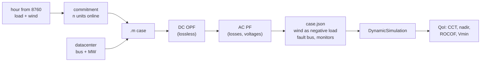
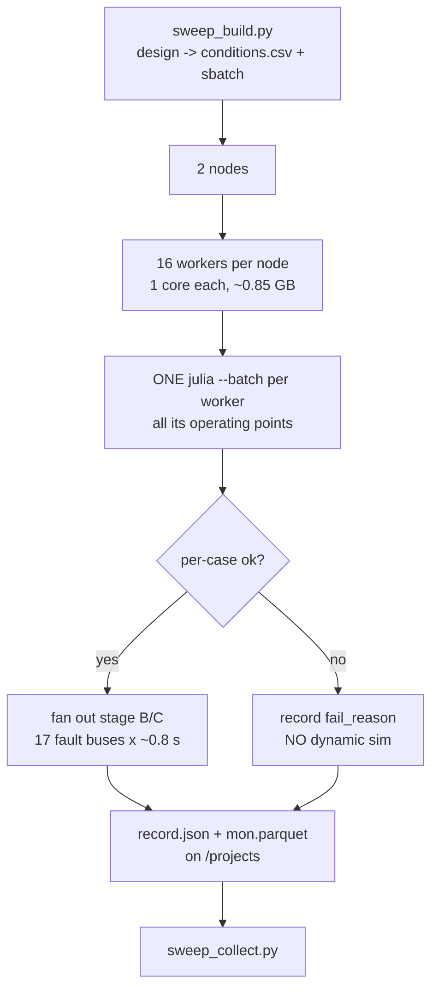

# Datacenter load and transient security: an aleatoric UQ pilot on GridKit

**Status:** pilot, October 2026. ACTIVSg200 (Illinois 200-bus synthetic case).
**Full detail:** [datacenter_load_uq_plan.md](datacenter_load_uq_plan.md) — this
report is the condensed version; the plan carries derivations, rejected
alternatives and the full change history.

---

## 1. What this is

Two deliverables, one study:

1. **Exercise GridKit as an end user** on a problem it has not been pointed at
   before, and report back what works and what does not.
2. **Demonstrate aleatoric UQ by sampling** on a dynamics problem, and find out
   where the sampling cost actually goes — with a view to much larger grids
   where brute force stops being an option.

The vehicle is a question utilities are being asked right now:

> **Where, and how much, large datacenter load can be added before dynamic
> security degrades — given that renewable output makes system inertia vary
> hour to hour?**

This is a pilot. The grid is small, the contingency set is narrow, and several
conclusions are bounded by model validity. The point is to establish the
machinery and learn where the difficulty lives.

---

## 2. Glossary

Several of these read backwards on first encounter.

| Term | Meaning |
|---|---|
| **Operating condition** | One (hour, commitment) pair. The hour fixes load and wind; the commitment fixes which thermal units are online. |
| **Baseline** | The *no-datacenter* run **for a given operating condition** — not one global reference. Each condition has its own, so `dCCT` compares like with like. |
| **Net load** | Demand minus wind, system-wide. What the thermal fleet must serve. |
| **CCT** | Critical clearing time: the longest fault the system survives. Larger is safer. |
| **The cap** | `cct_max = 0.5 s`, the top of the search. Set at a credible protection time; we do not look past it. |
| **Censored** | **CCT is at or above the cap** — the system survived the longest fault we consider. The stored `0.5` is a **lower bound, not a measurement**. Censored means *very stable*. |
| **Uncensored pair** | A (baseline, sited) pair where **both** are measured, so `dCCT` is a number rather than an inequality. |
| **Hosting capacity** | Largest datacenter MW at a bus that is both deliverable and secure. |
| **`LOCALLY_INFEASIBLE`** | The OPF cannot serve the load at all. A **result** (deliverability binds), not an error. |
| **Stage A / B / C** | Where a parameter binds: **A** = dispatch (needs a Julia solve), **B** = `case.json` edit (free), **C** = re-run (free). |
| **ZIP** | Load model shares `alphaZ`/`alphaI`/`alphaP` (constant impedance / current / power), summing to 1. |

> **New to power-system dynamics?** The plan doc has a
> [physical intuition section](datacenter_load_uq_plan.md#physical-intuition)
> covering why a fault is dangerous, why inertia buys time, what a ZIP load does
> during a voltage dip, and why censored runs are results rather than missing
> data.

---

## 3. The system

ACTIVSg200, a synthetic Illinois case: **200 buses, 246 branches, 49 generators**
(25 coal, 17 natural gas, 6 wind, 1 nuclear). The seed dispatch totals
**2,178 MW** of demand, which is the annual peak. The dynamic case carries
**40 Genrou** machines and **109 LoadZIP** loads.

Hourly load and wind come from an 8,760-hour dataset for this footprint, so the
(demand, wind) joint distribution is empirical rather than assumed.

> **Details:** [where the wind timeseries came from](datacenter_load_uq_plan.md#where-the-wind-timeseries-came-from-and-what-it-looks-like) ·
> [the operating-condition space](datacenter_load_uq_plan.md#6-the-operating-condition-space) ·
> [why 8760 is not a sampling design](datacenter_load_uq_plan.md#8760-is-not-a-sampling-design)

---

## 4. Building one operating condition



### 4.1 Commitment: a feasible band, not an economic optimum

We do **not** solve a unit-commitment MILP. We compute the band of *feasible*
commitments and sample across it:

* **lower bound** — adequacy (`capacity >= net x 1.10`) and a floor of 8 thermal
  units, below which the network loses voltage support and the integrator fails
  to initialise;
* **upper bound** — `sum(PMIN) <= net`, above which the OPF is infeasible.

At 762 MW net load the band is `[18, 38]`. Both ends are legitimate: at `n = 33`
the committed minimums total 740 MW, still under the load, so the units simply
run further down their range.

**Why sample the band rather than pick a point?** Because the two ends differ by

| commitment | fleet inertia | mean output per unit |
|---|---|---|
| n = 23 | **7,512 MW·s** | 33.1 MW |
| n = 33 | **11,702 MW·s** | 23.1 MW |

a **factor of 1.56 in inertia at identical load and wind**. That is the dominant
lever on stability at fixed net load. We have real data for the net-load
distribution but none for how this synthetic system's operators would commit, so
inventing a commitment PDF would fabricate the very thing that drives the
answer. Results are reported **conditionally** on commitment and can be
reweighted later if a real UC distribution appears.

> **Details:** [how commitment is sampled](datacenter_load_uq_plan.md#how-commitment-is-sampled) ·
> [why the band is so wide, and why we sample both ends](datacenter_load_uq_plan.md#why-the-band-is-so-wide-and-why-we-sample-both-ends) ·
> [commitment is a first-order driver (Phase 1b inertia sweep)](datacenter_load_uq_plan.md#1b-inertia-sweep-measured-2026-10-20)

### 4.2 Dispatch: DC OPF then AC PF

Two solves per condition, both PowerModels.jl with Ipopt:

1. **DC OPF** sets the economic dispatch. It is lossless, so the load is
   inflated by the loss estimate from the previous iteration.
2. **AC PF** then solves the real network at that dispatch, producing voltages
   and the actual losses, which feed the next iteration.

AC OPF was rejected as the primary path: DC OPF plus AC PF separates "who is
dispatched" from "what the network does about it", and is far cheaper.

The iteration exists because of a **slack problem**: a power flow leaves one
generator's P free, so it structurally cannot enforce `PMAX` on the slack, and
our slack is the nuclear unit `189_1` with **0.0082 MW** of headroom. Without
re-dispatch it would absorb the entire loss term, and in an hourly loop the
whole load change. One loss iteration reduces the overshoot from 27.05 MW to
0.34 MW on the worst hour (0.016 % of load), which is why `loss_iters = 1`.

> **Details:** [the dispatch chain](datacenter_load_uq_plan.md#10-the-dispatch-chain) ·
> [the slack problem](datacenter_load_uq_plan.md#the-slack-problem) ·
> [the loss-iteration fix, with convergence table](datacenter_load_uq_plan.md#fix) ·
> [why DC OPF then AC PF, rather than AC OPF](datacenter_load_uq_plan.md#why-dc-opf-then-ac-pf-rather-than-ac-opf)

### 4.3 Wind becomes negative load

Wind units are removed as `Genrou` machines and re-inserted as **negative
`LoadZIP`** at their own bus. Leaving them as synchronous machines would
contribute **2,766 MW·s** of inertia that real inverter-based wind does not
have — and inertia is precisely the quantity under study. The stand-in uses
`alphaI = 1` (constant current); constant power made the integrator fail at high
wind penetration.

> **Details:** [wind: why negative load, not fixed](datacenter_load_uq_plan.md#3-wind-why-negative-load-not-fixed) ·
> [implementation](datacenter_load_uq_plan.md#implementation) ·
> ["net load" is an aggregate, not a per-bus subtraction](datacenter_load_uq_plan.md#net-load-is-an-aggregate-not-a-per-bus-subtraction)

### 4.4 The datacenter

Added **before** dispatch, so the OPF must actually serve it, then split into
its own `LoadZIP` device so it can carry a different ZIP mix from the
surrounding load.

> **Details:** [ZIP coefficients are a first-class lever](datacenter_load_uq_plan.md#4-zip-coefficients-are-a-first-class-lever) ·
> [Phase 3: datacenter dimension](datacenter_load_uq_plan.md#phase-3-datacenter-dimension) ·
> [what is sampled, and what is chosen](datacenter_load_uq_plan.md#what-is-sampled-and-what-is-chosen) ·
> [design of the sweep](datacenter_load_uq_plan.md#design-of-the-sweep) ·
> [two limits, and the thermal one binds first](datacenter_load_uq_plan.md#two-limits-and-the-thermal-one-binds-first)

---

## 5. CCT by bisection

Critical clearing time is found by bisecting fault duration in `[0.05, 0.5]` s,
with a stability test of **pole slip relative to the centre of inertia**
(`max |δ_i − δ_COI| > 180°`).

* **2 simulations** is the early-exit path: stable at the bottom, still stable at
  the top, return censored.
* **8 simulations** means the boundary was inside the bracket.

The cap at 0.5 s is deliberate. EHV primary clearing is ~0.05–0.10 s and
breaker-failure backup ~0.25–0.50 s; a multi-second fault is not a contingency
any protection scheme permits, so a CCT beyond the cap has no engineering
meaning and is **reported as censored rather than searched for**.

The bisection probes write only the `delta` channels, not the full monitor set:
that cut probe output from 26.25 MB to 1.91 MB per probe (**13.8×**) with the
resulting CCT **identical** (0.2891 both ways).

> **Details:** [why critical clearing time is the headline metric](datacenter_load_uq_plan.md#why-critical-clearing-time-is-the-headline-metric) ·
> [stability criterion, and the false-positive test that was rejected](datacenter_load_uq_plan.md#stability-criterion) ·
> [bounding the search: faults must stay credible](datacenter_load_uq_plan.md#bounding-the-search-faults-must-stay-credible) ·
> [CCT measured: it discriminates, and net load drives it](datacenter_load_uq_plan.md#cct-measured-it-discriminates-and-net-load-drives-it) ·
> [the full QoI set](datacenter_load_uq_plan.md#the-qoi-set) ·
> [monitors: the shipped case records almost nothing](datacenter_load_uq_plan.md#monitors-the-shipped-case-records-almost-nothing)

---

## 6. Parallel execution on Kestrel

### 6.1 The cost structure that shapes everything

| operation | cost | stage |
|---|---|---|
| Julia process launch | **5.9 s** | — |
| one PF/OPF solve, warm | **0.04 s** | A |
| full dispatch, unbatched | 29.5 s | A |
| full dispatch, batched | **2.5 s** | A |
| one dynamic run | 0.4–0.8 s | B/C |
| one CCT bisection | 2–5 s | B/C |

**Interpreter launch dominates the solve by ~150×.** That single measurement
drives the whole design.

### 6.2 Two levers

**Batch the Julia solves.** Within one condition DC OPF → AC PF is strictly
sequential, but the *same stage across conditions* is independent, so conditions
advance in lockstep: one batched DC OPF for all, then one batched AC PF.

| batch size | per-point cost | speedup |
|---|---|---|
| 1 (unbatched) | 29.5 s | — |
| 4 | 7.8 s | **3.8×** |
| 12 | **2.83 s** | **10.4×** |

Verified to produce results identical to the unbatched path on net load, losses,
voltages and inertia.

**Fan out the free stages.** Fault location, fault duration, inertia scaling and
ZIP mix are all stage B/C — a JSON edit and a re-run. Once a dispatch is solved,
each additional disturbance costs ~0.8 s against a ~30 s solve.



Workers are **cores, not nodes**: the chain is single-threaded and uses ~0.85 GB
per worker (0.18 GB Python, 0.68 GB Julia + GridKit children), so on a 104-core,
246 GB node the binding constraint is cores.

### 6.3 Measured campaigns

| campaign | conditions | operating points | shape | wall |
|---|---|---|---|---|
| `phase3b` | 243 | 243 | 2 × 8 | ~95 s/worker |
| `aleatoric1` | 840 | 840 | 2 × 16 | ~2.5 min |
| `faultscreen1` | **1,020** | **60** | 2 × 15 | ~2 min |

`faultscreen1` is the design paying off: 1,020 conditions from **60** dispatch
solves, because the 17 fault locations fan off each solve for free. All three
campaigns collected **100 % of planned conditions with no missing records**.

### 6.4 Storage

Scratch and durable storage are split. Per-run churn stays on Lustre scratch;
only `record.json` and `mon.parquet` are written to `/projects`.

* Monitor output is converted **CSV → parquet**: 2.63 GB → 0.54 GB (**4.9×**),
  7× faster to read, and column-prunable (400 of 441 columns are bus voltages an
  `omega`-only analysis never touches).
* Lustre striping is narrow (`c=1`) because the workload is file-per-process:
  a 25 MB file uses **2 OST objects instead of 9** under the default layout.
* Plain `/tmp` on these nodes is **tmpfs, i.e. RAM**. Migrating the campaigns off
  it returned **5.0 GiB** of node memory. At 10k conditions this is an OOM, not a
  tidiness issue.

> **Details:** [parallel sampling runs](datacenter_load_uq_plan.md#parallel-sampling-runs) ·
> [execution model: one job per worker, Julia batched inside it](datacenter_load_uq_plan.md#execution-model-one-job-per-worker-julia-batched-inside-it-decided-2026-10-22) ·
> [what a sample is: parameters and where they bind (stage A/B/C)](datacenter_load_uq_plan.md#what-a-sample-is-parameters-and-where-they-bind) ·
> [parallelism: cores first, then nodes](datacenter_load_uq_plan.md#parallelism-cores-first-then-nodes) ·
> [storage](datacenter_load_uq_plan.md#storage) ·
> [Lustre layout](datacenter_load_uq_plan.md#scratchfs-pools-and-lustre-layout) ·
> [parquet](datacenter_load_uq_plan.md#serialise-the-monitor-output-as-parquet-not-csv) ·
> [guardrails](datacenter_load_uq_plan.md#guardrails)

---

## 7. Results

> **Details for this whole section:**
> [`phase3b` pilot results](datacenter_load_uq_plan.md#pilot-results-phase3b-run-2026-10-22) ·
> [`aleatoric1` aleatoric pilot](datacenter_load_uq_plan.md#aleatoric-pilot-aleatoric1-run-2026-10-22) ·
> [`faultscreen1` fault-location screening](datacenter_load_uq_plan.md#fault-location-screening-faultscreen1-run-2026-10-23) ·
> [Phase 1 go/no-go gate](datacenter_load_uq_plan.md#phase-1-does-the-premise-hold-passed-2026-10-20) ·
> [`inertia_MWs` undercount bug and its correction](datacenter_load_uq_plan.md#inertia_mws-was-silently-undercounted-bug-fixed-2026-10-22)

### 7.1 Baseline risk is sharply ordered by net load


| quintile | net MW | censored | **P(CCT < 0.25 s)** |
|---|---|---|---|
| q0 | 937 | 76 % | 0.139 |
| q1 | 1,136 | 62 % | 0.202 |
| q2 | 1,356 | 2 % | **0.733** |
| q3 | 1,608 | 0 % | **1.000** |
| q4 | 1,791 | 0 % | **1.000** |

A near step change between q1 and q2: below ~1,150 MW net load most conditions
ride through the cap, above ~1,350 MW essentially none do. Risk is not gradual
in net load; there is a threshold.

### 7.2 Hosting capacity is a network property

Maximum deliverable datacenter per bus, across **all 40 operating conditions**:

| bus | min | median | max | distinct values |
|---|---|---|---|---|
| 6 | 50 | 50 | 50 | **1** |
| 120 | 200 | 200 | 200 | **1** |
| 108 | 200 | 300 | 300 | 2 |
| 148 | 300 | 300 | 400 | 2 |

Two of four buses do not move **at all** across a year of load, wind and
commitment variation; the others shift by one ladder rung. The binding
constraint is deliverability — branch ratings — which are hour-independent.

Across a wider 16-bus sample the capacity spread is **8×** (50 MW to 400 MW),
driven by local network strength, not by the operating condition.

### 7.3 The aleatoric variability is in the damage


| datacenter MW | n | mean dCCT | **worst dCCT** |
|---|---|---|---|
| 50 | 88 | −0.012 | −0.113 |
| 100 | 66 | −0.026 | −0.169 |
| 200 | 66 | −0.029 | **−0.260** |
| 300 | 44 | −0.031 | −0.260 |

Monotone in size, but **the worst case is ~10× the mean**. The same 200 MW
datacenter costs ~0.03 s of CCT on a typical condition and up to 0.26 s on a bad
one. A single-snapshot or mean-value study would report the first number and
miss the second — which is the case for sampling, relocated from "how much can
we host" to "how bad is hosting it".

### 7.4 Contingency location: most faults carry no information


Across 17 fault locations spanning 0–14 hops:

| fault bus | median CCT | % censored | informative runs |
|---|---|---|---|
| 94 | **0.3664** | 35 % | 48 |
| 66 | 0.5 | 55 % | 41 |
| 68 | 0.5 | 60 % | 39 |
| 181 | 0.5 | 65 % | 31 |
| **other 13** | 0.5 | **100 %** | 0–5 |

**Thirteen of seventeen contingencies are censored in every condition.** About
76 % of a uniform contingency sampling budget would land on faults that cannot
discriminate between operating conditions.

**This is the sampling-design result of the pilot.** Contingency location should
be *screened cheaply, then concentrated on* — and the screen is affordable
precisely because fault location is a stage-B parameter. On a larger grid, where
the contingency list grows faster than the budget, this is the difference
between a feasible and an infeasible study.

Two caveats it also produced: bus 66, used as the reference throughout, is **not
the worst contingency** (bus 94 is more discriminating), and at 200 MW the two
strong siting buses are **indistinguishable** — "where" discriminates between
strong and weak buses, not among strong ones.

### 7.5 Censoring must be modelled, not dropped


| threshold | correct | censored dropped | inflation |
|---|---|---|---|
| 0.20 s | 0.586 | 0.795 | **1.36×** |
| 0.25 s | 0.632 | 0.858 | **1.36×** |
| 0.30 s | 0.657 | 0.892 | **1.36×** |

Discarding censored runs inflates estimated risk by **1.36×** in `aleatoric1`
and **4.31×** in `faultscreen1`, where 82 % of runs are censored. The inflation
factor is just `N_total / N_uncensored`: arithmetically trivial, easy to do by
accident, and it would systematically overstate datacenter risk.

Because censoring occurs at a single point beyond every observed event, the
Kaplan–Meier estimator here reduces to the empirical CDF **with the censored
runs left in the denominator** — which is exactly the part that gets dropped.

### 7.6 An epistemic parameter, tested and dismissed

`alphaP` (the datacenter's constant-power share) was the obvious first epistemic
dimension: constant-power load does not self-shed during a dip, so it should
hurt. Tested over 4 hours × 3 buses × 5 values:

* **CCT spread across `alphaP` was exactly 0.000 in 10 of 12 cells**, 0.007 in
  one (below the 0.01 bisection tolerance) and 0.028 in one.
* But `alphaP` **determines whether the case can be simulated at all**.

So it governs model validity, not the answer. We adopted `alphaP = 0.2` and ran
aleatoric-only. A parameter expected to matter, tested, and found not to **is a
UQ result**, and it justified spending the budget on operating conditions.

> **Details:** [`alphaP` tested as a sensitivity](datacenter_load_uq_plan.md#alphap-tested-as-a-sensitivity-it-governs-simulability-not-cct-measured-2026-10-22) ·
> [the 52 `sim_failed` are a model-validity limit, not instability](datacenter_load_uq_plan.md#the-52-sim_failed-are-a-model-validity-limit-not-instability)

---

## 8. GridKit end-user feedback

Findings from using the tool in anger, offered as concrete issues:

| finding | impact |
|---|---|
| **`REPCA` cannot do frequency droop** — the regulated bus exposes no frequency signal | No primary frequency response from IBR, so any nadir/ROCOF study with inverters is incomplete |
| **`LoadZIP` with `alphaP = 1` is not simulable under a deep fault** once the load is large relative to its bus. `IDASolve` fails ~0.02 s into the fault with the step size collapsing to 1e-17 | Constant-power load — the physically right model for a datacenter — cannot be used at scale. A current-limit / undervoltage-trip model is missing |
| **A high constant-power share is sometimes unsimulable, mechanism unexplained** — `alphaP = 1` runs fine on existing loads and on 200 MW at bus 129, but fails at bus 93; neither size nor ratio to host load explains it (2x2x2 table in the plan) | Datacenter ZIP mixes used in practice (`alphaP` 0.7–0.8) are unreachable at some buses; we are forced to `alphaP = 0.2` |
| **A fault *at* a constant-power load still fails** even at `alphaP = 0.2` (37 of 77 failures) | The most interesting contingency for a datacenter study is out of reach |
| **Events are `FAULT_ON`/`FAULT_OFF` only** | No generator-trip or load-step contingency, so no true power-imbalance event |
| **Monitors default to almost nothing** — post-#577 cases carry `"mon": []` on every bus | Nothing PMU-observable is recorded unless explicitly enabled |

Also verified, as a portability result: **GridKit built on RHEL 8 runs unchanged
on RHEL 9**. The binary needs GLIBC ≤ 2.14 and GLIBCXX ≤ 3.4.31 against a
glibc 2.34 node, all libraries resolve, and `WECC240_validation` passes in
0.64 s. One real difference: `/lib64/libomp.so` exists on RHEL 8 but not on
RHEL 9 compute nodes, so the runtime library path must point at the build's own
LLVM prefix — **scoped to the child process**, because putting it on the job
environment makes Julia load the wrong SuiteSparse.

> **Details:** [disturbances: what a bus fault can and cannot tell us](datacenter_load_uq_plan.md#8-disturbances-what-a-bus-fault-can-and-cannot-tell-us) ·
> [a disturbance-type limitation that shapes the study](datacenter_load_uq_plan.md#a-disturbance-type-limitation-that-shapes-the-study) ·
> [monitors](datacenter_load_uq_plan.md#monitors-the-shipped-case-records-almost-nothing) ·
> RHEL 9 evidence is in [kestrel_install.md](../kestrel_install.md)

---

### Issue draft: constant-power `LoadZIP` and IDA convergence

*Ready to file against GridKit; the integrator question may belong upstream with
SUNDIALS.*

**Summary.** A `LoadZIP` with a high constant-power share (`alphaP` near 1)
cannot be simulated when it is large relative to the voltage-dependent load at
the same bus. Pure constant-impedance behaviour is fine. The limit is a
**ratio**, not a size and not `alphaP` on its own.

**Why it matters.** Datacenter load is conventionally modelled around
`P/I/Z = 80/20/0` or `70/20/10`, i.e. `alphaP` of 0.7–0.8. We can only run
**`alphaP = 0.2`** across our bus sample, so the gap between standard practice
and what can be simulated is large, and it falls exactly on the load type this
study is about.

**Evidence** (ACTIVSg200, hour 6164, self-clearing fault at bus 66, `tmax` 10 s):

| test | result |
|---|---|
| `alphaP` swept 0 → 1 on **existing** loads of 87.1, 8.7 and 1.0 MW | **all run at `alphaP = 1.0`** |
| pure constant-power load added at bus 129 (87.1 MW host), 50 / 100 / 150 / **200 MW** | **all run**; ratio up to 2.3 |
| same at 300 MW | OPF `LOCALLY_INFEASIBLE` — deliverability, not dynamics |
| 200 MW at buses 93 / 158 / 172 (hosts ~1–5 MW, ratio 40+) | **fail** |
| 150 MW at bus 34 (**no** host load, ratio infinite) | **fail** |
| across the campaign | constant-power/host-load ratio **8.5** at successes, **25.6** at failures |

**Two distinct failure modes:**

* **no co-located voltage-dependent load** → `IDACalcIC` fails, i.e. the
  *initial conditions* cannot be found, before any disturbance and with a
  healthy power flow (`vmin` 0.9825);
* **large but finite ratio** → `IDASolve` fails **0.02 s into the fault**
  (`t = 1.0207`) with the step size collapsing to `h = 1.9e-17`.

```
[ERROR] Function IDASolve failed with flag IDA_CONV_FAIL!
[IDAHandleFailure] At t = 1.02069981458863 and h = 1.93178709017483e-17,
the corrector convergence failed repeatedly or with |h| = hmin.
```

**Interpretation, offered as a hypothesis rather than a diagnosis.** A constant
power load holds `P` fixed as `V → 0` during a fault, so current grows without
bound and the algebraic subsystem approaches a singularity. A co-located
voltage-dependent load appears to regularise it. If that is right, the fix is
physical rather than numerical — real datacenter converters current-limit or
trip on undervoltage, and `LoadZIP` can express neither.

**Questions for the GridKit / SUNDIALS teams:**

1. Is there an IDA configuration (tolerances, `maxnef`, line-search options,
   a different initial-condition calculation mode) that would extend the usable
   `alphaP` range? We have not tuned the integrator at all.
2. Is an undervoltage cutoff or current limit on `LoadZIP` feasible — the
   `Vlow`-style clamp that production tools apply to constant-power load?
3. A fault **at** the bus carrying the constant-power load fails even at
   `alphaP = 0.2` (37 of 77 failures in `faultscreen1`). For a datacenter study
   that is arguably the single most interesting contingency, so it would be
   useful to know whether it is reachable at all.

**Reproduction:** `scripts/sweep_build.py --dc-buses 93 --dc-mw 200` with
`CampaignConfig(dc_alpha_p=1.0)`, then `sweep_worker.py`. Failing `sim.log`
files are preserved under the campaign scratch tree.

---

## 9. Limitations

* **One contingency type.** Self-clearing bus faults only. These are angular and
  voltage events, not frequency events; the frequency QoI respond weakly by
  construction.
* **One system, small.** 200 buses. Hosting capacity being network-determined
  may not survive on a meshed transmission system with more redundancy.
* **Commitment is bracketed, not distributed.** No UC model, so all results are
  conditional on commitment.
* **Wind is a non-inertial stand-in**, not a real IBR model with
  fault-ride-through.
* **Datacenter load model is bounded by solver validity**, see §8.
* **Sample sizes are pilot-scale.** 20 hours supports distributional statements
  about the bulk, not about tails.
* The reference bus remains the nuclear unit `189_1`, which has 0.0082 MW of
  headroom — a known oddity not yet closed.

> **Details:** [known modelling limitations](datacenter_load_uq_plan.md#12-known-modelling-limitations) ·
> [open questions](datacenter_load_uq_plan.md#11-open-questions) ·
> [contingency choice](datacenter_load_uq_plan.md#5-contingency) ·
> [a self-clearing bus fault is an angular event, not a frequency event](datacenter_load_uq_plan.md#a-self-clearing-bus-fault-is-an-angular-and-voltage-event-not-a-frequency-event) ·
> [Phase 4: wind as a real IBR](datacenter_load_uq_plan.md#phase-4-optional-model-form-robustness-wind-as-a-real-ibr)

---

## 10. Where this goes

The pilot establishes that the expensive part is **stage A**, and that the
scientifically interesting dimensions — contingency location, disturbance
severity, model form — are nearly free once a dispatch exists. That asymmetry is
the lever for larger grids:

1. **Screen contingencies cheaply, then concentrate.** Measured here: 76 % of a
   uniform budget is wasted. On a 10k-bus case the contingency list is the part
   that explodes, and it is also the part that is free to explore.
2. **Treat censoring as information.** Both "survived beyond the cap" and
   "infeasible" are results, and at 82 % censoring they are most of the dataset.
3. **Exploit the conditional-independence structure.** Expensive outer samples
   over operating conditions, cheap inner fan-out over disturbances and model
   parameters — the same motivation as multilevel Monte Carlo, but driven by
   model structure rather than discretisation.

Immediate next steps are a wider contingency screen, paired-censoring treatment
of `dCCT`, and a short literature check on datacenter load modelling so §8's
constraint can be addressed rather than worked around.

---

*Machinery: `scripts/sweep_{build,worker,collect}.py`, `scripts/analyse_censored.py`,
`py-utils/campaign.py`. Campaign artifacts under
`/kfs2/projects/scidac/scidac-data/gridkit-campaigns/`.*
