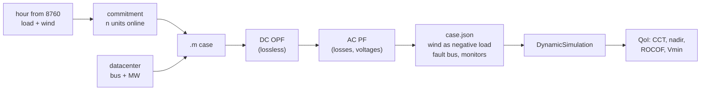
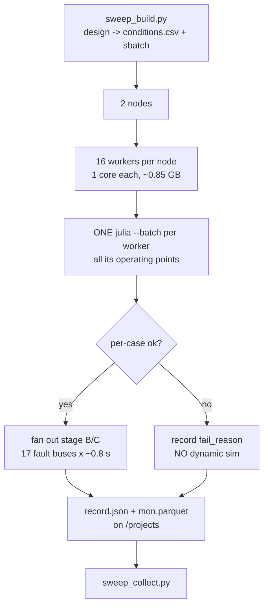
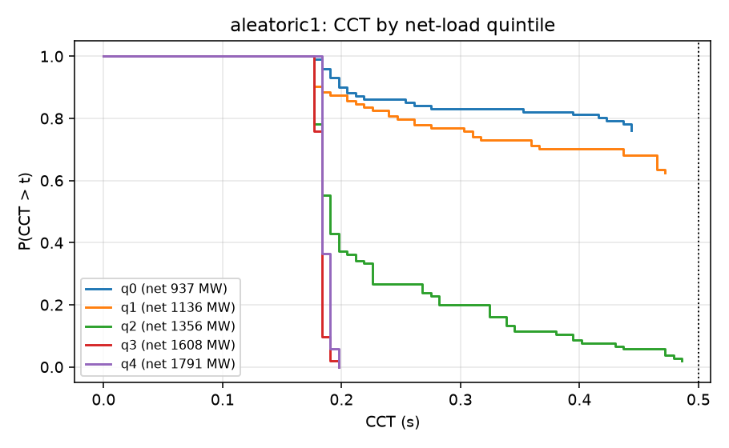
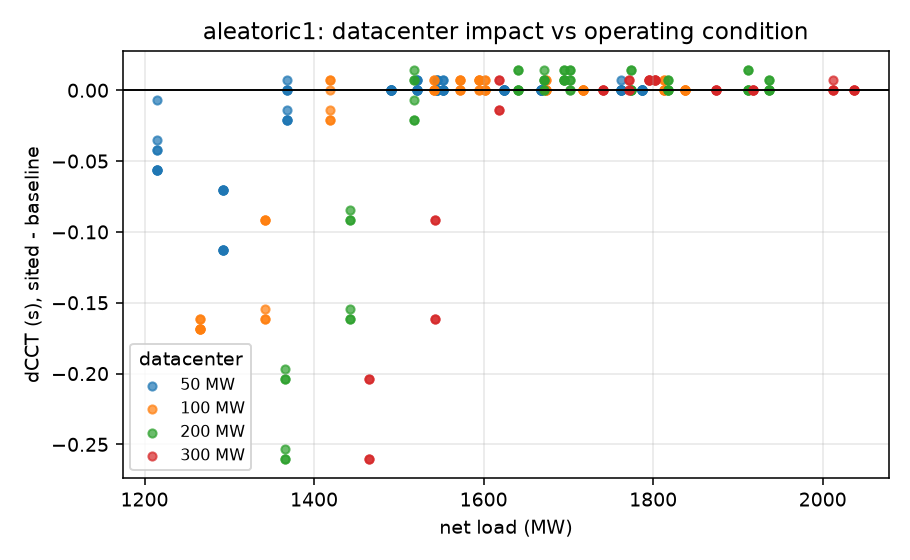
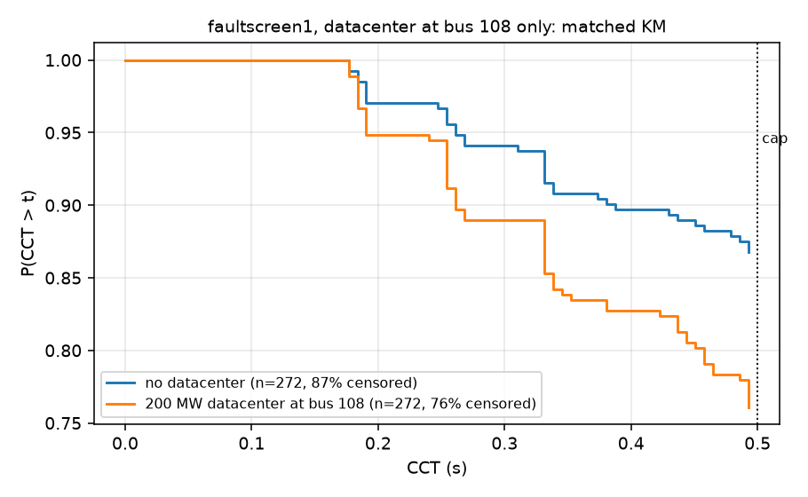
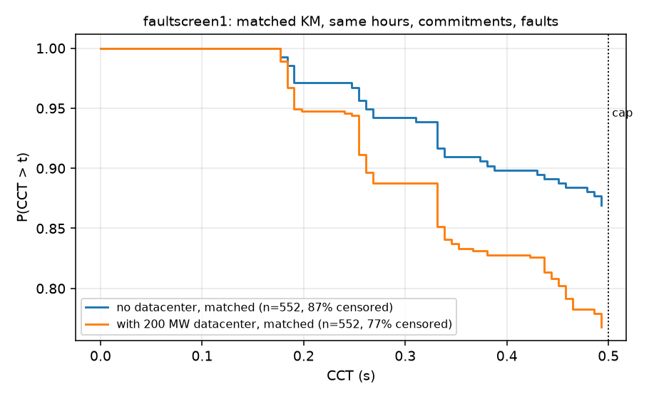
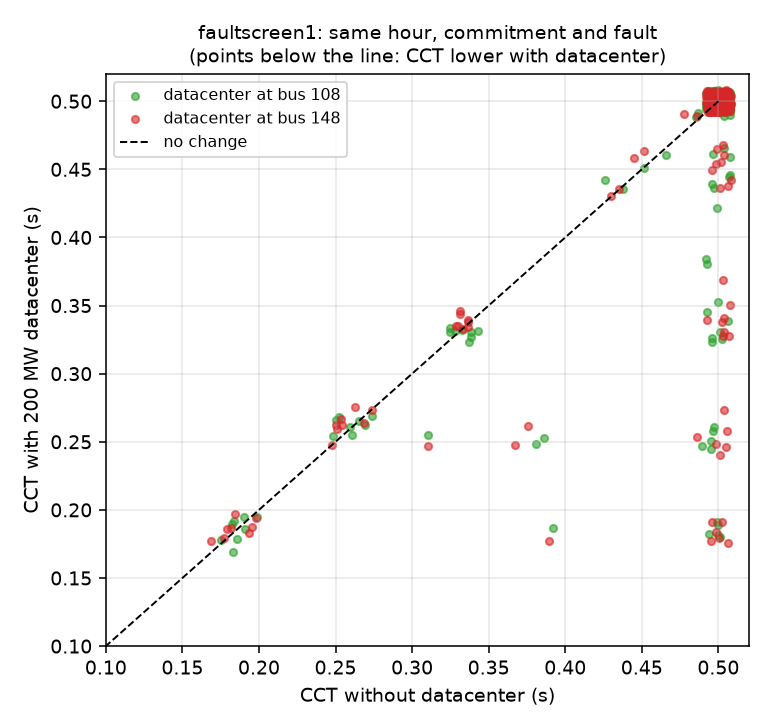
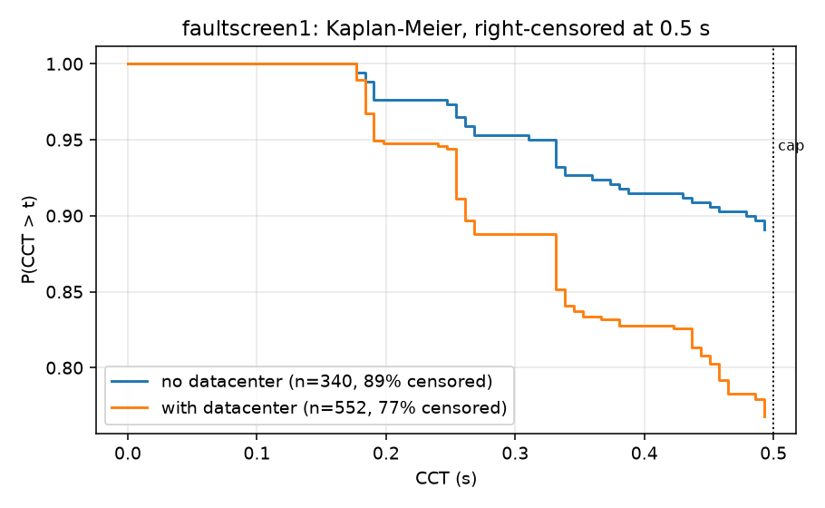
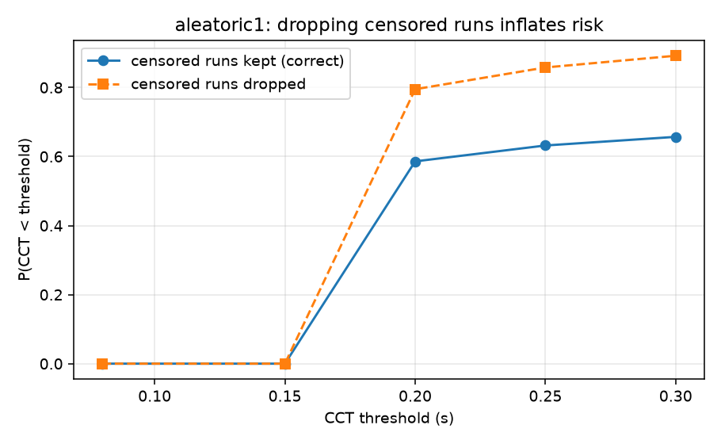

# Datacenter load and transient security: an aleatoric UQ pilot on GridKit

**Status:** pilot, October 2026. ACTIVSg200 (Illinois 200-bus synthetic case).

**This report stands alone.** It explains what we asked, how we went about it,
and what came out, in general terms. It does not assume you have read the other
two documents, and it does not contain code.

| document | answers | read it when |
|---|---|---|
| **this report** | *what did we find, and how, in general terms* | start here |
| [datacenter_load_uq_plan.md](datacenter_load_uq_plan.md) | *why each choice was made; every number and its provenance* | you want to question a decision |
| [dc_campaign_pipeline.md](dc_campaign_pipeline.md) | *which function does what* | you are changing the code |

Links marked **Details** point into the plan. They are optional.

---

## 1. What this is

Two deliverables, one study:

1. **Exercise GridKit as an end user** on a problem it has not been pointed at
   before, and report back what works and what does not.
2. **Demonstrate aleatoric UQ by sampling** on a dynamics problem, and find out
   where the sampling cost actually goes — with a view to much larger grids
   where brute force stops being an option.

The vehicle is a question utilities are being asked right now:

> **Where, and how much, large datacenter load can be added before dynamic
> security degrades — given that renewable output makes system inertia vary
> hour to hour?**

This is a pilot. The grid is small, the contingency set is narrow, and several
conclusions are bounded by model validity. The point is to establish the
machinery and learn where the difficulty lives.

---

## 2. Glossary

Several of these read backwards on first encounter.

| Term | Meaning |
|---|---|
| **Operating condition** | One (hour, commitment) pair. The hour fixes load and wind; the commitment fixes which thermal units are online. |
| **Baseline** | The *no-datacenter* run **for a given operating condition** — not one global reference. Each condition has its own, so `dCCT` compares like with like. |
| **Net load** | Demand minus wind, system-wide. What the thermal fleet must serve. |
| **CCT** | Critical clearing time: the longest fault the system survives. Larger is safer. |
| **The cap** | `cct_max = 0.5 s`, the top of the search. Set at a credible protection time; we do not look past it. |
| **Censored** | **CCT is at or above the cap** — the system survived the longest fault we consider. The stored `0.5` is a **lower bound, not a measurement**. Censored means *very stable*. |
| **Uncensored pair** | A (baseline, sited) pair where **both** are measured, so `dCCT` is a number rather than an inequality. |
| **Hosting capacity** | Largest datacenter MW at a bus that is both deliverable and secure. |
| **`LOCALLY_INFEASIBLE`** | The OPF cannot serve the load at all. A **result** (deliverability binds), not an error. |
| **Stage A / B / C** | Where a parameter binds: **A** = dispatch (needs a Julia solve), **B** = `case.json` edit (free), **C** = re-run (free). |
| **ZIP** | Load model shares `alphaZ`/`alphaI`/`alphaP` (constant impedance / current / power), summing to 1. |

> **New to power-system dynamics?** The plan doc has a
> [physical intuition section](datacenter_load_uq_plan.md#physical-intuition)
> covering why a fault is dangerous, why inertia buys time, what a ZIP load does
> during a voltage dip, and why censored runs are results rather than missing
> data.

---

## 3. The system

ACTIVSg200, a synthetic Illinois case: **200 buses, 246 branches, 49 generators**
(25 coal, 17 natural gas, 6 wind, 1 nuclear). The seed dispatch totals
**2,178 MW** of demand, which is the annual peak. The dynamic case
(`ACTIVSg200.case.json`) carries **40 Genrou** machines: 34 thermal and the 6 wind
units, which the campaign replaces with negative LoadZIP stand-ins (§4.3), leaving
**34 synchronous machines**. The 9 thermal units offline in the seed `.m`
(`GEN_STATUS = 0`) have no machine in the case and were not added in these
experiments. The JSON also carries **109 LoadZIP** loads, before the wind stand-ins are added.

Hourly load and wind come from an 8,760-hour dataset for this footprint, so the
(demand, wind) joint distribution is empirical rather than assumed.

> **Details:** [where the wind timeseries came from](datacenter_load_uq_plan.md#where-the-wind-timeseries-came-from-and-what-it-looks-like) ·
> [the operating-condition space](datacenter_load_uq_plan.md#6-the-operating-condition-space) ·
> [why 8760 is not a sampling design](datacenter_load_uq_plan.md#8760-is-not-a-sampling-design)

---

## 4. Building one operating condition



### 4.1 Commitment: a feasible band, not an economic optimum

We do **not** solve a unit-commitment MILP. We compute the band of *feasible*
commitments and sample across it:

* **lower bound** — adequacy (`capacity >= net x 1.10`) and a floor of 8 thermal
  units, below which the network loses voltage support and the integrator fails
  to initialise;
* **upper bound** — `sum(PMIN) <= net`, above which the OPF is infeasible.

At 762 MW net load the band is `[18, 38]`. Both ends are legitimate: at `n = 33`
the committed minimums total 740 MW, still under the load, so the units simply
run further down their range.

**Why sample the band rather than pick a point?** Because the two ends differ by

| commitment | fleet inertia | mean output per unit |
|---|---|---|
| n = 23 | **7,512 MW·s** | 33.1 MW |
| n = 33 | **11,702 MW·s** | 23.1 MW |

a **factor of 1.56 in inertia at identical load and wind** *(hour 4779, net
762 MW)*. The n = 33 value is the pre-correction formula value, which the plan
measured 1.4 % low at hour 6164, so the true ratio is likely slightly higher. That
is the dominant
lever on stability at fixed net load. We have real data for the net-load
distribution but none for how this synthetic system's operators would commit, so
inventing a commitment PDF would fabricate the very thing that drives the
answer. Results are reported **conditionally** on commitment and can be
reweighted later if a real UC distribution appears.

Adding a datacenter does **not** change the commitment. The same `n` units stay
online, and only the dispatch is re-solved (DC OPF, then AC PF). If the committed
fleet cannot serve the added load, the case is recorded as infeasible, not
re-committed. Those failures therefore overstate what an operator could do by
committing more units.

> **Details:** [how commitment is sampled](datacenter_load_uq_plan.md#how-commitment-is-sampled) ·
> [why the band is so wide, and why we sample both ends](datacenter_load_uq_plan.md#why-the-band-is-so-wide-and-why-we-sample-both-ends) ·
> [commitment is a first-order driver (Phase 1b inertia sweep)](datacenter_load_uq_plan.md#1b-inertia-sweep-measured-2026-10-20)

### 4.2 Dispatch: DC OPF then AC PF

Two solves per condition, both PowerModels.jl with Ipopt:

1. **DC OPF** sets the economic dispatch. It is lossless, so the load is
   inflated by the loss estimate from the previous iteration.
2. **AC PF** then solves the real network at that dispatch, producing voltages
   and the actual losses, which feed the next iteration.

AC OPF was rejected as the primary path: DC OPF plus AC PF separates "who is
dispatched" from "what the network does about it", and is far cheaper.

The iteration exists because of a **slack problem**: a power flow leaves one
generator's P free, so it structurally cannot enforce `PMAX` on the slack, and
our slack is the nuclear unit `189_1` with **0.0082 MW** of headroom. Without
re-dispatch it would absorb the entire loss term, and in an hourly loop the
whole load change. One loss iteration reduces the overshoot from 27.05 MW to
0.34 MW on the worst hour (0.016 % of load), which is why `loss_iters = 1`.

> **Details:** [the dispatch chain](datacenter_load_uq_plan.md#10-the-dispatch-chain) ·
> [the slack problem](datacenter_load_uq_plan.md#the-slack-problem) ·
> [the loss-iteration fix, with convergence table](datacenter_load_uq_plan.md#fix) ·
> [why DC OPF then AC PF, rather than AC OPF](datacenter_load_uq_plan.md#why-dc-opf-then-ac-pf-rather-than-ac-opf)

### 4.3 Wind becomes negative load

Wind units are removed as `Genrou` machines and re-inserted as **negative
`LoadZIP`** at their own bus. Leaving them as synchronous machines would
contribute **2,766 MW·s** of inertia that real inverter-based wind does not
have — and inertia is precisely the quantity under study. The stand-in uses
`alphaI = 1` (constant current); constant power made the integrator fail at high
wind penetration.

> **Details:** [wind: why negative load, not fixed](datacenter_load_uq_plan.md#3-wind-why-negative-load-not-fixed) ·
> [implementation](datacenter_load_uq_plan.md#implementation) ·
> ["net load" is an aggregate, not a per-bus subtraction](datacenter_load_uq_plan.md#net-load-is-an-aggregate-not-a-per-bus-subtraction)

### 4.4 The datacenter

A datacenter is represented as **additional electrical load placed at one
bus**. Two things about *how* it is added matter to the answer.

**It is added before dispatch, not after.** The load enters the network data
that the optimiser sees, so the commitment and dispatch must actually produce
and deliver the extra power. Adding it afterwards would be free energy
appearing from nowhere, and would understate the impact.

**It gets its own load device, with its own voltage behaviour.** Load in these
cases is represented by a **ZIP model**, which splits demand into three parts by
how each responds when voltage sags: a constant-**impedance** part (falls as
$V^2$), a constant-**current** part (falls as $V$), and a constant-**power**
part (does not fall at all). The split is written here as `P/I/Z` percentages.

The distinction is the physical reason a datacenter is interesting. Ordinary
constant-impedance load *sheds itself* during a voltage dip and helps the system
recover. Datacenter load is rectifier- and UPS-fed and behaves far closer to
constant power: it keeps demanding the same megawatts at reduced voltage, which
means drawing more current, which depresses voltage further. If the new load
were simply folded into whatever device already existed at the bus, it would
inherit the host's helpful constant-impedance behaviour and the study would
measure the wrong thing. So the host device is reduced and a **separate** device
is appended for the datacenter.

This works whether or not the chosen bus already has load. At a bus that has
load, the existing device is scaled down and the datacenter device added
alongside it; at a bus with none, the datacenter device is simply created. Both
were verified to compose correctly.

**The mix we actually ran was `P/I/Z = 20/80/0`, and that is a compromise.**
The physically intended model is pure constant power, `100/0/0`. It is not
simulable at every bus — see [section 8](#8-gridkit-end-user-feedback) — so the
campaigns used a mostly constant-current mix instead. The measured effect of
this choice on the headline metric is **at most 0.0281 s, and exactly zero in 10
of the 12 cases tested**. For scale, the *mean* CCT cost of a 200 MW datacenter
is 0.029 s and the worst case is 0.26 s (§7.3), so the ZIP-mix effect is
comparable to the mean datacenter effect and **about 10× smaller than the
worst case** — which is the quantity the study is actually about. It does not
move the headline results, but it is not negligible against the average one
either. The argument that `20/80/0` is defensible on its own terms is
that a converter-fed load hits its **current limit** during a deep dip, and a
current-limited converter *is* a constant-current load; that argument is
plausible but unverified.

For the pilot we keep `P/I/Z = 20/80/0`. A 80/20/0 re-run of the sited arms (a sensitivity
check, not in the headline results) gives more IDA initial-condition failures at high
`alphaP`; see [the IDA investigation](ida_ic_issue.md). It is not a replacement for the
pilot mix.

**Hunt summary (IDA initial-condition failures at high `alphaP`).** At 200 MW, the
buses where IDA cannot find a fault-on initial condition at `alphaP` 0.8 (18 buses) are
exactly the buses where the fault-on network algebra folds (also exact at 0.2 and 1.0).
Folds grow with `alphaP` and with MW, and shrink towards constant impedance. The
working hypothesis is that these are physical no-steady-state outcomes: the datacenter
moves a fault-on nose past a bolted fault. So more failures at high P mean fewer
places the datacenter can be sited, not an IDA defect. This is supported, not proven:
the IC failures match the fold sets exactly on three dispatches (h1879, h2151, h4770).
This is supported, not proven: the IDASolve (integration) failures are a separate issue
and not all are folds. Terms, results,
hypothesis and every script are in [the IDA initial-condition issue](ida_ic_issue.md)
([read first](ida_ic_issue.md#0-read-first), [results](ida_ic_issue.md#10-method-and-results),
[hypothesis](ida_ic_issue.md#11-hypothesis-h1-and-what-it-means),
[experiment index](ida_ic_issue.md#12-experiment-index)).

*Why the host is scaled down rather than N2 added alongside:* dispatch already sees the
bus load after the datacenter is added, so a second N2 device would double-count it.
The split keeps the total equal to what dispatch solved.

Power factor is assumed 0.98 lagging.

> **Details:** [ZIP coefficients are a first-class lever](datacenter_load_uq_plan.md#4-zip-coefficients-are-a-first-class-lever) ·
> [is the 20/80/0 mix defensible?](datacenter_load_uq_plan.md#is-the-20800-mix-defensible) ·
> [Phase 3: datacenter dimension](datacenter_load_uq_plan.md#phase-3-datacenter-dimension) ·
> [what is sampled, and what is chosen](datacenter_load_uq_plan.md#what-is-sampled-and-what-is-chosen) ·
> [design of the sweep](datacenter_load_uq_plan.md#design-of-the-sweep) ·
> [two limits, and the thermal one binds first](datacenter_load_uq_plan.md#two-limits-and-the-thermal-one-binds-first)

---

## 5. CCT by bisection

Critical clearing time is found by bisecting fault duration in `[0.05, 0.5]` s,
with a stability test of **pole slip relative to the centre of inertia**. The
centre of inertia is the inertia-weighted average rotor angle of the fleet,

$$\delta_{COI}(t) = \frac{\sum_i H_i S_i \delta_i(t)}{\sum_i H_i S_i}$$

and a run is declared unstable when any machine leaves that collective frame:

$$\max_{i,\,t} \bigl| \delta_i(t) - \delta_{COI}(t) \bigr| > 180°$$

Measuring against the COI rather than a fixed reference separates "the whole
system swung" (fine) from "one machine left the group" (not fine).

* **2 simulations** is the early-exit path: stable at the bottom, still stable at
  the top, return censored.
* **8 simulations** means the boundary was inside the bracket.

The cap at 0.5 s is deliberate. EHV primary clearing is ~0.05–0.10 s and
breaker-failure backup ~0.25–0.50 s *(standard protection practice, stated from
domain knowledge rather than a cited standard)*; a multi-second fault is not a contingency
any protection scheme permits, so a CCT beyond the cap has no engineering
meaning and is **reported as censored rather than searched for**.

The bisection probes write only the `delta` channels, not the full monitor set:
that cut probe output from 26.25 MB to 1.91 MB per probe (**13.8×**) with the
resulting CCT **identical** (0.2891 both ways).

> **Details:** [why critical clearing time is the headline metric](datacenter_load_uq_plan.md#why-critical-clearing-time-is-the-headline-metric) ·
> [stability criterion, and the false-positive test that was rejected](datacenter_load_uq_plan.md#stability-criterion) ·
> [bounding the search: faults must stay credible](datacenter_load_uq_plan.md#bounding-the-search-faults-must-stay-credible) ·
> [CCT measured: it discriminates, and net load drives it](datacenter_load_uq_plan.md#cct-measured-it-discriminates-and-net-load-drives-it) ·
> [the full QoI set](datacenter_load_uq_plan.md#the-qoi-set) ·
> [monitors: the shipped case records almost nothing](datacenter_load_uq_plan.md#monitors-the-shipped-case-records-almost-nothing)

---

## 6. Parallel execution on Kestrel

### 6.1 The cost structure that shapes everything

| operation | cost | stage |
|---|---|---|
| Julia process launch | **5.9 s** | — |
| one PF/OPF solve, warm (solver `solve_time` only) | **0.04 s** | A |
| full dispatch, unbatched (2 launches + solve + `.m` I/O) | 29.5 s | A |
| full dispatch, batched (per point, batch of 12) | **2.83 s** | A |
| one dynamic run (campaign wall per simulation, incl. I/O), `tmax` 10 s, full monitors | 0.45–0.63 s | B/C |
| one CCT bisection (2 runs if censored, 8 if bracketed) | **1–6 s** | B/C |

**Interpreter launch dominates the solve by ~150×.** That single measurement
drives the whole design.

*Read the dispatch rows carefully — they measure different boundaries.* `0.04 s`
is the solver alone; `2.83 s` is what a batched campaign pays per point
including `.m` writing and parsing, case construction and Lustre I/O; `29.5 s`
adds two cold Julia launches. The **0.28 s** dynamic run in §10 is solver time
only (scale probe, `tmax` 10 s, 0.15 s fault, full monitors) and is not
comparable to the wall-time rows here.

### 6.2 Two levers

**Batch the Julia solves.** Within one condition DC OPF → AC PF is strictly
sequential, but the *same stage across conditions* is independent, so conditions
advance in lockstep: one batched DC OPF for all, then one batched AC PF.

| batch size | per-point cost | speedup |
|---|---|---|
| 1 (unbatched) | 29.5 s | — |
| 4 | 7.8 s | **3.8×** |
| 12 | **2.83 s** | **10.4×** |

Per-point cost is wall time for the whole batch divided by the points in it, so
it carries the two Julia launches **and** the per-point `.m` I/O and case
building. That is why it falls towards an asymptote near 2 s rather than
towards the 0.04 s solve: launch is amortised, file handling is not.

Verified to produce results identical to the unbatched path on net load, losses,
voltages and inertia.

**Fan out the free stages.** Fault location, fault duration, inertia scaling and
ZIP mix are all stage B/C — a JSON edit and a re-run. Once a dispatch is solved,
each additional disturbance costs ~0.8 s against a ~30 s solve.



Workers are **cores, not nodes**: the chain is single-threaded and uses ~0.85 GB
per worker (0.18 GB Python, 0.68 GB Julia + GridKit children), so on a 104-core,
246 GB node it is cores rather than memory that would bind — memory would allow
well over 200. The campaigns ran 15–16 workers per node because the designs
were small enough to finish in minutes at that width, not because 104 were
unavailable.

### 6.3 Measured campaigns

| campaign | planned conditions | dispatches | dynamic runs | shape | wall |
|---|---|---|---|---|---|
| `phase3b` | 243 | 243 | 243 | 2 × 8 | ~95 s/worker |
| `aleatoric1` | 840 | 840 | 518 | 2 × 16 | ~2.5 min |
| `faultscreen1` | **1,020** | **60** | **969** | 2 × 15 | ~2 min |
| `afront1` | 1,360 | 272 | **1,120** | 1 × 16 | ~1.5 min |
| `afront2` | **2,720** | **136** | **2,240** | 1 × 16 | ~3 min |

"Dispatches" counts stage-A solves; "dynamic runs" counts simulations that
actually executed. Some operating points were **dispatch-infeasible** and never reached
dynamics: 322 of 840 in `aleatoric1` (all `LOCALLY_INFEASIBLE` at stage A),
51 of 1,020 in `faultscreen1` (3 dispatches × 17 faults), 48 points (240
planned runs) in `afront1`, and 24 (480) in `afront2`. Infeasibility is a
recorded result, not a loss, but it is not a simulation either. **3,360 of the
4,080 planned frontier runs were simulated.**

`faultscreen1` is the design paying off: 1,020 conditions from **60** dispatch
solves, because the 17 fault locations fan off each solve for free. `afront2`
pushes the same lever further — 2,240 simulations from 136 dispatches, a **16×**
fan-out, because both fault location *and* ZIP mix are stage-B parameters that
leave the power flow untouched. All five campaigns wrote **a record for every
planned condition, with none missing**.

*("Operating point" here means a distinct dispatch, i.e. a unique
(hour, commitment, datacenter bus, MW) combination — not the
(hour, commitment) pair of the §2 glossary, of which `aleatoric1` has 40.)*

### 6.4 Storage

Scratch and durable storage are split. Per-run churn stays on Lustre scratch;
only `record.json` and `mon.parquet` are written to `/projects`.

* Monitor output is converted **CSV → parquet**: 2.63 GB → 0.54 GB (**4.9×**)
  *(measured on the `phase3b` monitor set, not a whole campaign — §10's 22 GB
  figure is the projected raw total for all 840 `aleatoric1` runs at full
  monitoring)*,
  7× faster to read, and column-prunable (400 of the 441 columns in a typical
  `aleatoric1` run are bus voltages an
  `omega`-only analysis never touches).
* Lustre striping is narrow (`c=1`) because the workload is file-per-process:
  a 25 MB file uses **2 OST objects instead of 9** under the default layout.
* Plain `/tmp` on these nodes is **tmpfs, i.e. RAM**. Migrating the campaigns off
  it returned **5.0 GiB** of node memory. At 10k conditions this is an OOM, not a
  tidiness issue.

> **Details:** [parallel sampling runs](datacenter_load_uq_plan.md#parallel-sampling-runs) ·
> [execution model: one job per worker, Julia batched inside it](datacenter_load_uq_plan.md#execution-model-one-job-per-worker-julia-batched-inside-it-decided-2026-10-22) ·
> [what a sample is: parameters and where they bind (stage A/B/C)](datacenter_load_uq_plan.md#what-a-sample-is-parameters-and-where-they-bind) ·
> [parallelism: cores first, then nodes](datacenter_load_uq_plan.md#parallelism-cores-first-then-nodes) ·
> [storage](datacenter_load_uq_plan.md#storage) ·
> [Lustre layout](datacenter_load_uq_plan.md#scratchfs-pools-and-lustre-layout) ·
> [parquet](datacenter_load_uq_plan.md#serialise-the-monitor-output-as-parquet-not-csv) ·
> [guardrails](datacenter_load_uq_plan.md#guardrails)

---

## 7. Results

> **Details for this whole section:**
> [`phase3b` pilot results](datacenter_load_uq_plan.md#pilot-results-phase3b-run-2026-10-22) ·
> [`aleatoric1` aleatoric pilot](datacenter_load_uq_plan.md#aleatoric-pilot-aleatoric1-run-2026-10-22) ·
> [`faultscreen1` fault-location screening](datacenter_load_uq_plan.md#fault-location-screening-faultscreen1-run-2026-10-23) ·
> [Phase 1 go/no-go gate](datacenter_load_uq_plan.md#phase-1-does-the-premise-hold-passed-2026-10-20) ·
> [`inertia_MWs` undercount bug and its correction](datacenter_load_uq_plan.md#inertia_mws-was-silently-undercounted-bug-fixed-2026-10-22)

### 7.1 Risk is sharply ordered by net load



Over **all 518 completed `aleatoric1` runs** (~104 per quintile), baseline and
datacenter-sited together:

| quintile | net MW | censored | **P(CCT < 0.25 s)** |
|---|---|---|---|
| q0 | 937 | 76 % | 0.139 |
| q1 | 1,136 | 62 % | 0.202 |
| q2 | 1,356 | 2 % | **0.733** |
| q3 | 1,608 | 0 % | **1.000** |
| q4 | 1,791 | 0 % | **1.000** |

A near step change between q1 and q2: below ~1,150 MW net load most conditions
ride through the cap, above ~1,350 MW essentially none do. Risk is not gradual
in net load; there is a threshold.

**Two caveats on reading this as a pure net-load effect.** The population is
pooled, so it mixes net load with datacenter siting — though the sited-only
subset gives nearly the same profile (0.151, 0.219, 0.773, 1.000, 1.000), so
the ordering is not an artifact of pooling. The **baseline-only** subset has
just **8 runs per quintile** and gives 0.00, 0.00, 0.25, 1.00, 1.00. In
`aleatoric1` (ACTIVSg200) it places the transition in roughly the same net-load
range, about 1.15–1.45 GW, but one quintile later in the ranking. One run moves
a quintile by 0.125, so this subset cannot locate the step. The threshold
location is a robust feature; the individual probabilities are not tail
estimates and should not be read as such (see §9).

### 7.2 Hosting capacity is a network property

Maximum deliverable datacenter per bus, across **all 40 operating conditions**:

| bus | min | median | max | distinct values |
|---|---|---|---|---|
| 6 | 50 | 50 | 50 | **1** |
| 120 | 200 | 200 | 200 | **1** |
| 108 | 200 | 300 | 300 | 2 |
| 148 | 300 | 300 | 400 | 2 |

Two of four buses (6 and 120) do not move **at all** across the 20 sampled hours
× 2 commitments (40 conditions). The other two shift by one ladder rung: bus 148
at 400 MW passes the DC-OPF in only 6 of 40 conditions, and bus 108 at 300 MW
fails the AC power-flow check in 7 of 40. The limit is set by network strength,
but the rung it lands on depends on the operating condition, so the limit is
not hour-independent.

Across a wider 16-bus sample the capacity spread is **8×** (50 MW to 400 MW).
That sample was run at 3 hours (one per net-load tercile), so it shows the spread
across buses but cannot rule out an operating-condition effect across the full
40 conditions. The spread is consistent with local network strength; this is not
tested here.

**This measures the deliverability half of hosting capacity only.** §2 defines
hosting capacity as the largest datacenter that is *both deliverable and
secure*; here deliverability binds first and everything above is the
OPF-feasible limit. The security half is what §7.3 quantifies, and it is
**more** condition-dependent than deliverability: the same 200 MW costs 0.03 s
of CCT on average (median zero) and up to 0.26 s in the worst condition. So
"hosting capacity is a network property" holds for the spread across buses, but
not for the rung any one bus reaches, and it is **not** a claim about security.

### 7.3 The aleatoric variability is in the damage



| datacenter MW | n | mean dCCT | **worst dCCT** |
|---|---|---|---|
| 50 | 88 | −0.012 | −0.113 |
| 100 | 66 | −0.026 | −0.169 |
| 200 | 66 | −0.029 | **−0.260** |
| 300 | 44 | −0.031 | −0.260 |

*Pairs with an **uncensored baseline** only, which is why `n` falls with size
and why 400 MW has no row — too few pairs survive. These figures are therefore
conditional on the baseline being measurable, i.e. on the harsher operating
conditions.*

Pairs with a censored baseline are not discarded entirely. The partial-identification
step in `scripts/analyse_censored.py` (step 5) takes a censored baseline as at least
the 0.5 s cap, which gives a lower bound on damage. Over the 478 sited `aleatoric1`
runs, 352 have a measured sited CCT (266 exact, 86 one-sided), and 126 are censored
on both sides and stay in the denominator. Lower bounds from `damage_bounds.csv`:

| damage > x | 0 s | 0.05 s | 0.10 s | 0.20 s | 0.30 s |
|---|---|---|---|---|---|
| pairs | 148 | 122 | 98 | 65 | 32 |
| P(damage > x), lower bound | 0.31 | 0.255 | 0.205 | 0.136 | 0.067 |

Monotone in size, but **the worst case is ~10× the mean**. The same 200 MW
datacenter costs ~0.03 s of CCT on a typical condition and up to 0.26 s on a bad
one. Including the one-sided pairs, the worst identified damage is **at least
0.32 s** (300 MW, a censored baseline), so the table's worst figure is a floor. A single-snapshot or mean-value study would report the first number and
miss the second — which is the case for sampling, relocated from "how much can
we host" to "how bad is hosting it".

### 7.4 Contingency location: most faults carry no information



*Figure 7.4a. Matched Kaplan–Meier with the datacenter at bus 108 only: 272 datacenter runs, each paired with the baseline run at the same hour, commitment and fault, across 18 hour × commitment conditions and 16 fault locations. Blue: no datacenter, 87% censored. Orange: 200 MW datacenter at bus 108, 76% censored. The orange curve lies below the blue, so at this bus the datacenter lowers CCT.*



*Figure 7.4b. Matched Kaplan–Meier for the same comparison. Each of the 552 datacenter runs is paired with the baseline run at the same hour, commitment and fault, and both arms use those 552 pairs. Table 7.4b lists the runs behind each curve. The gap is essentially unchanged after matching, so the pooled gap is not an artefact of which conditions were sampled.*

**Table 7.4b. Runs behind each curve in Figure 7.4b.**

| | Blue: no datacenter | Orange: 200 MW datacenter |
|---|---|---|
| Runs in the curve | 552 pairs, drawing on 313 distinct baseline runs | 552 runs |
| Operating conditions (hour × commitment) | 19 | 19 |
| Fault locations | 17 | 17 |
| Datacenter bus | none | bus 108: 272 runs, 18 conditions, 16 faults; bus 148: 280 runs, 19 conditions, 15 faults |
| Censored at 0.5 s cap | 87% | 77% |



*Figure 7.4c. CCT for each matched pair, baseline (x) against CCT with a 200 MW datacenter (y). Points on the dashed line are unchanged; points below it are degraded. Censored values sit at the 0.5 s cap, jittered by ±0.008 s for visibility. The vertical drops from the cap are pairs where the baseline is censored and the datacenter run is not.*

Of the 552 matched pairs, 422 are censored in both arms, so they show no measurable change. In 58 pairs the baseline is censored but the datacenter run clears below the cap, with CCT between 0.18 and 0.49 s (median 0.33 s); these fall on faults 68, 66, 181, 94, 118 and 8. In 70 pairs both runs are observed: 10 drop by more than 0.01 s, the largest by 0.24 s (fault 94, hour 204, 0.49 s to 0.25 s), and the median change is zero. Degradation is real in this pilot, but it is concentrated in 68 of 552 pairs (12%) and a few faults, not a uniform shift across conditions.



*Figure 7.4d. Kaplan–Meier estimate of P(CCT > t) for critical clearing time (CCT) across the 17 `faultscreen1` fault locations, right-censored at the 0.5 s bisection cap. Blue: 340 baseline runs (no datacenter), 89% censored. Orange: 552 runs with a 200 MW datacenter at bus 108 or 148, 77% censored. This is a pooled comparison: the two arms cover different sets of hours, commitments and faults (baseline has 20 runs per fault, sited has 16 to 37), so Figures 7.4a–c use matched pairs instead.*

Across 17 fault locations spanning 0–14 hops. **All figures below are the 20baseline (no-datacenter) conditions**, which is the denominator that answers
"does this contingency discriminate between operating conditions?":

| fault bus | median CCT | % censored | informative runs of 20 |
|---|---|---|---|
| **94** | **0.3664** | **35 %** | **13** |
| 66 | 0.5 | 55 % | 9 |
| 68 | 0.5 | 60 % | 8 |
| 181 | 0.5 | 65 % | 7 |
| **other 13** | 0.5 | **100 %** | **0** |

*(Pooling the datacenter-sited runs as well, 892 runs, shifts the medians down
and the ordering slightly — bus 66 to 0.1906 s and bus 94 to 0.2609 s. Bus 66
has the **lowest pooled median of all 17**, so it is the harshest contingency
once a datacenter is sited even though bus 94 discriminates better on baseline.
The two denominators are not interchangeable and are kept separate
throughout.)*

**Thirteen of seventeen contingencies are censored in every baseline
condition.** About 76 % of a uniform contingency sampling budget would land on
faults that cannot discriminate between operating conditions.

**This is the sampling-design result of the pilot.** Contingency location should
be *screened cheaply, then concentrated on* — and the screen is affordable
precisely because fault location is a stage-B parameter. On a larger grid, where
the contingency list grows faster than the budget, this is the difference
between a feasible and an infeasible study.

Two caveats it also produced: bus 66, used as the reference throughout, is **not
the worst contingency** (bus 94 is more discriminating), and at 200 MW the two
strong siting buses are **indistinguishable** — "where" discriminates between
strong and weak buses, not among strong ones.

### 7.5 Censoring must be modelled, not dropped



| threshold | correct | censored dropped | inflation |
|---|---|---|---|
| 0.20 s | 0.586 | 0.795 | **1.36×** |
| 0.25 s | 0.632 | 0.858 | **1.36×** |
| 0.30 s | 0.657 | 0.892 | **1.36×** |

Discarding censored runs inflates estimated risk by **1.36×** in `aleatoric1`
and **4.31×** in `faultscreen1`. Both are computed over the
**datacenter-sited runs only** — 478 and 552 completed runs respectively —
which is the population the risk statement is about.

Because censoring occurs at a single point (0.5 s) beyond every observed event,
the Kaplan–Meier estimator reduces to the empirical CDF **with the censored
runs left in the denominator**. The inflation factor is therefore exactly

$$\frac{\hat{P}_{\text{drop}}}{\hat{P}_{\text{keep}}} = \frac{N_{\text{total}}}{N_{\text{uncensored}}}$$

which is why it is **constant across thresholds**: 478/352 = 1.36 and
552/128 = 4.31. Arithmetically trivial, easy to do by accident, and it would
systematically overstate datacenter risk.

> **Watch the denominator.** 4.31× corresponds to **76.8 % censoring among
> sited runs**, not the 81.5 % quoted for all completed `faultscreen1` runs or
> the 71 % of all 1,020 planned conditions. Three populations, three censoring
> rates; quoting one against another's label breaks the identity above and
> makes the figure look wrong. An earlier revision of this report did exactly
> that.

Because censoring occurs at a single point beyond every observed event, the
Kaplan–Meier estimator here reduces to the empirical CDF **with the censored
runs left in the denominator** — which is exactly the part that gets dropped.

### 7.6 An epistemic parameter, tested and dismissed

`alphaP` (the datacenter's constant-power share) was the obvious first epistemic
dimension: constant-power load does not self-shed during a dip, so it should
hurt. Tested over 4 hours × 3 buses × 5 values:

* **CCT spread across `alphaP` was exactly 0.000 in 10 of 12 cells**, 0.007 in
  one (below the 0.01 bisection tolerance) and 0.028 in one.
* But `alphaP` **determines whether the case can be simulated at all**.

So it governs model validity, not the answer. We adopted `P/I/Z = 20/80/0` and ran
aleatoric-only. A parameter expected to matter, tested, and found not to **is a
UQ result**, and it justified spending the budget on operating conditions.

**A later campaign found what `alphaP` was standing in for.** Mapping the
feasible-`alphaP` surface across two campaigns — `afront1`
(17 buses × 4 hours × 2 commitments × 2 sizes × 5 `alphaP` = **1,360 runs**)
and `afront2` (17 × 2 hours × 2 commitments × 2 sizes × **4 fault locations**
× 5 `alphaP` = **2,720 runs**), 4,080 together, a few minutes of compute —
showed the limit is **not primarily a property of the load**: with the fault at
any of the other three locations tested, pure constant-power load at 200 MW
runs at 93–100 % of feasible operating points, against 59 % at bus 66. The
controlling variable appears to be one we had held fixed. Fault location still changes
feasibility, but the mechanism is not what we first assumed: the failing solves are
fault-on re-initialisations at the fault-closing event, not an inactive device at
t = 0. Details are in [§8](#8-gridkit-end-user-feedback) and
[`ida_ic_issue.md`](ida_ic_issue.md).

This does not change the pilot's numbers — `alphaP` still barely moves CCT — but
it changes what we would do next, and it is the clearest piece of tool feedback
the study produced.

> **Details:** [`alphaP` tested as a sensitivity](datacenter_load_uq_plan.md#alphap-tested-as-a-sensitivity-it-governs-simulability-not-cct-measured-2026-10-22) ·
> [the feasible-`alphaP` frontier, mapped](datacenter_load_uq_plan.md#the-feasible-alphap-frontier-mapped-afront1-measured-2026-11-02) ·
> [fault location is the missing variable](datacenter_load_uq_plan.md#fault-location-is-the-missing-variable-afront2-measured-2026-11-02) ·
> [the 52 `phase3b` `sim_failed` are a model-validity limit, not instability](datacenter_load_uq_plan.md#the-52-sim_failed-are-a-model-validity-limit-not-instability)

---

## 8. GridKit end-user feedback

Findings from using the tool in anger, offered as concrete issues:

| finding | impact |
|---|---|
| **`REPCA` cannot do frequency droop** — the regulated bus exposes no frequency signal | No primary frequency response from IBR, so any nadir/ROCOF study with inverters is incomplete |
| **A `BusFault` that closes during the run makes the event-time initial-condition solve fail.** Discriminator at `alphaP` 1.0: an event-closed fault fails `IDACalcIC` at buses 1, 148 and 181 while bus 94 runs; the same open fault with no event passes | With a constant-power datacenter, some fault-on re-initialisations may not initialise. The mechanism is a candidate (IDA initial guess is the pre-fault state), not yet confirmed. See `ida_ic_issue.md` |
| **`LoadZIP` has no current limit or undervoltage trip** | Constant-power load — the physically right model for a datacenter — cannot self-limit. This is a modelling gap in its own right; whether it is also the root of the conditioning problem above is **unresolved** |
| **A fault *at* a constant-power load bus always fails** — 40 of 40 runs, at every `alphaP` including 0.2 | The most interesting contingency for a datacenter study is out of reach |
| **Events are `FAULT_ON`/`FAULT_OFF` only** | No generator-trip or load-step contingency, so no true power-imbalance event |
| **Monitors default to almost nothing** — post-#577 cases carry `"mon": []` on every bus | Nothing PMU-observable is recorded unless explicitly enabled |

Also verified, as a portability result: **GridKit built on RHEL 8 runs unchanged
on RHEL 9**. The binary needs GLIBC ≤ 2.14 and GLIBCXX ≤ 3.4.31 against a
glibc 2.34 node, all libraries resolve, and `WECC240_validation` passes in
0.64 s. One real difference: `/lib64/libomp.so` exists on RHEL 8 but not on
RHEL 9 compute nodes, so the runtime library path must point at the build's own
LLVM prefix — **scoped to the child process**, because putting it on the job
environment makes Julia load the wrong SuiteSparse.

> **Details:** [disturbances: what a bus fault can and cannot tell us](datacenter_load_uq_plan.md#8-disturbances-what-a-bus-fault-can-and-cannot-tell-us) ·
> [a disturbance-type limitation that shapes the study](datacenter_load_uq_plan.md#a-disturbance-type-limitation-that-shapes-the-study) ·
> [monitors](datacenter_load_uq_plan.md#monitors-the-shipped-case-records-almost-nothing) ·
> RHEL 9 evidence is in [kestrel_install.md](../kestrel_install.md)

---

### Issue draft: superseded, see `ida_ic_issue.md`

The earlier draft (an inactive `BusFault` failing at t = 0) is superseded. The
discriminator shows the failing solve is the fault-on one at the event time (see
[`ida_ic_issue.md` §3a](ida_ic_issue.md#3a-event-schedule-discriminator-discrim181-ida_discriminatepy)).
The draft GridKit issue, and the tests still needed before filing, are in
[`ida_ic_issue.md` §7–8](ida_ic_issue.md). **Not filed.**

**Reproduction (campaign-level).** `scripts/alphap_frontier.py --name afront2 --fault-buses
66,108,148,177` maps the surface in a few minutes on one node;
`scripts/alphap_collect.py --name afront2` prints the frontier table and the
failure-mode breakdown.

---

## 9. Limitations

* **One contingency type.** Self-clearing bus faults only. These are angular and
  voltage events, not frequency events; the frequency QoI respond weakly by
  construction.
* **One system, small.** 200 buses. Hosting capacity being network-determined
  may not survive on a meshed transmission system with more redundancy.
* **Commitment is bracketed, not distributed.** No UC model, so all results are
  conditional on commitment.
* **Wind is a non-inertial stand-in**, not a real IBR model with
  fault-ride-through.
* **The datacenter ZIP mix is a compromise forced by the solver.** We ran
  `P/I/Z = 20/80/0` against a commonly cited industry mix near `70/20/10`
  *(unsourced, see §11)*. The measured
  effect of that choice on CCT is at most 0.0281 s, and exactly zero in 10 of
  12 cases tested, so it does not move the headline results — but it is a
  model-form assumption, not a modelling preference. See §8.
* **All headline results use one fault location, bus 66**, which we now know is
  the case's 11-branch hub. It is the **harshest** contingency once a
  datacenter is sited (lowest pooled median CCT of all 17 locations), but
  **not** the most *discriminating* on baseline — bus
  94 is. It is also where constant-power load fails most often (46 of 112 feasible runs at `alphaP = 1`; 4 at 148, 3 at 177). Results are
  conditional on it in a way we did not appreciate when the campaigns were run.
* **Sample sizes are pilot-scale.** 20 hours supports distributional statements
  about the bulk, not about tails.
* The reference bus remains the nuclear unit `189_1`, which has 0.0082 MW of
  headroom — a known oddity not yet closed.

> **Details:** [known modelling limitations](datacenter_load_uq_plan.md#12-known-modelling-limitations) ·
> [open questions](datacenter_load_uq_plan.md#11-open-questions) ·
> [contingency choice](datacenter_load_uq_plan.md#5-contingency) ·
> [a self-clearing bus fault is an angular event, not a frequency event](datacenter_load_uq_plan.md#a-self-clearing-bus-fault-is-an-angular-and-voltage-event-not-a-frequency-event) ·
> [Phase 4: wind as a real IBR](datacenter_load_uq_plan.md#phase-4-optional-model-form-robustness-wind-as-a-real-ibr)

---

## 10. First look at ACTIVSg2000

The 200-bus case is small enough that brute force works: whole campaigns finish
in minutes. That is convenient but it hides the question the methods work
exists to answer, so before pausing we measured what changes at **ACTIVSg2000**
(2,000 buses, the TAMU synthetic Texas case). This is scoping, not a campaign.

**What already exists.** A GridKit `case.json` ships with the repo, raw TAMU
data and processed hourly `demand` / `wind` / **`solar`** profiles are on
`/projects`. The base case **runs unmodified**: a 10 s simulation with a
0.15 s fault completes with `rc = 0` at both default and full monitoring.

**Measured, same settings on both cases.** Stage-A figures are warm per-case
`solve_time` from one batched Julia process, so the ~6 s launch is amortised
rather than counted; cold single-shot timings are launch-dominated and
misleading.

| quantity | ACTIVSg200 | ACTIVSg2000 | ratio |
|---|---|---|---|
| buses | 200 | 2,000 | 10× |
| branches | 246 | 3,206 | 13× |
| devices | 476 | 5,787 | 12.2× |
| synchronous machines | 40 | 334 | 8.4× |
| `LoadZIP` | 109 | 1,245 | 11.4× |
| `case.json` | 0.24 MB | 2.93 MB | 12.2× |
| **DC OPF** (warm) | 0.011 s | 0.212 s | **19.1×** |
| **AC PF** (warm) | 0.018 s | 0.331 s | **18.5×** |
| **stage A total** | 0.029 s | 0.543 s | **18.7×** |
| **one dynamic run** (solver time), full monitors | 0.28 s | 7.08 s | **25.3×** |
| monitor CSV | 27.3 MB | 262.5 MB | 9.6× |
| monitor columns | 481 | 4,649 | 9.7× |

**The shape of the growth.** Against a 10× increase in buses, data scales
**linearly** ($\approx N^{1.0}$), stage A as $\approx N^{1.27}$, and the dynamic
simulation as $\approx N^{1.40}$. So compute grows faster than the network and
faster than storage, and the dynamic stage — the cheap one at 200 buses — grows
fastest.

**What that implies for a campaign.** Projecting `aleatoric1` (840 conditions,
one full run plus ~8 bisection probes each, so ~7,560 simulations). Serial
times use the measured per-run cost; wall times assume the pilot's 16 workers
per node and scale linearly, which is optimistic until per-worker memory is
known:

| | ACTIVSg200 | ACTIVSg2000 |
|---|---|---|
| per dynamic run (solver time), full monitors, `tmax` 10 s | 0.28 s | **7.08 s** |
| stage A, all 840 conditions | 24 s | 456 s |
| **dynamic runs, serial** | **~35 min** | **~14.9 h** |
| wall on 1 node, 16 workers | ~2.2 min | **~56 min** |
| wall on 1 node, 32 workers | ~1.1 min | **~28 min** |
| monitor output, raw CSV | 22 GB | **~220 GB** |
| after parquet | 4.5 GB | **~45 GB** |

*(`aleatoric1` actually took ~2.5 min of wall across 2 nodes x 16 workers; the
gap against the 1.1 min ideal is scheduling and startup overhead, so treat the
2000-bus wall figures as lower bounds.)*

So a full-size campaign is **under one node-hour at the pilot's 16 workers per
node, and less if more fit** — affordable either way. At 200 buses the 104
cores bind before memory does: at 0.85 GB per worker, 246 GB would allow about
290 workers before OS overhead. The 16 workers per node were the pilot's
choice, not a hard limit. Per-worker memory at 2000 buses is **unmeasured**,
so it is the number to measure before relying on any wall-time projection.
Until then, treat ~56 min as the planning number.
**Storage, not compute, is the binding constraint**, and the mitigation is
already known: 4,000 of the 4,649 columns are bus `Vr`/`Vi`, so selective
monitoring is worth far more here than it was at 200 buses, where the same trick
already bought 13.8× on bisection probes.

**The real reason this matters for the methods work.** The *design space* grows
along two axes: siting candidates grow about 11.5× (108 load buses to 1,245),
and fault locations grow 10× (200 to 2,000). Taken together that is about 115×
more design points, while per-sample cost grows 19–25×. Holding sampling
*density* fixed therefore projects to roughly **2,150–2,900×** the pilot's cost
(a projection, not a measurement). Brute force survives one order of magnitude and not two, which is the
concrete case for screening, surrogates and adaptive refinement rather than a
larger factorial. It also makes the pilot's measured 76 % contingency waste far
more expensive to tolerate.

**One blocker found, and it is in our code, not GridKit's.** The 2000-bus case
mixes machine, exciter and governor classes the 200-bus pipeline never saw, and
**101 of its online units carry no dynamic model at all**. Four single-class
assumptions had to be lifted before a re-dispatched case could be built. That
work is now done and verified: a case rebuilt through the campaign's own code
path initialises and runs, with the 101 static units handled as negative load —
the same stand-in already used for wind.

The subtle one is worth recording. At 13 buses carrying 2–11 generators, unit
ids are **positional**, and where the `.m` lists an offline unit that the case
omits, every later unit at that bus shifts by one. The machine then receives
another unit's dispatch. It does not show up as a wrong answer; it shows up as

```
[ERROR] Tgov1: initial valve position is outside [Pvmin, Pvmax]
```

Only 2 of the 334 machines were affected, and both were enough to stop the case
dead. Matching on `(bus, MBASE)` fixes it. **A 200-bus case is too small to
expose this**, which is the general lesson: single-generator buses hid a
mapping bug that a real network surfaces immediately.

**A `faultscreen`-shaped micro-campaign now runs on ACTIVSg2000.** One
dispatch, eight fault locations chosen at the highest-degree buses:

| | value |
|---|---|
| case rebuild | 0.12 s |
| per fault location | **5.95 s** |
| ran successfully | **7 of 8** |
| monitor output, `delta`+`omega` only | 18.2 MB per fault |
| max angle spread across the 7 | 106–110° |

**What scales, and what does not.** It is tempting to say the cost structure
inverts at 2000 buses. It does not. Like for like, a dynamic run has been about
**10× the warm dispatch solve at 200 buses and 13× at 2000** (0.28 s against 0.029 s; 7.08 s against 0.543 s). Stage A grows 18.7× and a dynamic run
25.3×, so the disturbance share creeps up and nothing more — the stage-split
fan-out still pays.

**What changes is absolute cost, and that is enough.** A CCT bisection is 8
simulations: **~2.2 s at 200 buses (8 × 0.28 s), ~57 s at 2000 (8 × 7.08 s)**. Combined with a design
space that grows about 115x (siting 11.5x × fault locations 10x), holding
sampling density fixed projects to **roughly 2,150–2,900x** the pilot's cost
(a projection, not a measurement).

So the optimisation target shifts for reasons of scale rather than ordering:
spend fewer dynamic runs. In rough order of expected payoff — a cheap
classifier that detects the censored case before committing to a bisection
(most of `aleatoric1` was censored, so those 8 probes mostly confirmed "nothing
happens"); surrogate or warm-started CCT seeded from neighbouring operating
points; early-terminating integration, since pole slip is detectable well
before `tmax`; and contingency screening that stops early. More parallelism
does not help, because it does not reduce the number of runs.

**Still to port.** `CampaignConfig` remains ACTIVSg200-specific: merit order,
commitment band and hourly profile mapping all assume that case's generator
table. A `faultscreen`-shaped campaign needs none of it and runs today; an
`aleatoric`-shaped campaign over hours and commitments does, and that is the
next piece of work.

**Not yet measured:** per-worker memory, which at 200 buses was 0.85 GB and sets
how many workers fit per node. With a 12× larger case and an 18–262 MB monitor
file this is the next number to get, and it may bind before runtime does.

> **Details:** [scaling measurements and projections](datacenter_load_uq_plan.md#scaling-to-activsg2000-measured-2026-11-02) ·
> [working with ACTIVSg2000](dc_campaign_pipeline.md#9-working-with-activsg2000)

---

## 11. Where this goes

The pilot establishes that the expensive part is **stage A**, and that the
scientifically interesting dimensions — contingency location, disturbance
severity, model form — are nearly free once a dispatch exists. That asymmetry is
the lever for larger grids:

1. **Screen contingencies cheaply, then concentrate.** Measured here: 76 % of a
   uniform budget is wasted. On a 10k-bus case the contingency list is the part
   that explodes, and it is also the part that is free to explore.
2. **Treat censoring as information.** Both "survived beyond the cap" and
   "infeasible" are results, and at 82 % censoring among `faultscreen1`'s
   completed runs they are most of the dataset.
3. **Exploit the conditional-independence structure.** Expensive outer samples
   over operating conditions, cheap inner fan-out over disturbances and model
   parameters — the same motivation as multilevel Monte Carlo, but driven by
   model structure rather than discretisation.

Immediate next steps are a wider contingency screen, paired-censoring treatment
of `dCCT`, and a short literature check on datacenter load modelling so §8's
constraint can be addressed rather than worked around. On the larger case, the
first task is the `CampaignConfig` port identified in §10 — merit order,
commitment band and hourly profile mapping — followed by a per-worker memory
measurement.

---

*Machinery: `scripts/sweep_{build,worker,collect}.py`, `scripts/analyse_censored.py`,
`scripts/alphap_{frontier,collect}.py`, `scripts/scale_{probe,stagea}.py`,
`py-utils/campaign.py`. Campaign artifacts under
`/kfs2/projects/scidac/scidac-data/gridkit-campaigns/`.*
