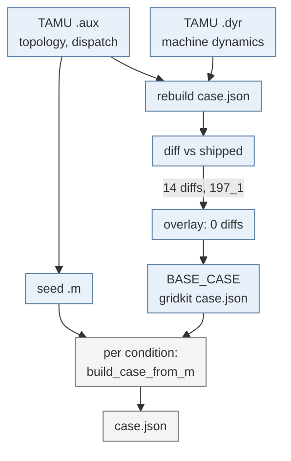
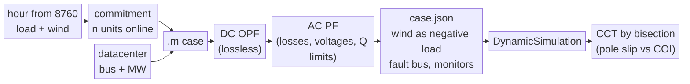
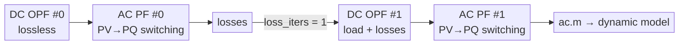
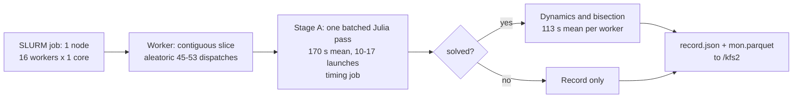
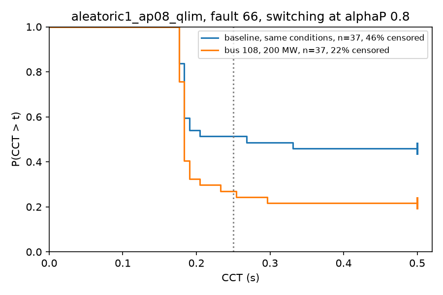
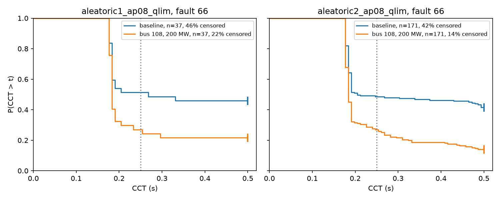
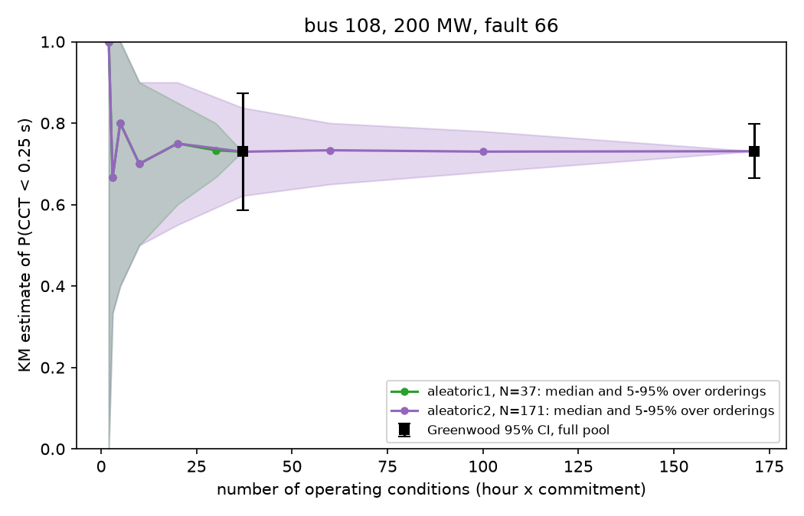
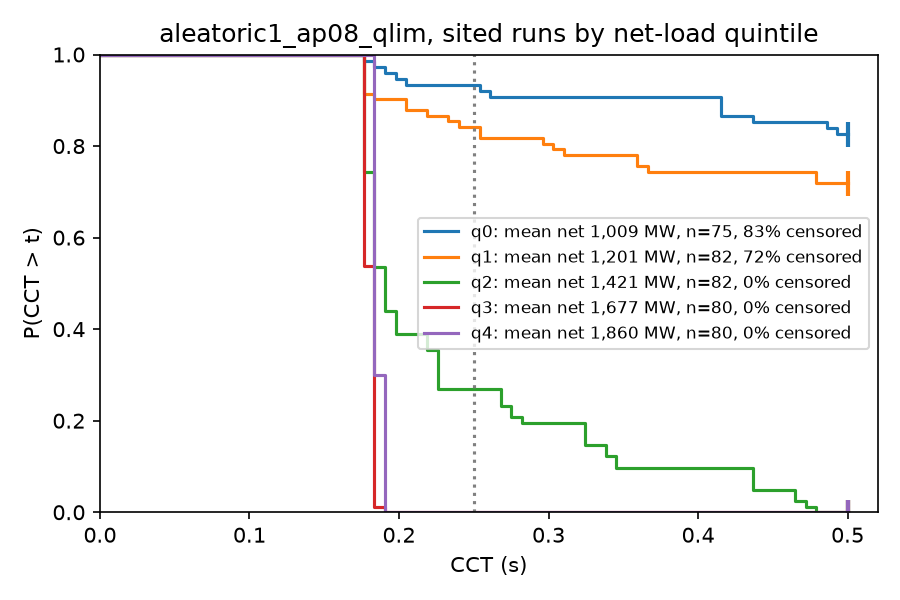
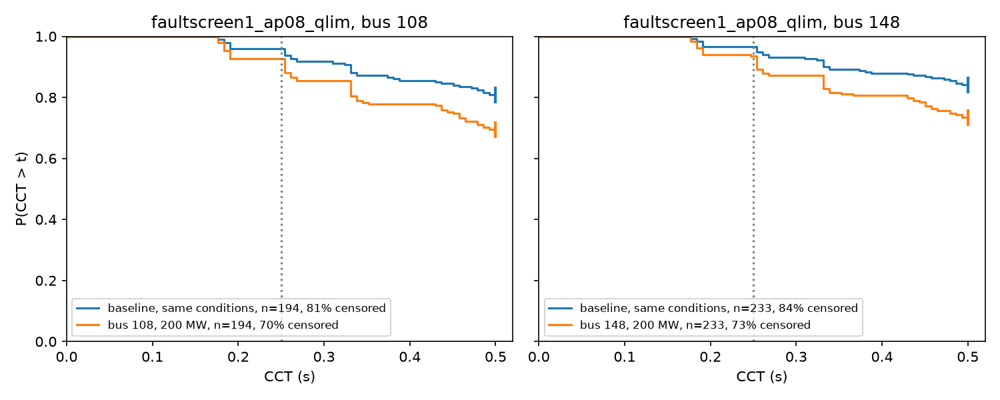

# Datacenter load and transient security: an aleatoric UQ pilot on GridKit

**Status:** pilot, October 2026; main campaigns updated November 2026 to the
P = 0.8, switched-PF setup (§7.0). ACTIVSg200 (Illinois 200-bus synthetic case).

**This report stands alone.** It explains what we asked, how we went about it,
and what came out, in general terms. It does not assume you have read the other
two documents, and it does not contain code.

| document | answers | read it when |
|---|---|---|
| **this report** | *what did we find, and how, in general terms* | start here |
| [datacenter_load_uq_plan.md](datacenter_load_uq_plan.md) | *why each choice was made; every number and its provenance* | you want to question a decision |
| [dc_campaign_pipeline.md](dc_campaign_pipeline.md) | *which function does what* | you are changing the code |

Links marked **Details** point into the plan. They are optional.

---

## 1. What this is

Two deliverables, one study:

1. **Exercise GridKit as an end user** on a problem it has not been pointed at
   before, and report back what works and what does not.
2. **Demonstrate aleatoric UQ by sampling** on a dynamics problem, and find out
   where the sampling cost actually goes — with a view to much larger grids
   where brute force stops being an option.

The vehicle is a question utilities are being asked right now:

> **Where, and how much, large datacenter load can be added before dynamic
> security degrades — given that renewable output makes system inertia vary
> hour to hour?**

This is a pilot. The grid is small, the contingency set is narrow, and several
conclusions are bounded by model validity. The point is to establish the
machinery and learn where the difficulty lives.

---

## 2. Glossary

Main terms used in our pilot study that follows.

| Term | Meaning |
|---|---|
| **Operating condition** | One (hour, commitment) pair. The hour fixes load and wind; the commitment fixes which thermal units are online. |
| **Placement** | Where the datacenter sits: none (the baseline), bus 108 or bus 148 in the fault sweep, or one of buses 6, 108, 120 and 148 in the aleatoric campaign. Not a property of the operating condition. |
| **Scenario** | One operating condition with one placement, e.g. hour 204, commitment 27, datacenter at bus 108. It is the unit the pilot's five rows describe. Each scenario is run against all faults. |
| **Baseline** | The *no-datacenter* run **for a given operating condition** — not one global reference. Each condition has its own, so `dCCT` compares like with like. |
| **Net load** | Demand minus wind, system-wide. What the thermal fleet must serve. |
| **CCT** | Critical clearing time: the longest fault the system survives. Larger is safer. |
| **Fault duration** | How long the fault stays on before it is cleared, in seconds. Stored as `fault_duration_s`. The pilot campaigns run each row at 0.1 s. The CCT search sets its own durations in `[0.05, 0.5]` s (§5). |
| **h-scale** | Multiplier on every generator's inertia constant `H` in the case. `1.0` is the base case, stored as `h_scale`. All pilot rows use `1.0`. |
| **Nadir** | The lowest system frequency reached after the fault, taken as the mean bus frequency (a proxy for the centre-of-inertia frequency), after the post-fault blank window. Higher is safer. Recorded, but not the stability test (§9). |
| **ROCOF** | Rate of change of frequency, `\|d f / dt\|` of that mean bus frequency in Hz/s, maximum after the blank window. Fast change means little inertia to absorb the imbalance. Recorded, but not the stability test (§9). |
| **The cap** | `cct_max = 0.5 s`, the top of the search. Set at a credible protection time; we do not look past it. |
| **Censored** | **CCT is at or above the cap** — the system survived the longest fault we consider. The stored `0.5` is a **lower bound, not a measurement**. Censored means *very stable*. |
| **Uncensored pair** | A (baseline, sited) pair where **both** are measured, so `dCCT` is a number rather than an inequality. |
| **Hosting capacity** | Largest datacenter MW at a bus that is both deliverable and secure. |
| **`LOCALLY_INFEASIBLE`** | The OPF cannot serve the load at all. A **result** (deliverability binds), not an error. |
| **Stage A / B / C** | The stage a parameter binds at: **A** = the dispatch (dispatch, which needs a Julia solve), **B** = the `case.json` edit, **C** = the dynamic re-run. |
| **ZIP** | Load model shares `alphaZ`/`alphaI`/`alphaP` (constant impedance / current / power), summing to 1. Written `P/I/Z`. The pilot's datacenter mix is `80/20/0` (§4.4). |
| **Main campaigns** | `aleatoric1_ap08_qlim` and `faultscreen1_ap08_qlim`: DC OPF, then AC PF with PV→PQ switching, datacenter at `P/I/Z = 80/20/0`, alphaP 0.8. The headline numbers are read against these (§7.0). |
| **DC OPF / AC PF** | DC OPF sets *who generates* from active power only (lossless, no voltages, no Q). AC PF takes that dispatch and solves the voltages and reactive power. |
| **PV bus / PQ bus** | PV: the generator fixes P and voltage magnitude, and Q is whatever holds the voltage. PQ: P and Q are fixed (a load); voltage is a result. |
| **Q limit** | A generator's maximum (`QMAX`, field-current heating) and minimum (`QMIN`, stator end-region heating) reactive output. |
| **PV→PQ switching** | When a generator's Q leaves its limits, it is fixed at the limit and its bus is solved as PQ. Standard in planning tools; the pipeline's version is in §4.2a. |

> **Details:** [physical intuition](datacenter_load_uq_plan.md#physical-intuition) covering faults, inertia, ZIP load during voltage dips, censored runs, etc.

---

## 3. The system

ACTIVSg200, a synthetic Illinois case: **200 buses, 246 branches, 49 generators**
(25 coal, 17 natural gas, 6 wind, 1 nuclear). The seed dispatch totals
**2,178 MW** of demand, which is the annual peak. The dynamic case
(`ACTIVSg200.case.json`) carries **40 Genrou** machines: 34 thermal and the 6 wind
units, which the campaign replaces with negative LoadZIP stand-ins (§4.3), leaving
**34 synchronous machines**. The 9 thermal units offline in the seed `.m`
(`GEN_STATUS = 0`) have no machine in the case and were not added in these
experiments. The JSON also carries **109 LoadZIP** loads, before the wind stand-ins are added.

Hourly load and wind come from an 8,760-hour dataset for this footprint, so the
(demand, wind) joint distribution is empirical rather than assumed.

> **Details:** [where the wind timeseries came from](datacenter_load_uq_plan.md#where-the-wind-timeseries-came-from-and-what-it-looks-like) ·
> [the operating-condition space](datacenter_load_uq_plan.md#6-the-operating-condition-space) ·
> [why 8760 is not a sampling design](datacenter_load_uq_plan.md#8760-is-not-a-sampling-design)

### One-time seed building

The shipped case is not used directly. Once per case, it is rebuilt from the two TAMU
source files, and the rebuild is checked against the shipped `case.json`. That gives two
artifacts. The **base case** supplies every machine's dynamic parameters. The **seed `.m`** supplies the dispatch: which units are online and how much they produce.
Each condition then overwrites only the dispatch, on a copy of the base case.
Blue boxes are the one-time build; grey boxes run per condition.



*Figure 3.1. One-time seed building (blue) and the per-condition build (grey).*

What we change relative to what ships:

* **Dynamics come from the base case, not the shipped file.** The rebuild differs from
  the shipped file in 14 parameters, all on machine `197_1`. The author's values are kept
  by overlay, so the base case equals the shipped file.
* **The dispatch is overwritten per condition.** The `.m` cannot store machine
  inertia, so dynamics are always inherited from the base case.
* **Six wind units become negative load stand-ins** (§4.3), so they carry no inertia.

> **Details:** [where validation checks are](m_to_case_helper.md#the-chain) describing the case rebuilding chain.

---

## 4. Building one operating condition



*Figure 4.1. Per-condition pipeline, from hour and commitment to CCT. Nadir, ROCOF and Vmin are also recorded but do not set CCT.*

### 4.1 Commitment: a feasible band, not an economic optimum

We do **not** solve a unit-commitment MILP. We compute the band of *feasible*
commitments and sample across it:

* **lower bound** — adequacy (`capacity >= net x 1.10`) and a floor of 8 thermal
  units, below which the network loses voltage support and the integrator fails
  to initialise;
* **upper bound** — `sum(PMIN) <= net`, above which the OPF is infeasible.

At 762 MW net load the band is `[18, 38]`. Both ends are legitimate: at `n = 33`
the committed minimums total 740 MW, still under the load, so the units simply
run further down their range.

**How commitment is sampled.** For each sampled hour, the band is computed from
that hour's own net load (demand minus wind). The campaign then commits at two
fixed positions in the band, 0.25 and 0.75 of the way from `n_min` to `n_max`,
rounded to whole units. So each hour gives two operating conditions. This is a
stratified choice at fixed positions, not a uniform draw from the band and not a
draw from an assumed distribution. The fault sweep (`faultscreen1_ap08_qlim`, §7.5) uses 10 hours × 2
commitments = 20 conditions. Its realised positions are 0.22 to 0.28 of the band,
after rounding to whole units. The aleatoric campaign (`aleatoric1_ap08_qlim`, §7.0) uses
20 hours × 2 commitments = 40 conditions. Hours are stratified by net-load
quintile with equal counts per quintile (2 each in the fault sweep, 4 each
in the aleatoric campaign), so each quintile carries equal weight, matching the empirical
net-load distribution. The aleatoric campaign's hours were drawn at random (seed 0). In both
campaigns the datacenter arms reuse the baseline commitment of their hour.

**Why commitment matters.** A commitment sets which thermal units are online, and
so the inertia and headroom on the system. A low-load hour can run many units at
part load, carrying more inertia, or run few, carrying less. Both are feasible,
and a single committed point would hide that spread. At hour 4779 (762 MW net
load), the two ends of the band are:

| commitment | fleet inertia | mean output per unit |
|---|---|---|
| n = 23 | **7,512 MW·s** | 33.1 MW |
| n = 33 | **11,702 MW·s** | 23.1 MW |

They differ by a **factor of 1.56 in inertia at identical load and wind**. The
n = 33 value is the pre-correction formula value, which the plan
measured 1.4 % low at hour 6164, so the true ratio is likely slightly higher. That
is the dominant
lever on stability at fixed net load. We have real data for the net-load
distribution but none for how this synthetic system's operators would commit, so
inventing a commitment PDF would fabricate the very thing that drives the
answer. Results are reported **conditionally** on commitment and can be
reweighted later if a real UC distribution appears.

Adding a datacenter does **not** change the commitment. The same `n` units stay
online, and only the dispatch is re-solved (DC OPF, then AC PF). If the committed
fleet cannot serve the added load, the case is recorded as infeasible, not
re-committed. Those failures therefore overstate what an operator could do by
committing more units.

> **Details:** [how commitment is sampled](datacenter_load_uq_plan.md#how-commitment-is-sampled) ·
> [why the band is so wide, and why we sample inside it](datacenter_load_uq_plan.md#why-the-band-is-so-wide-and-why-we-sample-inside-it) ·
> [commitment is a first-order driver (Phase 1b inertia sweep)](datacenter_load_uq_plan.md#1b-inertia-sweep-measured-2026-10-20)

### 4.2 Dispatch: DC OPF then AC PF

> **Implementation note:** Currently, the dispatch pipeline uses PowerModels.jl for both DC OPF and AC PF solves. As OPF functionality becomes available in GridKit (currently under development), we can readily substitute it into the pipeline. Maintaining PowerModels.jl as an alternative is beneficial for validation purposes and exploration of various AC OPF relaxation formulations.

Both solves use PowerModels.jl with Ipopt. Per condition:

1. **DC OPF** sets the economic dispatch. It is lossless, so the load is
   inflated by the loss estimate from the previous pass (zero on the first).
2. **AC PF** solves the real network at that dispatch, giving voltages, Q and
   the actual losses. The losses feed the next DC OPF.

*Figure 4.2* shows the loop. With `loss_iters = 1` there is one correction, so
each condition runs two DC OPFs and two AC PFs.



*Figure 4.2. Dispatch loop per condition: DC OPF, AC PF, one loss correction, AC PF. Each AC PF restarts its PV→PQ switching from all units at PV.*

The iteration exists because of a **slack problem**: a power flow leaves one
generator's P free, so it structurally cannot enforce `PMAX` on the slack, and
our slack is the nuclear unit `189_1` with **0.0082 MW** of headroom. Without
re-dispatch it would absorb the entire loss term, and in an hourly loop the
whole load change. One loss correction reduces the overshoot from 27.05 MW to
0.34 MW on the worst hour (0.016 % of load), which is why `loss_iters = 1`. A
second correction reduces it only to 0.005 MW.

**Why AC OPF is not the reported path.** We ran AC OPF too, as the other way to get Q
limits (§4.2b). Reporting DC OPF then AC PF with switching is a choice, for one main
reason:

* *The dispatch stays fixed.* Switching changes Q, not the dispatch, so a CCT
  difference from the unlimited run is due to reactive limits. AC OPF re-dispatches
  (about 280 MW summed in the pilot), so its results cannot be compared with the
  switched PF on Q alone.

A supporting reason: AC OPF drove the maximum voltage to exactly 1.100 pu in every
hour tested, riding the limit, while DC OPF then AC PF kept it at 0.99 to 1.06 pu. We
take the latter as the better starting state, but we have not tested its effect on CCT.

AC OPF stays in the pipeline as the `ac_opf` option. It is a cross-check, and it can be
reported if needed.

> **Details:** [the dispatch chain](datacenter_load_uq_plan.md#10-the-dispatch-chain) ·
> [the slack problem](datacenter_load_uq_plan.md#the-slack-problem) ·
> [the loss-iteration fix, with convergence table](datacenter_load_uq_plan.md#fix) ·
> [why DC OPF then AC PF, rather than AC OPF](datacenter_load_uq_plan.md#why-dc-opf-then-ac-pf-rather-than-ac-opf)

### 4.2a Reactive limits: PV to PQ switching

**Why.** A power flow has three bus types. A PQ bus has fixed P and Q (a load).
A PV bus fixes P and voltage magnitude, and its Q is whatever holds that voltage,
so the solver can ask a machine for any Q. A real generator cannot: it is limited
by field-current heating at the top (`QMAX`) and stator end-region heating at the
bottom (`QMIN`). Without a limit the PF can hold a bus at its setpoint with a
reactive output the machine cannot deliver.

**OPF and PF, and where Q limits can enter.**
- **DC OPF** chooses the dispatch. It uses active power only (lossless, no
  voltages, no Q), so Q limits cannot appear in it at all.
- **AC OPF** could carry `QMAX`/`QMIN` as constraints. It is not the reported
  path (§4.2), so the limits are enforced in the **AC PF**.
- **AC PF** takes the dispatch as given and solves voltages and Q. The PF we run
  does not enforce Q limits by itself. *(measured: 2 to 11 Q-limit violations per
  scenario, §4.2a table below.)*

**What we implemented.** Standard PV→PQ switching as an outer loop around the AC
PF. Solve; any unit with Q beyond a limit is fixed at that limit and its bus is
treated as PQ; re-solve; a fixed unit whose bus voltage recovers past its setpoint
returns to PV (at most twice); repeat until nothing changes. The DC OPF dispatch
(P) is never changed. Every unit is restored as an in-service machine at its fixed
Q, so the dynamic model still contains all of them. The switch is on by
default (`enforce_q_lims`). The unlimited-Q campaigns (`faultscreen1`, the highp reruns,
`cct_check`, `alphap_frontier`) pin it off, so they still reproduce. Both main campaigns (`aleatoric1_ap08_qlim` and `faultscreen1_ap08_qlim`, alphaP 0.8) run with it on.

**How switching sits in the loop.** Switching runs inside each AC PF and does not
touch the DC OPF, which never sees Q. Each AC PF restarts from all units at PV, at the
new dispatch, and re-discovers its own switches. Nothing carries into the next DC OPF
except the losses. A switched PF can shift losses (0.00 to 0.82 MW across the
five measured scenarios, linked below), and that shifts the next load inflation. A unit switched to PQ in one pass is
therefore not PQ in the next DC OPF or the next AC PF's start.

> **Details:** [PV to PQ switching in the plan, with the five-scenario measurements and the effect on earlier results](datacenter_load_uq_plan.md#reactive-limits-in-the-ac-pf-pv-to-pq-switching) ·
> [code walkthrough in the pipeline](dc_campaign_pipeline.md#42a-reactive-limits-pv-to-pq-switching) ·
> [Q-limited fold recount](ida_ic_issue.md#105-q-limits-pvpq-outer-loop-q_limit_pfpy)

### 4.2b AC OPF as a second Q-limit route

**What.** PM.jl's AC OPF carries `QMAX`/`QMIN` as constraints, so it enforces Q
limits without a switching loop. It replaces DC OPF plus AC PF, and the pipeline
runs it as an opt-in path (`ac_opf`). The full reasoning is in
[plan §10](datacenter_load_uq_plan.md#ac-opf-as-a-second-q-limit-route-pmjl); the
code is in [pipeline §4.2b](dc_campaign_pipeline.md#42b-ac-opf-path-pmjl-second-q-limit-route).

**Pilot** (five scenarios at hour 204, alphaP 0.8: four sited scenarios, bus 108 or 148 × commitment 27 or 38, plus one no-datacenter base at commitment 27): the AC OPF converged at all five with zero Q
violations. Losses were lower than the switched PF (23.6 to 26.3 MW against 32 to
36 MW). The dispatch moved by about 280 MW summed, and the slack sat at its `PMAX`
with zero headroom, against 0.75 to 1.53 MW switched. `Vmax` reached 1.100.

**Campaigns** (full design, 1020 rows each). Relative to the switched PF, AC OPF
shifts CCT upward: mean +0.022 s at alphaP 0.2 and +0.027 s at 0.8, with a largest
shift of +0.32 s. The control, the same AC OPF with Q limits widened, differs from
the Q-limited AC OPF by −0.002 s on average (range −0.106 to +0.014 s). So the Q
limits themselves account for almost none of the AC OPF shift. What produces the rest
is not isolated.

**Why switching, not AC OPF.** AC OPF changes the dispatch, and switching does not.
In the pilot, AC OPF moved about 280 MW summed and parked the slack at `PMAX`.
Switching keeps the DC OPF dispatch and changes only Q, moving losses by at most
0.82 MW. So a CCT difference from the unlimited run can be attributed to reactive
limits alone. That is the one reason we report switching, and it is the question this
report asks.

**Status.** Not adopted for the main campaigns. Switching stays the primary Q-limit route, and
AC OPF stays a cross-check that can be reported if asked. Details, status counts and the
control design are in [plan §10](datacenter_load_uq_plan.md#ac-opf-as-a-second-q-limit-route-pmjl).

### 4.3 Wind becomes negative load

Wind units are removed as `Genrou` machines and re-inserted as a **negative
`LoadZIP`** at their own bus, with `alphaI = 1` (constant current). Left as
synchronous machines, they could contribute **up to 2,766 MW·s** of inertia at
their ratings (sum over the 6 wind Genrou units of `H` × `mva`), whatever the wind output, and inertia is what the study varies.
Constant power made the integrator fail at high wind penetration.

**Implementation.** Hourly wind MW is pinned in the DC OPF, the AC power flow
solves its reactive output, and the solved P and Q are written into the ZIP.
Stage B rewrites `case.json`: each wind unit's `Genrou`, `Tgov1` and `SexsPti`
are removed and a `LoadZIP` is added with `Pnom = −PG/100` and
`Qnom = −QG/100` (per unit, 100 MVA base), `alphaI = 1`, `alphaP = 0`. GridKit
treats positive `Pnom` as consumed, so the negative value injects PG. At the
initial voltage this reproduces the power-flow P and Q exactly; after that the
injection scales with |V|, which is constant current.

> **Details:** [wind pipeline, function by function](datacenter_load_uq_plan.md#pipeline-trace-one-wind-unit-one-hour)

**Why it is acceptable.** Converter-interfaced generation is modelled in
positive-sequence transient stability as a controllable current source. The
Sandia PSTess manual says that, *"as in the WECC REGC_A model"*, the converter
interface is "a controllable current source" (Elliott et al., 2021,
[OSTI 1819998](https://www.osti.gov/biblio/1819998), abstract). A constant-current
ZIP is a simple stand-in for that current injection, not a REGC_A model. GridKit
accepts negative ZIP values (no parameter validation), and the pre-fault power
drift includes the stand-ins. Post-fault behaviour with them is not separately
verified.

> **Details:** [wind: why negative load, not fixed](datacenter_load_uq_plan.md#3-wind-why-negative-load-not-fixed) ·
> [implementation](datacenter_load_uq_plan.md#implementation) ·
> ["net load" is an aggregate, not a per-bus subtraction](datacenter_load_uq_plan.md#net-load-is-an-aggregate-not-a-per-bus-subtraction)

### 4.4 The datacenter

A datacenter is represented as **additional electrical load placed at one
bus**. Two things about *how* it is added matter to the answer.

**It is added before dispatch, not after.** The load enters the network data
that the optimiser sees, so the commitment and the dispatch must produce and
deliver the extra power. If it were added after dispatch, neither the commitment
nor the OPF would see it: the power flow would have the slack bus supply it, and
the committed fleet could be too small to serve it or larger than needed.

**It gets its own load device, with its own voltage behaviour.** Load in these
cases is represented by a **ZIP model**, which splits demand into three parts by
how each responds when voltage sags: a constant-**impedance** part (falls as
$V^2$), a constant-**current** part (falls as $V$), and a constant-**power**
part (does not fall at all). The split is written here as `P/I/Z` percentages.

The distinction is the physical reason a datacenter is interesting. Ordinary
constant-impedance load *sheds itself* during a voltage dip and helps the system
recover. Datacenter load is rectifier- and UPS-fed and behaves far closer to
constant power: it keeps demanding the same megawatts at reduced voltage, which
means drawing more current, which depresses voltage further. If the new load
were simply folded into whatever device already existed at the bus, it would
inherit the host's helpful constant-impedance behaviour and the study would
measure the wrong thing. So the datacenter gets a **separate** device, and the
host device is left as it was.

**Every load device in the shipped case is constant impedance.** All 109
`LoadZIP` devices in `ACTIVSg200.case.json` have `alphaI = alphaP = 0`, so
`alphaZ = 1`. Before any datacenter is added, every host load is pure constant
impedance.

**How the datacenter reaches the model.** The MW is added to the bus's demand in
the `.m` before dispatch, so the OPF has to serve it. The network build then
folds all demand at each bus into one `LoadZIP`, host plus datacenter together.
`split_out_datacenter` subtracts the datacenter's MW and MVAr from that device,
which restores the original host load, and appends a second device for the
datacenter. The end state is the original host (N1, `alphaZ = 1`) beside the
datacenter (N2, `P/I/Z = 80/20/0`). That is the same as adding an N2 device
beside an untouched N1; the subtraction only undoes the fold. A bus with no load
has no host to restore, and the datacenter device is the only one.

> **Details:** [datacenter pipeline, function by function](datacenter_load_uq_plan.md#how-a-datacenter-enters-the-model-pipeline-trace)

**Placement.** The candidate pool is the 16 load-carrying buses of the `phase3b`
siting sample. The two main campaigns use subsets of it:

* the fault sweep (`faultscreen1_ap08_qlim`, §7.5): buses 108 and 148, at 200 MW;
* the aleatoric campaign (`aleatoric1_ap08_qlim`, §7.0): buses 6, 108, 120 and 148, at
  50, 100, 200, 300 or 400 MW.

> **Details:** [placement selection](datacenter_load_uq_plan.md#placement-selection)

**The pilot mix is `P/I/Z = 80/20/0`.** The physically intended model is pure
constant power, `100/0/0`. It is not simulable at every bus (see
[section 8](#8-gridkit-end-user-feedback)), and folds grow with `alphaP` (hunt
summary below), so `alphaP` 1.0 fails more initial-condition solves. The campaigns therefore use 80% constant power and 20% constant current, with no constant
impedance. The 20% constant-current share rests on a plausible but unverified argument: a
converter-fed load reaches its current limit in a deep dip, and a current-limited converter
behaves as constant current. The 20% is a choice, not a fitted value. The earlier
campaigns used `20/80/0`, now a sensitivity case; its effect on CCT is in the
[plan](datacenter_load_uq_plan.md#alphap-tested-as-a-sensitivity-it-governs-simulability-not-cct-measured-2026-10-22).

**Hunt summary (IDA initial-condition failures at high `alphaP`).** At 200 MW and `alphaP`
0.8, the 18 buses where IDA finds no fault-on initial condition are the buses where the
fault-on network algebra has a fold. This matches exactly on three dispatches. The working
hypothesis is that the datacenter moves the fold past a bolted fault, so these are physical
no-steady-state outcomes, not an IDA defect. In practice, a higher `alphaP` leaves fewer buses
where a datacenter of a given size can be sited. This is supported, not proven. The IDASolve
(integration) failures are a separate issue. Definitions, how the fold is computed, the
results and the table are in the [plan](datacenter_load_uq_plan.md#fold-hunt-summary-ida-initial-condition-failures-at-high-alphap);
the full record is in [the IDA initial-condition issue](ida_ic_issue.md)
([read first](ida_ic_issue.md#0-read-first), [results](ida_ic_issue.md#10-method-and-results),
[hypothesis](ida_ic_issue.md#11-hypothesis-h1-and-what-it-means),
[experiment index](ida_ic_issue.md#12-experiment-index)).

Power factor is assumed 0.98 lagging.

> **Details:** [ZIP coefficients are a first-class lever](datacenter_load_uq_plan.md#4-zip-coefficients-are-a-first-class-lever) ·
> [is the 20/80/0 mix defensible?](datacenter_load_uq_plan.md#is-the-20800-mix-defensible) ·
> [Phase 3: datacenter dimension](datacenter_load_uq_plan.md#phase-3-datacenter-dimension) ·
> [what is sampled, and what is chosen](datacenter_load_uq_plan.md#what-is-sampled-and-what-is-chosen) ·
> [design of the sweep](datacenter_load_uq_plan.md#design-of-the-sweep) ·
> [two limits, and the thermal one binds first](datacenter_load_uq_plan.md#two-limits-and-the-thermal-one-binds-first)

---

## 5. CCT by bisection

Critical clearing time is found by bisecting fault duration in `[0.05, 0.5]` s,
with a stability test of **pole slip relative to the centre of inertia**. The
centre of inertia is the inertia-weighted average rotor angle of the fleet,

$$\delta_{COI}(t) = \frac{\sum_i H_i S_i \delta_i(t)}{\sum_i H_i S_i}$$

and a run is declared unstable when any machine leaves that collective frame:

$$\max_{i,\,t} \bigl| \delta_i(t) - \delta_{COI}(t) \bigr| > 180°$$

Every symbol maps to a GridKit name or to a derived quantity:

| Symbol | Meaning | GridKit name, and where it is read |
|---|---|---|
| $i$ | one of the 26 Genrou machines in ACTIVSg200 | `Genrou` device `id`, e.g. `49_1_genrou` |
| $H_i$ | inertia constant, in s | `H` in `params` of device $i$ in `case.json` |
| $S_i$ | machine MVA base | `mva` in `params` of device $i$ in `case.json` |
| $\delta_i(t)$ | rotor angle of machine $i$ | Genrou state `delta` (radians), monitor column `Genrou_<device id>_delta`, e.g. `Genrou_49_1_genrou_delta`; converted to degrees |
| $t$ | simulation time, in s | `t` column of the monitor CSV |
| $\delta_{COI}(t)$ | centre-of-inertia angle, in degrees | not a model parameter; computed from the weights $H_i S_i / \sum_j H_j S_j$ (`_coi_weights`, `is_unstable` in `py-utils/campaign.py`) |
| $180°$ | pole-slip threshold | `pole_slip_deg` in `is_unstable`; not a model parameter |

Measuring against the COI rather than a fixed reference separates "the whole
system swung" (fine) from "one machine left the group" (not fine).

The bisected variable is the fault duration. The fault is applied at `t_on` =
1.0 s and cleared at `t_off` = `t_on` + duration, in the `fault_on` and
`fault_off` events of `solver.json`.

* **2 simulations** is the early-exit path: stable at the bottom, still stable at
  the top, return censored. If the bottom probe (0.05 s) is already unstable, the
  search stops with no CCT (NaN) after one simulation.
* **8 simulations** means the boundary was inside the bracket. The reported CCT
  is the last stable duration tried, so it sits within the 0.01 s tolerance below
  the boundary.

The cap at 0.5 s is deliberate. EHV primary clearing is ~0.05–0.10 s and
breaker-failure backup ~0.25–0.50 s *(standard protection practice, stated from
domain knowledge rather than a cited standard)*; a multi-second fault is not a contingency
any protection scheme permits, so a CCT beyond the cap has no engineering
meaning and is **reported as censored rather than searched for**.

The bisection probes write only the `delta` channels, not the full monitor set:
that cut probe output from 26.25 MB to 1.91 MB per probe (**13.8×**) with the
resulting CCT **identical** (0.2891 both ways).

> **Details:** [why critical clearing time is the headline metric](datacenter_load_uq_plan.md#why-critical-clearing-time-is-the-headline-metric) ·
> [stability criterion, and the false-positive test that was rejected](datacenter_load_uq_plan.md#stability-criterion) ·
> [bounding the search: faults must stay credible](datacenter_load_uq_plan.md#bounding-the-search-faults-must-stay-credible) ·
> [CCT measured: it discriminates, and net load drives it](datacenter_load_uq_plan.md#cct-measured-it-discriminates-and-net-load-drives-it) ·
> [the full QoI set](datacenter_load_uq_plan.md#the-qoi-set) ·
> [monitors: the shipped case records almost nothing](datacenter_load_uq_plan.md#monitors-the-shipped-case-records-almost-nothing)

---

## 6. Parallel execution on Kestrel

The aleatoric campaign ran as one SLURM job on one node: 16 single-core workers, each taking a contiguous slice of `conditions.csv`. A worker solves its stage-A dispatches in one batched Julia pass, then runs dynamics for the dispatches that solved. Records are written per run, so a campaign can resume.

> **Details:** [wall time for the two main campaigns](datacenter_load_uq_plan.md#wall-time-in-the-two-main-campaigns-measured-2026-11-10) ·
> [parallel sampling runs](datacenter_load_uq_plan.md#parallel-sampling-runs) ·
> [storage](datacenter_load_uq_plan.md#storage) ·
> [execution model](datacenter_load_uq_plan.md#execution-model-one-job-per-worker-julia-batched-inside-it-decided-2026-10-22)

| campaign | design rows | simulated | wall | per worker, mean: stage A / dynamics |
|---|---|---|---|---|
| `aleatoric1_ap08_qlim` | 840 | 484 | 6.0 min (SLURM 19813984) | 170 s / 113 s |
| `aleatoric2_ap08_qlim` | 3,780 | 2,155 | 17.1 min (SLURM 19830145) | 297 s / 516 s |
| `faultscreen1_ap08_qlim` | 1,020 | 935 | ~4.4 min (slowest worker) | 122 s / 92 s |

*Simulated* means the dispatch solved and dynamics ran (`ok` plus `sim_failed`). The rest are `LOCALLY_INFEASIBLE` at dispatch.

Resources, measured for `aleatoric2`:

* **CPU.** Workers were busy 86% of the job (`sacct`: 235 CPU-min over 16 workers). The job
  held the whole 104-CPU node and ran 16 workers by choice, so 13% of its CPUs were busy.
* **Memory.** 0.88 GB per worker (Python and Julia); the node peaked at 13.8 GB.
* **Load balance.** Worker wall times ranged from 511 s to 1,019 s. Contiguous slices leave
  the mean worker idle about 20% of the job.
* **Stage A.** 1.3 s per dispatch, against 3.3 s in `aleatoric1`. A working hypothesis is
  that larger batches amortise Julia launches; this is not isolated.
* **Storage.** A *design row* is one line of `conditions.csv`: one sampling point, set by its
  hour, commitment, datacenter bus and size, and fault bus. Its duration and h-scale columns
  are constant in the pilot campaigns (0.1 s and 1.0, see the glossary). Stage A solves
  each row once, and a solved row also gets a CCT bisection and a stored time series. The
  three main campaigns (5,640 design rows) hold 15.9 GB on `/kfs2` and 88 GB of scratch on
  disk. For `aleatoric`, that is 2.6 MB per design row. Four measures keep it down:
  * **Bisection probes write `delta` only.** The CCT needs time and the Genrou rotor angle,
    21 of 441 columns. One bisection went from 210 MB to 15.3 MB (13.8×) with the CCT
    unchanged, and its wall time from 4.0 s to 2.1 s, on one 200-bus case.
  * **Parquet with zstd and float32 channels.** One 200-bus run went from 26.3 MB of CSV to
    5.3 MB (5.0×). Column pruning reads 3 of 467 columns.
  * **Only `ok` runs keep a series.** Infeasible and `sim_failed` rows keep their record only.
  * **Records go straight to `/kfs2` at the end of each run**, with no copy step from scratch.
    Scratch is not `/tmp`, which is RAM on nodes without local disk.

  Details, including the SLURM I/O totals, are in the
  [plan's storage section](datacenter_load_uq_plan.md#pilot-totals-and-what-a-design-row-is).
  The striping layout is applied to each campaign's directories and verified with `lfs getstripe`.
  Its speed benefit is a working hypothesis.



*Figure 6.1. Per worker, aleatoric means. Fault sweep: stage A 122 s, dynamics 92 s.
Launch counts from the timing job, not the campaign logs.*

**At 2,000 buses.** Per-worker memory is partly measured. One dynamic run with full
monitors peaked at 126 MB, and one stage-A batch of two cases (dc-opf and ac) peaked at
1.0 GB including Julia (SLURM 19830315, a single-process probe, not a campaign). A full
worker batch of about 225 dispatches is not measured, and it sets the per-worker number.
Wall time and storage at 2,000 buses are projections in [§10](#10-first-look-at-activsg2000).

---

## 7. Results

> **Details for this section:**
> [main results, both campaigns](datacenter_load_uq_plan.md#main-results-the-two-switched-campaigns-measured-2026-11-10) ·
> [`aleatoric1_ap08_qlim` run](datacenter_load_uq_plan.md#aleatoric-with-switching-aleatoric1_ap08_qlim-run-2026-11-10) ·
> [earlier campaign results, moved from this report](datacenter_load_uq_plan.md#earlier-campaign-results-moved-from-the-report-2026-11-10) ·
> [`phase3b` pilot](datacenter_load_uq_plan.md#pilot-results-phase3b-run-2026-10-22) ·
> [`faultscreen1` (alphaP 0.2, unlimited Q)](datacenter_load_uq_plan.md#fault-location-screening-faultscreen1-run-2026-10-23) ·
> [Phase 1 go/no-go gate](datacenter_load_uq_plan.md#phase-1-does-the-premise-hold-passed-2026-10-20) ·
> [`inertia_MWs` undercount bug and its correction](datacenter_load_uq_plan.md#inertia_mws-was-silently-undercounted-bug-fixed-2026-10-22)

### 7.0 Sampling space and the two main campaigns

Both main campaigns use the operating-condition design of §4.2, where an operating condition is an (hour, commitment) pair. Both use DC OPF dispatch, then AC power flow with PV→PQ switching (§4.2a), the datacenter as an 80/20/0 ZIP device added on top of the host load (§4.4), and alphaP 0.8. They differ in what else varies:

| | **Aleatoric campaign** `aleatoric1_ap08_qlim` | **Fault campaign** `faultscreen1_ap08_qlim` |
|---|---|---|
| purpose | how much operating conditions move CCT | which fault locations and placements matter |
| hours | 20 (4 per net-load quintile) | 10 (2 per net-load quintile) |
| operating conditions (hour, commitment) | 40 | 20 |
| fault locations | 1 (bus 66) | 17 |
| placements | none, or bus 6, 120, 108, 148 | none, or bus 108, 148 |
| datacenter size | 50, 100, 200, 300, 400 MW | 200 MW |
| runs | 840 = 40 baseline + 800 datacenter | 1,020 = 340 baseline + 680 datacenter |
| solved | 439 (40 baseline, 399 datacenter) | 767 (340 baseline, 427 datacenter) |
| no outcome | 401 (45 `sim_failed`, 356 at dispatch) | 253 (168 `sim_failed`, 85 at dispatch) |
| datacenter runs censored at the 0.5 s cap | 121 of 399 (30.3%) | 306 of 427 (71.7%) |

The aleatoric campaign varies operating conditions, placement and size, at one fault. The fault campaign varies fault location and placement, at one size. **No outcome** means the run did not dispatch or did not simulate. It is reported as such, never as stable or unstable.

### 7.1 Reading the curves: Kaplan–Meier and censoring

Each curve estimates **$P(\mathrm{CCT} < t)$**: the share of operating conditions in which a fault cleared at $t$ seconds would be unstable. A run still stable at the 0.5 s simulation cap is *censored*: we know $\mathrm{CCT} \ge 0.5$ s, not its value. The Kaplan–Meier (KM) estimator uses censored runs correctly:

$$\hat S(t)=\prod_{t_i\le t}\Bigl(1-\frac{d_i}{n_i}\Bigr),\qquad \widehat P(\mathrm{CCT}<t)=1-\hat S(t)$$

Here the $t_i$ are the distinct measured CCT values, $d_i$ is the number of runs measured at $t_i$, and $n_i$ is the number still at risk at $t_i$ (runs measured at or after $t_i$, plus censored runs). No measured CCT exceeds the cap, so for $t < 0.5$ s the estimate is simply the number of runs measured below $t$, divided by all solved runs, with the censored runs left in the denominator. No-outcome runs are excluded, so every curve is conditional on the run having solved. Figures plot the complement, $P(\mathrm{CCT} > t)$.

> **Worked example:** [ten made-up CCTs, with two censored runs, and the calculation step by step](datacenter_load_uq_plan.md#kaplanmeier-worked-example-on-ten-made-up-ccts) (illustrative values, not campaign data).

The rest of §7 runs as follows. §7.2 works one matched example, and §7.2b puts the 37- and 171-condition curves side by side. §7.3 asks what adding operating conditions does to the estimate, using both pools. §7.4 splits risk by net load. §7.5 reports the fault sweep. §7.6 quantifies censoring. §7.7 covers the earlier campaigns and alphaP.

### 7.2 A simple example: one bus, one size, one fault

**Sampling:** `aleatoric1_ap08_qlim`, 200 MW at bus 108, fault at bus 66. Of the 40 operating conditions, 37 solve with the datacenter. The baseline is the same 37 conditions with no datacenter.

**Greenwood interval.** Greenwood's formula estimates the variance of a KM estimate: $\widehat{\mathrm{Var}}\big(\hat S(t)\big)=\hat S(t)^2\sum_{t_i\le t}\frac{d_i}{n_i(n_i-d_i)}$, with $d_i$ and $n_i$ as in §7.1. We report $\mathrm{SE}=\sqrt{\widehat{\mathrm{Var}}}$. The 95% interval is $\hat P\pm 1.96\,\mathrm{SE}$, with $\hat P=1-\hat S(t)$ (the plain interval, not log–log).

| | no datacenter | 200 MW at bus 108 |
|---|---|---|
| operating conditions (matched) | 37 | 37 |
| censored at 0.5 s | 46% | 22% |
| **P(CCT < 0.25 s)** | **0.49** | **0.73** |
| 95% Greenwood CI for P(CCT < 0.25 s) | 0.325–0.648 | 0.587–0.873 |
| KM median CCT | 0.27 s | 0.18 s |



*Figure 7.2. Kaplan–Meier P(CCT > t) on the same 37 operating conditions, without the datacenter (blue) and with the 200 MW datacenter at bus 108 (orange), fault at bus 66. Curves run to the 0.5 s cap. A censored run is still stable at the cap, so its curve holds at that value, and the tick at 0.5 s marks the censored share.*

On these conditions the datacenter shortens CCT: P(CCT < 0.25 s) rises from 0.49 to 0.73. Three of the 40 conditions did not solve with the datacenter, and their baseline CCT is censored. Counting all three as CCT ≥ 0.25 s gives 27 of 40 (0.675). Counting all three as below 0.25 s gives 30 of 40 (0.75). The direction holds, but on this sample the size of the shift is uncertain by about 0.07.

> **Working hypothesis for the direction.** The datacenter adds 200 MW to bus 108, on top of the unchanged constant-impedance host load, and 80% of that added load does not fall with voltage. During the fault the added load keeps drawing its power, where a constant-impedance load of the same size would fall, which pushes the generators harder. The alphaP sensitivity (§7.7) does not separate the two. It varied the P/I split with Z at zero, and CCT barely moved. So the presence of non-impedance load, rather than the P/I split within it, is the likely driver. This is not tested here. A run with the same 200 MW at a fixed impedance share would test it.

### 7.2b The same example at 37 and 171 operating conditions

**Sampling:** bus 108, 200 MW, fault at bus 66, against the matched baseline on the same conditions. Left: `aleatoric1_ap08_qlim`, 37 conditions (the §7.2 sample). Right: `aleatoric2_ap08_qlim`, 171 conditions (60 hours × 3 commitments, of which 171 solve with the datacenter). The two campaigns share no conditions, so they are independent samples.

| | 37 conditions (§7.2) | 171 conditions |
|---|---|---|
| no datacenter: P(CCT < 0.25 s), 95% Greenwood CI | 0.486 (0.325–0.648) | 0.515 (0.440–0.590) |
| 200 MW at bus 108: P(CCT < 0.25 s), 95% Greenwood CI | 0.730 (0.587–0.873) | 0.731 (0.665–0.797) |
| censored at 0.5 s, no datacenter / bus 108 | 46% / 22% | 42% / 14% |



*Figure 7.2b. Kaplan–Meier P(CCT > t) at bus 108, 200 MW (orange) against the matched baseline (blue), fault at bus 66. Left: 37 conditions (`aleatoric1`). Right: 171 conditions (`aleatoric2`). Same axes in both panels, curves run to the 0.5 s cap, and the tick at 0.5 s marks the censored share. With 171 conditions the curve has about 4.6 times as many conditions behind each step, so it resolves finer structure and the interval at 0.25 s is narrower.*

Two points. First, the datacenter moves P(CCT < 0.25 s) from about 0.5 to 0.73 in both campaigns (the two panels). Second, the datacenter-arm interval is 0.132 wide at 171 conditions, against 0.287 at 37, the narrowing expected from the larger sample. The interval describes the procedure: if the study were repeated with new samples of conditions, about 95% of intervals built this way would contain the true P. It does not give a 95% probability that the true value lies in this one. Overlap of two separate intervals is not a test of a difference. The arms are matched on the same conditions, so a difference needs a paired interval, which we have not computed. Nine of the 180 conditions did not solve with the datacenter (8 solve failures, 1 simulation failure) and are excluded from the 171. §7.3 gives a related check on how the estimate settles as conditions are added.

### 7.3 More operating conditions: how the estimate settles

We checked whether the estimate stops moving as conditions are added, by recomputing it on random subsets of each pool (*subsampling*, Politis and Romano, 1994; references and details in the [plan](datacenter_load_uq_plan.md#subsampling-the-term-what-it-is-used-for-and-what-73-showed)). For bus 108, 200 MW, the median over 2,000 random orderings settles at 0.730–0.733 from about 30–37 conditions in both pools. This holds for these two pools only, and the check does not give an uncertainty; that is the Greenwood interval in §7.2b. The campaign did not need it, because all samples are already used. We might use the same check later as an alternative way to size a future study, if a full-size design costs too much. The plan sets out how.



*Figure 7.3. KM estimate of P(CCT < 0.25 s) at bus 108, 200 MW, over random orderings of the 37-condition pool (green) and the 171-condition pool (purple). Line: median over 2,000 orderings. Shading: 5th–95th percentile. Black squares: full-pool estimate with its 95% Greenwood interval. Both medians sit at 0.730–0.733 from about 30–37 conditions onward. This is a check on these two pools only.*

The spread of CCT across conditions does not shrink with more samples. Adding conditions shrinks the error in the probability; the spread is a property of the conditions, and reducing it needs conditioning on something that explains it, such as net load (§7.4). Within the two highest net-load quintiles every measured CCT lies between 0.177 and 0.191 s, while the lower quintiles range up to 0.49 s.

### 7.4 Risk by net load

**Sampling:** `aleatoric1_ap08_qlim`, datacenter at buses 6, 120, 108 and 148, at 50 to 400 MW, one fault. Hours are split into five net-load quintiles of 4 hours each. Each quintile holds 160 datacenter runs (4 buses × 5 sizes × 4 hours × 2 commitments).

| quintile | mean net load (MW) | datacenter runs solved | no outcome | censored | **P(CCT < 0.25 s)** |
|---|---|---|---|---|---|
| q0 | 1,009 | 75 of 160 | 85 | 83% | **0.07** |
| q1 | 1,201 | 82 of 160 | 78 | 72% | **0.16** |
| q2 | 1,421 | 82 of 160 | 78 | 0% | **0.73** |
| q3 | 1,677 | 80 of 160 | 80 | 0% | **1.00** |
| q4 | 1,860 | 80 of 160 | 80 | 0% | **1.00** |



*Figure 7.4. Kaplan–Meier P(CCT > t) by net-load quintile, datacenter runs only (all buses and sizes), fault 66.*

P(CCT < 0.25 s) climbs from 0.07 in the lowest quintile to 1.00 in the two highest, with the step between q1 (mean 1,201 MW) and q2 (mean 1,421 MW). Conditioning on net load therefore accounts for the spread in §7.3.

- **Conditional on solving.** Between 49% and 53% of datacenter runs in each quintile have no outcome. Whether the no-outcome runs would have the same CCT is unknown.
- **Dispatch failures are spread across quintiles** (68 to 77 each), unlike the fault campaign (§7.5).
- **Baseline has only 8 solved runs per quintile**, too few for a quintile estimate. The matched comparison is in §7.2.

### 7.5 The fault sweep: what it measures and which faults discriminate

**Sampling:** `faultscreen1_ap08_qlim`, the fault sweep. 10 hours (2 per net-load quintile) × 2 commitments × 17 fault locations. There are 340 baseline runs with no datacenter, all solved, and 680 runs with a 200 MW datacenter at bus 108 or 148.

| | baseline (no datacenter) | datacenter (200 MW) |
|---|---|---|
| solved | 340 of 340 | 427 of 680 |
| censored at 0.5 s | 302 (88.8%) | 306 (71.7%) |
| no outcome | — | 253: 168 `sim_failed` (97 at alphaP 0.8 only, 71 at both alphaP levels), 85 at dispatch |

Matched by (hour, commitment, fault), using datacenter runs that solved:

* **Bus 108**, 194 pairs: P(CCT < 0.25 s) is 0.072 with the datacenter and 0.041 without. Censored: 70% and 81%.
* **Bus 148**, 233 pairs: 0.064 and 0.034. Censored: 73% and 84%.
* The datacenter is measured where the baseline is censored in 22 pairs (bus 108) and 25 pairs (bus 148). The reverse happens in none.
* Where both runs are measured, the pairs cover the same 37 conditions at both buses, because the baseline is measured on only 38 conditions. The median ΔCCT is 0 s, 5 of 37 pairs fall with the datacenter, and the largest drop is 0.24 s.

Reading: on this campaign the datacenter raises P(CCT < 0.25 s) only slightly, from 0.04 to 0.07 at bus 108 and from 0.03 to 0.06 at bus 148. Most baseline runs are censored (81–84% on these pairs), so the signal is weak. The direction matches §7.2, which uses a different fault and a measured baseline.

> **Working hypothesis for the 97 runs that fail only at alphaP 0.8.** These are datacenter runs that solve at alphaP 0.2 and fail at alphaP 0.8: 89 at initialization and 8 in the transient. The constant-power share may move the fault-on dispatch past a bolted fault, so no post-fault start exists. This is supported on one dispatch (h1879), not established elsewhere, and can be falsified. The predictions, and the breakdown of the 71 shared failures and the 85 dispatch failures, are in the [issue doc §11](ida_ic_issue.md#11-hypothesis-h1-and-what-it-means) and the [plan](datacenter_load_uq_plan.md#main-results-the-two-switched-campaigns-measured-2026-11-10). Report these runs as no outcome.

All 85 dispatch failures fall in q0, the lowest net-load quintile: 85 of its 136 datacenter runs, or 63%. No dispatch failure occurs in q1 to q4. The cause of the q0 concentration has not been checked.

Baseline CCT by fault location, for the 20 baseline conditions each:

| fault bus | median baseline CCT | censored | measured of 20 |
|---|---|---|---|
| **94** | **0.37 s** | **35%** | **13** |
| 66 | 0.5 s (cap) | 55% | 9 |
| 68 | 0.5 s (cap) | 60% | 8 |
| 181 | 0.5 s (cap) | 60% | 8 |
| other 13 | 0.5 s (cap) | 100% | 0 |



*Figure 7.5. Kaplan–Meier P(CCT > t) for the datacenter at bus 108 (left) and bus 148 (right), each against the baseline on the same matched (hour, commitment, fault) conditions. Baseline in blue, datacenter in orange.*

Thirteen of 17 fault locations are censored in every baseline condition, so a uniform fault budget spends most of its runs on faults that cannot separate operating conditions. Fault screening should be cheap, followed by concentration on the informative faults; the [plan](datacenter_load_uq_plan.md#main-results-the-two-switched-campaigns-measured-2026-11-10) has the design detail. Bus 66, the fault in the aleatoric campaign, is not the most informative location: bus 94 is. At 200 MW, buses 108 and 148 look alike in this sample (0.072 against 0.064 for P(CCT < 0.25 s)).

### 7.6 Censoring: dropping censored runs inflates risk

Dropping censored runs from a risk estimate inflates it by a factor that depends only on the censored share, not on the threshold:

| campaign | datacenter runs solved | measured | censored share | inflation from dropping censored runs |
|---|---|---|---|---|
| `aleatoric1_ap08_qlim` | 399 | 278 | 30.3% | **1.44×** |
| `faultscreen1_ap08_qlim` | 427 | 121 | 71.7% | **3.53×** |

$$\frac{\hat P_{\text{drop}}}{\hat P_{\text{keep}}} = \frac{N_{\text{solved}}}{N_{\text{measured}}}$$

This follows from §7.1, since censoring sits at one point beyond every measured value. The factor is arithmetic, but it is easy to get wrong by quoting one population's censored share against another's label. The 3.53× corresponds to 71.7% censoring among datacenter runs that solved. It is not the share of the 1,020 planned runs.

### 7.7 Earlier campaigns and the alphaP sensitivity

These results are not in the headline numbers above. Their details are in the plan.

* **`phase3b`** (243 conditions, 16 buses, 3 hours) is the siting pilot. It found that hosting capacity varies 8× across buses (50 to 400 MW). The limit at a given bus shifts with the operating condition, so capacity is not hour-independent.
* **`aleatoric1` and `faultscreen1`** at alphaP 0.2 with unlimited Q are first-pass versions of the two main campaigns. Their analyses, including the earlier censoring factors of 1.36× and 4.31×, are in the plan.
* **alphaP** was tested as a sensitivity. CCT spread across alphaP was zero in 10 of 12 cases, but alphaP decides whether a case simulates at all. The main campaigns use 0.8 with switching. At alphaP 0.8, 253 of 680 datacenter runs have no outcome, against 156 at 0.2 (§7.5). With the fault at the three other locations tested, pure constant-power load at 200 MW runs at 93–100% of feasible dispatches, against 59% at bus 66. The limit is therefore not primarily a property of the load; see the plan and [issue §11](ida_ic_issue.md#11-hypothesis-h1-and-what-it-means).

> **Details:** [`alphaP` tested as a sensitivity](datacenter_load_uq_plan.md#alphap-tested-as-a-sensitivity-it-governs-simulability-not-cct-measured-2026-10-22) ·
> [the feasible-`alphaP` frontier, mapped](datacenter_load_uq_plan.md#the-feasible-alphap-frontier-mapped-afront1-measured-2026-11-02) ·
> [fault location is the missing variable](datacenter_load_uq_plan.md#fault-location-is-the-missing-variable-afront2-measured-2026-11-02) ·
> [the 52 `phase3b` `sim_failed` are a model-validity limit, not instability](datacenter_load_uq_plan.md#the-52-sim_failed-are-a-model-validity-limit-not-instability)

---

## 8. GridKit end-user feedback

Findings from using the tool in anger, offered as concrete issues:

| finding | impact |
|---|---|
| **`REPCA` cannot do frequency droop** — the regulated bus exposes no frequency signal | No primary frequency response from IBR, so any nadir/ROCOF study with inverters is incomplete |
| **A `BusFault` that closes during the run makes the event-time initial-condition solve fail.** Discriminator at `alphaP` 1.0: an event-closed fault fails `IDACalcIC` at buses 1, 148 and 181 while bus 94 runs; the same open fault with no event passes | At `alphaP` 0.8, 97 sited runs (200 MW) fail that pass at 0.2 (89 initialization, 8 transient) and have no outcome (§7.5). The mechanism is a candidate (IDA initial guess is the pre-fault state), consistent on the one dispatch checked (h1879), not yet confirmed generally. See `ida_ic_issue.md` |
| **`LoadZIP` has no current limit or undervoltage trip** | Constant-power load — the physically right model for a datacenter — cannot self-limit. This is a modelling gap in its own right; whether it is also the root of the conditioning problem above is **unresolved** |
| **A fault *at* a constant-power load bus always fails** — 40 of 40 runs, at every `alphaP` including 0.2 | The most interesting contingency for a datacenter study is out of reach |
| **Events are `FAULT_ON`/`FAULT_OFF` only** | No generator-trip or load-step contingency, so no true power-imbalance event |
| **Monitors default to almost nothing** — post-#577 cases carry `"mon": []` on every bus | Nothing PMU-observable is recorded unless explicitly enabled |

Also verified, as a portability result: **GridKit built on RHEL 8 runs unchanged
on RHEL 9**. The binary needs GLIBC ≤ 2.14 and GLIBCXX ≤ 3.4.31 against a
glibc 2.34 node, all libraries resolve, and `WECC240_validation` passes in
0.64 s. One real difference: `/lib64/libomp.so` exists on RHEL 8 but not on
RHEL 9 compute nodes, so the runtime library path must point at the build's own
LLVM prefix — **scoped to the child process**, because putting it on the job
environment makes Julia load the wrong SuiteSparse.

> **Details:** [disturbances: what a bus fault can and cannot tell us](datacenter_load_uq_plan.md#8-disturbances-what-a-bus-fault-can-and-cannot-tell-us) ·
> [a disturbance-type limitation that shapes the study](datacenter_load_uq_plan.md#a-disturbance-type-limitation-that-shapes-the-study) ·
> [monitors](datacenter_load_uq_plan.md#monitors-the-shipped-case-records-almost-nothing) ·
> RHEL 9 evidence is in [kestrel_install.md](../kestrel_install.md)

---

### Issue draft: superseded, see `ida_ic_issue.md`

The earlier draft (an inactive `BusFault` failing at t = 0) is superseded. The
discriminator shows the failing solve is the fault-on one at the event time (see
[`ida_ic_issue.md` §3a](ida_ic_issue.md#3a-event-schedule-discriminator-discrim181-ida_discriminatepy)).
The draft GridKit issue, and the tests still needed before filing, are in
[`ida_ic_issue.md` §7–8](ida_ic_issue.md). **Not filed.**

**Reproduction (campaign-level).** `scripts/alphap_frontier.py --name afront2 --fault-buses
66,108,148,177` maps the surface in a few minutes on one node;
`scripts/alphap_collect.py --name afront2` prints the frontier table and the
failure-mode breakdown.

---

## 9. Limitations

* **One contingency type.** Self-clearing bus faults only. These are angular and
  voltage events, not frequency events; the frequency QoI respond weakly by
  construction.
* **One system, small.** 200 buses. Hosting capacity being network-determined
  may not survive on a meshed transmission system with more redundancy.
* **Commitment is bracketed, not distributed.** No UC model, so all results are
  conditional on commitment.
* **Wind is a non-inertial stand-in**, not a real IBR model with
  fault-ride-through.
* **The datacenter ZIP mix is a choice, not a fitted value.** The pilot mix is
  `P/I/Z = 80/20/0`, and the earlier campaigns used `20/80/0`. A commonly cited
  industry mix near `70/20/10` is *unsourced* (see §11). The measured effect of the
  alphaP choice on CCT is at most 0.0281 s, and exactly zero in 10 of 12 cases
  tested (§7.7), so it does not move the headline results. But at alphaP 0.8, 253
  of 680 sited runs have no outcome, against 156 at 0.2 (§7.5), so the mix does change which runs can be
  measured. See §8.
* **The aleatoric results use one fault location, bus 66** (§7.2–7.4). Bus 66 is
  the case's 11-branch hub. In the earlier unlimited-Q campaign it had the lowest pooled
  median CCT of all 17 locations, but that was not re-checked on the switched campaign.
  It is **not** the most *discriminating* on baseline: bus 94 is (§7.5). It is also where constant-power load fails most often (46 of 112 feasible runs at `alphaP = 1`; 4 at 148, 3 at 177). Results are
  conditional on it in a way we did not appreciate when the campaigns were run.
* **Q limits are enforced in the main campaigns, not in the earlier ones.** Every
  campaign before `faultscreen1_ap08_qlim` is unlimited. The main campaigns are switched
  (§4.2a), and AC OPF is a second route with a control (§4.2b). Switching raises the solve-failed rows from 51 to 85 (5 dispatches instead of 3, all `LOCALLY_INFEASIBLE`).
* **No-outcome runs are not stable or unstable.** Of the 680 sited runs in the
  fault sweep, 253 have no outcome: 97 fail only at alphaP 0.8 (89 initialization,
  8 transient), 71 fail initialization at both alphaP levels, and 85 fail at dispatch
  (34 DC OPF, 51 AC PF) (§7.5). We report them as no outcome. The 97 are the largest
  unknown in the headline result.
* **Sample sizes are pilot-scale.** 20 hours supports distributional statements
  about the bulk, not about tails.
* The reference bus remains the nuclear unit `189_1`, which has 0.0082 MW of
  headroom — a known oddity not yet closed.

> **Details:** [known modelling limitations](datacenter_load_uq_plan.md#12-known-modelling-limitations) ·
> [open questions](datacenter_load_uq_plan.md#11-open-questions) ·
> [contingency choice](datacenter_load_uq_plan.md#5-contingency) ·
> [a self-clearing bus fault is an angular event, not a frequency event](datacenter_load_uq_plan.md#a-self-clearing-bus-fault-is-an-angular-and-voltage-event-not-a-frequency-event) ·
> [Phase 4: wind as a real IBR](datacenter_load_uq_plan.md#phase-4-optional-model-form-robustness-wind-as-a-real-ibr)

---

## 10. First look at ACTIVSg2000

The 200-bus case is small enough that brute force works: whole campaigns finish
in minutes. That is convenient but it hides the question the methods work
exists to answer, so before pausing we measured what changes at **ACTIVSg2000**
(2,000 buses, the TAMU synthetic Texas case). This is scoping, not a campaign.

**What already exists.** A GridKit `case.json` ships with the repo, raw TAMU
data and processed hourly `demand` / `wind` / **`solar`** profiles are on
`/projects`. The base case **runs unmodified**: a 10 s simulation with a
0.15 s fault completes with `rc = 0` at both default and full monitoring.

**Measured, same settings on both cases.** Stage-A figures are warm per-case
`solve_time` from one batched Julia process, so the ~6 s launch is amortised
rather than counted; cold single-shot timings are launch-dominated and
misleading.

| quantity | ACTIVSg200 | ACTIVSg2000 | ratio |
|---|---|---|---|
| buses | 200 | 2,000 | 10× |
| branches | 246 | 3,206 | 13× |
| devices | 476 | 5,787 | 12.2× |
| synchronous machines | 40 | 334 | 8.4× |
| `LoadZIP` | 109 | 1,245 | 11.4× |
| `case.json` | 0.24 MB | 2.93 MB | 12.2× |
| **DC OPF** (warm) | 0.011 s | 0.212 s | **19.1×** |
| **AC PF** (warm) | 0.018 s | 0.331 s | **18.5×** |
| **stage A total** | 0.029 s | 0.543 s | **18.7×** |
| **one dynamic run** (solver time), full monitors | 0.28 s | 7.08 s | **25.3×** |
| monitor CSV | 27.3 MB | 262.5 MB | 9.6× |
| monitor columns | 481 | 4,649 | 9.7× |

**The shape of the growth.** Against a 10× increase in buses, data scales
**linearly** ($\approx N^{1.0}$), stage A as $\approx N^{1.27}$, and the dynamic
simulation as $\approx N^{1.40}$. So compute grows faster than the network and
faster than storage, and the dynamic stage — the cheap one at 200 buses — grows
fastest.

**What that implies for a campaign.** Projecting `aleatoric1` (840 conditions,
one full run plus ~8 bisection probes each, so ~7,560 simulations). Serial
times use the measured per-run cost; wall times assume the pilot's 16 workers
per node and scale linearly, which is optimistic until per-worker memory is
known:

| | ACTIVSg200 | ACTIVSg2000 |
|---|---|---|
| per dynamic run (solver time), full monitors, `tmax` 10 s | 0.28 s | **7.08 s** |
| stage A, all 840 conditions | 24 s | 456 s |
| **dynamic runs, serial** | **~35 min** | **~14.9 h** |
| wall on 1 node, 16 workers | ~2.2 min | **~56 min** |
| wall on 1 node, 32 workers | ~1.1 min | **~28 min** |
| monitor output, raw CSV | 22 GB | **~220 GB** |
| after parquet | 4.5 GB | **~45 GB** |

*(Calibration: `aleatoric1` took 6.0 min of wall on one node with 16 workers
(SLURM job 19813984). The ideal for the same job is 2.2 min, so the measured
overhead is about 2.7×, from scheduling, startup and per-launch cost. Applied to
the 2000-bus ideal, a full-size campaign is about **2.5 h of wall on one node at
16 workers**, not under one node-hour. These are projections, not measurements.)*

Compute is still affordable, but it is not negligible. At 200 buses the 104
cores bind before memory does: at 0.88 GB per worker, 246 GB would allow about
280 workers before OS overhead. The 16 workers per node were the pilot's
choice, not a hard limit. At 2000 buses one dynamic run peaked at 126 MB and a
two-case stage-A batch at 1.0 GB, but a full worker batch is **unmeasured**, so
it is the number to measure before relying on any wall-time projection.
Until then, treat ~2.5 h (calibrated, one node, 16 workers) as the planning
number.
**Storage, not compute, is the binding constraint**, and the mitigation is
already known: 4,000 of the 4,649 columns are bus `Vr`/`Vi`, so selective
monitoring is worth far more here than it was at 200 buses, where the same trick
already bought 13.8× on bisection probes.

**The real reason this matters for the methods work.** The *design space* grows
along two axes: siting candidates grow about 11.5× (108 load buses to 1,245),
and fault locations grow 10× (200 to 2,000). Taken together that is about 115×
more design points, while per-sample cost grows 19–25×. Holding sampling
*density* fixed therefore projects to roughly **2,150–2,900×** the pilot's cost
(a projection, not a measurement). Brute force survives one order of magnitude and not two, which is the
concrete case for screening, surrogates and adaptive refinement rather than a
larger factorial. It also makes the pilot's measured 76 % contingency waste far
more expensive to tolerate.

**One blocker found, and it is in our code, not GridKit's.** The 2000-bus case
mixes machine, exciter and governor classes the 200-bus pipeline never saw, and
**101 of its online units carry no dynamic model at all**. Four single-class
assumptions had to be lifted before a re-dispatched case could be built. That
work is now done and verified: a case rebuilt through the campaign's own code
path initialises and runs, with the 101 static units handled as negative load —
the same stand-in already used for wind.

The subtle one is worth recording. At 13 buses carrying 2–11 generators, unit
ids are **positional**, and where the `.m` lists an offline unit that the case
omits, every later unit at that bus shifts by one. The machine then receives
another unit's dispatch. It does not show up as a wrong answer; it shows up as

```
[ERROR] Tgov1: initial valve position is outside [Pvmin, Pvmax]
```

Only 2 of the 334 machines were affected, and both were enough to stop the case
dead. Matching on `(bus, MBASE)` fixes it. **A 200-bus case is too small to
expose this**, which is the general lesson: single-generator buses hid a
mapping bug that a real network surfaces immediately.

**A `faultscreen`-shaped micro-campaign now runs on ACTIVSg2000.** One
dispatch, eight fault locations chosen at the highest-degree buses:

| | value |
|---|---|
| case rebuild | 0.12 s |
| per fault location | **5.95 s** |
| ran successfully | **7 of 8** |
| monitor output, `delta`+`omega` only | 18.2 MB per fault |
| max angle spread across the 7 | 106–110° |

**What scales, and what does not.** It is tempting to say the cost structure
inverts at 2000 buses. It does not. Like for like, a dynamic run has been about
**10× the warm dispatch solve at 200 buses and 13× at 2000** (0.28 s against 0.029 s; 7.08 s against 0.543 s). Stage A grows 18.7× and a dynamic run
25.3×, so the disturbance share creeps up and nothing more — the stage-split
fan-out still pays.

**What changes is absolute cost, and that is enough.** A CCT bisection is 8
simulations: **~2.2 s at 200 buses (8 × 0.28 s), ~57 s at 2000 (8 × 7.08 s)**. Combined with a design
space that grows about 115x (siting 11.5x × fault locations 10x), holding
sampling density fixed projects to **roughly 2,150–2,900x** the pilot's cost
(a projection, not a measurement).

So the optimisation target shifts for reasons of scale rather than ordering:
spend fewer dynamic runs. In rough order of expected payoff — a cheap
classifier that detects the censored case before committing to a bisection
(most of `aleatoric1` was censored, so those 8 probes mostly confirmed "nothing
happens"); surrogate or warm-started CCT seeded from neighbouring operating
points; early-terminating integration, since pole slip is detectable well
before `tmax`; and contingency screening that stops early. More parallelism
does not help, because it does not reduce the number of runs.

**Still to port.** `CampaignConfig` remains ACTIVSg200-specific: merit order,
commitment band and hourly profile mapping all assume that case's generator
table. A `faultscreen`-shaped campaign needs none of it and runs today; an
`aleatoric`-shaped campaign over hours and commitments does, and that is the
next piece of work.

**Partly measured:** per-worker memory. At 200 buses it was 0.88 GB per worker with
16 workers. At 2000 buses a dynamic run peaked at 126 MB and a two-case stage-A batch at
1.0 GB, but a full worker batch is not yet measured, and it may bind before runtime does.

> **Details:** [scaling measurements and projections](datacenter_load_uq_plan.md#scaling-to-activsg2000-measured-2026-11-02) ·
> [working with ACTIVSg2000](dc_campaign_pipeline.md#9-working-with-activsg2000)

---

## 10a. Sampling at scale

The pilot's aleatoric campaign is a grid of 40 operating conditions. Later
uncertainty work will need distributions over more wind and load conditions, more
placements and more fault buses, with spatial structure. Brute force will not scale,
so the question is which dynamic runs to spend, not only how fast each one is.

What the pilot shows, verified:

- At 37 solved conditions, the estimate of P(CCT < 0.25 s) has a standard error of
  about 0.07 ([§7.2](#72-a-simple-example-one-bus-one-size-one-fault)). Halving that
  error takes four times the conditions.
- CCT spread is concentrated by net-load quintile ([§7.4](#74-risk-by-net-load)).
  Stratifying on net load is a candidate variance reduction, not yet tested.
- Wind and load are not separate axes. `CampaignConfig` has `load_scale` and
  `wind_scale`, but the hour selection does not use them.

Recommendations, and one run to measure cost:

1. **Decompose the variance of the existing 840 runs** over hour, commitment, bus and
   size before any new run. This costs nothing and shows which axes matter.
2. **`aleatoric2` ran** (SLURM 19830145): 3,780 design rows, 1,958 solved, 17.1 min on
   one node, 9.9 GB stored. Wind and load stay one axis. Dynamics cost per simulated run
   is unchanged at about 3.8 s (§6).
3. **Treat spatial sampling as its own design question**, where the datacenter sits
   and where the fault is. Screen placements cheaply, then sample in proportion to
   their effect.
4. **Cut cost per sample** (censoring classifier, warm-started bisection, early
   termination) alongside the sample count. At 2000 buses, 10,000 bisections are
   about 158 h of serial dynamic time per placement and fault, so the sample count
   must be controlled, not only the per-run cost.

> **Details:** [sampling at scale](datacenter_load_uq_plan.md#sampling-at-scale-aleatoric-uq-beyond-the-pilot-recommendations-2026-11-11-aleatoric2-run-to-measure-cost) ·
> [the sampling dimensions](datacenter_load_uq_plan.md#the-sampling-dimensions)

---

## 11. Where this goes

The pilot establishes that the expensive part is **stage A**, and that the
scientifically interesting dimensions — contingency location, disturbance
severity, model form — are nearly free once a dispatch exists. That asymmetry is
the lever for larger grids:

1. **Screen contingencies cheaply, then concentrate.** Measured here: 76 % of a
   uniform budget is wasted. On a 10k-bus case the contingency list is the part
   that explodes, and it is also the part that is free to explore.
2. **Treat censoring as information.** Both "survived beyond the cap" and
   "infeasible" are results, and at 82 % censoring among `faultscreen1`'s
   completed runs (alphaP 0.2, unlimited) they are most of the dataset.
3. **Exploit the conditional-independence structure.** Expensive outer samples
   over operating conditions, cheap inner fan-out over disturbances and model
   parameters — the same motivation as multilevel Monte Carlo, but driven by
   model structure rather than discretisation.

Immediate next steps are a wider contingency screen, paired-censoring treatment
of `dCCT`, and a short literature check on datacenter load modelling so §8's
constraint can be addressed rather than worked around. On the larger case, the
first task is the `CampaignConfig` port identified in §10 — merit order,
commitment band and hourly profile mapping — followed by a full-batch memory
measurement at 2000 buses.

---

*Machinery: `scripts/sweep_{build,worker,collect}.py`, `scripts/analyse_censored.py`,
`scripts/alphap_{frontier,collect}.py`, `scripts/scale_{probe,stagea}.py`, `scripts/probe_2000_mem.{py,sh}`,
`py-utils/campaign.py`. Campaign artifacts under
`/kfs2/projects/scidac/scidac-data/gridkit-campaigns/`.*
