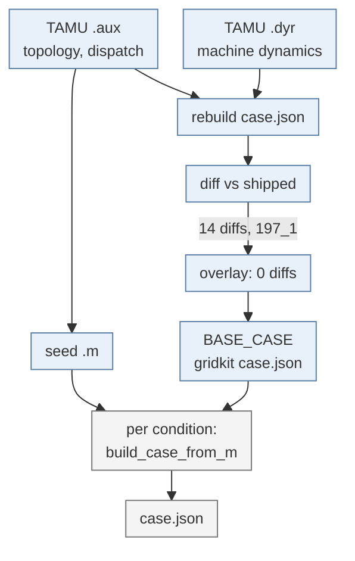
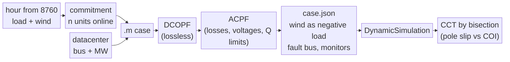
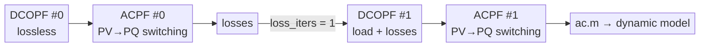
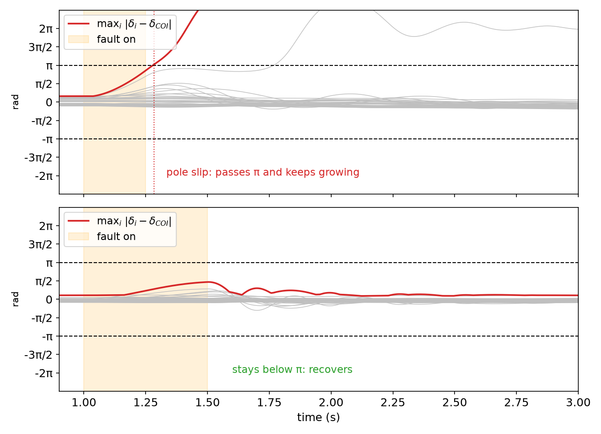
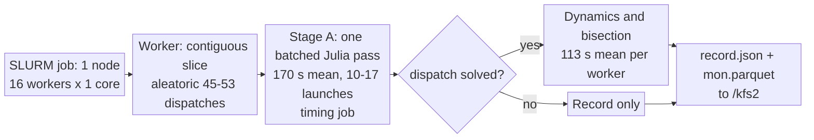
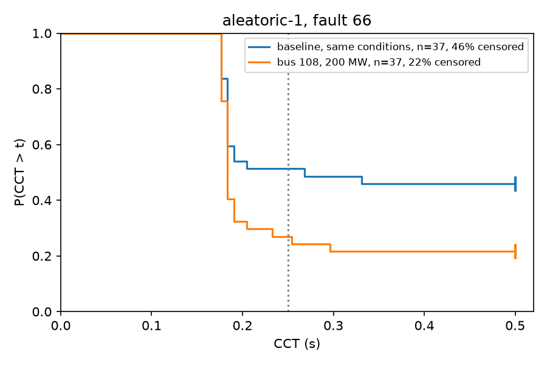
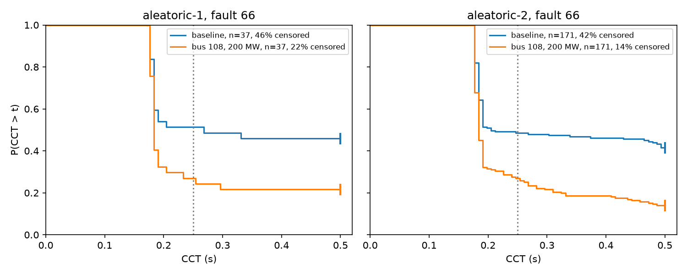
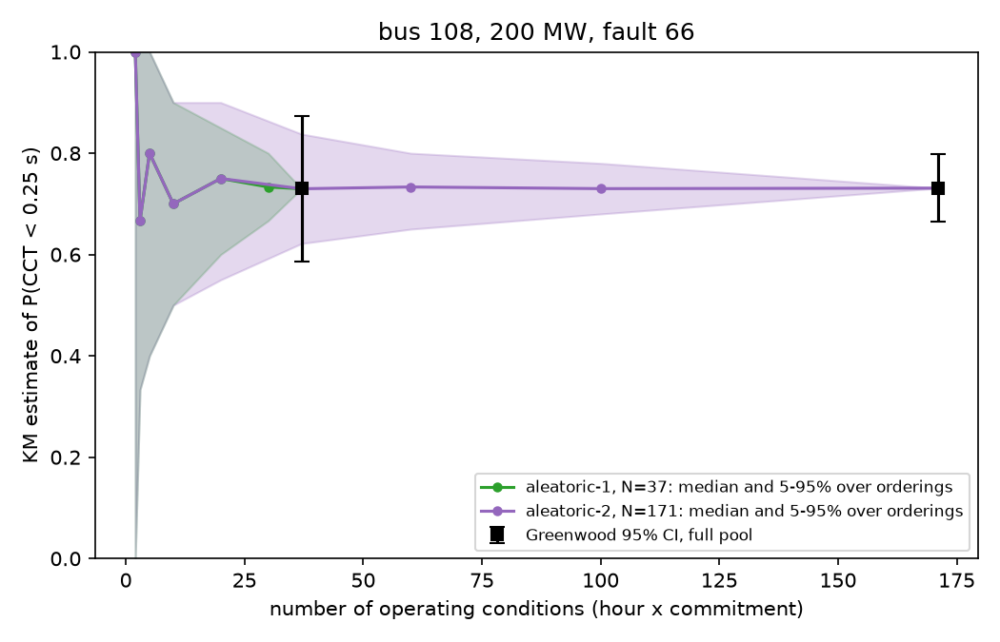
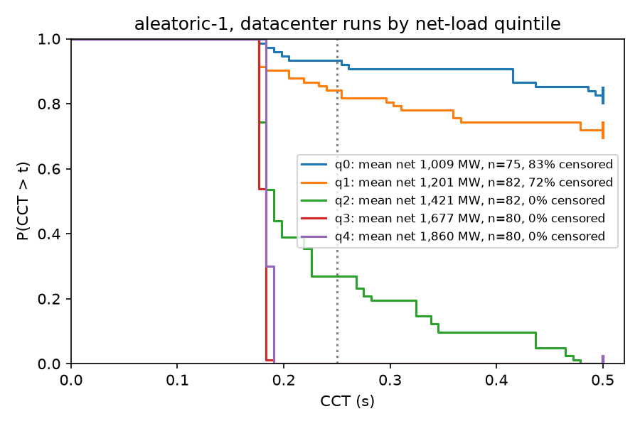
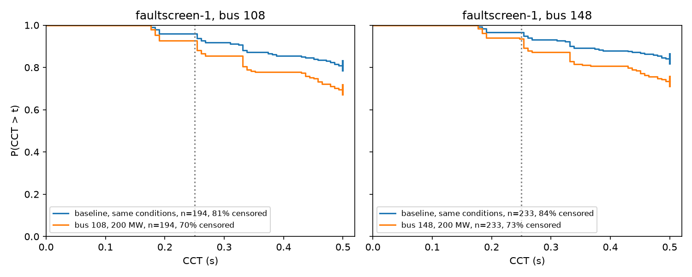

# Datacenter load and transient security: an aleatoric UQ pilot on GridKit

**Status:** pilot, October 2026; main campaigns updated November 2026 to the
P = 0.8, switched-PF setup (§7.0). ACTIVSg200 (Illinois 200-bus synthetic case).
All simulations use GridKit v0.2.0 [1].

**This report is self-contained.** It explains what we asked, how we went about it,
and what came out, in general terms. It does not assume you have read the other
two documents, and it does not contain code.

| document | answers | read it when |
|---|---|---|
| **this report** | *what did we find, and how, in general terms* | start here |
| [datacenter_load_uq_plan.md](datacenter_load_uq_plan.md) | *why each choice was made; every number and its provenance* | you want to question a decision |
| [dc_campaign_pipeline.md](dc_campaign_pipeline.md) | *which function does what* | you are changing the code |

Links marked **Details** point into the plan. They are optional.

---

## 1. What this is

Two deliverables, one study:

1. **Exercise GridKit as an end user** [1] on a problem it has not been pointed at
   before, and report back what works and what does not.
2. **Demonstrate aleatoric UQ by sampling** [2] on a dynamics problem, and find out
   where the sampling cost actually goes: with a view to much larger grids
   where brute force stops being an option.

The vehicle is a central interconnection question [3]:

> **Where, and how much, large datacenter load can be added before dynamic
> security degrades: given that IBR output makes system inertia vary
> hour to hour?** [4]

This is a pilot study. The grid is small, the contingency set is narrow, and several
conclusions are bounded by model validity. The point is to establish the
machinery and learn where the difficulty lives.

---

## 2. Glossary

Main terms used in our pilot study that follows.

| Term | Meaning |
|---|---|
| **Operating condition** | One (hour, commitment) pair. The hour fixes load and wind; the commitment fixes which thermal units are online. |
| **Placement** | Where the datacenter sits: none (the baseline), or one of buses 6, 108, 120 and 148. Not a property of the operating condition. |
| **Net load** | Demand minus wind, system-wide. What the thermal fleet must serve. |
| **CCT** | The CCT is the longest fault the system can survive before a generator loses synchronism. Larger is safer. |
| **Baseline** | The same operating condition with no datacenter. Each operating condition has its own baseline, so the change in CCT caused by the datacenter is always measured on the same condition. |
| **Search cap (0.5 s)** | The longest fault duration we test. Protection systems clear real faults well within 0.5 s, so a longer fault is not a realistic event, and we do not search beyond it. |
| **Censored** | The system survived even the longest fault we test. We then know only that its CCT is at least 0.5 s, not its value. Censored runs are very stable. |
| **Infeasible dispatch** | With the committed generators, the dispatch optimisation cannot serve the load. This means the extra load cannot be delivered under that commitment: a finding about the system, not a software error. Power-flow (ACPF) failures are a separate case and are not infeasible dispatches. |
| **No outcome** | A run that produced no CCT: the DCOPF dispatch, the ACPF power flow or the dynamic simulation failed. Reported separately, never as stable or unstable. |
| **ZIP load** | A load model that splits demand into constant-impedance (Z), constant-current (I) and constant-power (P) parts, written as P/I/Z percentages. The datacenter uses 80/20/0 (§4.4). |
| **Campaigns** | Three batches of simulations, all built the same way (§4). Two aleatoric campaigns, **aleatoric-1** and **aleatoric-2**, vary the operating condition and the datacenter's location and size, at one fault location; aleatoric-2 is a larger, independent repeat of aleatoric-1. The fault-screening campaign, **faultscreen-1**, varies the fault location instead. §7.0 compares them. |
| **DCOPF / ACPF** | DCOPF sets *who generates* from active power only (lossless, no voltages, no Q). ACPF takes that dispatch and solves the voltages and reactive power. |
| **PV bus / PQ bus** | PV: the generator fixes P and voltage magnitude, and Q is whatever holds the voltage. PQ: P and Q are fixed (a load); voltage is a result. |
| **Q limit** | A generator's maximum and minimum reactive power (Q) output. |
| **PV→PQ switching** | When a generator's Q leaves its limits, it is fixed at the limit and its bus is solved as PQ. Standard in planning tools; the pipeline's version is in §4.2. |

> **Details:** [physical intuition](datacenter_load_uq_plan.md#physical-intuition) covering faults, inertia, ZIP load during voltage dips, censored runs, etc.

---

## 3. The Illinois synthetic grid (ACTIVSg200)

ACTIVSg200, a synthetic Illinois case [5]: **200 buses, 246 branches, 49 generators**
(43 thermal: 25 coal, 17 natural gas, 1 nuclear; and 6 wind). The default GridKit
`case.json` has **40 synchronous machines** (34 thermal units with status on in
the `.aux` and the 6 wind units). The campaign replaces the wind units with
negative-load stand-ins (§4.3). However, all 43 thermal units have dynamic models in the
`.dyr`, so the 9 with status off in the `.aux` can be committed in a sampled
case. Each sampled case contains only its committed thermal units as `Genrou`
machines. The case also carries **109 loads**.

Hourly load and wind are synthetic one-year series for this case, so the
(demand, wind) joint distribution is taken from them rather than assumed.

> **Details:** [where the wind timeseries came from](datacenter_load_uq_plan.md#where-the-wind-timeseries-came-from-and-what-it-looks-like) ·
> [the operating-condition space](datacenter_load_uq_plan.md#6-the-operating-condition-space) ·
> [why 8760 is not a sampling design](datacenter_load_uq_plan.md#8760-is-not-a-sampling-design)

### One-time seed building

The ACTIVSg200 `case.json` distributed with GridKit is not
used directly. Once per case, we rebuild it from the two TAMU source files, the
PowerWorld network file (`.aux`) and the dynamics file (`.dyr`), and check the
rebuild against the distributed case. That gives two
artifacts. The **base case** supplies every machine's dynamic parameters. The **seed `.m`** supplies the dispatch: which units are online and how much they produce.
Each condition then overwrites only the dispatch, on a copy of the base case.
Blue boxes are the one-time build; grey boxes run per condition.

*Figure 3.1. One-time seed building (blue) and the per-condition build (grey).*

What we change relative to the distributed case:

* **Dynamics come from the base case.** The rebuild differs from
  the distributed case in 14 parameters, all on one machine (`197_1`). We keep the
  distributed values, so the base case equals the distributed case.
* **The dispatch is overwritten per condition.** The dispatch file cannot store machine
  inertia, so dynamics are always inherited from the base case.
* **Six wind units become negative load stand-ins** (§4.3), so they carry no inertia.

> **Details:** [where validation checks are](m_to_case_helper.md#the-chain) describing the case rebuilding chain.

---

## 4. Building one operating condition

Every simulation in this study starts from one operating condition: a sampled
hour of load and wind, and a commitment of thermal units. *Figure 4.1* shows how
that condition becomes a CCT. The commitment is chosen (§4.1), the generators
are dispatched (§4.2), the wind units and the datacenter are added to the
dynamic model (§4.3, §4.4), and the CCT is found by repeated simulation (§5).

*Figure 4.1. Per-condition pipeline, from hour and commitment to CCT.*

### 4.1 Commitment: a feasible band, not an economic optimum

We do **not** solve a unit-commitment problem. Thermal units are ranked in merit
order: cheapest first by linear cost, with the nuclear unit always on.
Committing *n* units means switching on the first *n* in that ranking. We
compute the band of *feasible* values of *n* and sample across it:

* **lower bound**: enough committed capacity to cover net load with a 10%
  reserve, and at least 8 thermal units. With fewer, the network loses voltage
  support and the simulation cannot be initialised;
* **upper bound**: the committed units' combined minimum output must not exceed
  net load, otherwise the dispatch is infeasible.

At 762 MW net load the band is 18 to 38 units. Both ends are legitimate: with 33
units the committed minimums total 740 MW, still under the load, so the units
simply run further down their range.

**How commitment is sampled.** For each sampled hour, the band is computed from
that hour's own net load (demand minus wind). The campaign then commits at two
fixed positions in the band, a quarter and three quarters of the way from its
lower to its upper end, rounded to whole units. So each hour gives two
operating conditions. This is a stratified choice at fixed positions, not a
uniform draw from the band and not a draw from an assumed distribution. The
faultscreen-1 (§7.6) uses 10 hours × 2 commitments = 20 conditions.
Campaign aleatoric-1 (§7.0) uses 20 hours × 2 commitments = 40 conditions.
Hours are stratified by net-load quintile: the 8,760 hours are split into five
equal-count bins of net load, and hours are drawn at random without replacement
from each bin, with equal counts per bin (2 each in faultscreen-1, 4 each in
aleatoric-1). Each quintile therefore holds 20% of the year's hours, so equal
counts give each quintile its population share. Hours within a quintile are not
weighted. In all campaigns the datacenter runs reuse the baseline commitment of
their hour.

**Why commitment matters.** A commitment sets which thermal units are online, and
so the inertia and headroom on the system. A low-load hour can run many units at
part load, carrying more inertia, or run few, carrying less. Both are feasible,
and a single committed point would hide that spread. At hour 4779 (762 MW net
load), the two ends of the band are:

| commitment | fleet inertia | mean output per unit |
|---|---|---|
| n = 23 | **7,512 MW·s** | 33.1 MW |
| n = 33 | **11,702 MW·s** | 23.1 MW |

They differ by a **factor of 1.56 in inertia at identical load and wind**. That
is the dominant
lever on stability at fixed net load. We have a synthetic one-year hourly load
series for ACTIVSg200 (from the TAMU repository, like the `.dyr` and `.m` files)
and a synthetic wind series, which together give the net-load distribution. We
have no data for how this synthetic system's operators would commit, so
inventing a commitment probability distribution would fabricate the very thing that drives the
answer. Results are reported **conditionally** on commitment and can be
reweighted later if a real commitment distribution becomes available.

Adding a datacenter does **not** change the commitment. The same units stay
online, and only the dispatch is re-solved (DCOPF, then ACPF). If the committed
fleet cannot serve the added load, the case is recorded as an infeasible dispatch, not
re-committed. Those failures therefore overstate what an operator could do by
committing more units.

> **Details:** [how commitment is sampled](datacenter_load_uq_plan.md#how-commitment-is-sampled) ·
> [why the band is so wide, and why we sample inside it](datacenter_load_uq_plan.md#why-the-band-is-so-wide-and-why-we-sample-inside-it) ·
> [commitment is a first-order driver (Phase 1b inertia sweep)](datacenter_load_uq_plan.md#1b-inertia-sweep-measured-2026-10-20)

### 4.2 Dispatch: DCOPF then ACPF

Both solves use the Julia [6] package PowerModels.jl [7] with Ipopt [8]. Per condition:

1. **DCOPF** sets the economic dispatch. It is lossless, so the load is
   inflated by the loss estimate from the previous pass (zero on the first).
2. **ACPF** solves the real network at that dispatch, giving voltages, reactive
   power and the actual losses. The losses feed the next DCOPF.

*Figure 4.2* shows the loop. With one loss correction, each condition runs two
DCOPFs and two ACPFs.

*Figure 4.2. Dispatch loop per condition: DCOPF, ACPF, one loss correction, ACPF. Each ACPF restarts its PV→PQ switching from all units at PV.*

The iteration exists because of a **slack problem**: a power flow leaves one
generator's active power free, so it cannot enforce that generator's maximum
output, and our slack is the nuclear unit, which has only **0.0082 MW** of
headroom. Without re-dispatch it would absorb the entire loss term, and in an
hourly loop the whole load change. One loss correction reduces the overshoot
from 27.05 MW to 0.34 MW on the worst hour (0.016 % of load). A second
correction reduces it only to 0.005 MW, so one is enough.

**Reactive power limits: PV→PQ switching.** PowerModels.jl's ACPF does not
enforce generators' reactive power limits (Q limits) by default. We enforce them by PV→PQ
switching: after solving voltages, any generator outside a Q limit is fixed
at that limit and its bus switched to PQ, then the power flow is re-solved.
Fixed generators return to PV if voltage recovers past setpoint (repeated up to
twice). In a five-point check at hour 204 (commitments
27 and 38, datacenter at buses 108 and 148 at 200 MW, plus one point without a datacenter),
the default ACPF left 2 to 11 generators outside their Q limits, while our switching brought all of
them within their limits.

We also tested ACOPF, which enforces Q limits as constraints. It was not adopted
because it also changes the active-power dispatch (about 280 MW summed over the
pilot), which would mix a dispatch effect into every CCT comparison; switching
keeps the DCOPF active dispatch.

> **Details:** [the dispatch chain](datacenter_load_uq_plan.md#10-the-dispatch-chain) ·
> [the slack problem](datacenter_load_uq_plan.md#the-slack-problem) ·
> [the loss-iteration fix, with convergence table](datacenter_load_uq_plan.md#fix) ·
> [why DCOPF then ACPF, rather than ACOPF](datacenter_load_uq_plan.md#why-dc-opf-then-ac-pf-rather-than-ac-opf) ·
> [switching implementation and five-scenario measurements](datacenter_load_uq_plan.md#reactive-limits-in-the-ac-pf-pv-to-pq-switching) · [pipeline code](dc_campaign_pipeline.md#42a-reactive-limits-pv-to-pq-switching) · [ACOPF design and pilot results](datacenter_load_uq_plan.md#ac-opf-as-a-second-q-limit-route-pmjl)

> **Implementation note:** The dispatch pipeline uses PowerModels.jl for both DCOPF and ACPF solves. As OPF functionality becomes available in GridKit (under development), we can readily substitute it into the pipeline. Maintaining PowerModels.jl as an alternative is beneficial for validation purposes and exploration of various ACOPF relaxation formulations.

### 4.3 Wind becomes negative load

Wind units are removed as synchronous machines (`Genrou`) and re-inserted as a
**negative load** at their own bus, modeled as constant current. Left as
synchronous machines, these six units would add a fixed **2,766 MW·s** of inertia
(sum of inertia constant × rating over the six, from the case), independent of their
output. Real inverter-based wind provides no such inertia.

**Implementation.** Hourly wind MW is pinned in the DCOPF, the ACPF
solves its reactive output, and the solved P and Q are written into the
negative load. In the dynamic case each wind unit's machine, governor and
exciter models are removed and a ZIP load is added with `Pnom = −PG/100` and
`Qnom = −QG/100` (per unit, 100 MVA base), all of it constant current. GridKit
treats positive `Pnom` as consumed, so the negative value injects PG. At the
initial voltage this reproduces the power-flow P and Q exactly; after that the
injection scales with `|V|`, which is constant current.

> **Details:** [wind pipeline, function by function](datacenter_load_uq_plan.md#pipeline-trace-one-wind-unit-one-hour) · [wind: why negative load, not fixed](datacenter_load_uq_plan.md#3-wind-why-negative-load-not-fixed) · [implementation](datacenter_load_uq_plan.md#implementation) · ["net load" is an aggregate, not a per-bus subtraction](datacenter_load_uq_plan.md#net-load-is-an-aggregate-not-a-per-bus-subtraction)

**Why it is acceptable.** Converter-interfaced generation is modeled in
positive-sequence transient stability as a controllable current source [9]. The
Sandia PSTess manual says that, *"as in the WECC REGC_A model"*, the converter
interface is "a controllable current source" [10]. A constant-current
load is a simple stand-in for that current injection.

> **Implementation note:** The default ACTIVSg200 case lacks native wind/PV converter controls models for wind and photovoltaic units. However, GridKit includes comprehensive IBR models, specifically REGCA (converter control), REECB (reactive power and volt/var support), and REPCA (plant control), which are unit-tested in the codebase and already appear in the WECC case. Substituting these proper IBR models for the current constant-current stand-in is straightforward and will be readily incorporated in future campaigns to improve fidelity of inverter-based resource dynamics.

### 4.4 The datacenter

A datacenter is represented as **additional electrical load placed at one
bus**. Two things about how it is added matter to the study design.

**It is added before dispatch, not after.** The load enters the network data
that the optimiser sees, so the commitment and the dispatch must produce and
deliver the extra power. If it were added after dispatch, neither the commitment
nor the OPF would see it: the power flow would have the slack bus supply it, and
the committed fleet could be too small to serve it or larger than needed.

**It gets its own load device, with its own voltage behaviour.** Load in these
cases is represented by a **ZIP model** [11], which splits demand into three parts by
how each responds when voltage sags: a constant-**impedance** part (**power proportional to $V^2$**), a constant-**current** part (**power proportional to $V$**), and a constant-**power**
part (**constant regardless of voltage**). The split is written here as P/I/Z percentages.

The distinction is the physical reason a datacenter is interesting. Ordinary
constant-impedance load sheds itself during a voltage dip and helps the system
recover. Because data center IT racks interface with the grid through double-conversion uninterruptible power supplies (UPS) and active power factor correction (PFC) converters, the power electronics act as a buffer that maintains constant power draw across nominal and post-fault voltage variations, making a predominantly constant-power ($\alpha_P$) representation appropriate within a ZIP load framework [12, 13]. This behavior causes the datacenter to keep demanding the same megawatts at reduced voltage, which
means drawing more current, which depresses voltage further. If the new load
were simply folded into the load already at the bus, it would
inherit that load's helpful constant-impedance behaviour and the study would
measure the wrong thing. So the datacenter gets a **separate** load device, and the
existing load at the bus is left as it was. Every existing load in the default case is
pure constant impedance.

**Our modeled datacenter mix is P/I/Z = 80/20/0**: To account for non-IT facility overhead, such as motor-based cooling systems (chillers, pumps, and fans) that exhibit voltage-dependent, constant-current-like behavior, we assign $\alpha_I = 0.2$ alongside the dominant IT constant-power share of $\alpha_P = 0.8$ ($\alpha_Z = 0$), consistent with utility data center modeling splits of 60% to 90% IT constant power and 10% to 40% cooling load [14].

**Placement.** Campaign faultscreen-1 (§7.6) places a 200 MW datacenter at
bus 108 or bus 148. Campaigns aleatoric-1 and aleatoric-2 (§7.0) place it at bus 6, 108, 120 or
148, at 50, 100, 200, 300 or 400 MW.

> **Details:** [datacenter pipeline, function by function](datacenter_load_uq_plan.md#how-a-datacenter-enters-the-model-pipeline-trace) · [placement selection](datacenter_load_uq_plan.md#placement-selection) · [is the 20/80/0 mix defensible?](datacenter_load_uq_plan.md#is-the-20800-mix-defensible) · [alphaP tested as a sensitivity](datacenter_load_uq_plan.md#alphap-tested-as-a-sensitivity-it-governs-simulability-not-cct-measured-2026-10-22) · [fold hunt summary](datacenter_load_uq_plan.md#fold-hunt-summary-ida-initial-condition-failures-at-high-alphap)

> **Implementation note:** The GridKit team has plans to develop comprehensive dynamic models for datacenter loads. Once implemented and validated, these models will be readily incorporated to replace the quasi-static ZIP approximation and improve system response fidelity.

---

## 5. CCT by bisection

Critical clearing time is found by bisecting fault duration in `[0.05, 0.5]` s,
with a stability test of **pole slip relative to the centre of inertia**. The
centre of inertia [15] is the inertia-weighted average rotor angle of the fleet,

$$\delta_{COI}(t) = \frac{\sum_i H_i S_i \delta_i(t)}{\sum_i H_i S_i}$$

and a run is declared unstable when any machine leaves that collective frame:

$$\max_{i,\,t} \bigl| \delta_i(t) - \delta_{COI}(t) \bigr| > \pi$$

Every symbol maps to a GridKit name or to a derived quantity:

| Symbol | Meaning | GridKit name, and where it is read |
|---|---|---|
| $i$ | one committed synchronous machine in the sample | `Genrou` device `id`, e.g. `49_1_genrou` |
| $H_i$ | inertia constant, in s | `H` in `params` of device $i$ in `case.json` |
| $S_i$ | machine MVA base | `mva` in `params` of device $i$ in `case.json` |
| $\delta_i(t)$ | rotor angle of machine $i$, in radians | Genrou state `delta`, monitor column `Genrou_<device id>_delta`, e.g. `Genrou_49_1_genrou_delta` |
| $t$ | simulation time, in s | `t` column of the monitor CSV |
| $\delta_{COI}(t)$ | centre-of-inertia angle, in radians | not a model parameter; computed from the weights $H_i S_i / \sum_j H_j S_j$ (`_coi_weights`, `is_unstable` in `py-utils/campaign.py`) |
| $\pi$ | pole-slip threshold | used in `is_unstable` |

Measuring against the COI rather than a fixed reference separates "the whole
system swung" (fine) from "one machine left the group" (not fine).

The bisected variable is the fault duration. The fault is applied at `t_on` =
1.0 s and cleared at `t_off` = `t_on` + duration, in the `fault_on` and
`fault_off` events of `solver.json`.

* **Censored early exit case (2 simulations)**: if stable at the bottom and still stable at
  the top, we return censored. If the bottom probe (0.05 s) is already unstable, the
  search stops with no CCT (NaN) after one simulation.
* **Typical case (e.g., 8 simulations)**: the boundary was inside the `[0.05, 0.5]` bracket. Bisection
  halves the bracket on each probe until the width is less than `tol=0.01`, and the reported CCT is the last
  stable duration probed.

The CCT cap at 0.5 s is deliberate. On power grids, primary protection clears faults in ~0.05-0.10 s, with backup protection clearing in ~0.25-0.50 s [15]. Any fault duration beyond this window is not a contingency that protection schemes permit, so outcomes beyond the cap are reported as censored. The cap can be adjusted if necessary in other context.

*Figure 5.1. Rotor-angle deviation from COI for one unstable sample (top) and one censored sample (bottom)  from  aleatoric-1 baseline (no datacenter) on a shared time axis. Orange: fault on (0.25 s top, 0.5 s bottom). Top: the red trace passes $\pi$ (dotted line), a pole slip, and keeps growing, so the machine loses synchronism. Bottom: the red trace peaks at $0.47\pi$ and never reaches $\pi$, so the system recovers within the 10 s run. Grey: each machine's $\delta_i - \delta_{COI}$. Red: maximum over machines of $|\delta_i - \delta_{COI}|$ (the machine can change). Dashed: $\pm\pi$, the pole-slip threshold.*

The bisection probes write only the `delta` channels, not the full monitor set:
that cut probe output from 26.25 MB to 1.91 MB per probe (**13.8×**).

> **Details:** [why critical clearing time is the headline metric](datacenter_load_uq_plan.md#why-critical-clearing-time-is-the-headline-metric) ·
> [stability criterion, and the false-positive test that was rejected](datacenter_load_uq_plan.md#stability-criterion) ·
> [bounding the search: faults must stay credible](datacenter_load_uq_plan.md#bounding-the-search-faults-must-stay-credible) ·
> [CCT measured: it discriminates, and net load drives it](datacenter_load_uq_plan.md#cct-measured-it-discriminates-and-net-load-drives-it) ·
> [the full QoI set](datacenter_load_uq_plan.md#the-qoi-set) ·
> [monitors: the shipped case records almost nothing](datacenter_load_uq_plan.md#monitors-the-shipped-case-records-almost-nothing)

---

## 6. Parallel execution on Kestrel

Each campaign ran as one SLURM job [16] on one node: 16 single-core workers, each taking a contiguous slice of the campaign's list of runs. A worker first solves the dispatches for its slice in one batched Julia pass (the *dispatch stage*), then runs the dynamic simulations for the dispatches that solved. Results are written per run, so a campaign can resume.

> **Details:** [wall time for the two main campaigns](datacenter_load_uq_plan.md#wall-time-in-the-two-main-campaigns-measured-2026-11-10) ·
> [parallel sampling runs](datacenter_load_uq_plan.md#parallel-sampling-runs) ·
> [storage](datacenter_load_uq_plan.md#storage) ·
> [execution model](datacenter_load_uq_plan.md#execution-model-one-job-per-worker-julia-batched-inside-it-decided-2026-10-22)

| campaign | planned runs | simulated | wall time | per worker, mean: dispatch / dynamics |
|---|---|---|---|---|
| aleatoric-1 | 840 | 484 | 6.0 min | 170 s / 113 s |
| aleatoric-2 | 3,780 | 2,155 | 17.1 min | 297 s / 516 s |
| faultscreen-1 | 1,020 | 935 | ~4.4 min (slowest worker) | 122 s / 92 s |

*Simulated* counts the runs whose dispatch and power flow solved, so that a dynamic simulation
was attempted (whether or not it completed). For the remaining runs the dispatch or the power flow
failed, so no simulation was run.

Resources, measured for aleatoric-2:

* **CPU.** Workers were busy 86% of the job (235 CPU-min over 16 workers). The job
  held the whole 104-CPU node and ran 16 workers by choice, so 13% of its CPUs were busy.
* **Memory.** 0.88 GB per worker (Python and Julia); the node peaked at 13.8 GB.
* **Load balance.** Worker wall times ranged from 511 s to 1,019 s. Contiguous slices leave
  the mean worker idle about 20% of the job.
* **Dispatch stage.** 1.3 s per dispatch, against 3.3 s in aleatoric-1. A working
  hypothesis is that larger batches amortise Julia start-up.
* **Storage.** The three campaigns (5,640 planned runs) hold 15.9 GB; in aleatoric-1
  and aleatoric-2 that is about 2.6 MB per run. Two measures keep it down: the CCT search records only the rotor angles it needs
  (21 of 441 output columns, 13.8× smaller), and results are stored as compressed
  Parquet rather than CSV (5.0× smaller).

*Figure 6.1. Per worker, aleatoric means. Fault sweep (faultscreen-1): dispatch 122 s, dynamics 92 s.
Launch counts from a separate timing job, not the campaign logs.*

> **Implementation note:** The SLURM script requests one node with 16 cores, splits
> the campaign's list of runs into 16 contiguous slices, and launches one worker per
> slice as a background Python process, then waits for them all. Because the workers
> are local background processes rather than `srun` job steps, a job runs on a
> single node. The work is embarrassingly parallel (independent slices, one result
> file per run), and multi-node execution through an `srun`-per-node (or MPI)
> launcher is being implemented.

---

## 7. Results

> **Details:** [main results, both campaigns](datacenter_load_uq_plan.md#main-results-the-two-switched-campaigns-measured-2026-11-10) ·
> [`aleatoric1_ap08_qlim` run](datacenter_load_uq_plan.md#aleatoric-with-switching-aleatoric1_ap08_qlim-run-2026-11-10) ·
> [earlier campaign results, moved from this report](datacenter_load_uq_plan.md#earlier-campaign-results-moved-from-the-report-2026-11-10) ·
> [`phase3b` pilot](datacenter_load_uq_plan.md#pilot-results-phase3b-run-2026-10-22) ·
> [`faultscreen1` (alphaP 0.2, unlimited Q)](datacenter_load_uq_plan.md#fault-location-screening-faultscreen1-run-2026-10-23) ·
> [Phase 1 go/no-go gate](datacenter_load_uq_plan.md#phase-1-does-the-premise-hold-passed-2026-10-20) ·
> [`inertia_MWs` undercount bug and its correction](datacenter_load_uq_plan.md#inertia_mws-was-silently-undercounted-bug-fixed-2026-10-22)

### 7.0 Sampling space and the campaigns

All campaigns use the operating-condition design of §4.1, where an operating condition is an (hour, commitment) pair. All use DCOPF dispatch, then ACPF with PV→PQ switching (§4.2), and the datacenter as an 80/20/0 ZIP load added beside the existing load at its bus (§4.4). The two main campaigns differ in what else varies:

| | **aleatoric-1** | **faultscreen-1** |
|---|---|---|
| purpose | how much operating conditions move CCT | which fault locations and placements matter |
| hours | 20 (4 per net-load quintile) | 10 (2 per net-load quintile) |
| operating conditions (hour, commitment) | 40 | 20 |
| fault locations | 1 (bus 66) | 17 |
| placements | none, or bus 6, 120, 108, 148 | none, or bus 108, 148 |
| datacenter size | 50, 100, 200, 300, 400 MW | 200 MW |
| runs | 840 = 40 baseline + 800 datacenter | 1,020 = 340 baseline + 680 datacenter |
| solved | 439 (40 baseline, 399 datacenter) | 767 (340 baseline, 427 datacenter) |
| no outcome | 401 (45 simulation failures, 242 dispatch failures, 114 power-flow failures) | 253 (168 simulation failures, 34 dispatch failures, 51 power-flow failures) |
| datacenter runs censored at the 0.5 s cap | 121 of 399 (30.3%) | 306 of 427 (71.7%) |

**Campaign aleatoric-1** varies operating conditions, placement and size, at one fault. Campaign faultscreen-1 varies fault location and placement, at one size. **No outcome** means the dispatch, the power flow or the simulation failed. It is reported as such, never as stable or unstable.

**Campaign aleatoric-2** is a larger, independent repeat of aleatoric-1: 60 new hours × 3 commitments = 180 operating conditions, with the same placements and sizes. It shares no conditions with aleatoric-1, and is used in §7.3 and §7.4 to check that the results reproduce and how they settle as conditions are added.

### 7.1 Reading the curves: Kaplan–Meier and censoring

Each curve estimates **$P(\mathrm{CCT} < t)$**: the share of operating conditions in which a fault cleared at $t$ seconds would be unstable. A run still stable at the 0.5 s simulation cap is *censored*: we know $\mathrm{CCT} \ge 0.5$ s but not its value. The Kaplan–Meier (KM) estimator [16] uses censored runs correctly:

$$\hat S(t)=\prod_{t_i\le t}\Bigl(1-\frac{d_i}{n_i}\Bigr),\qquad \widehat P(\mathrm{CCT}<t)=1-\hat S(t)$$

Here the $t_i$ are the distinct measured CCT values, $d_i$ is the number of runs measured at $t_i$, and $n_i$ is the number still at risk at $t_i$ (runs measured at or after $t_i$, plus censored runs). No measured CCT exceeds the cap, so for $t < 0.5$ s the estimate is simply the number of runs measured below $t$, divided by all solved runs, with the censored runs left in the denominator. No-outcome runs are excluded, so every curve is conditional on the run having an outcome. Figures plot the complement, $P(\mathrm{CCT} > t)$.

<!-- tex:skip -->
> **Details:** [ten made-up CCTs, with two censored runs, and the calculation step by step](datacenter_load_uq_plan.md#kaplanmeier-worked-example-on-ten-made-up-ccts) (illustrative values, not campaign data).
<!-- /tex:skip -->

The rest of §7 runs as follows. §7.2 works one matched example, and §7.3 repeats it on the larger aleatoric-2. §7.4 asks what adding operating conditions does to the estimate. §7.5 splits risk by net load. §7.6 reports faultscreen-1. §7.7 quantifies censoring.

### 7.2 A simple example: one bus, one size, one fault

**Sampling:** aleatoric-1, 200 MW at bus 108, fault at bus 66. Of the 40 operating conditions, 37 solve with the datacenter. The baseline is the same 37 conditions with no datacenter.

**Greenwood interval.** Greenwood's formula [6] estimates the variance of a KM estimate:

$$\widehat{\mathrm{Var}}\big(\hat S(t)\big)=\hat S(t)^2\sum_{t_i\le t}\frac{d_i}{n_i(n_i-d_i)}$$

with $d_i$ and $n_i$ as in §7.1. We report the standard error $\mathrm{SE}=\sqrt{\widehat{\mathrm{Var}}}$. The 95% interval is $\hat P\pm 1.96\,\mathrm{SE}$, with $\hat P=1-\hat S(t)$ (the plain interval, not log–log).

| | no datacenter | 200 MW at bus 108 |
|---|---|---|
| operating conditions (matched) | 37 | 37 |
| censored at 0.5 s | 46% | 22% |
| **P(CCT < 0.25 s)** | **0.49** | **0.73** |
| 95% Greenwood CI for P(CCT < 0.25 s) | 0.325–0.648 | 0.587–0.873 |
| KM median CCT | 0.27 s | 0.18 s |

*Figure 7.2. Kaplan–Meier P(CCT > t) on the same 37 operating conditions, without the datacenter (blue) and with the 200 MW datacenter at bus 108 (orange), fault at bus 66. Curves run to the 0.5 s cap. A censored run is still stable at the cap, so its curve holds at that value, and the tick at 0.5 s marks the censored share.*

Across the 37 matched conditions where both arms solve, the datacenter raises the share of runs with CCT under 0.25 s from 0.49 (18 of 37) to 0.73 (27 of 37). Three conditions did not solve with the datacenter, so we dropped the same three from the baseline.

**Why the datacenter may shorten CCT (working hypothesis).** The datacenter adds 200 MW to bus 108, beside the unchanged constant-impedance load already there, and 80% of that added load does not fall with voltage. During the fault the added load keeps drawing its power, where a constant-impedance load of the same size would fall, which pushes the generators harder.

**Takeaway.** The matched comparison shows the datacenter raises P(CCT < 0.25 s) and lowers the KM median CCT from 0.27 to 0.18 s. The 95% Greenwood intervals are 0.325–0.648 for the baseline (half-width 0.16) and 0.587–0.873 for the datacenter (half-width 0.14). They overlap, so this comparison alone does not test a difference; a paired interval is needed (§7.3). It is the starting point that §7.3 and §7.4 build on with 171 conditions and a convergence check.

### 7.3 The same example in aleatoric-1 and aleatoric-2

Below, tables and figures show replication of the §7.2 comparison across two independent campaigns. **Sampling:** bus 108, 200 MW, fault at bus 66, each compared against the baseline on the same operating conditions. On the left, aleatoric-1 has 37 matched conditions (the §7.2 sample). On the right, aleatoric-2 has 180 operating conditions (60 hours × 3 commitments). Nine of the 180 conditions have no outcome with the datacenter, so, as in aleatoric-1, they are dropped from both arms, leaving 171 matched conditions. The two campaigns have no operating conditions in common, so the second campaign adds new conditions rather than repeating the first.

| | 37 conditions (§7.2) | 171 conditions |
|---|---|---|
| no datacenter: P(CCT < 0.25 s), 95% Greenwood CI | 0.486 (0.325–0.648) | 0.515 (0.440–0.590) |
| 200 MW at bus 108: P(CCT < 0.25 s), 95% Greenwood CI | 0.730 (0.587–0.873) | 0.731 (0.665–0.797) |
| censored at 0.5 s, no datacenter / bus 108 | 46% / 22% | 42% / 14% |

*Figure 7.3. Kaplan–Meier P(CCT > t) at bus 108, 200 MW (orange) against the matched baseline (blue), fault at bus 66. Left: 37 conditions (aleatoric-1). Right: 171 conditions (aleatoric-2). Same axes in both panels, curves run to the 0.5 s cap, and the tick at 0.5 s marks the censored share. With 171 conditions the curve has about 4.6 times as many conditions behind each step, so it resolves finer structure and the interval at 0.25 s is narrower.*

Both campaigns show the same shift. At 171 conditions, P(CCT < 0.25 s) rises from 0.515 to 0.731, and at 37 it rises from 0.49 to 0.73. Nine of the 180 conditions have no outcome with the datacenter, so they are dropped from both arms, leaving 171. The datacenter's 95% Greenwood interval narrows from 0.29 to 0.13 wide as conditions are added. That interval is a property of the method, not of this one study: across repeated studies, about 95% of intervals built this way would contain the true value. Because the arms are matched, the direct test is paired by condition: at 171 conditions the datacenter raises P(CCT < 0.25 s) by 0.22 (95% CI 0.15 to 0.28), and no condition moves the other way.

**Takeaway.** A second campaign, with no conditions in common with the first, shows the same shift: at 37 and at 171 conditions the datacenter raises P(CCT < 0.25 s) by about 0.22 to 0.24 on matched conditions. The larger campaign narrows the interval by about half and barely moves the estimates. The effect holds across these two samples, but both use one placement and one fault, so they do not show how it varies with other buses, sizes or faults.

### 7.4 More operating conditions: how the estimate settles

We checked whether the estimate stops moving as conditions are added, by recomputing it on random subsets of each campaign's conditions (*subsampling* [17]). For bus 108, 200 MW, the median over 2,000 random orderings settles at 0.730–0.733 from about 30–37 conditions in both campaigns. This holds for these two campaigns only, and the check does not give an uncertainty; that is the Greenwood interval in §7.3. We might use the same check later to size a future study, if a full-size design costs too much.

*Figure 7.4. KM estimate of P(CCT < 0.25 s) at bus 108, 200 MW, over random orderings of the 37 conditions of aleatoric-1 (green) and the 171 of aleatoric-2 (purple). Line: median over 2,000 orderings. Shading: 5th–95th percentile. Black squares: full-campaign estimate with its 95% Greenwood interval. Both medians sit at 0.730–0.733 from about 30–37 conditions onward.*

**Takeaway.** In both pools the median estimate sits at about 0.73 once roughly 30 to 37 conditions are included (Figure 7.4). The band around it still spans about 0.62 to 0.84 at 37 conditions in aleatoric-2, so more conditions narrow the interval but do not move the estimate. The uncertainty itself comes from the Greenwood intervals in §7.2 and §7.3.

### 7.5 Risk by net load

**Sampling:** In aleatoric-1, the datacenter is placed at buses 6, 120, 108 and 148, at five sizes from 50 to 400 MW, with one fault at bus 66. The 20 sampled hours are split into five net-load quintiles of four hours each, and each hour is run with two commitments. Each quintile therefore holds 160 datacenter runs: 4 buses, 5 sizes, 4 hours and 2 commitments.

| quintile | mean net load, no datacenter (MW) | datacenter runs solved | no outcome | censored | **P(CCT < 0.25 s)** |
|---|---|---|---|---|---|
| q0 | 809 | 75 of 160 | 85 | 83% | **0.07** |
| q1 | 1,001 | 82 of 160 | 78 | 72% | **0.16** |
| q2 | 1,221 | 82 of 160 | 78 | 0% | **0.73** |
| q3 | 1,477 | 80 of 160 | 80 | 0% | **1.00** |
| q4 | 1,660 | 80 of 160 | 80 | 0% | **1.00** |

*Figure 7.5. Kaplan–Meier P(CCT > t) by net-load quintile, datacenter runs only (all buses and sizes), fault 66.*

P(CCT < 0.25 s) climbs from 0.07 in the lowest quintile to 1.00 in the two highest. The largest step is between q1, with a mean net load of 1,001 MW, and q2, at 1,221 MW. The spread in CCT follows the same split: every solved datacenter run in the two highest quintiles has CCT between 0.177 and 0.191 s, while the two lowest quintiles reach the 0.5 s cap.

- **Conditional on solving.** Between 49% and 53% of datacenter runs in each quintile have no outcome, so each P value is conditional on a run having an outcome. The no-outcome runs may have a different CCT, and we do not know whether they do.
- **Baseline.** The baseline has eight runs per quintile (four hours × two commitments), and all eight solve. Their P values are 0, 0, 0.25, 1.00 and 1.00. That is too few for a quintile estimate, but it is consistent with net load driving CCT even without the datacenter.

**Takeaway.** Net load is the dominant driver: P(CCT < 0.25 s) climbs from 0.07 to 1.00 across the quintiles, with the sharpest step between q1 (1,001 MW) and q2 (1,221 MW). Instability concentrates in the high-net-load hours, so net load is a useful first screen.

### 7.6 Fault screening (faultscreen-1): which faults discriminate

**Sampling:** faultscreen-1. 10 hours (2 per net-load quintile) × 2 commitments × 17 fault locations. There are 340 baseline runs with no datacenter, all solved, and 680 runs with a 200 MW datacenter at bus 108 or 148.

| | baseline (no datacenter) | datacenter (200 MW) |
|---|---|---|
| solved | 340 of 340 | 427 of 680 |
| censored at 0.5 s | 302 (88.8%) | 306 (71.7%) |
| no outcome | (see note) | 253: 168 simulation failures, 34 dispatch failures, 51 power-flow failures |

Matched by (hour, commitment, fault), using datacenter runs that solved:

* **Bus 108**, 194 pairs: P(CCT < 0.25 s) is 0.072 with the datacenter and 0.041 without. Censored: 70% and 81%.
* **Bus 148**, 233 pairs: 0.064 and 0.034. Censored: 73% and 84%.
* The datacenter is measured where the baseline is censored in 22 pairs (bus 108) and 25 pairs (bus 148). The reverse happens in none.
* Where both runs are measured, the pairs cover the same 37 conditions at both buses, because the baseline is measured on only 38 conditions. The median change in CCT is 0 s, CCT falls with the datacenter in 5 of 37 pairs, and the largest drop is 0.24 s.

Reading: on this campaign the datacenter raises P(CCT < 0.25 s) only slightly, from 0.04 to 0.07 at bus 108 and from 0.03 to 0.06 at bus 148. Most baseline runs are censored (81–84% on these pairs), so the signal is weak. The direction matches §7.2, which uses a different fault and a measured baseline.

All 85 dispatch and power-flow failures (34 DCOPF, 51 ACPF) fall in q0, the lowest net-load quintile: 85 of its 136 datacenter runs, or 63%. None occurs in q1 to q4. The cause of the q0 concentration has not been checked.

Baseline CCT by fault location, for the 20 baseline conditions each:

| fault bus | median baseline CCT | censored | measured of 20 |
|---|---|---|---|
| **94** | **0.37 s** | **35%** | **13** |
| 66 | 0.5 s (cap) | 55% | 9 |
| 68 | 0.5 s (cap) | 60% | 8 |
| 181 | 0.5 s (cap) | 60% | 8 |
| other 13 | 0.5 s (cap) | 100% | 0 |

*Figure 7.6. Kaplan–Meier P(CCT > t) for the datacenter at bus 108 (left) and bus 148 (right), each against the baseline on the same matched (hour, commitment, fault) conditions. Baseline in blue, datacenter in orange. The two panels look nearly identical because at 200 MW the bus choice barely moves CCT; they are not the same plot (n = 194 vs 233, with different censored shares).*

Thirteen of 17 fault locations are censored in every baseline condition, so a uniform fault budget spends most of its runs on faults that cannot separate operating conditions. Fault screening should be cheap, followed by concentration on the informative faults. Bus 66, the fault in aleatoric-1 and aleatoric-2, is not the most informative location: bus 94 is. At 200 MW, buses 108 and 148 look alike in this sample (0.072 against 0.064 for P(CCT < 0.25 s)).

**Takeaway.** Most faults carry no information: 13 of 17 never leave the cap, so a uniform fault budget is mostly wasted; while a few (bus 94) discriminate, and at 200 MW the two placements behave almost identically. Where the datacenter sits matters less than the operating condition and the fault; the practical lesson is to screen contingencies cheaply, then concentrate the budget on the few that separate conditions.

### 7.7 Censoring: dropping censored runs inflates risk

The KM curves in §7.2–§7.6 keep censored runs in the denominator; this section shows what it costs to drop them instead, a common shortcut. Dropping censored runs from a risk estimate inflates it by a factor that depends only on the censored share, not on the threshold:

| campaign | datacenter runs solved | measured | censored share | inflation from dropping censored runs |
|---|---|---|---|---|
| aleatoric-1 | 399 | 278 | 30.3% | **1.44×** |
| faultscreen-1 | 427 | 121 | 71.7% | **3.53×** |

$$\frac{\hat P_{\text{drop}}}{\hat P_{\text{keep}}} = \frac{N_{\text{solved}}}{N_{\text{measured}}}$$

This follows from §7.1, since censoring sits at one point beyond every measured value. The factor is arithmetic, but it is easy to get wrong by quoting one population's censored share against another's label. The 3.53× corresponds to 71.7% censoring among datacenter runs that solved. It is not the share of the 1,020 planned runs.

**Takeaway.** This is the quantitative reason §7 uses Kaplan–Meier rather than a naive below-threshold share: discarding censored runs would have inflated every risk number here: 1.4× in aleatoric-1, 3.5× in faultscreen-1. Keeping censored runs is not a refinement; it is the difference between a right and a wrong answer.

> **Details:** [`alphaP` tested as a sensitivity](datacenter_load_uq_plan.md#alphap-tested-as-a-sensitivity-it-governs-simulability-not-cct-measured-2026-10-22) · [the feasible-`alphaP` frontier, mapped](datacenter_load_uq_plan.md#the-feasible-alphap-frontier-mapped-afront1-measured-2026-11-02) · [fault location is the missing variable](datacenter_load_uq_plan.md#fault-location-is-the-missing-variable-afront2-measured-2026-11-02) · [`phase3b` siting pilot and earlier campaigns](datacenter_load_uq_plan.md#pilot-results-phase3b-run-2026-10-22)

---

## 8. First look at the Texas synthetic grid (ACTIVSg2000)

The 200-bus case is small enough that brute force works: whole campaigns finish
in minutes. That is convenient but it hides the question the methods work
exists to answer, so we measured what changes on the Texas synthetic grid,
**ACTIVSg2000** (2,000 buses, from the TAMU repository [17]). This is a scoping
study, not a campaign.

**What already exists.** A GridKit dynamic case is distributed with GridKit, and
raw TAMU data and processed hourly demand, wind and **solar** profiles are
available. The base case **runs unmodified**: a 10 s simulation with a
0.15 s fault completes successfully at both default and full monitoring.

**Measured, same settings on both cases.** Dispatch-stage numbers are per-case solver times, measured inside one batched Julia process. The process starts once, so its ~6 s start-up cost is not counted in each solve. Timing a single solve in a fresh process mostly measures start-up, so those numbers would not be useful for projections.

| quantity | ACTIVSg200 | ACTIVSg2000 | ratio |
|---|---|---|---|
| buses | 200 | 2,000 | 10× |
| branches | 246 | 3,206 | 13× |
| devices | 476 | 5,787 | 12.2× |
| synchronous machines | 40 | 334 | 8.4× |
| loads | 109 | 1,245 | 11.4× |
| dynamic case file | 0.24 MB | 2.93 MB | 12.2× |
| **DCOPF** (warm) | 0.011 s | 0.212 s | **19.1×** |
| **ACPF** (warm) | 0.018 s | 0.331 s | **18.5×** |
| **dispatch stage total** | 0.029 s | 0.543 s | **18.7×** |
| **one dynamic run** (solver time), full monitors | 0.28 s | 7.08 s | **25.3×** |
| monitor CSV | 27.3 MB | 262.5 MB | 9.6× |
| monitor columns | 481 | 4,649 | 9.7× |

**The shape of the growth.** Against a 10× increase in buses, data scales
**linearly** ($\approx N^{1.0}$), the dispatch stage as $\approx N^{1.27}$, and the dynamic
simulation as $\approx N^{1.40}$. So compute grows faster than the network and
faster than storage, and the dynamic stage (the cheap one at 200 buses) grows
fastest.

**What that implies for a campaign.** Projecting aleatoric-1 (840 runs,
one full run plus ~8 bisection probes each, so ~7,560 simulations). Serial
times use the measured per-run cost; wall times assume the pilot's 16 workers
per node and scale linearly, which is optimistic until per-worker memory is
known:

| | ACTIVSg200 | ACTIVSg2000 |
|---|---|---|
| per dynamic run (solver time), full monitors, 10 s simulated | 0.28 s | **7.08 s** |
| dispatch stage, all 840 runs | 24 s | 456 s |
| **dynamic runs, serial** | **~35 min** | **~14.9 h** |
| wall on 1 node, 16 workers | ~2.2 min | **~56 min** |
| wall on 1 node, 32 workers | ~1.1 min | **~28 min** |
| monitor output, raw CSV | 22 GB | **~220 GB** |
| after parquet | 4.5 GB | **~45 GB** |

On the 2,000-bus case we ran only setup and single-run checks: the end-to-end rebuild with one dynamic run, a faultscreen-shaped micro-campaign of one dispatch and eight fault locations, and single-run and single-batch memory probes. We did not run any aleatoric campaign on the 2,000-bus case. A campaign the size of aleatoric-1 projects to ~2.5 h per node at 16 workers, applying the overhead measured on the 200-bus run. Full worker memory is unmeasured, so treat this as a planning figure, not a guarantee.

**Storage, not compute, is the bottleneck.** At 200 buses the CPU saturates 
before memory; at 2,000 buses selective monitoring matters far more (the 4,649 
output columns are mostly bus voltages). **Cost to scale to 2,000 buses: brute 
force survives one order of magnitude, not two.** The design space grows 115× 
(siting 11.5× and fault locations 10×), while per-sample cost grows 19–25×. 
Holding sampling density fixed projects 2,150–2,900× the pilot's cost. That 
makes screening, surrogates and adaptive refinement the concrete case, not a 
luxury.

**Takeaway.** Brute force survives one order of magnitude of grid size, not two:
a campaign the size of aleatoric-1 at 2,000 buses is projected at about 2.5 h on one node,
storage rather than compute is the bottleneck, and the dynamic run, nearly free at 200
buses, becomes the cost to minimise. Scaling the pilot is a methods problem,
not a hardware one, which §9 takes up.

> **Details:** [scaling measurements, the ACTIVSg2000 port, and the positional-id trap](datacenter_load_uq_plan.md#scaling-to-activsg2000-measured-2026-11-02) ·
> [sampling at scale and the sampling dimensions](datacenter_load_uq_plan.md#sampling-at-scale-aleatoric-uq-beyond-the-pilot-recommendations-2026-11-11-aleatoric2-run-to-measure-cost) ·
> [working with ACTIVSg2000](dc_campaign_pipeline.md#9-working-with-activsg2000)

---

## 9. Next steps

The pilot leaves a clear picture of where cost lives and therefore where the
methods work should go. At 200 buses the expensive part is the **dispatch stage**, and
interesting dimensions such as contingency location or disturbance
severity are nearly free once a dispatch exists. However, at 2,000 buses
(§8), the dynamic run dominates, the design space grows by
two orders of magnitude, and the quantity to minimise becomes the number of dynamic
simulations. Making aleatoric UQ affordable at that scale is **FY27 planned
work**, pursued along two tracks.

**Track 1: spend fewer, better-chosen dynamic runs.** 

1. **Screen contingencies cheaply, then concentrate.** 76 % of a uniform fault
   budget was wasted here (§7.6), with 13 of 17 locations fully censored. On a
   2k-bus case the contingency list is the part that explodes and also the part
   that is free to explore.
2. **Treat censoring as information.** Both "survived beyond the cap" and
   "no outcome" are results, and at high censoring they are most of the dataset.
   A cheap 1–2 run classifier that detects the censored case before committing to
   an 8-run CCT bisection would remove most of the cost.
3. **Condition and stratify, rather than only adding samples.** CCT spread follows
   net load (§7.5), so stratified or importance sampling on
   net load cuts variance at fixed cost; a variance decomposition of the existing
   840 runs is a zero-cost first step.
4. **Surrogate or warm-started CCT, and early-terminating integration.**
   Neighbouring dispatches have strongly correlated CCT, and pole slip is
   detectable well before the end of the simulated window, so both the number and the length of
   simulations can be cut.

**Track 2: a graph surrogate, as an alternative and supplement to sampling.**
The grid is intrinsically a graph: the admittance matrix is a weighted Laplacian
over buses, a fault propagates through branch impedances as a message-passing
process, and "which bus to site load at" is itself a graph question. Graph
neural networks and graph transformers carry exactly that inductive bias [18],
and have been used as fast power-system surrogates [19]. A surrogate trained on
the records the sampling campaigns already produce, e.g.,
`(graph, operating point, parameters, fault)` → trajectory map, could emulate
CCT or the stability label cheaply, turning the expensive solver into a screening
tool. Full dynamic runs could be reserved for confirmation and for labelling the cases
where the surrogate is least certain, an active-learning approach [20] that chooses
which runs to do. This is **supplemental** to sampling-based UQ, not a
replacement: the surrogate lowers per-sample cost, while the sampling design
still fixes what the estimate means.

The near-term steps are: a wider contingency screen, a
treatment of censoring in the paired (with and without datacenter) comparison,
a variance decomposition of the existing runs, and running the campaigns on the Texas grid
(§8). The graph-surrogate track builds on the dataset those
campaigns are already generating.

> **Details:** [where numerical-methods contributions could be made](datacenter_load_uq_plan.md#where-numerical-methods-contributions-could-be-made)

---

## 10. GridKit end-user feedback

Findings from using the tool in anger, offered as concrete issues:

| finding | impact |
|---|---|
| **`REPCA` cannot do frequency droop**: the regulated bus exposes no frequency signal | No primary frequency response from IBR, so any nadir/ROCOF study with inverters is incomplete |
| **A `BusFault` that closes during the run makes the event-time initial-condition solve fail.** Discriminator at `alphaP` 1.0: an event-closed fault fails `IDACalcIC` at buses 1, 148 and 181 while bus 94 runs; the same open fault with no event passes | At `alphaP` 0.8, 97 sited runs (200 MW) fail that pass at 0.2 (89 initialization, 8 transient) and have no outcome (§7.6). The mechanism is a candidate (IDA initial guess is the pre-fault state), consistent on the one dispatch checked (h1879), not yet confirmed generally. See `ida_ic_issue.md` |
| **`LoadZIP` has no current limit or undervoltage trip** | Constant-power load, the physically right model for a datacenter, cannot self-limit. This is a modelling gap in its own right; whether it is also the root of the conditioning problem above is **unresolved** |
| **A fault *at* a constant-power load bus always has no outcome**: 40 of 40 runs, at every `alphaP` including 0.2 | The most interesting contingency for a datacenter study is out of reach |
| **Events are `FAULT_ON`/`FAULT_OFF` only** | No generator-trip or load-step contingency, so no true power-imbalance event |
| **Monitors default to almost nothing**: post-#577 cases carry `"mon": []` on every bus | Nothing PMU-observable is recorded unless explicitly enabled |

Also verified, as a portability result: **GridKit built on RHEL 8 runs unchanged
on RHEL 9**. The binary needs GLIBC ≤ 2.14 and GLIBCXX ≤ 3.4.31 against a
glibc 2.34 node, all libraries resolve, and `WECC240_validation` passes in
0.64 s. One real difference: `/lib64/libomp.so` exists on RHEL 8 but not on
RHEL 9 compute nodes, so the runtime library path must point at the build's own
LLVM prefix: **scoped to the child process**, because putting it on the job
environment makes Julia load the wrong SuiteSparse.

> **Details:** [disturbances: what a bus fault can and cannot tell us](datacenter_load_uq_plan.md#8-disturbances-what-a-bus-fault-can-and-cannot-tell-us) ·
> [a disturbance-type limitation that shapes the study](datacenter_load_uq_plan.md#a-disturbance-type-limitation-that-shapes-the-study) ·
> [monitors](datacenter_load_uq_plan.md#monitors-the-shipped-case-records-almost-nothing) ·
> RHEL 9 evidence is in [kestrel_install.md](../kestrel_install.md)

---

### Issue draft: superseded, see `ida_ic_issue.md`

The earlier draft (an inactive `BusFault` failing at t = 0) is superseded. The
discriminator shows the failing solve is the fault-on one at the event time (see
[`ida_ic_issue.md` §3a](ida_ic_issue.md#3a-event-schedule-discriminator-discrim181-ida_discriminatepy)).
The draft GridKit issue, and the tests still needed before filing, are in
[`ida_ic_issue.md` §7–8](ida_ic_issue.md). **Not filed.**

**Reproduction (campaign-level).** `scripts/alphap_frontier.py --name afront2 --fault-buses
66,108,148,177` maps the surface in a few minutes on one node;
`scripts/alphap_collect.py --name afront2` prints the frontier table and the
failure-mode breakdown.

---

## 11. Limitations

* **One contingency type.** Self-clearing bus faults only. These are angular and
  voltage events, not frequency events; the frequency QoI respond weakly by
  construction.
* **One system, small.** 200 buses. Hosting capacity being network-determined
  may not survive on a meshed transmission system with more redundancy.
* **Commitment is bracketed, not distributed.** No UC model, so all results are
  conditional on commitment.
* **Wind is a non-inertial stand-in**, not a real IBR model with
  fault-ride-through.
* **The datacenter ZIP mix is a choice, not a fitted value.** The pilot mix is
  `P/I/Z = 80/20/0`, and the earlier campaigns used `20/80/0`. A commonly cited
  industry mix near `70/20/10` is *unsourced* (see §9). The measured effect of the
  alphaP choice on CCT is at most 0.0281 s, and exactly zero in 10 of 12 cases
  tested, so it does not move the headline results. But at alphaP 0.8, 253
  of 680 sited runs have no outcome, against 156 at 0.2 (§7.6), so the mix does change which runs can be
  measured. See §10.
* **The aleatoric results use one fault location, bus 66** (§7.2–7.5). Bus 66 is
  the case's 11-branch hub. In the earlier unlimited-Q campaign it had the lowest pooled
  median CCT of all 17 locations, but that was not re-checked on the switched campaign.
  It is **not** the most *discriminating* on baseline: bus 94 is (§7.6). It is also where constant-power load fails most often (46 of 112 runs whose dispatch solved, at `alphaP = 1`; 4 at 148, 3 at 177). Results are
  conditional on it in a way we did not appreciate when the campaigns were run.
* **Q limits are enforced in the main campaigns, not in the earlier ones.** Every
  campaign before `faultscreen1_ap08_qlim` is unlimited. The main campaigns use switching with Q limits (§4.2), with ACOPF as an alternative (§4.2). Switching raises the `solve_failed` rows from 51 to 85 and the failing dispatches from 2 to 3, and all power-flow failures are `LOCALLY_INFEASIBLE`.
* **No-outcome runs are not stable or unstable.** Of the 680 sited runs in the
  fault sweep, 253 have no outcome: 97 fail only at alphaP 0.8 (89 initialization,
  8 transient), 71 fail initialization at both alphaP levels, and 85 fail at dispatch or power flow
  (34 DCOPF, 51 ACPF) (§7.6). We report them as no outcome. The 97 are the largest
  unknown in the headline result.
* **Sample sizes are pilot-scale.** 20 hours supports distributional statements
  about the bulk, not about tails.
* The reference bus remains the nuclear unit `189_1`, which has 0.0082 MW of
  headroom: a known oddity not yet closed.

> **Details:** [known modelling limitations](datacenter_load_uq_plan.md#12-known-modelling-limitations) ·
> [open questions](datacenter_load_uq_plan.md#11-open-questions) ·
> [contingency choice](datacenter_load_uq_plan.md#5-contingency) ·
> [a self-clearing bus fault is an angular event, not a frequency event](datacenter_load_uq_plan.md#a-self-clearing-bus-fault-is-an-angular-and-voltage-event-not-a-frequency-event) ·
> [Phase 4: optional model form robustness, wind as a real IBR](datacenter_load_uq_plan.md#phase-4-optional-model-form-robustness-wind-as-a-real-ibr)

---

## 12. Implementation

The campaign execution infrastructure, including scripts for fault screening, statistical analysis, and scaling studies, is documented in the [dc_campaign_pipeline.md](dc_campaign_pipeline.md) reference manual. Refer to that document for implementation details, function signatures, and usage instructions for the analysis pipeline.

---

## References

The bracketed numbers used above (e.g. [1]) refer to this list. BibTeX entries
are in `tex-report/uq-usecase_refs.bib`.

<!-- Each entry ends with a hidden "bib:Key" comment naming its BibTeX key in
tex-report/uq-usecase_refs.bib. The LaTeX converter maps [N] through these tags.
See tex-report/README.md, section "Citations". -->

1. S. Peles et al., *GridKit*, Version 0.2.0, 2025. <https://github.com/ORNL/GridKit>, doi:10.11578/dc.20250310.1 <!-- bib:GridKit2025 -->
2. A. Der Kiureghian and O. Ditlevsen, "Aleatory or Epistemic? Does It Matter?," *Structural Safety*, 31(2):105–112, 2009. doi:10.1016/j.strusafe.2008.06.020 <!-- bib:DerKiureghian2009 -->
3. A. Shehabi et al., "2024 United States Data Center Energy Usage Report," Lawrence Berkeley National Laboratory, LBNL-2001637, 2024. <!-- bib:Shehabi2024 -->
4. F. Milano, F. Dörfler, G. Hug, D. J. Hill, and G. Verbič, "Foundations and Challenges of Low-Inertia Systems," *Power Systems Computation Conference (PSCC)*, 2018. doi:10.23919/PSCC.2018.8450880 <!-- bib:Milano2018 -->
5. A. B. Birchfield, T. Xu, K. M. Gegner, K. S. Shetye, and T. J. Overbye, "Grid Structural Characteristics as Validation Criteria for Synthetic Networks," *IEEE Transactions on Power Systems*, 32(4):3258–3265, 2017. doi:10.1109/TPWRS.2016.2616385 <!-- bib:Birchfield2017 -->
6. J. Bezanson, A. Edelman, S. Karpinski, and V. B. Shah, "Julia: A Fresh Approach to Numerical Computing," *SIAM Review*, 59(1):65–98, 2017. doi:10.1137/141000671 <!-- bib:Bezanson2017 -->
7. C. Coffrin, R. Bent, K. Sundar, Y. Ng, and M. Lubin, "PowerModels.jl: An Open-Source Framework for Exploring Power Flow Formulations," *Power Systems Computation Conference (PSCC)*, 2018. doi:10.23919/PSCC.2018.8442948 <!-- bib:Coffrin2018 -->
8. A. Wächter and L. T. Biegler, "On the Implementation of an Interior-Point Filter Line-Search Algorithm for Large-Scale Nonlinear Programming," *Mathematical Programming*, 106(1):25–57, 2006. doi:10.1007/s10107-004-0559-y <!-- bib:wachter2006 -->
9. P. Pourbeik et al., "Generic Dynamic Models for Modeling Wind Power Plants and Other Renewable Technologies in Large-Scale Power System Studies," *IEEE Transactions on Energy Conversion*, 32(3):1108–1116, 2017. doi:10.1109/TEC.2016.2639050 <!-- bib:Pourbeik2017 -->
10. R. T. Elliott et al., "Advanced Control and Monitoring of Inverter-Based Resources (PSTess)," National Renewable Energy Laboratory (NREL), 2021. <https://www.osti.gov/biblio/1819998> <!-- bib:Elliott2021 -->
11. IEEE Task Force on Load Representation for Dynamic Performance, "Load Representation for Dynamic Performance Analysis," *IEEE Transactions on Power Systems*, 8(2):472–482, 1993. doi:10.1109/59.260837 <!-- bib:IEEELoad1993 -->
12. North American Electric Reliability Corporation (NERC), "Load Modeling Working Group (LMWG) Meeting Materials: Data Center Load Modeling Technical Reference," July 2026. <https://www.nerc.com/globalassets/who-we-are/standing-committees/rstc/lmwg/20260714_lmwg-meeting-materials.pdf> <!-- bib:nerc2026lmwg -->
13. G. E. Colón-Reyes, R. Dye, C. Tomlin, and D. Callaway, "Effects of Dynamic Power Electronic Load Models on Power Systems Analysis Using ZIP-E Loads," arXiv:2407.12715, 2024. doi:10.48550/arXiv.2407.12715 <!-- bib:colon2024effects -->
14. North American Electric Reliability Corporation (NERC), "Large Loads Task Force (LLTF) Reference Guide: Data Center Load Modeling Practices," 2024. <!-- bib:nerc2024lltf -->
15. P. Kundur, *Power System Stability and Control*, McGraw-Hill, 1994. <!-- bib:Kundur1994 -->
16. E. L. Kaplan and P. Meier, "Nonparametric Estimation from Incomplete Observations," *Journal of the American Statistical Association*, 53(282):457–481, 1958. doi:10.1080/01621459.1958.10501452 <!-- bib:KaplanMeier1958 -->
17. D. N. Politis and J. P. Romano, "Large Sample Confidence Regions Based on Subsamples Under Minimal Assumptions," *Annals of Statistics*, 22(4):2031–2050, 1994. doi:10.1214/aos/1176325754 <!-- bib:PolitisRomano1994 -->
18. A. B. Yoo, M. A. Jette, and M. Grondona, "SLURM: Simple Linux Utility for Resource Management," *Job Scheduling Strategies for Parallel Processing (JSSPP)*, 44–60, 2003. doi:10.1007/10968987_3 <!-- bib:Yoo2003 -->
19. M. Greenwood, "The Natural Duration of Cancer," *Reports on Public Health and Medical Subjects*, 33:1–26, 1926. <!-- bib:Greenwood1926 -->
20. Texas A&M University, "Electric Grid Test Case Repository" (ACTIVSg200, ACTIVSg2000). <https://electricgrids.engr.tamu.edu> <!-- bib:TAMUrepo -->
