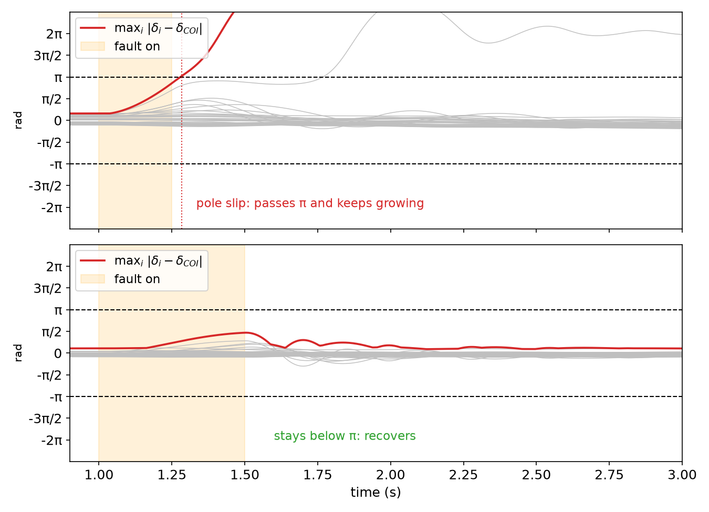
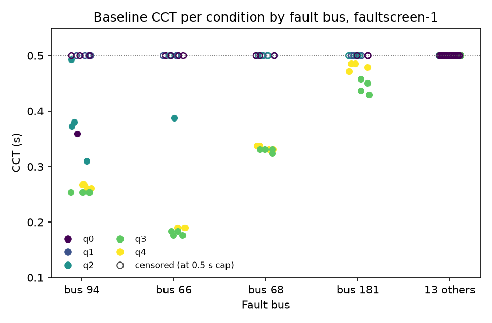

# Test figures (for review, not in report)

## Figure 1: unstable vs censored, same fault onset

*Figure 1. Rotor-angle deviation from COI for one unstable sample (top) and one censored sample (bottom), both aleatoric-1 baseline (no datacenter), on a shared time axis. Orange: fault on (0.25 s top, 0.5 s bottom). Top: the red trace passes $\pi$ (dotted line), a pole slip, and keeps growing, so the machine loses synchronism. Bottom: the red trace peaks at $0.47\pi$ and never reaches $\pi$, so the system recovers within the 10 s run. Grey: each machine's $\delta_i - \delta_{COI}$. Red: maximum over machines of $|\delta_i - \delta_{COI}|$ (the machine can change). Dashed: $\pm\pi$, the pole-slip threshold.*

Verification: both panels are replays of the stored `case.json` and `solver.json` with the campaign's DynamicSimulation runner. The unstable replay matches the stored 0.1 s series to 5.95e-8 rad. The censored replay has no stored series to compare against.

## Figure 2: CCT per operating condition, by fault bus

*Figure 2. Each dot is one baseline (no datacenter) operating condition at one fault bus; there are 20 conditions per bus (10 hours × 2 commitments). Color shows the net-load quintile, from q0 (lowest) to q4 (highest). Hollow markers are censored: the system had not lost synchronism by the 0.5 s cap, and they are drawn at the cap. Filled markers are measured CCTs. Bus 94 is measured in almost every quintile, from about 0.25 s to 0.5 s. Bus 66 is measured from q2 up, near 0.18 s at q3 and q4. Buses 68 and 181 are measured only in q3 and q4, at about 0.33 s and 0.43 to 0.49 s. The other 13 buses are censored in every condition, so they carry no information about separation. Within one quintile, the spread reflects hour and commitment as well as net load. Each quintile has 4 conditions per bus, so this is a small sample.*

Verification: computed from `faultscreen1_ap08_qlim/results.parquet`, rows with `dc_mw == 0` (340 runs). Censored means `cct_censored` is true. CCT is `cct_s`. Points are jittered horizontally for display only.
