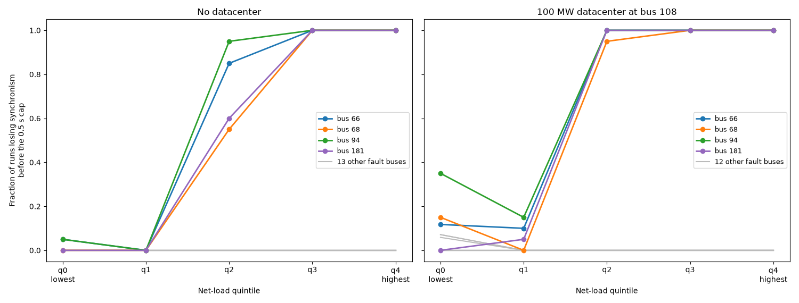
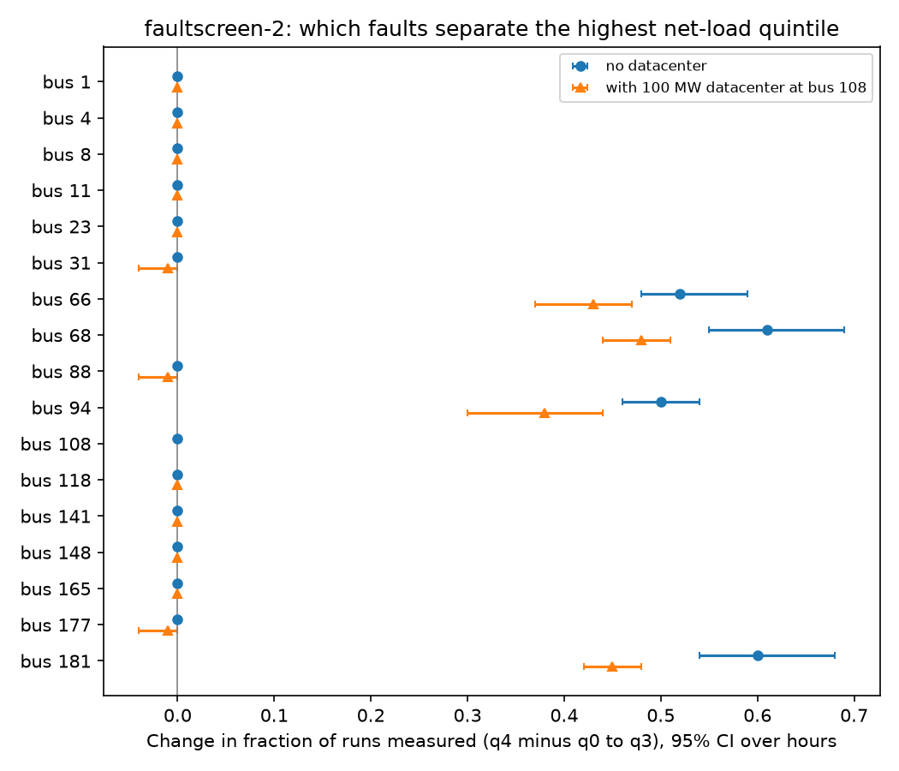
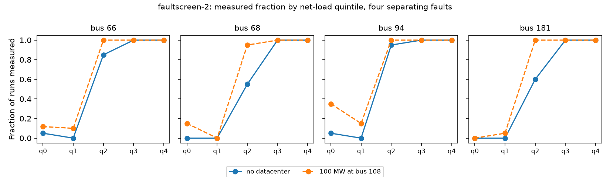

# Test figures (for review, not in report)

## Figure 1: unstable vs censored, same fault onset

*Figure 1. Rotor-angle deviation from COI for one unstable sample (top) and one censored sample (bottom), both aleatoric-1 baseline (no datacenter), on a shared time axis. Orange: fault on (0.25 s top, 0.5 s bottom). Top: the red trace passes $\pi$ (dotted line), a pole slip, and keeps growing, so the machine loses synchronism. Bottom: the red trace peaks at $0.47\pi$ and never reaches $\pi$, so the system recovers within the 10 s run. Grey: each machine's $\delta_i - \delta_{COI}$. Red: maximum over machines of $|\delta_i - \delta_{COI}|$ (the machine can change). Dashed: $\pm\pi$, the pole-slip threshold.*

Verification: both panels are replays of the stored `case.json` and `solver.json` with the campaign's DynamicSimulation runner. The unstable replay matches the stored 0.1 s series to 5.95e-8 rad. The censored replay has no stored series to compare against.

## Figure 2: fraction losing synchronism by net-load quintile, all 17 fault buses (faultscreen-2)

*Figure 2. For each fault bus, the fraction of runs that lose synchronism before the 0.5 s cap, by net-load quintile from q0 (lowest) to q4 (highest). Left: no datacenter. Right: 100 MW datacenter at bus 108. Each point is the share of about 20 runs per quintile. Buses 66, 68, 94 and 181 rise from near zero at low net load to near one at high net load, which means they separate conditions. The other 13 buses stay at or near zero in every quintile (at most 0.07), so they do not separate the conditions.*

Verification: computed from `faultscreen2_ap08_qlim/results.parquet`, ok runs with a CCT (3,166 of 3,400). A run loses synchronism when `cct_censored` is false. Sim-failed runs are excluded from each point's denominator. Figure 2 replaces the earlier per-condition plot of faultscreen-1. That file stays in `test_figs/` for reference. Regenerate from the repo root with `python scripts/plot_faultscreen2_lost_by_quintile.py --out work-notes/test_figs/faultscreen2_lost_by_quintile_all.png` (see `dc_campaign_pipeline.md`).

## Figure 3: which faults separate the highest net-load quintile (faultscreen-2)

*Figure 3. For each of the 17 fault buses, the change in the fraction of runs that lose synchronism before the 0.5 s cap, comparing the highest net-load quintile (q4) with the other four combined. Blue circles are without the datacenter. Orange triangles are with a 100 MW datacenter at bus 108. Bars are 95% intervals from resampling hours within each quintile. Buses 66, 68, 94 and 181 separate: their intervals sit well above zero with and without the datacenter. The other 13 buses have intervals that include zero, so their results do not change with net load. Bus 108 has no datacenter point because all 100 datacenter runs with the fault at bus 108 failed to simulate.*

Verification: computed from `faultscreen2_ap08_qlim/results.parquet` (3,400 runs: 3,170 ok, 230 sim_failed). Four ok runs have no CCT and are excluded. The change is the fraction measured in q4 minus the pooled fraction in q0 to q3, using ok runs only. Intervals are the 2.5th and 97.5th percentiles over 2,000 resamples of hours within each quintile. A fault separates if its interval excludes zero. Values are in `test_figs/faultscreen2_separation.csv`.

## Figure 4: measured fraction by net-load quintile, four separating faults (faultscreen-2)

*Figure 4. For buses 66, 68, 94 and 181, the fraction of runs that lose synchronism before the 0.5 s cap, by net-load quintile. Each point uses 20 baseline runs and up to 20 datacenter runs. Solid lines are without the datacenter. Dashed lines are with a 100 MW datacenter at bus 108. All four buses go from near zero at low net load to near one at high net load. The datacenter adds early losses at low net load, most at bus 94 (0.05 to 0.35 in q0), and moves the switch to lower quintiles for buses 68 and 181.*

Verification: same source and filters as Figure 3, grouped by `bin` (q0 to q4). Datacenter runs with a sim_failed status are excluded from the denominators.

## Test conclusions (not for the report)

- Buses 66, 68, 94 and 181 are the four faults that separate the highest quintile. The same four separated in faultscreen-1, which had 4 baseline runs per quintile per fault. faultscreen-2 has 20 per quintile per fault.
- The same four separate with the 100 MW datacenter present. The gap is smaller with the datacenter at all four buses (for example 0.61 without and 0.48 with at bus 68), because the datacenter adds early losses at low net load.
- The other 13 fault buses show no separation with or without the datacenter. Their runs are almost all censored, so the 0.5 s cap could hide separation at those buses.
- Failures: 230 datacenter runs failed to simulate. 100 are at fault bus 108 (the datacenter bus), 66 are at bus 118, and 104 are in q0. The aleatoric campaign at 100 MW had no simulation failures, with a fault at bus 66. The failure pattern here is not explained yet.
- Limits: one datacenter size, one placement, one threshold (the 0.5 s cap), and one split (q4 versus the rest). The bootstrap assumes each hour is an independent draw within its quintile.
- Possible use (a suggestion, not a result): the four separating faults are the candidate list for choosing faults in the next aleatoric campaign. Bus 66, used by `aleatoric1_ap08_qlim`, is on that list.
