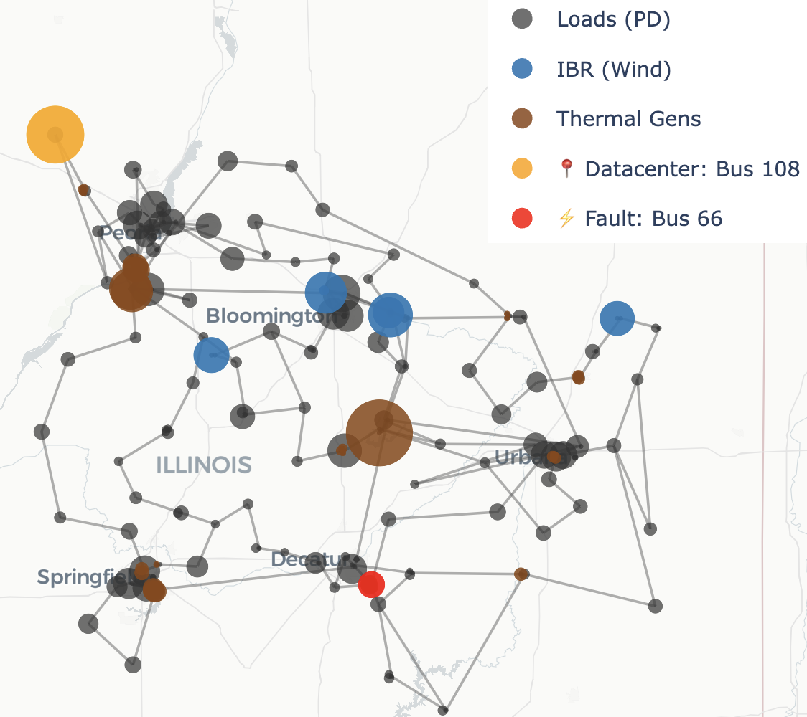
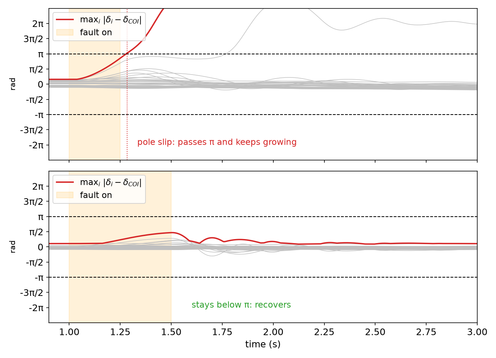
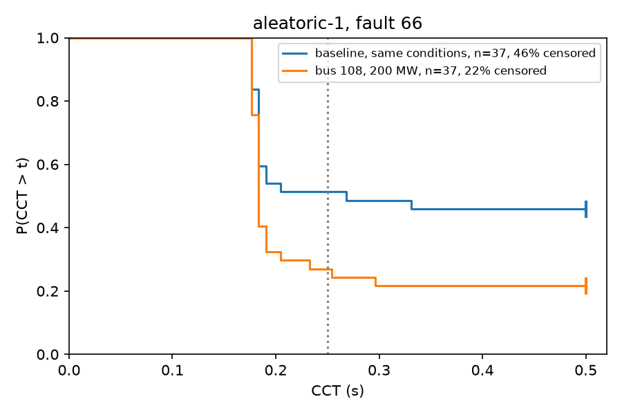
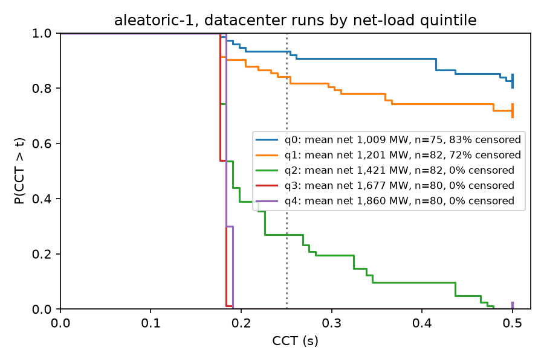
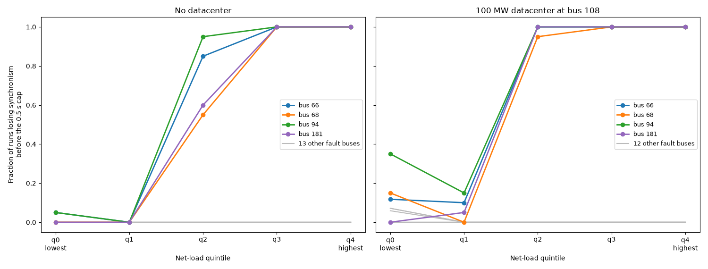

# Datacenter Load and Transient Security: Pilot Study Slides

---

## Slide 0: Datacenter Load and Transient Security: An Aleatoric UQ Pilot on GridKit

**Central Question:**
Where, and how much, large datacenter load can be added to the Illinois grid before dynamic security degrades, given that IBR output makes system inertia vary hour to hour?

**Study Scope:**
- **Grid:** ACTIVSg200 (Illinois synthetic case, 200 buses)
- **Method:** Sampling-based aleatoric uncertainty quantification
- **Key Metric:** Critical Clearing Time (CCT) — longest fault system survives before generator loss of synchronism
- **Finding:** Constant-power datacenter load shifts CCT distribution significantly; 100 MW placement raises failure risk from ~50% to ~73%

**Outcomes:**
- Demonstrated GridKit as end-user tool on new application
- Identified cost drivers across sampling dimensions (operating conditions, faults, placements)
- Profiled scalability bottlenecks: sampling-wise analysis, fault screening, outcome categorization for 2000-bus deployment

---

## Slide 1: The Research Question

**Title:** Datacenter Load Impact on Stability: A UQ Sampling Study

**Central Question:**
How much large constant-power datacenter load can be safely added to a meshed grid with high IBR penetration, and how does placement location affect critical clearing time?

**Why It Matters:**
- High IBR penetration reduces system inertia variability across time and operating conditions
- Constant-power load representation (datacenter) differs fundamentally from traditional voltage-dependent loads
- Placement location, load size, and operating condition interact; quantifying dependencies requires sampling

**Study Approach:**
- Pilot on 200-bus Illinois synthetic grid with real hourly load/wind data
- Apply sampling-based aleatoric UQ to quantify stability margins
- Establish and validate sampling methodology for 2000-bus deployment

**[Figure: Illustration of grid topology with IBR + datacenter siting locations]**

---

## Slide 2: Glossary: Key Terms

| Term | Meaning |
|---|---|
| **Operating condition** | One (hour, commitment) pair. Hour fixes load and wind; commitment fixes which thermal units are online. |
| **Baseline** | Same operating condition with no datacenter. Change in CCT is always measured on the same condition. |
| **Net load** | Demand minus wind, system-wide. What the thermal fleet must serve. |
| **Critical Clearing Time (CCT)** | Longest fault duration system survives before generator loses synchronism. Larger is safer. |
| **Censored** | System survived the longest fault tested (0.5 s cap). We know CCT ≥ 0.5 s but not its value. |
| **ZIP load** | Load model splitting demand into constant-impedance (Z), constant-current (I), and constant-power (P) parts. Datacenter uses P/I/Z: 80/20/0; wind stand-ins use 0/100/0 (pure constant-current, models controllable current source). |
| **No outcome** | A run with no CCT value: DCOPF dispatch, ACPF power flow, or dynamic simulation failed. Reported separately, never as stable or unstable. |
| **Placement** | Where the datacenter sits: none (baseline), or one of buses 6, 108, 120, 148. |

*Caption: Glossary of key terms: operating condition, baseline, net load, CCT, censored, ZIP load, no outcome, placement. [slide2_table.png]*

---

## Slide 3: The Illinois Synthetic Grid (ACTIVSg200)

**Grid Characteristics:**
- **200 buses, 246 branches, 49 generators** (43 thermal: 25 coal, 17 gas, 1 nuclear; 6 wind IBR)
- **40 synchronous machines** (34 thermal with dynamic models online, 6 wind units, 9 offline thermal units can be committed) — from GridKit's default case.json
- **109 loads** across the network
- Hourly load and wind are synthetic one-year series (TAMU repository)

**Base case:** One-time build from TAMU files (topology, dispatch, dynamics); dispatch overwritten per condition; six wind units become negative load stand-ins (no inertia).

*Caption: ACTIVSg200 (200-bus Illinois synthetic grid): topology, loads, and generator mix. [ACTIVSg200_slides_topology_loads_ibr.png]*

---

## Slide 4: Building One Operating Condition

**• Unit Commitment: Not Real UC**
- We do not solve a real UC problem. Results are **conditional on this sampling strategy**; applying real UC distributions is future work.
- We rank units by gen costs (nuclear always on); sample *n* at the quarter and three-quarter positions within the feasible band per hour.
- Feasible band per hour: lower bound = capacity to cover net load + 10% reserve; upper bound = committed minimums ≤ net load. At identical load & wind, inertia varies 1.56× across the band.

**• Dispatch: DCOPF → ACPF**
- We use PowerModels.jl for both DCOPF and ACPF solves. As OPF functionality becomes available in GridKit (under development), we will substitute it in. PowerModels.jl serves as a validation tool and enables exploration of different ACOPF relaxation formulations.
- DCOPF (lossless) sets economic dispatch active power; ACPF (with losses) solves voltages, reactive power, and enforces Q limits.

---

## Slide 5: Operating Condition Dynamics

**• Wind as Negative Load**
- Default ACTIVSg200 case comes with wind units as GENROU synchronous machines; we remove them and use a constant-current ZIP stand-in instead.
- Left as synchronous machines, these 6 wind units would add a fixed **2,766 MW·s** of inertia.
- Hourly wind MW is fixed in the DCOPF, P and Q from ACPF are written into the negative ZIP load stand-in at wind bus.

**• The Datacenter ZIP**
- Datacenter is represented as **additional electrical load placed at one bus**.
- We use ZIP model: 80% constant-power (IT), 20% constant-current (motor-based cooling).

---

## Slide 6: Critical Clearing Time by Bisection

**• Stability Criterion: Centre of Inertia (COI) Pole Slip**
- Pole slip measured relative to inertia-weighted average rotor angle:

$$\delta_{COI}(t) = \frac{\sum_i H_i S_i \delta_i(t)}{\sum_i H_i S_i}$$

- Run unstable when (any machine leaves collective inertial frame):

$$\max_{i,t} |\delta_i(t) - \delta_{COI}(t)| > \pi$$

**• CCT Search: Bisection [0.05, 0.5] s**
- Fault applied at $t_{on} = 1.0$ s, cleared at $t_{off} = 1.0 + \text{duration}$; bisection tolerance 0.01 s.
- Censored run: stable at 0.5 s cap, reported as CCT ≥ 0.5 s.

*Caption: Unstable sample: red trace passes π (pole slip). Censored sample: peaks at 0.47π, recovers. [delta_unstable_vs_censored.png]*

---

## Slide 7: Sampling Space and Three Campaigns

**• Campaign Design**
- Three independent campaigns built varying fault, datacenter buses, and sizes.
- Stratification: 8,760 hours split into 5 equal-count bins by net load; hours drawn randomly within quintiles.
- Per-Condition Sequence: Hour → UC draw → Datacenter added → DCOPF + ACPF → CCT by bisection.
- Datacenter Sizes: in aleatoric-1 and -2: 50, 100, 200, 300, 400 MW. in faultscreen-2: 100 MW only.

| Dimension | **aleatoric-1** | **aleatoric-2** | **faultscreen-2** |
|---|---|---|---|
| **Hours** | 20 (4 per quintile) | 60 (12 per quintile) | 50 (10 per quintile) |
| **Conditions** | 40 | 180 | 100 |
| **Faults** | 1 (bus 66) | 1 (bus 66) | 17 locations |
| **Datacenter** | 4 buses, 5 sizes | 4 buses, 5 sizes | 1 bus, 1 size |
| **Total runs** | 840 | 3,780 | 3,400 |
| **Runs with CCT** | 439 (52%) | 2,155 (57%) | 3,170 (93%) |
| **No outcome** | 401 (356 dispatch/PF, 45 sim) | 1,625 (1,428 dispatch/PF, 197 sim) | 230 (all simulation) |

*Caption: Campaign scale and design dimensions. [slide7_table.png]*

**Notes:**
- UC is fixed based on baseline net load; not re-committed for added datacenter. This enables matched-pair comparison across datacenter sizes and operating conditions, isolating the datacenter effect from UC variability. Larger loads may exceed committed capacity (dispatch failures recorded as "no outcome").
- Mean net load in highest quintile (q4) is ~1,660 MW; 400 MW is ~24% of that.
- Results are conditional on this UC sampling strategy. Applying real UC distributions is future work.

---

## Slide 8: Reading the Curves: Kaplan–Meier and Censoring

**• Kaplan–Meier Estimator with Censoring**
- Each KM curve estimates $P(\text{CCT}<t)$: the share of operating conditions in which a fault cleared at $t$ seconds would be unstable (correctly handles censored runs).

$$1 - P(\text{CCT}<t) = P(\text{CCT}>t) = \hat S(t) = \prod_{t_i\le t}\left(1-\frac{d_i}{n_i}\right)$$

- 95% CI from Greenwood variance:

$$P(\text{CCT}<t) \pm 1.96 \cdot \text{SE}$$

**• Example: 200 MW at Bus 108, Fault at Bus 66 (37 Conditions)**
- Datacenter raises failure risk: baseline P(CCT < 0.25 s) = 0.49 → 0.73 with 200 MW. Median CCT drops from 0.27 s to 0.18 s.

*Caption: Kaplan–Meier P(CCT > t) on the same 37 operating conditions, without the datacenter (blue) and with 200 MW at bus 108 (orange). [main_aleatoric_km_simple.png]*

---

## Slide 9: Risk by Net Load

**• Risk Concentrates in High Net-Load Quintiles**
- Risk is conditional on runs that solved; focus on high net-load scenarios where instability dominates.

| Net-load quintile | Mean load (MW) | Runs solved | Censored | **P(CCT < 0.25 s)** |
|---|---|---|---|---|
| q0 | 809 | 75 of 160 | 83% | 0.07 |
| q1 | 1,001 | 82 of 160 | 72% | 0.16 |
| q2 | 1,221 | 82 of 160 | 0% | 0.73 |
| q3–q4 | 1,477–1,660 | 160 of 160 | 0% | 1.00 |

*Caption: Failure risk concentrates in high net-load quintiles. [slide9_table.png]*

*Caption: Kaplan–Meier P(CCT > t) by net-load quintile, all datacenter configurations. [main_aleatoric_km_by_netload.png]*

---

## Slide 10: Fault Screening: Which Faults Separate Operating Conditions

**• Fault Screening Results (100 conditions, 17 faults screened)**
- Before spending runs on a full campaign, we need to know which faults can tell operating conditions apart.
- 4 separating faults (buses 66, 68, 94, 181): outcome changes with net load, rising curve in failure share vs quintile. 13 flat faults: censored everywhere, cannot separate conditions.

*Caption: faultscreen-2: four faults change with net load, thirteen do not. [main_faultscreen2_lost_by_quintile.png]*

**Notes:**
- A fault that every condition stays stable through past the 0.5 s cap looks the same everywhere, so it cannot separate them.
- Screening should precede future aleatoric campaigns: identifies active faults early, reducing full campaign cost and variance.

---

## Slide 11: Scaling to Texas: ACTIVSg2000

**• Initial Profiling Test**
- We ran an initial small profiling test on the 2000-bus Texas synthetic grid, **ACTIVSg2000**.
- The design space grows 115× (siting 11.5× and fault locations 10×), while cost per run grows about 19–25×.
- At the same sampling density, serial compute time (solver CPU time for the dispatch and dynamic runs) grows about 2,500×.
- Storage per run grows ~10×. For a full aleatoric-1 campaign at the same sampling density (115× more samples): ~1,000× total storage.

| Resource | ACTIVSg200 | ACTIVSg2000 |
|---|---|---|
| Dispatch stage (all 840 runs) | 24 s | 456 s |
| Dynamic runs, serial | ~35 min | ~14.9 h |
| Wall time, 1 node, 16 workers | ~2.2 min (ideal) | ~56 min (ideal) |
| Wall time, 1 node, 16 workers (actual 2.7× overhead) | ~6 min | **~2.5 h** |
| Monitor output (raw CSV) | 22 GB | ~220 GB |
| Monitor output at same sampling density (115× design space) | — | ~1,000× (~22 TB) |

*Caption: Projected aleatoric-1 on Texas (840 runs, ~7,560 simulations). [slide11_table.png]*

---

## Slide 12: Parallel Execution on NLR HPC Cluster

**• Two-Stage Worker Pipeline and Storage**
- Parallel launch implemented within nodes and workers (CPU cores). For aleatoric campaigns, we ran on one node with 16 workers (one per core); each worker takes a contiguous slice of runs.
- Stage 1: Batched dispatch (DCOPF + ACPF solved together per worker). Stage 2: Dynamics and CCT bisection (only for runs with feasible dispatch).
- Pilot campaigns (5,640 planned runs) occupy 15.9 GB; 2.6 MB per run. Compressed Parquet storage (5.0×) + selective output columns (13.8×) keep size manageable.

| Campaign | Planned | Simulated | Wall Time | Per Worker |
|---|---|---|---|---|
| aleatoric-1 | 840 | 484 | 6.0 min | 170 s dispatch / 113 s dynamics |
| aleatoric-2 | 3,780 | 2,155 | 17.1 min | 297 s dispatch / 516 s dynamics |
| faultscreen-2 | 3,400 | 3,400 | ~26 min | 154 s dispatch / 966 s dynamics |

*Caption: Measured resource usage and wall time for three campaigns. [slide12_table.png]*

---

## Slide 13: Next Steps

- Conclude 200-bus datacenter placement campaign with expanded aleatoric sampling, comprehensive fault pre-screening, and investigation of no-outcome conditions.
- Expand sampling framework from 200-bus to 2000-bus grid: stratified/importance sampling on top-ranked factors.
- Graph NN surrogates for adaptive sampling guidance: leverage grid topology to identify high-impact parameter regions.

---
